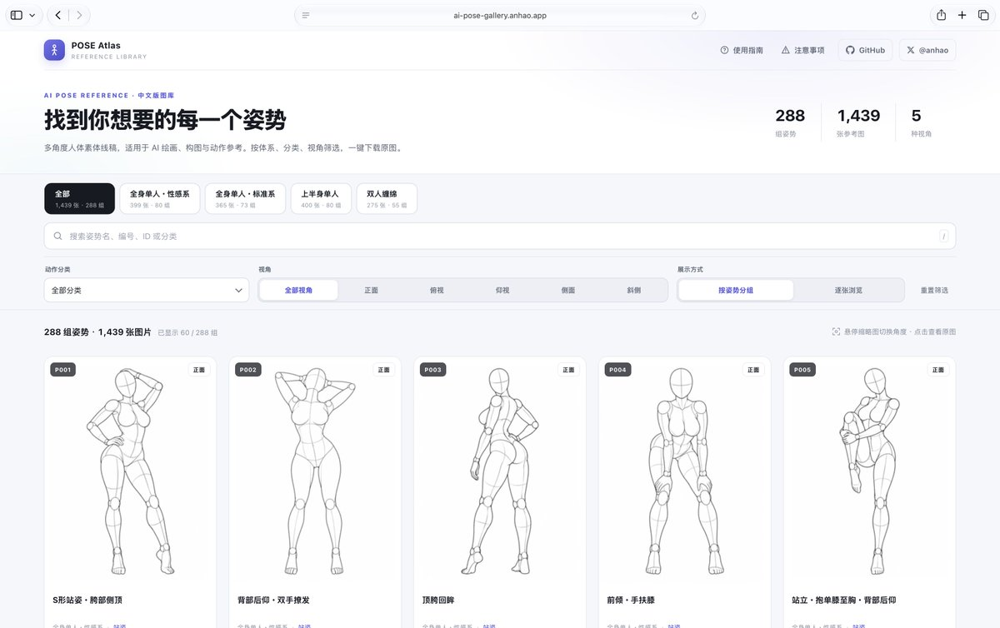

# 安好：1439 个 AI 美女姿势参考图库开源（中文版，可商用可二创）

> 把 1439 张人像姿势图整理成可检索数据库，支持「改成这个姿势」式指令调用，免费、商用与二次编辑均允许。在线浏览与 GitHub 开源版本同步提供，解决 AI 生成人像时姿势单一、构图缺参考的问题。

<!-- more -->

## 原始发布：ギア（@giaaibusi）

1439 个 AI 美女 姿势 参考图

已开源中文版本，可直接下载

做视频，做 AI 图必备呀

在线地址：https://ai-pose-gallery.anhao.app/

开源地址：https://github.com/anhao/ai-pose-gallery-zh https://x.com/anhao_ai/status/2115070903386296398

AI 美女「ポージング」データベース無料公開！

「このポーズに変えて」だけで使えるように

1,439 枚のポーズ集をデータベース化しました

・無料

・商用利用 OK

・編集、二次利用 OK

引用元の記事からお受け取り下さい https://t.co/bdXOVNtyua

## 相关页面

- [[sources/aaronyi-open-topic-radar]]
- [[concepts/ai-content-pipeline]]
