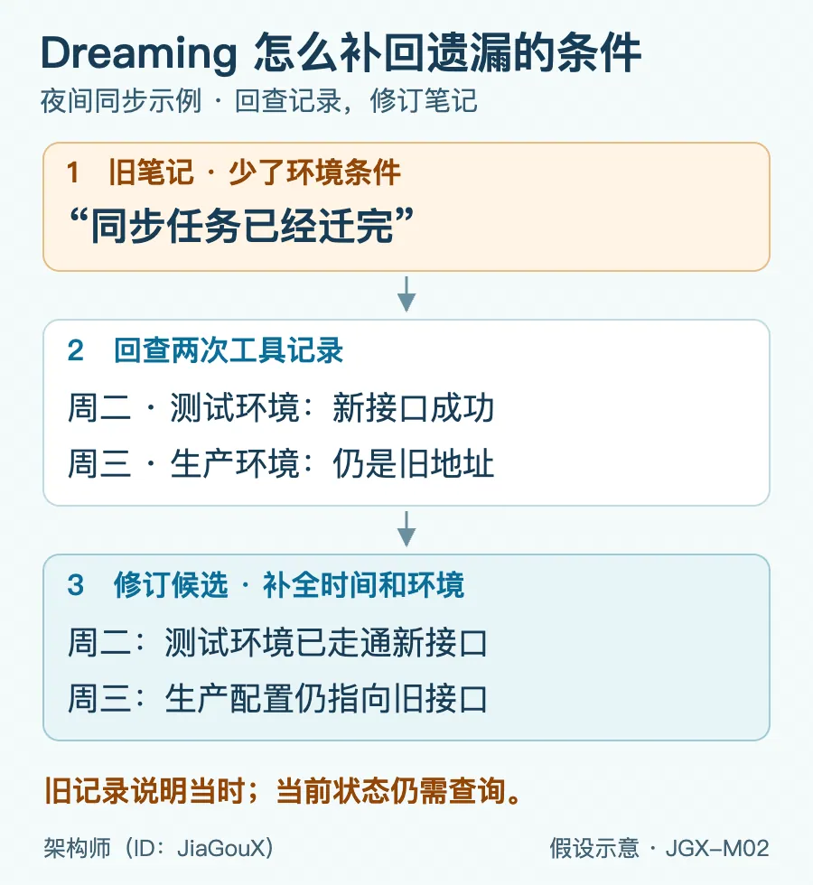
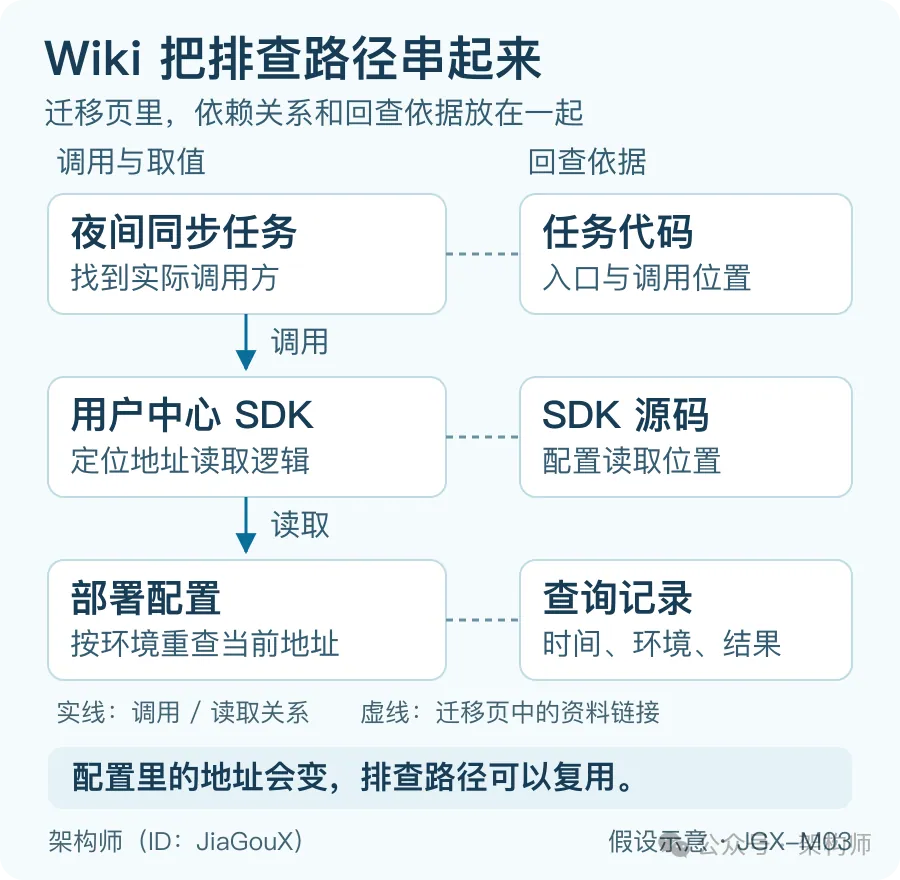

# Claude 的4层记忆是如何设计的？

> **核心观点**：Agent 记忆不是"存得越多越好"，而是**分层存放 + 离线整理 + 按需读取**三件事配合。文件里存着、会话读到了、回答用对了，是三件必须分别验证的事。

11 月 6 日，Anthropic 发布研究《The components of agent memory》，系统解释了任务做完之后 Claude 能留下什么给下一次会话用。

<!-- more -->

---

## 一、四层记忆架构

研究用四层来解释这套记忆设计：

| 层 | 内容 | 作用 |
|---|---|---|
| **会话记录** | 原始经过：查了什么、工具回了什么 | 回溯核对当时的事实 |
| **笔记** | 把值得再用的发现摘出来 | 下次少翻几个文件 |
| **Wiki** | 几次会话里的线索整理成互相链接的页面 | 从任务名一路查到配置 |
| **启动上下文** | 开工时先看到的那几行提示 | 给出"去哪儿翻"的入口 |

以一个后端常见场景为例：让 Claude 查一个夜间用户数据同步任务，它翻了任务代码，又查了用户中心 SDK 和部署配置。哪些东西值得带到下次？

- **会话记录**里有每一步怎么查、工具回了什么。后来要核对"那次查的到底是测试还是生产"，翻回当时的记录就行。
- **笔记**留一句真正用得上的发现，比如"同步接口的地址由用户中心 SDK 从部署配置里读"。下次再查，可以少翻好几个文件。
- **Wiki** 把几次排查串起来。一次会话找到了夜间任务，另一次查到了 SDK 读哪份配置，把这些发现链接起来，下次就能接着查。
- **启动上下文**只带开工时要看的几句，比如"查夜间同步，先翻迁移笔记"。具体查到了什么，用到再打开。

在这个例子里，值得反复用的是那条"**从任务代码一路查到配置**"的路径。某天读出来的具体地址，也可以连同日期和环境留下，方便以后对照变化。下次再问"现在的同步地址是什么"，顺着这条路径重查，省下的是重新摸清依赖关系的功夫。


*图 1：记忆怎么接力*

这里的"记忆"，指**留在会话外、供以后读取的上下文，不动模型权重**。自己搭 Agent 时，这几层可以先用一组文件来组织，分别保存原始记录、笔记、Wiki 页面和启动索引。Dreaming 负责回看和整理这些内容；至于文件怎么读、整理好的记忆怎么交给下一次会话，Claude Code 和 Managed Agents 各有各的做法。

---

## 二、Dreaming：离线纠错机制

还是夜间同步。假设周二，Claude 在测试环境跑通了新接口，顺手记了一句"同步任务已经迁完"。周三换了个会话，一查生产配置，夜间任务还指着旧接口。

两次查到的东西都对，坏就坏在周二那条笔记**漏了"测试环境"四个字**，下一次读起来就完全是另一回事了。

让 Dreaming 把这两次会话翻出来对一对：周二的工具结果显示，新接口在测试环境返回成功；周三查的生产配置里，填的还是旧地址。笔记就可以改成两句：

> 周二，测试环境走通了新接口。周三查生产配置，夜间同步任务仍指向旧接口。



*图 2：Dreaming 怎么补回遗漏的条件（示意）*

### 为什么必须离线

写这篇研究的 Lance Martin 在 X 上把 Dreaming 描述为一轮**离线计算**：回看经历，纠错、记笔记、重新组织记忆。

不过，旧记录能帮它核对的是"当时发生了什么"。周三之后生产有没有切换，还得重新查。

当场记下的线索，后面的步骤就能读到，但写笔记也会分走当前任务的注意力。Dreaming 把回看和重组放到任务之外，可以对照多次会话；代价是这轮整理需要额外的计算，**结果也不一定马上进入正在进行的会话**。

### 证据留存的前提

笔记能改回来，靠的是当时查过的东西还找得到。

Claude Code 会按期限清理本地会话，**自动记忆文件不随这次清理删除**。过几个月要是只剩一句"已经迁完"，就很难知道当时查的是哪儿了。

因此日期、环境和配置位置能帮下一次继续查；**要核对当时的具体结果，还得保留相应的证据**。

---

## 三、Wiki：把散落线索串成路径

笔记改对了，任务、SDK 和配置之间的关系还得串起来。在这个例子里，接口地址写在部署配置中，夜间任务通过用户中心 SDK 调用它。只搜旧地址，可能找得到配置，却看不出哪个任务在用它。线索散在三处，Wiki 可以把这条关系写在同一页。

迁移页里可以有这么一行：

> 夜间同步任务调用用户中心 SDK，SDK 从部署配置读同步地址。核对生产切换时，看定时任务实际加载的配置。

任务名、SDK 和配置各自链接回原来的记录。下次从"同步任务报错了"这头查起，也能找到接口那头。

**要是只想问某个环境变量在哪儿，直接搜代码可能更快。同一条调用链查得越频繁，越值得提前理清。**



*图 3：Wiki 把排查路径串起来（示意）*

这与 4 月讨论 Karpathy 的 LLM Wiki 时的关注点一致：把反复查到的关系留下来，还能顺着链接回到原始资料。

### 评测数字

这次 Anthropic 进一步给出了评估数字。他们拿 **Stainless 的约 35 万份内部文件出了 25 道题**，让 Claude 用几种查法作答。Wiki 是用 128 个会话建起来的。

| 查法 | 评分项满足比例 | 每题 token |
|---|---|---|
| 单翻 Wiki | 48% | — |
| 单用搜索 | 53% | 基准 |
| Wiki + 搜索 | **61%** | 比单用搜索**少约 2 万 token** |

这 48% 是逐步整理出来的：构建 Wiki 的会话从 2 个增加到 128 个，单用 Wiki 作答时，评分项满足比例从 13% 提高到 48%。

**这里省的是答题时翻资料的开销，建 Wiki 花掉的那 128 个会话，得另算。**

### 适用边界

Anthropic 还拿法律文档做了对照：

- 需要**跨几份文件拼信息**的题，Wiki 帮助明显；
- 答案**主要在单份文件里**的那组任务，Wiki 没显出优势。

放到我们的例子里，**要不要建页，就看任务、SDK 和配置这几段关系，后面会不会反复用到**。

### 多 Agent 协作时的页面分工

Anthropic 还做了一组合同实验：多个 Agent 往同一张表里写，互相覆盖，加上摘要漏了条款，最后简报只覆盖了 **57 项事实中的 41 项**。后来改成每份合同单独建页、交给一个 Agent 写、条款保留原文，57 项全保住了。

不过页面分工和条款保留方式是一起改的，各自帮了多少，这组实验分不开。

合同需要保留逐字条款，接口迁移需要保留环境、配置位置和依赖关系。**页面留到多细，取决于下次要拿它回答什么。**

放回同步任务，调用方和服务端各留一份查过的记录，迁移页链接到这些记录，后续就能分别核对双方的进度。

---

## 四、新会话怎么读

写完迁移页，还得让 Claude 下次知道去哪儿翻。

索引上只写"同步迁移"，碰到一句"夜间同步怎么又报错了"，它未必想得到是同一件事。**索引里要用平时提问会用的名字**，比如：

> 夜间同步、用户中心 SDK，见 sync-migration.md

周三查到的地址放在页里，用到再翻。

启动时先给索引，可以让 Claude 在还没想好搜什么时，就知道有这条线索可查。不过索引每次都会占上下文，里面的错误也可能反复影响后续会话。把详细经过放进主题页、用到再读，新会话就不用带上整段旧记录。

### Claude Code 的自动记忆

Claude Code 的自动记忆就是这么做的。启用后，新会话会读 `MEMORY.md` 的**前 200 行或 25 KB**，哪个上限先到读到哪儿，主题文件按需再读。

比如迁移页的入口排在第 210 行，打开文件能看到，新会话开工时却看不到这一行。

> 9 月拆 Claude Code 记忆系统时得出的结论：**文件里存着、会话读到了、回答用对了，是三件事。**
>
> 这次 Dreaming 补上的是前一段——下一次要读的内容，怎么从过去的经历里整理出来。

### Managed Agents：整理与采用分离

Managed Agents 把"整理"和"采用"分得很清楚。研究预览里的 Dreams API 把整理结果写进**一份新库，原来的库不动**。

- 运行中就可能出现新库，失败或取消也可能留下部分内容；
- 判断整理有没有做完，要看任务是否到 `completed`；
- 完成整理，**不会自动替应用切换记忆库**。

完成之后，应用可以先看改了哪些文件，再决定下次会话挂哪份库。

### 排查"记忆明明改了，Claude 还是那句话"

要是笔记明明改了，Claude 还是那句"已经迁完"，可以按顺序查：

1. 新会话挂的哪份库？
2. 会话事件里实际读了哪个文件？
3. 如果改过的笔记已经读到，接下来再看它有没有保留测试与生产的区别，有没有用工具核对当前配置。

在 Claude Code 里，可以从 `/memory` 打开自动记忆目录，挑一条有主题页的旧经验，另开一个会话，按平常的问法问一遍，看它会不会自己找到那页。

---

## 五、给自建 Agent 的落地方案

把这套思路用到自己的 Agent，可以拿夜间同步任务做一次小范围尝试：**保存查过的结果，给新会话接上读取入口，再用同一个问题观察它怎么查。**

### 步骤 1：留一份有出处的任务笔记

文件可以这样组织，原始记录里保留相关工具的输入和结果：

```text
memory/INDEX.md          启动时读取的索引
memory/sync-migration.md 同步任务的排查笔记
records/sync-tue.md      周二测试环境的查询记录
records/sync-wed.md      周三生产环境的查询记录
```

`sync-migration.md` 里除了任务到 SDK、SDK 到配置的关系，再写清具体代码位置、配置位置、查询时间和环境，附上对应原始记录的路径。周二测试通过、周三生产仍用旧地址，**分开记**。涉及"现在走哪个接口"，笔记里注明从哪份配置重新查询。

### 步骤 2：把索引接到新会话的启动过程里

在这个自建方案中，应用每次创建会话时读取 `memory/INDEX.md`，把内容放进启动上下文。同时给 Agent 提供两类工具：

- 按路径读取笔记和原始记录
- 查询指定环境的当前配置

索引里可以这样写：

> 夜间用户数据同步、用户中心 SDK、接口迁移：见 memory/sync-migration.md。

这里的 `INDEX.md` 由应用自行加载；Claude Code 自动记忆的入口仍是前面提到的 `MEMORY.md`。

运行时**记录实际读了哪个文件、查了哪个环境**，方便区分三种失败：没找到笔记、没读笔记、读完后用错了条件。

### 步骤 3：对照三种情况，检查读取和查询过程

问题固定为"测试环境的夜间同步现在走哪个接口？"。每次都另开会话，前两次保持模型、配置和可用工具一致，**只改变是否提供记忆**。

| 尝试 | 给 Agent 什么 | 主要观察什么 |
|------|--------------|-------------|
| 不带记忆 | 问题和相同的工具 | 能否找到正确任务，查了几次工具 |
| 带上记忆 | 再加索引和任务笔记 | 是否沿笔记找到配置，减少重复查找 |
| 修改配置后 | 保留旧笔记，把测试配置换个地址 | 是否重新查配置，回答新值并给出出处 |

**先对照实际配置检查答案和出处，再看工具调用中省掉了哪些重复查找。**若还在报旧值，就顺着文件读取和配置查询记录定位原因。

三种情况走通后，把这道题留作**回归问题**，以后更新笔记或调整读取方式时再跑；是否持续省事，还得放到更多实际任务里观察。

### 任务笔记多起来之后

可以按任务、SDK、配置建互相链接的 Wiki 页面。需要纠错时，让整理过程同时读旧笔记和原始记录，**逐条列出冲突、依据与修改，先写成候选版**。检查改动、重跑刚才的问题，再让后续会话读取新版。

这样，Dreaming 的整理结果就有了明确的采用步骤。

---

## 六、记忆的边界

昨天的功夫留住了，下一次就有机会沿着查过的路径继续。

要是有人问"旧接口今天能下线了吗？"，记忆能提醒 Agent 还有个夜间同步任务需要核对。接下来得查生产任务现在指到哪儿，最近还有没有请求打到旧接口。

**笔记告诉它去哪儿查；能不能下线，今天的配置和流量说了算。**

---

## 参考资料

- Anthropic《[The components of agent memory](https://www.anthropic.com/research/components-of-agent-memory)》
- Lance Martin 在 X 上对 Dreaming 的说明（<https://x.com/RLanceMartin/status/2118815962573291545>）
- Claude Platform《[Dreams](https://platform.claude.com/docs/en/managed-agents/dreams)》
- Claude Platform《[Using agent memory](https://platform.claude.com/docs/en/managed-agents/memory)》
- Claude Code《[How Claude remembers your project](https://code.claude.com/docs/en/memory)》
- Andrej Karpathy 的 LLM Wiki 草案（<https://gist.github.com/karpathy/442a6bf555914893e9891c11519de94f>）
