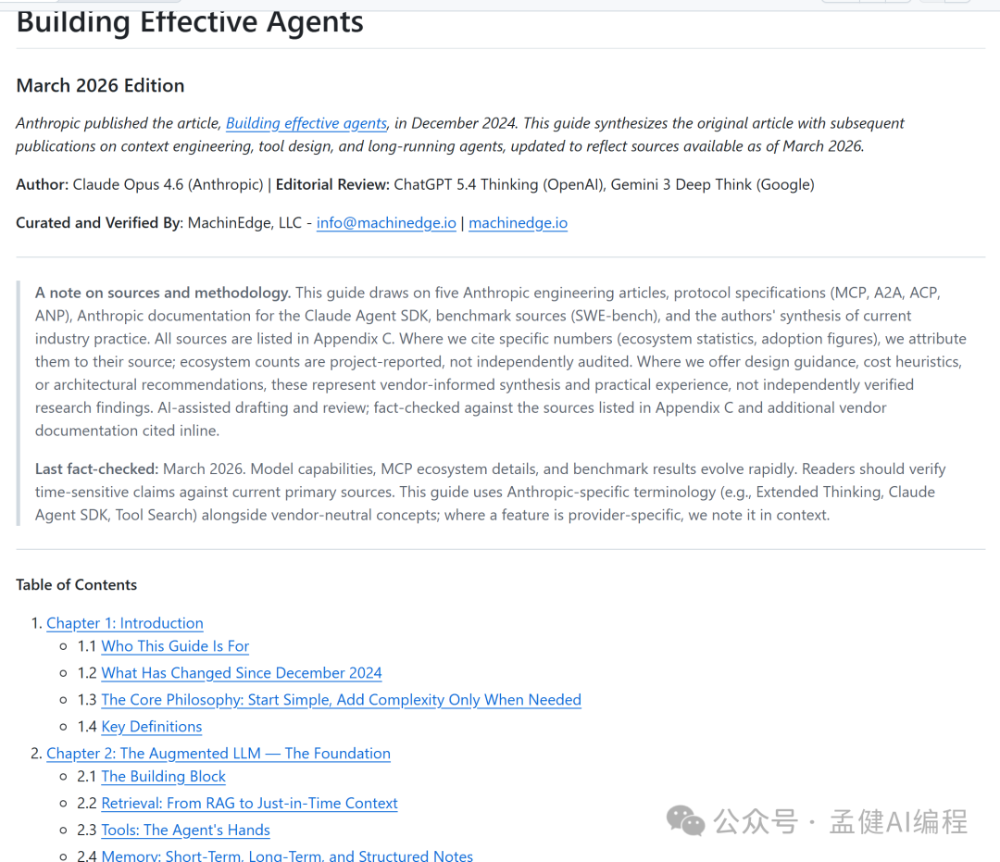

# Anthropic：为何 Unix 哲学才是 Agent 协作终局？

> 团队堆了四五个全能 Agent 协同干活，结果在测试环境跑得好好的，一进复杂业务流，不是陷入死循环，就是上下文相互污染直接崩盘。

## 三句话看懂

1. 全能型单体 Agent 复杂度过高且不可控，动态自由协同必然带来系统级失控
2. 真正的 Agent 协作必须依赖精细解耦，单一职责比全能幻想更具落地价值
3. 借鉴 Unix 管道与解耦哲学设计工作流，是保障多 Agent 系统稳定交付的工程终局

## 全能单体的幻觉：为什么自发协作总会失控

许多工程师刚开始搭建系统时，习惯把一个 Agent 当成一个无所不能的高级员工。Prompt 写了三千字，工具塞了十几个，甚至还让几个同级别的 Agent 在一个共享上下文里自发讨论。

这种做法在 Demo 里或许惊艳，但放到线上业务里，它的安全边际几乎为零。

- 单体一旦承载过多角色，上下文长度便会急速膨胀，幻觉发生率成倍上升
- 多 Agent 之间如果通信协议没有严格的数据契约，A 生成的发散结论会被 B 进一步放大，最终形成不可逆的错误雪崩
- 追求自由协作不等于拥有可靠系统

## Unix 的管道遗产：单一职责与标准流的解耦

计算机工程发展了半个多世纪，今天我们在大模型上踩过的坑，半个世纪前的软件先驱早就给出过解法。那就是 **Unix 哲学**：只做一件事，并把它做好；程序的输出必须能作为另一个程序的输入。

在 Unix 体系里，cat、grep、awk 每个命令的功能极其聚焦，它们之间不知道对方的内部实现，唯一的连接媒介是标准文本流。

将这个思想移植到多 Agent 动态工作流中：

- 每一个 Agent 必须是一个最小功能单元（Micro-Agent）
- 拥有明确限定的输入 Schema、严苛的工具集以及确定的输出格式
- Agent 之间不需要无休止地聊天对话，而是像 Unix 管道一样，前一个 Agent 的 Structured Output 经过验证与裁剪后，作为确定性数据输入给下一个 Agent

通过接口协议彻底解耦，系统获得了可观测性与可重试能力。只要某个环节输出不合规，工作流可以在管道层面阻断并进行局部重试，而不是让整个会话链路陪跑崩溃。

## 动态工作流演进：Anthropic 给工程落地的安全边际

Anthropic 在峰会上公开拆解的架构演进，本质上就是从「静态硬编码」向「动态解耦流水线」的成熟跃迁。

他们没有走向让 Agent 完全自主狂奔的极端，而是在编排层做了大量的工程收敛：

- 主控路由只负责解析意图并决定流水线分支
- 具体的落地执行由专门的子 Agent 独立完成
- 每一个子任务在执行前，都会通过上下文过滤器剪除与当前任务无关的冗余信息

我们不能寄希望于大模型突然变聪明来拯救糟糕的系统设计，而是要用确定性的管道架构去包容大模型天生存在的概率波动。

> "宁可用确定的管道约束概率的波动，也不用失控的自由赌脆弱的成功。"

## 工程师的算账逻辑：在失控之前做减法

做商业交付，必须学会算账：

- Token 消耗是成本
- 调用延迟是成本
- 偶发死循环导致的用户投诉更是不可承受的成本

多 Agent 协作的终局，从来不是把系统做厚，而是把每个单元做薄，把它们之间的交互通道做窄。

克制才是高级的工程修养。借鉴 Unix 的管道与解耦设计思想，把宽泛的任务切成独立的小片，用严格的输入输出契约锁死边界。当你的系统能在每个环节实现清晰的监控、拦截与降级，商业化落地才算真正拥有了安全边际。

## Related Pages

- [[concepts/input-attribution]]
- [[patterns/agent-router-table]]
- [[concepts/shared-weekly-pool]]

## Sources

- 孟健《Anthropic：为何Unix哲学才是Agent协作终局？》：mp.weixin.qq.com/s/S5GPbFCrNRjocF53-gnFvQ
