# 阿哲 Phil（@Formulasearch）：FDE 是临时外包 or 真 AI 落地？——附小白快速入门与辨别方式

> 针对 AI 圈最火热的新岗位 FDE（Forward Deployed Engineer）做深度调研与辨别指南：指出 OpenAI、Anthropic、Google 海内外一线云厂商集体抢招、上海写入官方人才培养计划甚至高校开设 Pre-FDE 试点班的现状，最高薪资达 50-80K；结合亲身经历与一线从业者访谈，厘清「临时外包」与「真 AI 落地」的本质区别，给出适用于零基础小白的入门路径与求职参考。

<!-- more -->

## AI 落地越难，FDE 越吃香？

今年 AI 圈最火的岗位叫 FDE，OpenAI、Anthropic、Google 在招，国内腾讯云、阿里云、网易、字节也都在招。海内外招聘平台上，这个岗位一年之内涨了好多倍。

比如上海，已经把它写进了官方的人才培养计划，甚至有大学从高考开始招「Pre-FDE 试点班」。

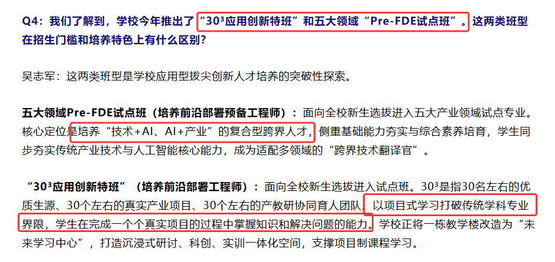

薪资也确实给的不少，我查到的最高一个岗位，50-80K。看起来确实是一个很吃香的岗位，但真是如此吗？本文我会结合我自己的亲身经验，调研结果和对于一些一线人员的经验交流，总结分析一个适用于小白的鉴别方法，以及对于有意向朋友的求职的参考。

## ▲ FDE 到底是什么

FDE 全称 Forward Deployed Engineer，中文有三个叫法在混用——前沿部署工程师、前线部署工程师、AI 落地工程师，其实都一样。

简单来讲，FDE 就是被公司派驻到客户那里，辅助客户把 AI 真正用起来的那个角色。

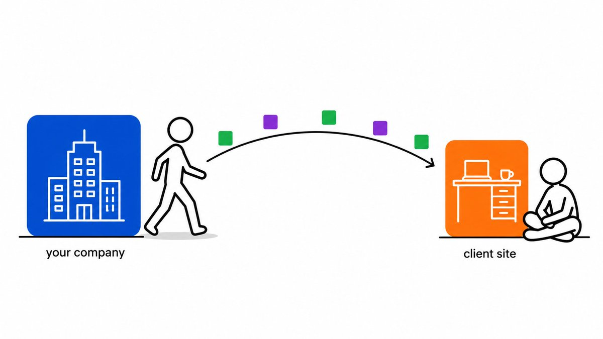

它和销售不同，销售把产品卖出去就结束了；也和坐在自己公司写代码的工程师不同。FDE 坐到客户的工位旁边，先弄清楚对方每天如何工作，再把 AI 嵌进那个流程，让它真正运转起来，并且有人持续使用。（是不是有点外派驻场，或者外包的感觉...）

深圳一家公司在招聘启事里写了一句，我认为是一个准确的定义：

把 AI 从演示，变成业务现场可持续运行的系统。

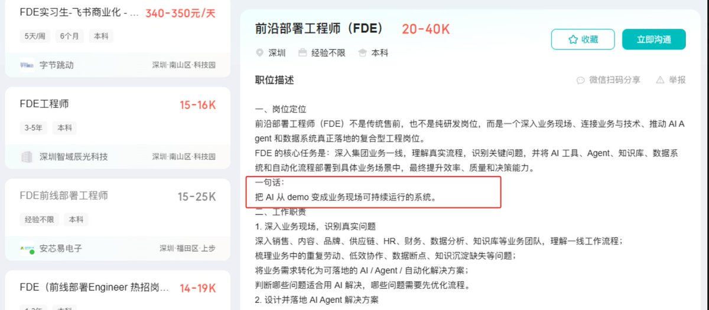

为什么突然需要这样一个岗位？因为 AI 发展至今，所有人都撞上了同一堵墙：AI 在会议室里演示得很好，一进入真实的企业就失效。

数据是杂乱的，流程没有标准化，老系统对接不上，员工不会用也不想用。这些问题模型自己解决不了，只能派人到现场逐个拆解。

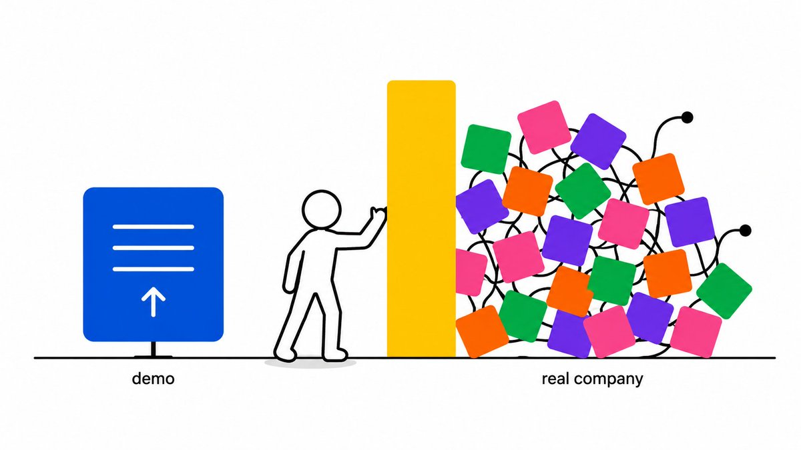

SO，被派过去的这个人，就是 FDE。

当决定开始求职时，还会遇到一个问题：同一个岗位有七八个名字。 招聘网站上这些标题底下经常是同一份招聘启事 —— 前沿部署工程师 / 前线部署工程师 / FDE / AI 解决方案工程师 / 大模型交付工程师 / AI 应用工程师 / AI 交付工程师...琳琅满目

但反过来，写着 FDE 的岗位也未必真是 FDE。

## ▲ 不是什么岗位都能叫 FDE 的

我在 BOSS 直聘上把成都、上海、杭州、深圳四个城市的 FDE 岗位逐一查阅了一遍。

最低的岗位 3-8K，最高的 50-80K，相差十几倍。而且这个差距不是资历拉开的——好几个都写着「经验不限」，薪资却从 10-15K 到 20-40K 不等。

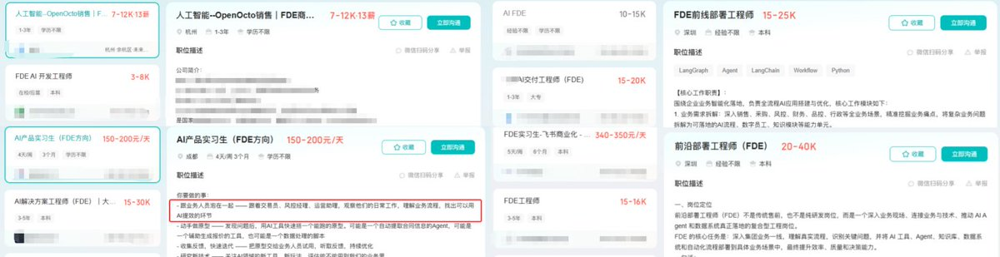

搞笑的是，我搜到一个岗位叫「手机功耗 FDE」，8-10K，实际工作是手机功耗测试，与 AI 毫无关系。

一半的岗位在做真正的落地，另一半只是把「驻场实施」换了个名字，甚至像那个功耗测试岗一样，只是拿这三个字母当招聘噱头。

所以上篇讲两件事：FDE 实际在做什么，以及怎么分辨真假。 至于零基础怎么进、这个岗位值不值得进，放在下篇。

## 一、FDE 实际在做什么

## 1. 解决的是「最后一公里」

有一个律所的例子，客户最初的说法是：我们想做个 AI 知识库。技术团队的第一反应是把文档导入，让 AI 能够检索。

深入沟通之后才发现，问题根本不在知识库：

- Word 文档里全是截图和网页链接，AI 读不出来
- 资料分散在办公软件、老系统和历史卷宗里
- 律所没有技术人员，交付之后律师需要能自行维护
- 最要紧的是，他们要的不是网上查得到的知识，是律所这些年积累的那套方法

客户口头描述的需求，和他真正想买的东西，中间差了一整轮业务诊断。

这正是 FDE 的工作。一位从业者的判断很直接：

真正的 FDE，八成时间在理解业务，两成时间在做 AI；上手第一件事不是写代码，是开始提问。

## 2. 真假的分界线：交付之后有没有沉淀

真正的 FDE 产出两份东西。一份给客户，是一套能用的系统；一份给自己公司，是一套可以复制到下一个客户身上的方法。

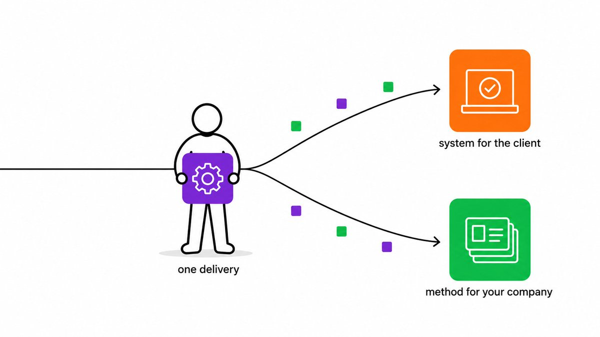

把有价值的客户现场经验，固化成产品优化建议

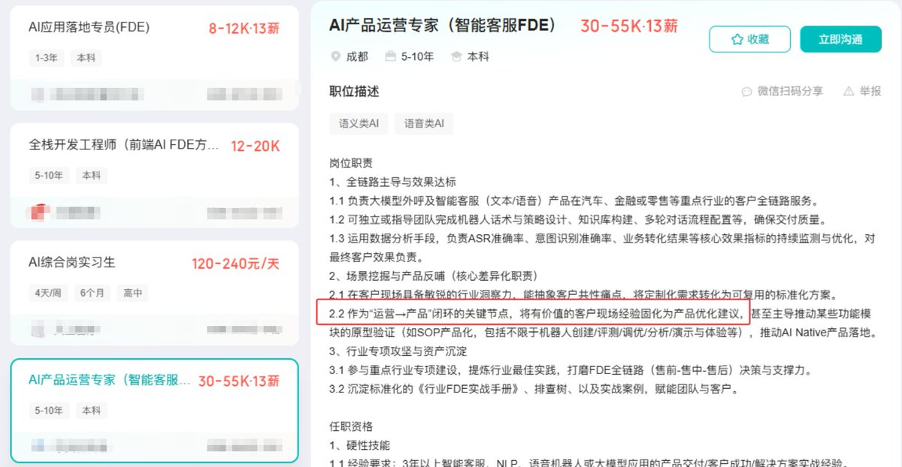

每月产出至少 4 个别人可以直接复用的方案包

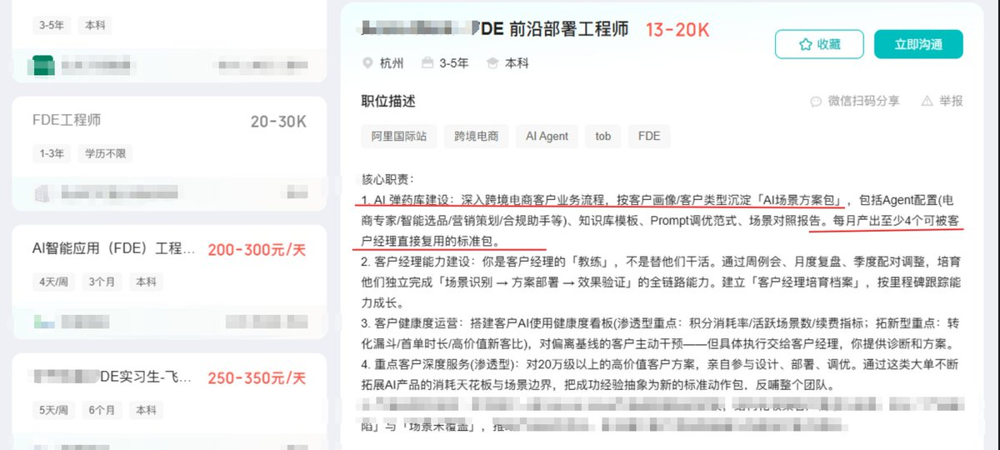

因此，要注意只为客户交付、交付完成即离场、没有留下任何沉淀的，这是纯粹的外包。

国内目前 FDE 和硅谷的区别，可以一句话概括：硅谷的 FDE 更多在研究怎么把最新的模型用好，国内的重心在于把系统装到客户环境并保证它稳定运行，基础工程的比重更高。

另外，这条路国内其实走了十年，只是当时不叫 FDE，而是叫「售前 + 实施 + 技术支持 + 项目现场 + 临时产品经理」。做过实施、售前、交付、驻场、技术支持的人，经验本来就能翻译成 FDE 简历。

## 3. FDE 完整的工作链条

一份大厂 FDE 的面试记录里，面试官讲了完整的链条：

接到商机 → 做出演示版本 → 小规模试跑验证 → 客户现场正式交付 → 上线后持续维护

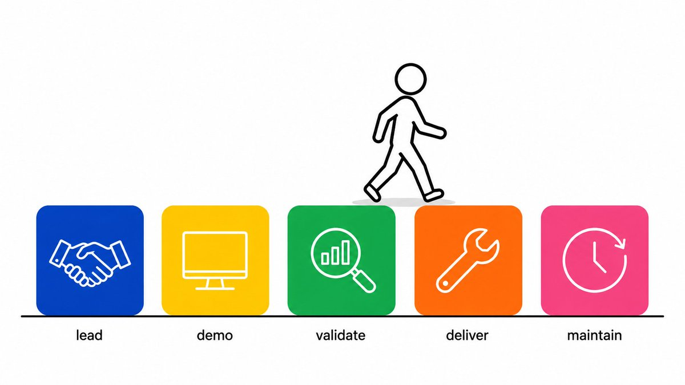

「接到商机」在最前，意味着需要与销售一同面对客户。不适应与人打交道的，在这一步就该止步。

「演示版本」和「试跑验证」是两件事。 演示版本用于展示，试跑要拿真实数据跑出结论。许多项目正是止步于这两者之间。

「上线后持续维护」在最后。 交付不是终点，这是它与外包最大的区别之一——外包验收签字就结束了。

还有一条职责叫「设计人机分工」：哪些工作交给 AI、哪些必须留给人、出错之后由谁承担。这里考察的是方案设计，与编程无关。

## 4. FDE 薪资：求职网站实况

以下是我逐个查阅 BOSS 直聘四个城市的结果，约 55 个在招岗位，可以当作样本参考。

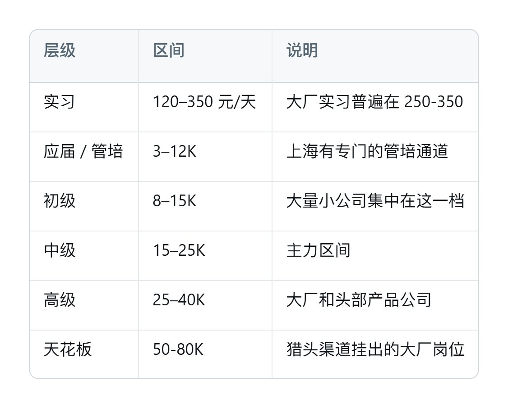

有一个细节值得注意：同一家大厂的同一个 FDE 岗位，官网招聘页不写薪资，猎头渠道挂的是 50-80K，实习岗写的是 300-350 元/天。 一家公司三个渠道三个价格，真实的价格区间只在猎头渠道可见。

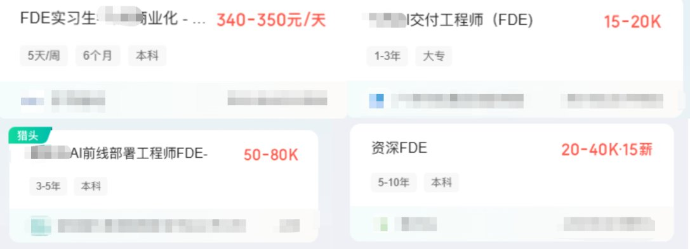

一些做了多年交付的老工程师在论坛上讨论过这个岗位：需求不稳定、容易被优化掉、小公司根本不专门招而是让内部员工兼任、真正在招的多是大厂和国企。

也有一些真实感受的分享：

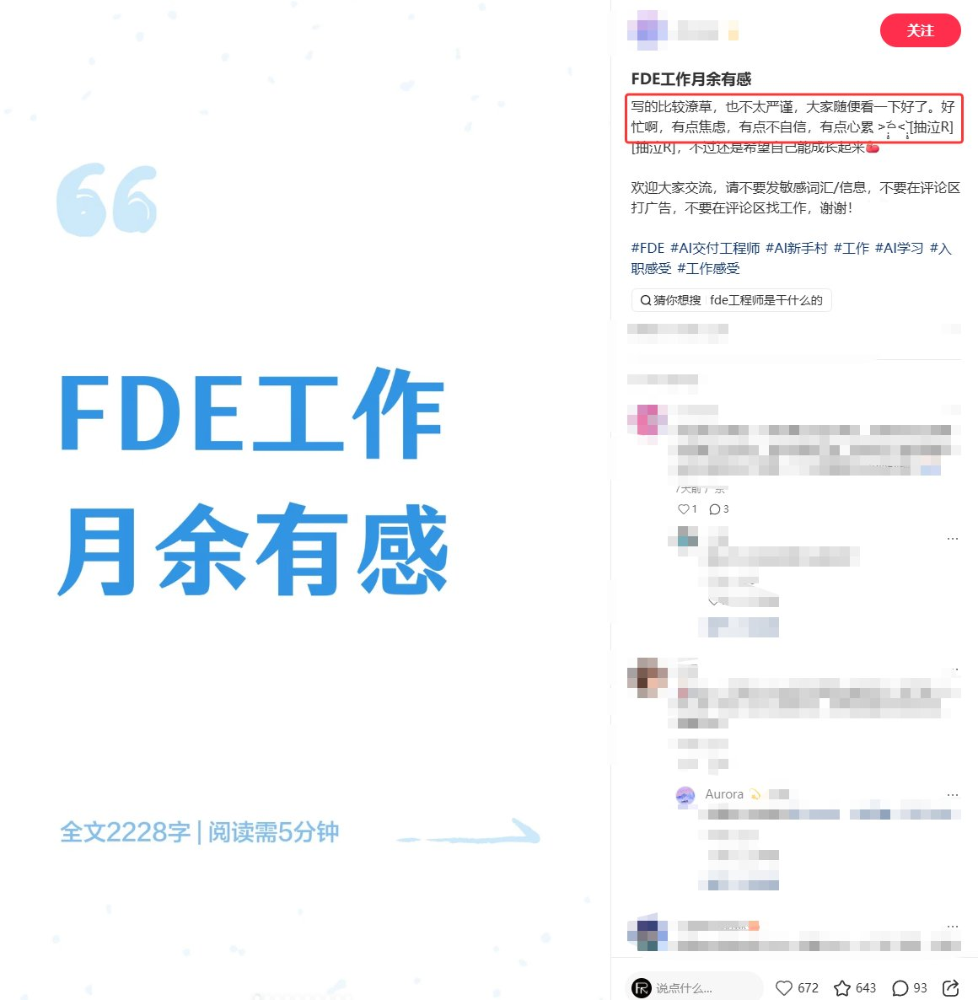

“钱少事多最先裁的岗位”和“少看虚假广告”。// 好忙啊，有点焦虑，有点不自信，有点心累。

## 二、如何分辨真假 FDE？

## 1. 三个对面试官的提问

问题一：你们 FDE 做的东西，有没有变成公司产品的一部分？

比如：过去半年，咱们这边有没有哪个功能是因为 FDE 在客户现场发现问题才做的？举个例子。

举得出具体例子，那可能是真的 FDE 岗，如果只能回答“我们会收集反馈”，估计就是个驻场。

问题二：方案由谁决定？我能不能改？

追问：我到现场发现真实问题与合同描述不一致，有没有权限调整方案？

能说清流程，是真的。回答“按合同来”“要走变更申请”，说明你是执行的人，不是解决问题的人。

问题三：这个项目如何收费？

按人天计价，你的价值被定义成工时，天花板已经锁死。有效果指标和验收标准，才是真正 FDE 的商业模式。

## 2. 三个通过 JD 来判断的信号

信号一：招聘启事开头有没有主动声明「我们不是××」。有的反而更可能是真的。

这是我查完四城岗位最意外的发现。六家公司，各自在与不同的东西划清界限：

- 「FDE 不是传统售前，也不是纯研发岗位」
- 「你不是坐在办公室等需求文档的工程师，也不是只负责讲方案的售前」
- 「区别于普通交付工程师的执行属性」
- 「不做纯粹的『配置工』」
- 「我们不是做概念演示，也不是简单接入一个聊天机器人」

市场上的假货多到什么程度？多到真正在做这件事的公司必须在招聘启事第一段先自证。

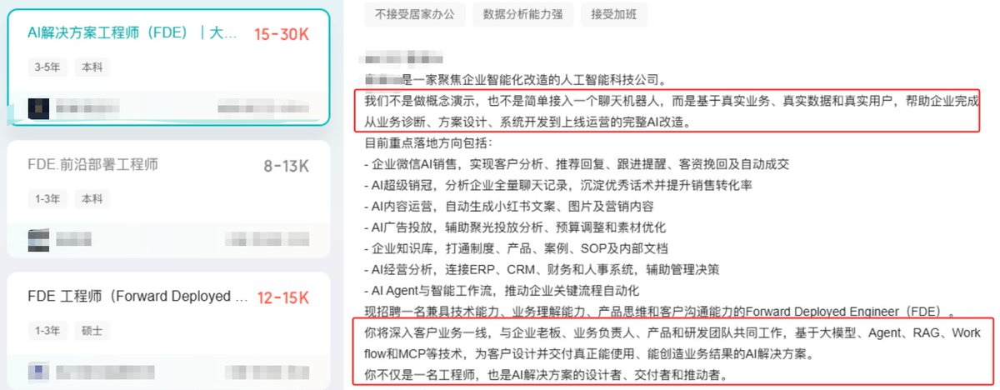

信号二：薪资和经验要求对不上的，点进去看职责。

一个岗位，列表上写 15-25K·14 薪，看上去是正式岗位。点进去，经验要求写的是「在校/应届」，职责全部是“协助资深工程师完成……”“参与客户现场调研”“辅助完成测试”，页面末尾写着“提供实习证明、表现优异者可获得 offer、免费三餐和下午茶”。

这是实习岗位，却挂着正式岗位的薪资。 其他公司的同类岗位写明是实习，200-300 元/天。

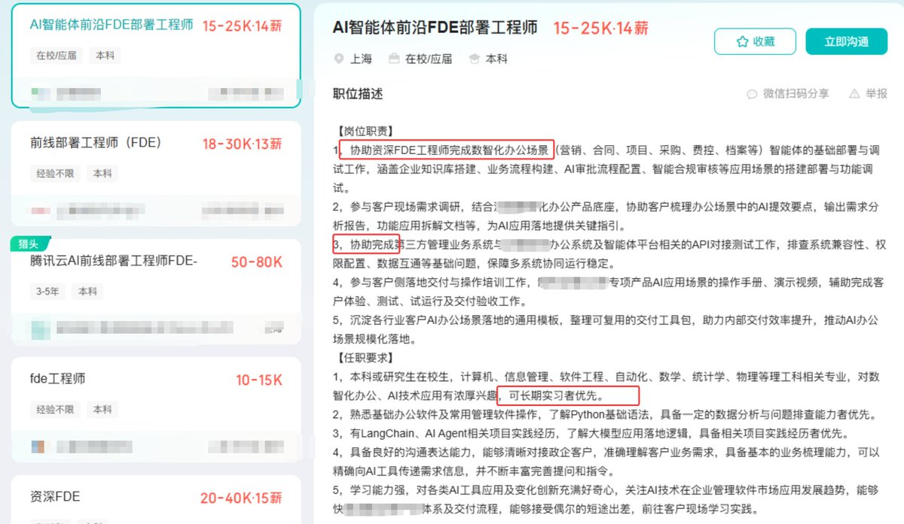

规律很简单：职责里全部是「协助」「参与」「辅助」的，实为辅助性工作。

信号三：直接看这个名头底下在做什么。

除了开头那个搞笑的「手机功耗 FDE」，还有一个更典型的：「人工智能 XX 销售 ｜ FDE 商务」，7-12K，学历不限，岗位职责第一条是「销售转化，占 70%」，任职要求里还有「年化薪销比＞1:10」。这是彻底的销售岗位，FDE 只是它要卖的产品之一罢了。

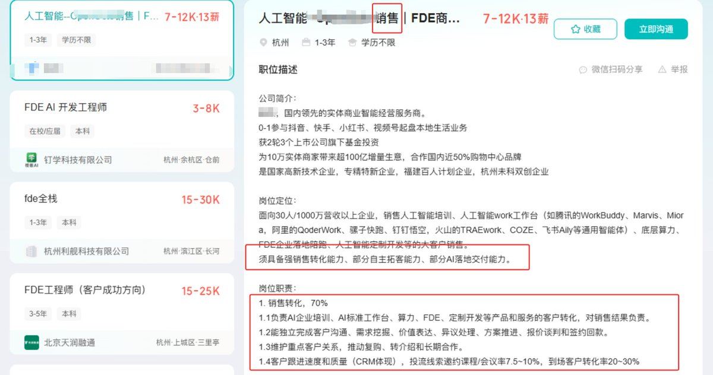

一个是纯人力，一个是纯销售。这三个字母现在几乎可以承载任何内容。

## 小结

回到标题那个问题，FDE 确实是目前 AI 落地最直接的岗位，但实际的就业现状则是，一大半是临时外包和假岗位，极少的才是真 AI 落地，但是有办法在投简历和面试时分辨。

核心其实只有一条：

这份工作结束后，除了客户拿到系统，你和你的公司有没有留下能复用的东西。

有，是 FDE；没有，那就只是其他职位换了个名字。

👉 下篇讲如何上车：三条入行路径、按薪资分层的能力清单、面试怎么准备，以及我自己在做的类似 FDE 的两项业务，也放在下篇。

## 附：数据来源

一手数据：BOSS 直聘成都、上海、杭州、深圳四城手动搜索的约 55 个在招岗位、12 份完整招聘启事；腾讯招聘官网 3 个在招 FDE 岗位的完整职责与任职要求。

政策信息：[澎湃新闻](https://www.thepaper.cn/newsDetail_forward_33271383)、[新浪财经](https://finance.sina.com.cn/tjhz/2026-06-16/doc-inicpzzz7814249.shtml)。

行业分析与从业者观点：[腾讯云开发者社区](https://cloud.tencent.com/developer/article/2674646)、[53AI](https://www.53ai.com/news/Palantir/2026061023150.html)、[testerhome 讨论帖](https://testerhome.com/topics/44501)

🥳感谢看到这里，我是阿哲， 前建筑师 → AIGC 设计师&架构师

欢迎关注我 [@Formulasearch](https://x.com/Formulasearch)，我会持续分享可实操的AI提示词，工具教程，实践经验。

## 相关页面

- [[sources/fanbing-dsh-superagent-engineering-common-sense]]
- [[sources/khazix-one-year-agent-automation-system]]
- [[concepts/agentic-architectures]]
- [[concepts/ai-oneperson-company]]
