# Aron 厚玉（@aronhouyu）：我把 TikTok 运营塞进了 Codex——选品、拆账号、找达人全流程自动化

> 将 TikTok 电商全生命周期运营搬进 Codex 的工程实操：结合专属 Skill 实现爆品趋势挖掘、对标账号拆解、达人批量建联与带货文案自动生成，将跨平台繁琐的运营人工成本降低 80% 以上。

`<!-- more -->`

我最近在折腾一件事，尝试把 tiktok 运营里那些反复做、特别耗时间的工作，整理成一套 codex 能直接调用的 agent skill。

主要解决的是：

找标杆店铺

筛选增长商品

找成交视频

匹配合适的达人

提取视频字幕

拆竞争对手账号

研究一个类目值不值得进入

最后生成未来 7 天或 30 天的行动方案

我把这套东西放到了 GitHub：

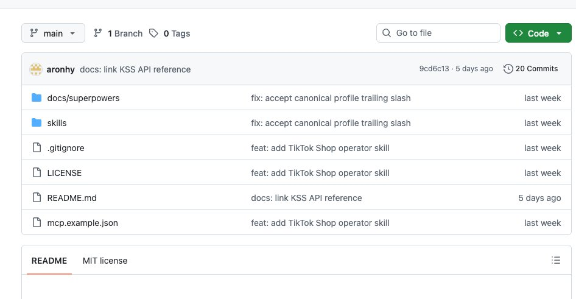

自己在内部使用了一段时间，总结出的 skill，顺手做成了 agent 可以调用的，

简单的一句话理解：

通过达人精灵的 mcp，把 tiktok 地数据找出来，并且形成固定的工作流。

例如我现在使用的：

美国区日用品及推广方案

条件：评分 4.5+｜价格 30–50 美元｜近 7 天增长较快

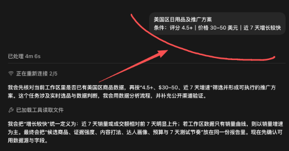

调用了一堆工具，都是 codex 内置的，甚至都不用管

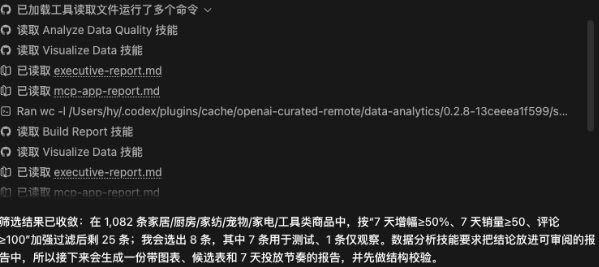

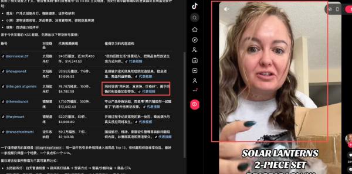

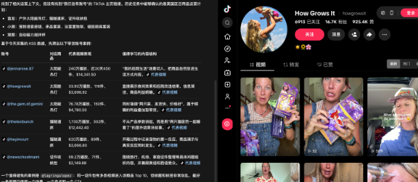

如何使用

直接带 codex/workbuddy/你的各种 agent 中输入：

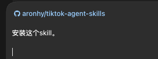

aronhy/tiktok-agent-skills

安装这个 skill。

ai 会自己进行安装，并查询相关的 skill 结果，完全不用管。（安装 skill 之后需要重启一次）

前提：

使用 skill 需要消耗 mcp 的相关点数，点数的内容会在 git 地址中的相关文档中有。

安装后能得到什么

目前这套仓库里有四个核心 Skill

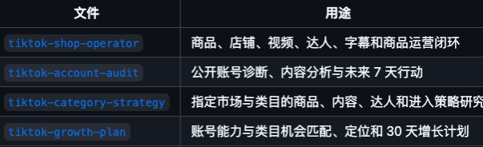

## 1. 商品运营结果 [tiktok-shop-operator](https://github.com/aronhy/tiktok-agent-skills/blob/main/skills/tiktok-shop-operator/SKILL.md)

输入国家、类目、价格、评分、销量等条件，Codex 可以通过达人精灵 MCP 查询商品，再继续关联店铺、带货视频和达人。

最后输出的是：

- 筛选出可以值得跟进的品
- 对应的标杆店铺是什么
- 什么视频的成交，带货会更多
- 筛选出达人
- 综合上面的信息，需要做什么

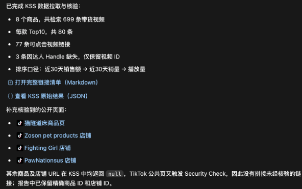

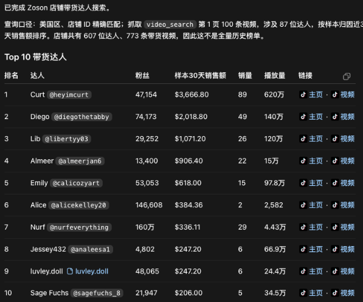

而且每个都有链接，有主页，粉丝数，销量，销售额是多少，播放量是多少。

可以给予这些内容，做更加详细的筛选，以及计划。

## 2. 账号诊断结果 [tiktok-account-audit](https://github.com/aronhy/tiktok-agent-skills/blob/main/skills/tiktok-account-audit/SKILL.md)

给它一个公开 TikTok 账号链接，它会分析：

- 账号定位
- 内容好坏
- 爆款样本
- 更新节奏
- 当前问题
- 可以复制的结构
- 未来 7 天动作

对起号，以及相关的账号逻辑都非常有利，可以当作相关的建议。

甚至可以把自己的账号/对标账号都搞进去，看账号哪里有问题。

下列是中间的过程，其实过程都可以不看的。

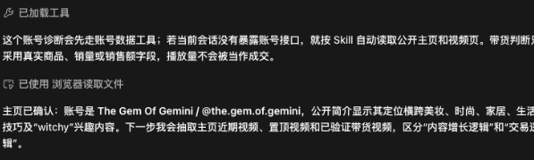

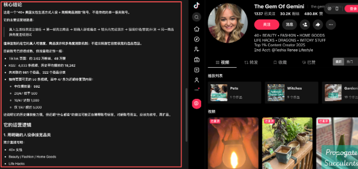

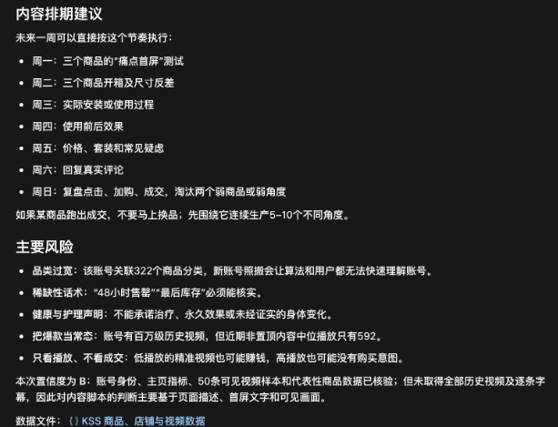

内容太多，我们就不用一个一个截图了。

## 3. 类目研究结果

如果你还没有确定做什么产品，可以先给它一个国家和目标类目。

它会从商品、店铺、内容和达人几个维度找证据，

如果值得，再给差异化定位和前三个验证动作；如果数据不足，也会把缺失信息和限制写清楚。

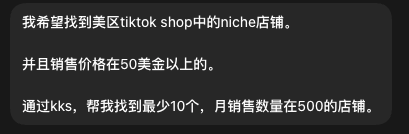

就像我需要的这种：

美区，50 美金，月销售量 500+的店铺。

看看有什么惊喜。

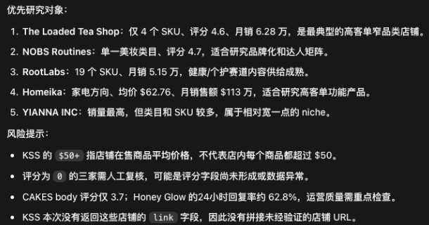

那这些，其实就可以顺着往下去做查找以及运营。

其实还可以添加判断条件：

例如：30 天内，1000 单以内，500 单以上，50 美金以上。 这样会更加清晰。

- 为什么不是直接给 Codex 一段 Prompt

## 因为在使用 codex 做运营的时候，发现了几个问题。

1。。。如果没有前置的数据做支撑，其实 ai 还是会发生幻觉，他会给你一些没用的，不准确的信息。这些信息显然不是我们需要的。 所以才有了达人精灵的 mcp，给运营做数据支撑。

2 大部分人都不知道自己应该做什么，下一步需要做什么，执行什么，

所以才自己做了 skill，让这些逻辑，可以固定流程。

这样每一步都可以清晰，可见。

1 做成 skill 之后，还可以方便其他人使用。

MCP、Skill 和 Codex 分别负责什么

这三个东西很容易混在一起。

可以这样理解：

达人精灵 MCP：提供数据

它负责提供商品、店铺、视频、达人和字幕等查询能力。

例如：

商品价格、评分、销量和销售额

店铺评分、商品数量和销售表现

视频播放、互动和带货数据

达人粉丝、平均播放、互动率和带货能力

指定视频的字幕

具体能调用哪些工具、参数和字段，以当前连接的 MCP schema 以及达人精灵官方文档为准。

Skill：提供方法

Skill 决定：

查询顺序

筛选逻辑

数据优先级

证据要求

缺失处理

输出格式

Codex：负责理解和执行

Codex 读取自然语言需求和 Skill，然后：

1 检查 MCP 当前提供的工具。

2 组织查询和分页。

3 筛选、关联、排序和核对数据。

4 标记时间、地区和统计窗口。

5 把结果整理成可以继续执行的运营任务。

没有 MCP，Agent 很难获得真实的 TikTok Shop 数据。

没有 Skill，Agent 即使能调用工具，也容易变成东查一下、西查一下，结果不稳定，逻辑也不统一。

## 怎么安装到 Codex

先克隆仓库：

```markdown
git clone https://github.com/aronhy/tiktok-agent-skills.git

cd tiktok-agent-skills

```

把所需 Skill 复制到 Codex Skills 目录：

```markdown
mkdir -p ~/.codex/skills

cp -R skills/tiktok-shop-operator \

skills/tiktok-account-audit \

skills/tiktok-category-strategy \

skills/tiktok-growth-plan \

~/.codex/skills/
```

刷新或重新启动 Codex，让它重新发现 Skill。

仓库当前包含：

tiktok-shop-operator

tiktok-account-audit

tiktok-category-strategy

tiktok-grow

接达人精灵 MCP

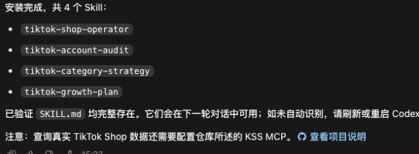

接下来需要在本地配置达人精灵 MCP

仓库里的 mcp.example.json 提供了不含真实凭据的配置示例。目前主要使用两个 MCP 服务：

达人精灵 mcp

kss-universal

https://mcp.kolsprite.com/universal/mcp

kss-caption

https://mcp.kolsprite.com/caption/mcp

认证 Header 名为：

secret-key

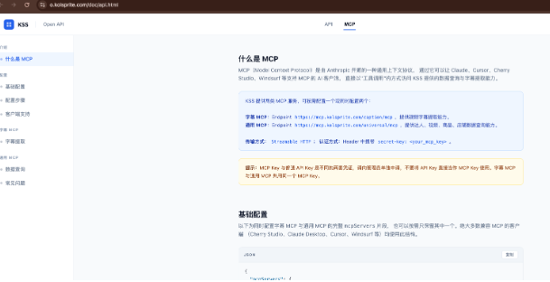

注意，MCP Key 和普通 API Key 不是同一个凭证，不能混用。

真实 Key 只应该保存在本地配置或安全环境变量中，不要写进 README、Skill、截图或 Git 提交。

达人精灵 API、参数和返回字段可以参考：

[https://o.kolsprite.com/doc/api.html](https://o.kolsprite.com/doc/api.html)

四种可以直接复制的用法

下面这些 Prompt 可以配合仓库中的四个核心 Skill 使用。

使用前请把尖括号内的占位内容替换成真实信息。

1. 商品选品

使用 $tiktok-shop-operator 查找`<国家/地区>`的`<目标类目>`商品。筛选条件：- 价格：`<价格区间>`- 评分：`<最低评分>`- 时间窗口：`<近 7 天/近 30 天>`- 重点关注：销量、销售额和增长率请按照销售额降序排列，结果前置，并说明数据范围、统计周期和完整性。

2. 标杆店铺研究

使用 $tiktok-shop-operator 查找`<国家/地区>``<目标类目>`中销量较高、评分在`<最低评分>`以上的店铺。输出店铺名称、店铺链接、评分、商品数量、销量、销售额、达人数量和视频数量，并总结每家店铺的主力价格带和核心商品。

3. 查找爆款带货视频

使用 $tiktok-shop-operator 查找商品“`<商品名称或商品链接>`”的相关带货视频。筛选近`<时间范围>`销售额超过`<金额>`的视频，按照销售额降序排列。输出视频链接、达人、发布时间、播放量、互动率、销量和销售额，并总结这些视频共同使用的 Hook、卖点和演示方式。

4. 从视频反查达人

使用 $tiktok-shop-operator 分析“`<商品名称或商品链接>`”的带货视频，并找出相关达人。筛选视频销售额超过`<金额>`的达人，按照成交表现排序。输出达人主页、粉丝量、平均播放量、互动率、历史带货表现和代表视频，并给出合作优先级。

5. 提取字幕并拆解脚本

使用 $tiktok-shop-operator 提取这个 TikTok 视频的字幕：`<视频链接>`输出：1. 原始字幕 2. 中文字幕 3. 开头 Hook4. 用户痛点 5. 核心卖点 6. 证明或演示方式 7. CTA8. 可以复用但不直接照搬的脚本结构

6. 完整商品运营闭环

使用 $tiktok-shop-operator 围绕`<国家/地区>`的`<目标类目或商品>`完成一次 TikTok Shop 运营研究。按照以下流程执行：选品 → 标杆店铺 → 爆款带货视频 → 达人 → 字幕拆解 → 行动方案最终输出选品结论、达人优先级、内容方向、三个推荐 Hook，以及未来 7 天的执行计划。

7. 竞争对手账号诊断

使用 $tiktok-account-audit 分析这个公开 TikTok 竞争对手账号：`<账号链接>`请分析账号定位、目标用户、内容支柱、更新频率、爆款视频结构、常用 Hook 和增长机会。结果前置，先告诉我：1. 这个账号做对了什么 2. 哪些方法值得借鉴 3. 哪些内容不适合直接照搬 4. 未来 7 天最应该执行的三个动作

8. 多个竞争账号对比

使用 $tiktok-account-audit 分析下面这些公开 TikTok 账号：`<账号链接 1>``<账号链接 2>``<账号链接 3>`比较它们的定位、内容支柱、爆款结构、更新节奏和互动表现。最后总结：- 每个账号最强的内容方向- 它们共同使用的内容公式- 市场中尚未被充分覆盖的内容机会- 我们可以验证的三个差异化方向

9. 新类目进入研究

使用 $tiktok-category-strategy 研究`<国家/地区>`的`<目标类目>`。结合商品、店铺、视频、达人和用户需求进行分析。结果前置，先回答：1. 是否建议进入 2. 最值得关注的价格带和细分类目 3. 市场竞争是否过热 4. 可以采用什么差异化定位 5. 接下来最应该验证的三个动作

10. 类目内容机会研究

使用 $tiktok-category-strategy 分析`<国家/地区>``<目标类目>`的 TikTok 内容机会。重点研究：- 当前常见内容主题- 爆款视频结构- 用户经常提出的问题- 仍未被充分满足的内容需求- 适合新账号测试的内容方向最后生成 10 个选题和 3 种可以连续制作的内容系列。

11. 账号与类目适配判断

使用 $tiktok-growth-plan 分析这个账号是否适合进入`<国家/地区>`的`<目标类目>`：账号：`<TikTok 账号链接>`商业目标：`<涨粉/建立品牌/获取询盘/销售商品>`请判断账号现有能力与目标类目的适配度，并输出：1. 建议进入、暂缓进入或先小范围验证 2. 应该保留、停止和新增的内容 3. 账号定位调整建议 4. 三条可选增长路径 5. 未来 30 天的行动计划

12. 通用自动识别 Prompt

请根据下面的 TikTok 运营目标，自动选择最合适的 Skill 执行：`<描述你的账号、商品、类目或运营问题>`要求：- 结果前置- 标注数据来源和统计周期- 区分观察、推断和假设- 明确缺失信息和数据限制- 给出三个可以立即执行的动作如果缺少的信息会改变主要结论，一次只向我询问一个最关键的问题。

## 相关页面

- [[sources/kkkeric-grok-bot-growth-22-bots]]
- [[sources/chuhaiqu-social-distribution-playbook]]
