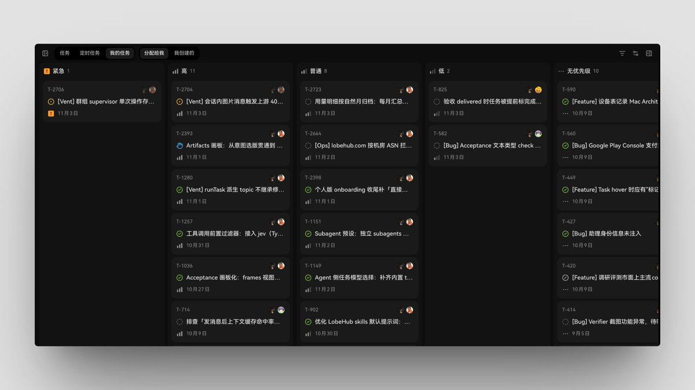
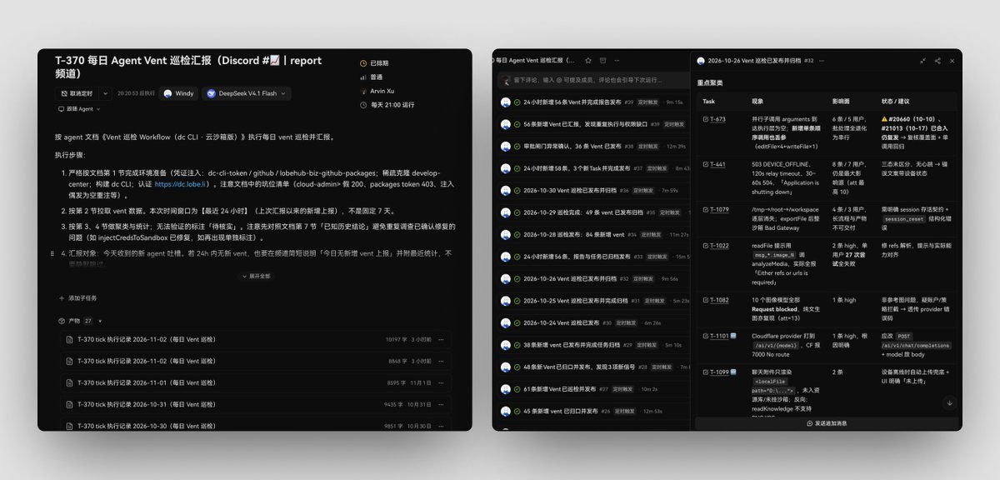
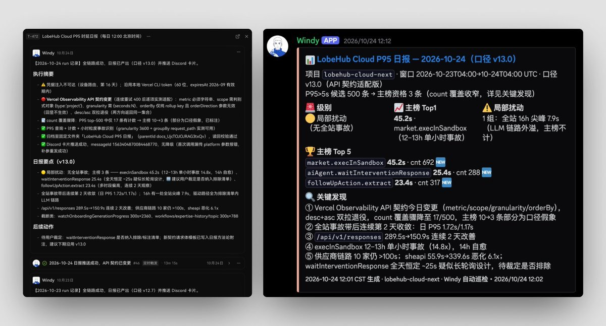
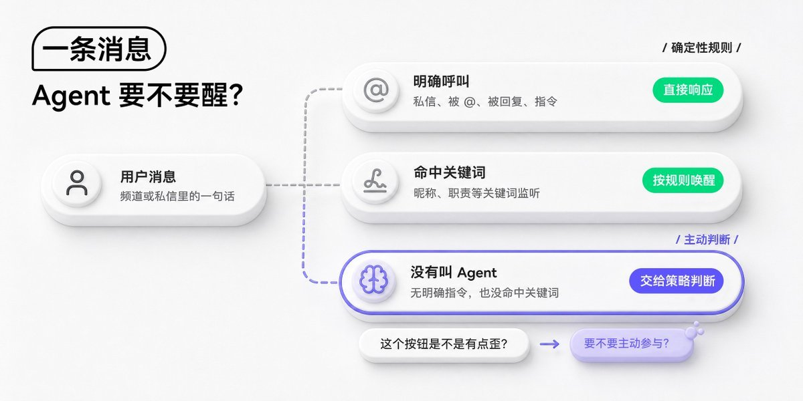
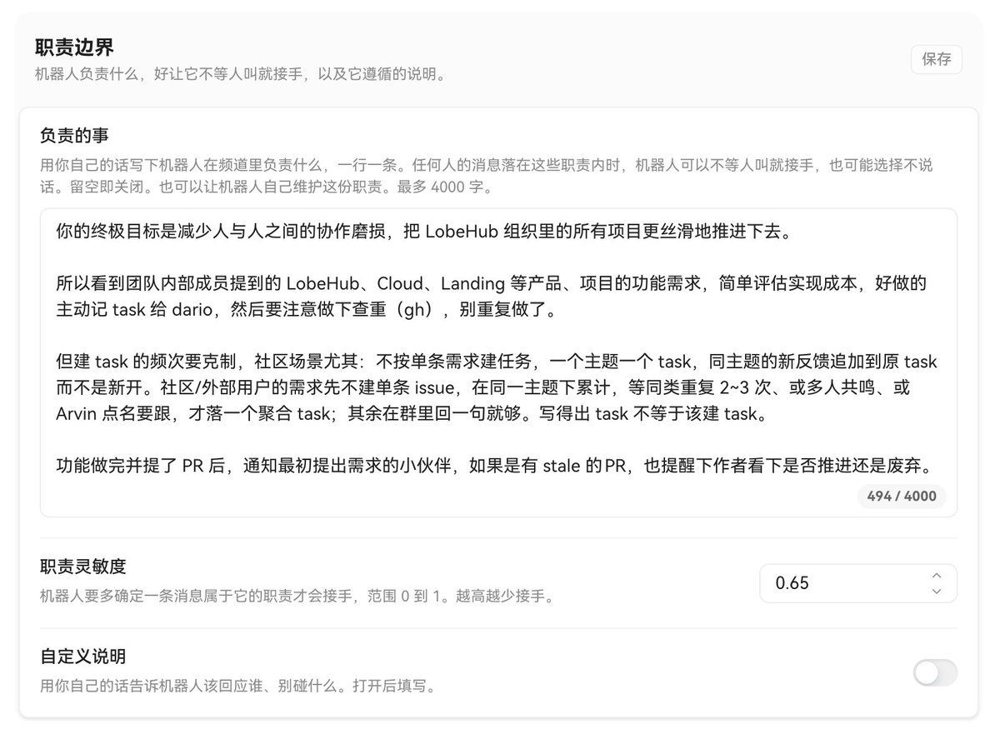
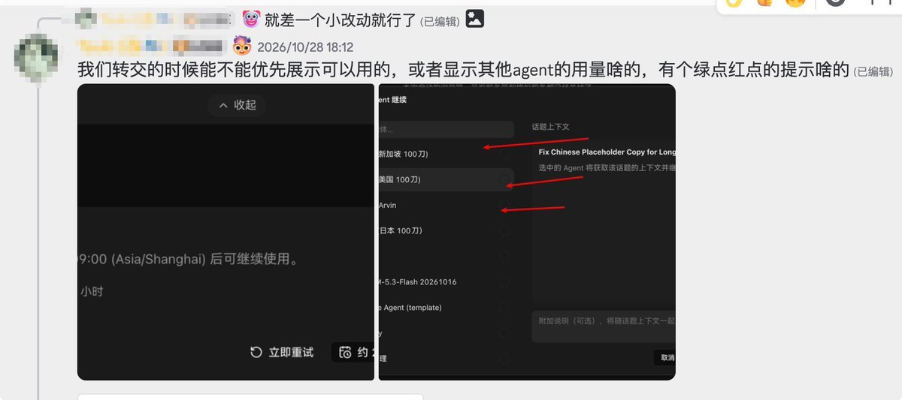
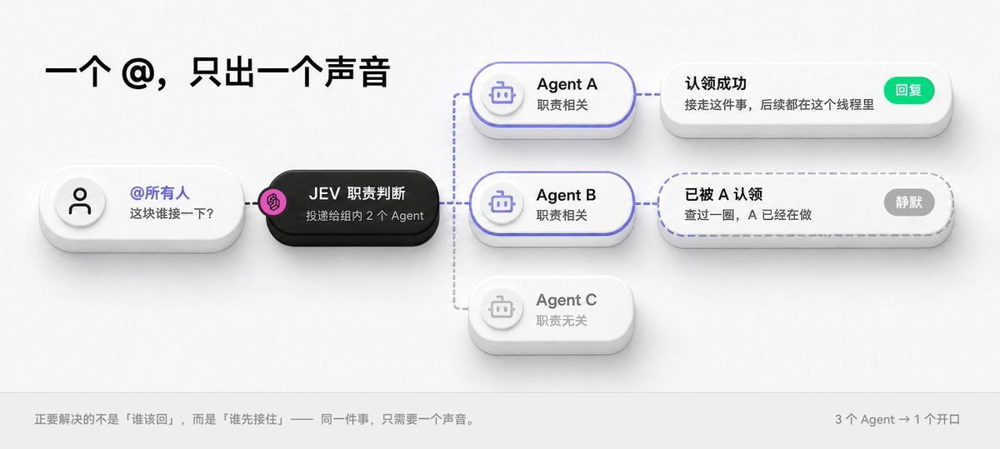
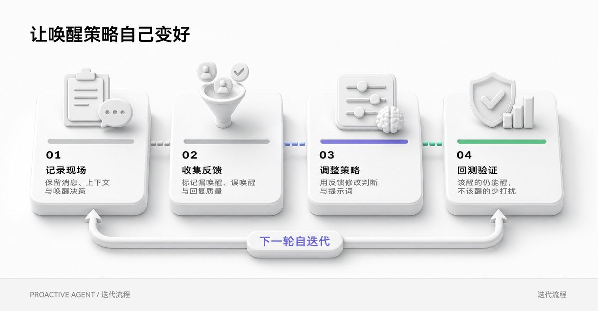

# 空谷 Arvin Xu（@arvin17x）：LobeHub 中 SuperAgent 的产品技术实践——以工单串联会话、策略化主动唤醒与沉默是金

> LobeHub 创始人深度呼应 DeepSeek SuperAgent 架构，全盘揭秘真实生产系统落地四大核心：一是以独立的 Task（工单）身份跨越割裂的 Session，给人类清晰看板、给 Agent 明确上下文边界、给自演进定时任务明确落点；二是 Proactive 主动唤醒架构（直接呼叫、关键词与职责匹配三层策略设计），剖析「职责范围内」与「插话有价值」的度量差异；三是「沉默是金」理念，提供两阶段前置过滤与自发放弃机制防噪音打扰；四是依托 Tracing 留存现场、用户表情反馈与夜间总结回测驱动自进化。

<!-- more -->

看完 DeepSeek SuperAgent 的文章，里面写的很多想法，正是我们这几个月一直在探索与实践的，譬如什么时候该醒，什么时候该闭嘴，醒了之后又该不该开口。

所以花了两天时间做了下梳理，这篇文章非常像是产品与工程侧对 SuperAgent 的呼应 —— 把 SuperAgent 这个词，落到我们在 LobeHub 里真正做过的几件事，以及一个悬而未决的疑。

## 一、一件事得有一张工单

先说第一处。我之前一直在想，session 和 session 之间到底该是什么关系？一件事可能要聊好几次、跑好几轮；如果每次都只按 session 来组织，其实很难说清这些执行究竟是在推进同一件事，还是几件不同的事。

去年 10 月开始深度使用 Linear 之后，我越来越觉得 Task 是个很好的切分单位：先有「这件事」，然后才有围绕它发生的讨论和执行。但我用 CC + Linear 时，体验又挺割裂：Linear 里有记录的 issue，CC 里有执行它的 session，两边都在描述同一件事，却没有自然地连在一起。我当时就在想：它们本来就是一件事的两面，为什么要还让人自己去两个应用里面跳来跳去呢？

回过头来看 SuperAgent 的 Router / Worker 设计。Router 决定交给谁，Worker 负责把活干出来；但光靠这两层，还没有回答「它们在为哪件事工作」。我想补的 Task，不是再加一个负责调度的角色，而是给那件事一个独立于 session 的身份。这样不同的 session 可以围绕同一个 Task 展开，一次执行也能找到它归属的那件事。

所以我们在 LobeHub 里把 Task 做成一张「工单」：哪个 Agent 来干、在哪个环境里干、用哪个 Model 来干，都记在这张单子上；Worker 跑出来的 trajectory，也归到这张单子下面。至少在我现在的理解里，session 更像一次交流或执行发生的地方，Task 才是把这些过程串起来的那件事。

这个设计的好处，我一开始只看到一层，后来发现其实是三件事。

第一件，人有地方看了。 一件事如果只活在聊天记录里，人是没法判断它走到哪一步的。Task 有形态，有形态才有「展示」可言——不然你只能对着一条滚动条猜它到底干完没有。这其实是我最初的初衷，也是能带来直接的用户体验提升的地方。

第二件，上下文有了边界。这是我用了几个月之后意识到的。 Agent 最难受的从来不是没能力，是被塞进一段无限长的对话里，什么都得记着，什么都得接着。Task 给了它一个可以切出去的落点：这件事归这件事，那件事归那件事。

每个 task 都可以有一个独立的 agent，独立的 model、独立的环境，以及独属于这个 task 的 session 序列，这使得一件事的长期演进真正成为了可能。

第三件，触发信号这件事有了落点。 既然 Task 是一张独立的单子，「什么时候触发它」就变成一个可以单独拎出来设计的问题：可以由用户触发，也可以由 agent 自己触发，也可以由定时任务触发。这几条路一通，定时任务就不只是「到点跑一遍脚本」了——它可以去迭代这张工单本身，今天跑出什么、明天怎么改，慢慢地就有了一点自演进的味道。

我在 9 月 9 日创建的后端接口 P95 日报，在一个多月的迭代后，Agent 自行将口径迭代到了 v13 版本，中间我没有做过任何一次干预。

这三条听起来好像没啥太大的相关性，但其实它们在回答同一个问题： 一个 Agent 和一次执行，多个 agent 和多次执行之间，应该需要什么样的组织关系。

## 二、唤醒这件事，难的不是叫醒

如果这篇只能留一节，我一定只留这节，这里深度剖析了我们 Proactive 实现的一手实践。

像 Coding Agent 的唤醒机制可以说简单到几乎不用设计：人敲一句，它就动。所有的主动性都在人这边，它不需要有任何判断。

而一旦 agent 要在群里、在频道里、在没有明确指令的日常对话里活着，问题就整个变了。

最经典的两种唤醒是确定性的：有人 @ 它，它醒；命中某些关键词，比如「bug」，它醒。这两条特别好写，也特别好解释——因为它们是规则，不是判断。规则不需要智能。

但真实的聊天不长这样。真实聊天里大量是「这个按钮是不是有点歪」「这块要不要再想想」，甚至就是随口一句，连主语都没有。这种时候它该不该自己醒？

所以这里能做的事，其实比想象的多很多，我们分成了三层 —— 直接叫、关键词与主动判断。

## 三、唤醒是一套策略工程

具体怎么设计唤醒，有几个核心思路展开聊聊。

第一，唤醒这件事应该是一个策略化的设计方案。 不要做写死的判断逻辑，会迷失。不同策略之间存在「与、或、并、跳过」这一系列权重配置，同时有固定策略，也有交给模型判断的 LLM 策略。

譬如，在一个群里聊到设计相关的话题，设计 agent 就应该主动被唤醒，跑一轮并且接话。聊到具体的开发任务，它就不该醒，应该沉默着。

如果一个系统的唤醒是靠系统提示词里写一句「请在合适的时候主动参与」，那不叫策略，那叫愿望。实测愿望是拦不住任何一次误唤醒的。

那怎么办？我们给每个 bot 提供了一个自己的职责栏位。有了这层之后，讨论产品的时候，主管 agent NASA 会介入，答疑，或者干脆直接把需求记下来；讨论到需求或者设计形态，设计 agent 才会唤出来，去呈现相应的设计方案。而这种朴素设计思想的效果出乎意料地 work。

第二，我后来发现，在有些我期待 nasa 唤醒的场景下，nasa 并没有唤醒。但如果此时唤醒的话，体验上应该会有惊喜感。

通过回测才发现，我期待它唤醒的场景下往往不属于它的职责。duty 问的是「是不是职责范围内的事」，不是「插话有没有价值」，上一条截图中的职责匹配得分是 0.61，没过 0.65 的唤醒线。而另外有人问 Nasa 刚发的链接为什么还带着 sign in 的 meta，它职责分只有 0.27。前者是它有机会查清楚的问题，后者更是它自己的回复相关的问题。只问「属不属于职责」，很容易把这种值得接的话放过去。

我也试了把阈值往下调，比如降到 0.60，前面那条 0.61 的问题就能进来；但那个链接问题只有 0.27，还是会漏掉。而在我自己标注了的同一批记录里，一句「其实就是 Agent Role」这样的闲聊也拿到了 0.55。继续降低阈值，它也可能被叫醒。光调这个数字，能改变唤醒的多少，却没法判断 Nasa 这时说话到底能不能帮上忙。

此时我突然意识到，「这事归不归我管」和「我现在插一句有没有帮助」，其实是两个不同的命题。这是两种不同的优化方向。一种是「老实本分」地做好自己，另一种则是乐行好施地帮助他人。而一个好的 agent 伙伴，应该是「手里有活，眼里有光」，两者兼具。

## 四、沉默是金

还有一个我觉得特别重要的东西：沉默。

在 proactive 的场景里，沉默不是一个 bug，它反而变成了一个很重要的 feature。

你不给它留这个出口，主动就一定会变成噪声。一个永远在接话的话痨 agent，最后大概率被所有人静音——这几乎是可预见的结局。

在实现的思路上，其实大家会很类似，都是两阶段，先有一段前置判断，然后再是 agent 执行。一般前一段用一个分类器快速判别一下，这条消息要不要惊动谁；但其实后面那段也需要考虑 —— agent 被唤醒之后，它自己要决定是不是该停下来，或者干脆不响应。

有了这样一套机制，后面的流程才谈得上。因为唤醒是一个叫醒的动作，而叫醒之后要不要开口，才是更智能的。为什么 bot 在被唤醒后，不能是「看了一眼，觉得没自己什么事，然后继续睡」？

## 五、它得能自己变好

策略是会过期的，也需要演进。那如何演进？

我在之前的[《需要自进化的不是 Agent，而是 Harness》](https://x.com/arvin17x/status/2059489592097849698) 里提过，tracing 是进化的原材料，所以这里就有了核心的 4 步。

第一件事，记录完整的原始场景。 只有留了现场，用户才能观测、才能理解这个 bot 到底该怎么调整和优化——它是没醒对，还是醒了但说错了？这两种问题要改的地方完全不一样。没有现场，反馈就只剩情绪，而「它好烦」这种话你没法据此改任何东西。

第二件事，给它一套拿得到反馈的机制。 点赞、点踩，或者干脆丢一个笑哭的表情。随手给出的表情就已经具备丰富的反馈信号了。

第三件事，每天晚上做总结的时候自我迭代一次。 把白天的信号过一遍，自己改一版。

第四件事，回测。 这一条才是真正的工作量：之前该唤醒的还唤醒，之前不该唤醒的被解决掉。

这件事我们还在迭代过程中，目前只是完成了第一步。在接下来一两周内，我们将会完整实现 2~4 步，进而让 agent 同事在和大伙相处的过程中，越来越得体、知分寸。

## 还有一件暂无思绪的事，留给大家一起探讨

以上是我们在 Super Agent 这条路上的一些实践与思考。但哪怕探索了这么多，还有一个问题已经萦绕了我们 3 个多月，我们都还没想明白该怎么优雅地解决。而且我相信它会在接下来，随着大家在用协同 agent 时频次越来越高，变得越来越显著。

它就是，资源或者资产的归属。

场景很简单，一个 agent 在频道里产出了一份东西。于是立刻有两个问题蹦出来——这条执行的成本算谁的？是 bot 主人的，还是发起这件事的人的？这份产出又属于谁？是主人，还是发起者？

往前推一步就会发现，这已经不只是记账问题了。它涉及到组织当中，生产资料和生产价值发生的结构化特征。

放大到社会里来开，我们有合同机制，白纸黑字锚定最终产物的归属。但 agent 这个载体有点特殊：它是一个自动运行的载体，一方面它用的资源是主人的，另一方面发起者可能又带上了自己的那部分资源。两边都出了一部分，产物落谁名下？

举两个场景，它们甚至是需求完全相反的场景，特别能说明这种冲突。

假设有一个帮人整理邮件的 agent。如果用的是创建 bot 的主人绑定的 Gmail，那整理出来的全是主人的邮件——这显然不合理吧，用户要的是整理的自己邮箱，此时 Gmail 是必须要是连到发起者才行的。

再假设有另外一个 agent ，连接了某个股票数据库 MCP ， 以 bot 的形式对团队提供服务。这时候对话发起者本身并不拥有这个 MCP 服务，他只有「想用」的意愿。如果你让他先去把这个 MCP 的所有权配一遍，这事非常麻烦：他既没有权限，大概也没有这个必要。

这两个例子放在一起，我无法直接说「资源都归发起者」或者「都归 bot 主人」。整理邮件时，agent 得用发起者的 Gmail；查股票数据库时，它可能恰恰要用 bot 主人提供的 MCP Server。同样是一个人在频道里叫 agent 做事，能用谁的资源，答案就已经不一样了。再往下问，调用成本由谁承担、产出的内容算谁的，也不能只凭「谁发起了对话」一项来定。

以前用 Coding Agent 时不太会被这个问题绊住：通常是我在自己的环境里发起执行、提供资源，也由我接收结果。可一旦把 agent 放进团队频道，这几个人可能不再是同一个人。发起者能提需求，不代表他有权调用 bot 主人的所有资源；bot 主人提供了工具，也不代表每份产出都该归他。

所以这块我们到现在也还没想清楚。表面上是在分资源的使用权限、执行成本和产物归属；再往下问，其实是：agent 在代表谁做事？它凭什么调用某个人或团队的资源？做成了、做错了，谁来接这个结果？

我隐约觉得，这可能碰到了人和 agent 一起工作时最根本的关系。但这个关系到底该怎么定义，我们也还在仍在求索中。

如果你对我所描述的这些技术特性感兴趣，欢迎查看我们的开源仓库： [https://github.com/lobehub/lobehub](https://github.com/lobehub/lobehub) 让 agent 读一读。

如果你想真的在自己的团队中来尝试体验 SuperAgent，可以直接来我们的网站注册体验 👉[ https://lobehub.co](https://lobehub.com/)m

## 相关页面

- [[sources/criscxuan-deepseek-super-agent-architecture-teardown]]
- [[sources/fanbing-dsh-superagent-engineering-common-sense]]
- [[sources/khazix-agent-autoloop-open-source-architecture]]
- [[concepts/agentic-architectures]]
- [[concepts/agent-autonomous-pipeline]]
