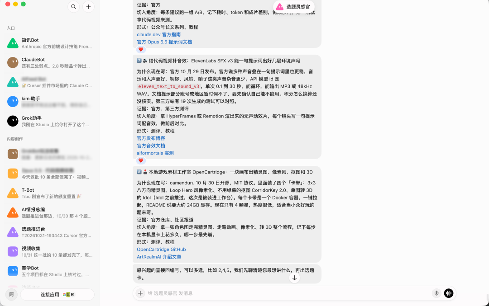
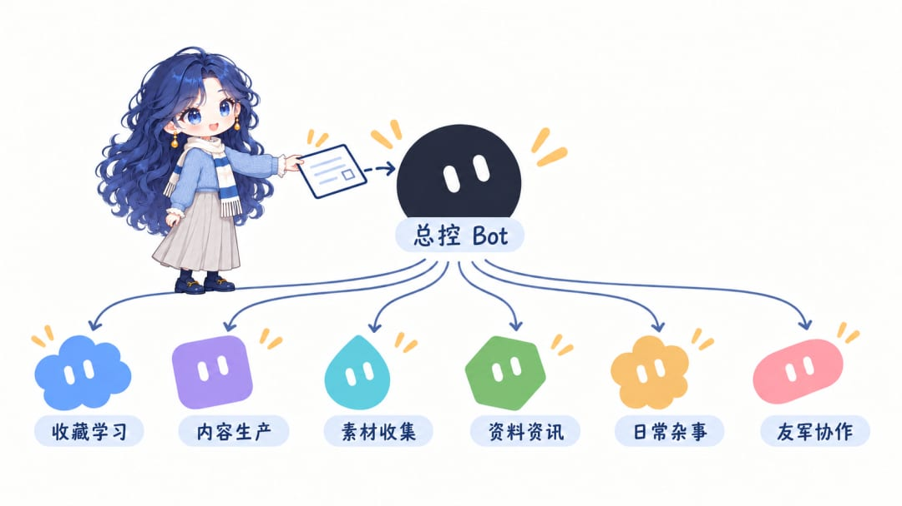
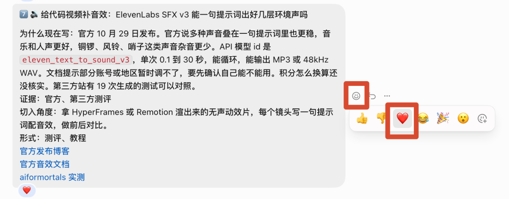
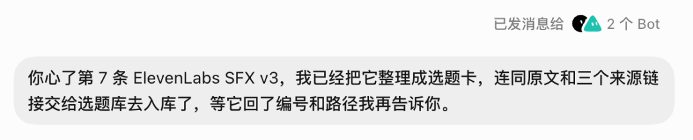
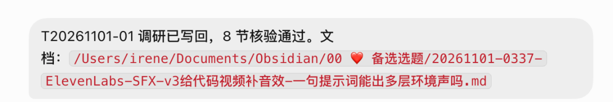
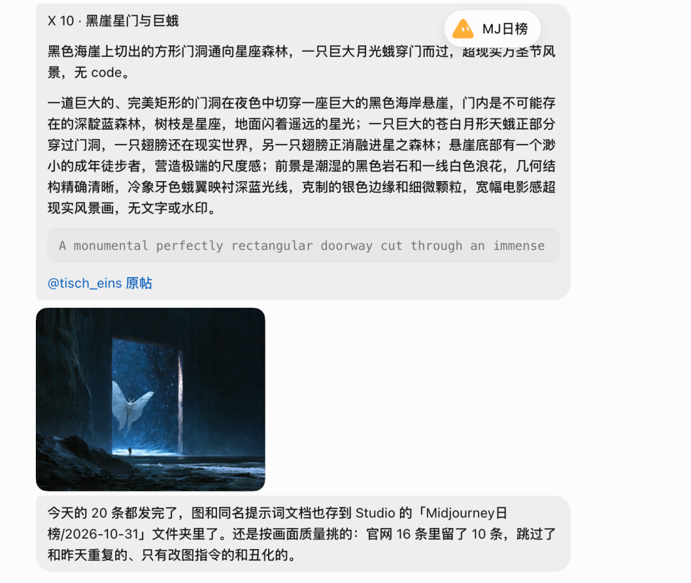
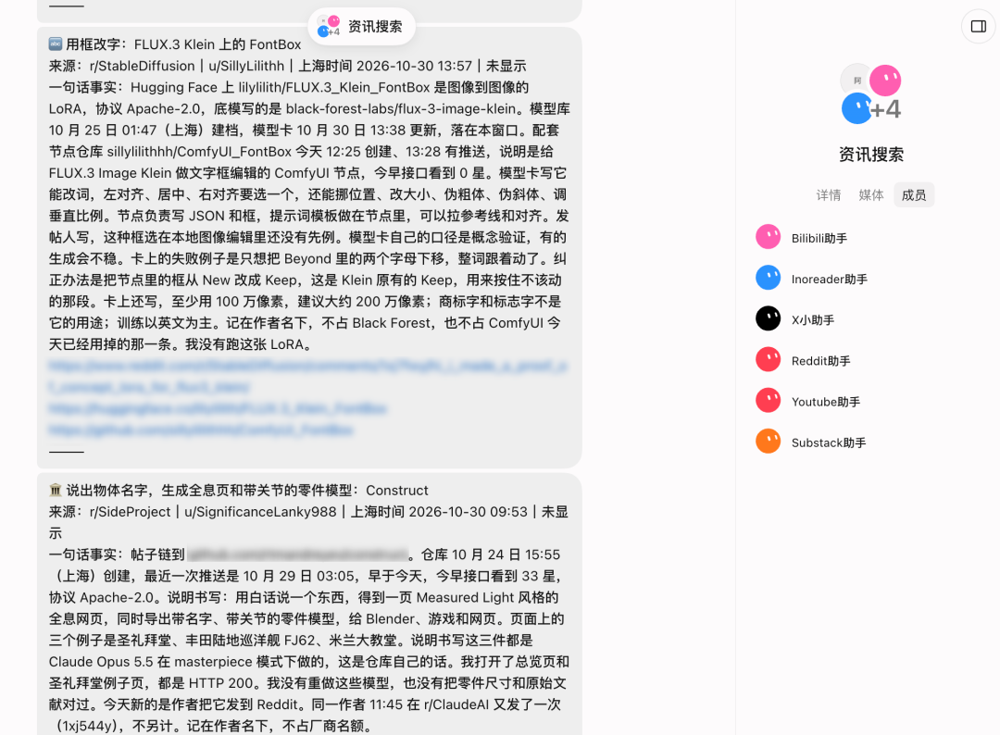
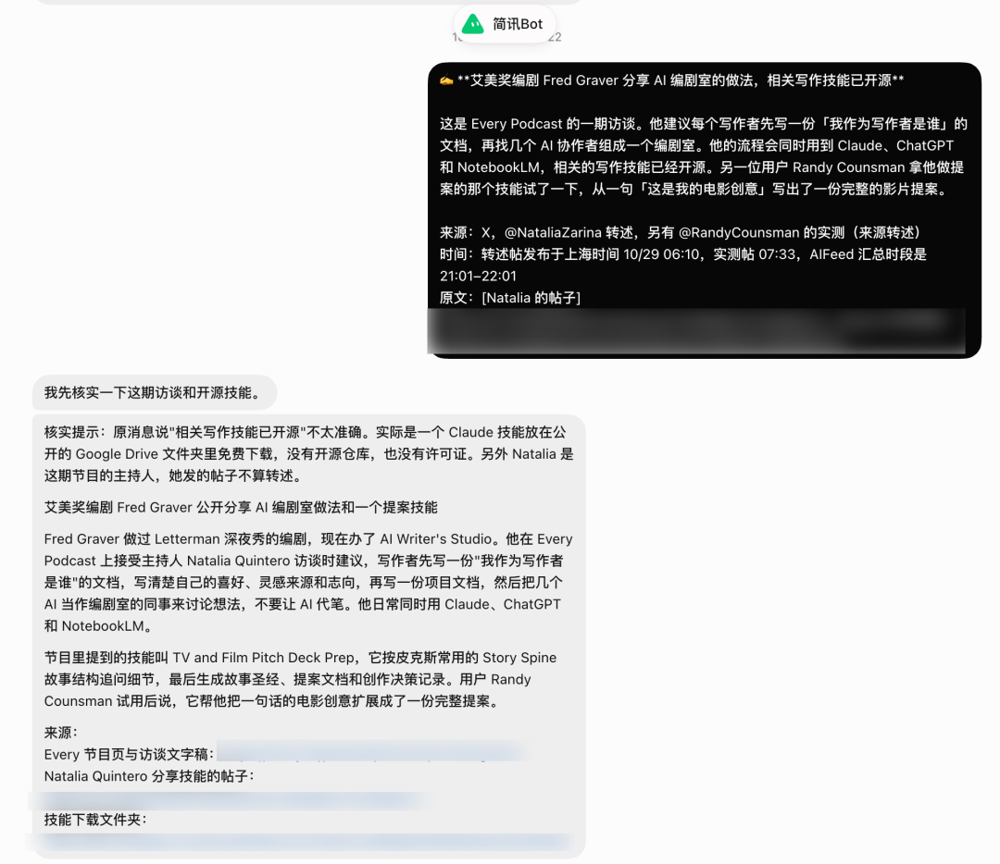
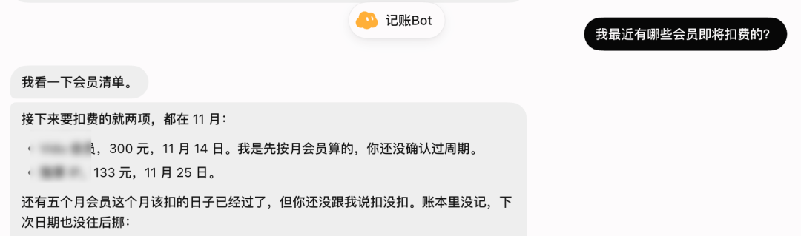
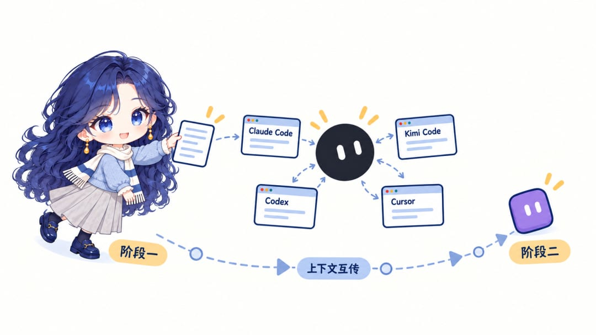

# 使用 GrokBot 两个月后，我的 GrokBot 分工全公开分享

> 深度使用 GrokBot 两个月的完整实战经验：总控 Bot 作为主管分发任务与统一规则；六大分组（收藏与学习、内容生产、素材收集、资料资讯、日常杂事、友军串联）各司其职；气泡表情快捷工作流（点赞进收藏待定、爱心进本地 Obsidian 选题库）；核心分工原则「重活交给本地 Grok CLI，轻活交给云端 GrokBot」；飞书 CLI 打通云文档与多维表格自动记账；聚合 Claude Code 与 Kimi Code 实现多 Agent 跨阶接力。

<!-- more -->

嗨大家好，我是阿真！

8 月份我开始使用 GrokBot。实不相瞒，那是有一次 SuperGrok Heavy 出了个漏洞优惠，我半夜刷到，一个冲动就冲了。买了以后有 Cursor 会员、SuperGrok Heavy 会员，还有当时 X 大力推的 GrokBot 会员。

谢谢老马，这个福利没有回收哈哈哈。

两个月里我用它做了很多尝试，今天来分享一下我在用 Grok Bot 做什么。这些都没什么难度，直接给它要求就可以建一个 Bot 用起来，上手还是很友好的。

GrokBot 的本质是 personal agent，你可以建很多个独立的 Bot，每个 Bot 负责一些事项。

除了可以区分不同 Bot，它还可以打通和本地电脑的连接，通过远程方式完成一些本地事务，或者登录云电脑上的账号，通过自动化任务完成每天定期或定时的事务，很是方便。

我个人感觉它不适合流程比较长、相对比较复杂，以及需要不断去回看和评审的任务，这个用起来就比较难受。

跟它对话就像微信好友聊天，我发一个气泡，它回我几个气泡，如果是一个项目，后续不管是要查它发给我的内容，还是我发出去的内容，都比较麻烦。

所以类似 Coding 这类活我不怎么让 GrokBot 做，这些需要长上下文，要反复看代码改动、来回评审，气泡对话反复上下拉不太合适。写代码不如直接用 Agent，或者有任务可以交给后面友军系列里的 Claude Code、Kimi Code 等，GrokBot 只负责派活和串联。

但如果让它做一些收集类、整理类的日常杂事，它可以处理得非常好。

## 总控 Bot

首先，我会有一个总控的 Bot，我就叫它 GrokBot。它相当于我的主管，我什么事情都可以先交给它它来分配任务。

总控主要负责随手事务处理、对其他 Bot 组发号施令，本地电脑相关操作，以及资料整理，统一管理分 Bot 的规则。

比如所有收藏类 Bot 的存储路径，我只需要告诉总控一次，它会同步改掉所有分 Bot 的设置。

接下来就是基于我个人的需求，在 GrokBot 里面进行分组，确定我每一个分组里面 Bot 的职能了。

## 收藏和学习

在讲这个分组的 Bot 之前，分享我一个有趣的用法。

长按它回复给我的任意一条气泡，选一个表情，就能做快捷反馈。有时候它发的信息比较多，我没来得及仔细看，就可以直接按住气泡选表情。我给两个表情定了不同的含义，这个告诉 Grok Bot 我点击这个表情它怎么处理就行。

点赞👍 ，点赞 = 稍后处理。它会帮我收到一个收藏 Bot 里。在这个收藏 Bot 里面，它的状态是“等待决定”，类似于待会儿再看。我会在晚上或者有空闲的碎片时间，仔细查看里面的内容并决定怎么处理。

爱心❤️，爱心 = 进入选题库。比如我觉得它发的信息很有分享价值，或者是一个值得延伸的选题，我就会点爱心，它就会直接存到我本地 Obsidian 的选题库里。

我在“收藏和学习”这个分类里有 4 个 Bot。分别是收藏 Bot、学习 Bot、待播列表和访谈 Bot。

学习 Bot：我会把 YouTube 或者哔哩哔哩的学习视频丢给它。我有一个“学习包”的 skill 给到它，之后我丢给它一条用 Claude Code 剪 TikTok 视频的教程，它会整理简介和核心内容，再以这条视频为原点，向上找前置知识，向下找进阶内容，组成一条 10 个视频的学习路线。

待播列表：有点类似于我的“想看”列表，放我现在想看、但还没时间看的视频链接。它会收录并整理好简介和推荐理由，等我有时间看的时候，就能快速想起来当时为什么收藏它。

访谈 Bot：帮我筛选 X、YouTube、小宇宙等平台上值得听的访谈与深度节目。每次精选 3-5 期，写清楚嘉宾、核心观点和可以摘录的金句，附一张 9:16 的分享卡，再用 1-5 颗星打出“值得看指数”，方便我快速了解内容，决定要不要看。

## 内容生产

我平时会分享一些自媒体的内容，这里就让它帮我做一些内容生产的拓展。

我这里会有口播助理、配片助理、图文编辑、封面台、人设导演和复盘 Bot。

口播助理会帮我把飞书文章素材或者旧脚本，直接改写成可以直接念的口播稿（像我本人在说话那样），给到一个快速的脚本作为草稿参考。

配片助理会帮我制作视频素材，它会去搜索很多相关的图片或视频素材，整理放到我本地项目的文件夹里，方便我后续如果做视频的话去使用。

图文编辑会把飞书的长文改成即刻、小红书或者 X 的短版内容。它先给一个初稿，我再基于初稿改成适合发出去的文案。

补充一点，如果我最终输出的是比较详细的文档内容，我会通过已经打通的飞书 Cli，直接将它变成飞书云文档。这样方便我在各个场景下修改和补充，也可以进一步把链接发给它，让它给我提修改建议。

强烈推荐，飞书 CLI 真的非常好用，建议大家但凡使用 Agent 都要尝试一下。

人设导演：其实这个我用的不算频繁，但有时候挺方便的。我会给到一个人物方向，它帮我先出三套视觉方案；我选定之后，它再生成提示词并提交生成图片，最后把图片返回给我。

它能做到这一步，靠的是云电脑，我在上面登录了自己的 Midjourney 账号，Bot 直接在网页里操作，我只需要给一个方向。云电脑可以有无限玩法，不过有的平台大家谨慎小心别把号玩没了。

复盘 Bot：在我的公众号文章发完大概一周后，我会把后台数据截图发给它，由它核实并汇总数据，给我一份阶段性小结，并建议我接下来怎么做。

## 素材收集

在素材收集方面，我属于那种“囤囤鼠”人设。我会收集非常多各个方向的素材，并且将它们存到本地，等到了要使用、有需要的时候直接去查看。

可能大家会想到，如果有非常多像我这样收集整理的任务，会不会出现 token 不够用的情况？我需要大量收集的任务会直接让它用我本地的 Grok CLI 去做，做完通知我。因为 Grok CLI 那边的 token 实在很多，我几乎每个周期都用不完。

简单说就是重活给 CLI，轻活给 Bot。Grok CLI 负责收集，GrokBot 负责分类、整理和定时推送。

还有就是任务周期有的是每天有的是隔天有的是每周，这个如果到了额度不够的程度了也需要一点取舍。

很多用户说 GrokBot 不要建太多 Bot，这话也有道理的。每个 Bot 的回复、定时任务、Bot 之间互发消息、群聊回复都算用量，而且每个 Bot 每一轮都会重读自己的聊天记录，聊得越久越费。

因此，也要考虑 Bot 职责重叠的问题，每个 Bot 侧重点尽可能有针对性。

另外还有一点就是 Grok CLI 还可以帮忙制作图片或者生成视频，质量都挺不错的。划重点，它生图也是可以写中文的，并且效果还可以。所以有的时候我需要完成没那么高要求的图片视频生成任务，都会直接让它做。

继续说我在素材收集里面的 Bot。我分为了视频收集、代码视频收集、美学 Bot、图片收集、MJ 日榜和一些 Agent 的玩法收集、有趣的项目。

这些有的是属于 Bot 类的，有的是类似于项目制的，定期去收集。有的是账号类的，可以直接登录；有的是直接通过 Grok CLI 去 X、Twitter、Reddit、B 站等平台收集信息，然后再反馈给我。

Bot 不一定对应一个动作，也可以对应一个长期课题，围绕一个主题，持续收集，持续更新。

## 资料与资讯

这一个分类，更多的是倾向于资讯相关。

这里面我有各平台的研究 Bot，非常多，包括 YouTube、哔哩哔哩、X、Reddit、GitHub、Product Hunt、HN News 等等。这些基本都是登陆就能给我反馈的。

这些平台 Bot 的主管是 AI 情报总编。我跟它说一个关键词，告诉它检索哪些平台，或者让它自己判断派给哪几个平台，它收齐后交给本地 Grok CLI 去重和核查，最后给我一份清单。

另外，我把我的 RSS 订阅也登录上了。我用的是 Inoreader，订阅自己关注的。有相关的消息或者热门的讯息，它都会每天推给我。

这些 Bot 不会每一个单独给我发消息，我将它们拉到了一个组里。这也是 GrokBot 的一个功能，支持分组和群组，每个组最多可以拉 6 个 Bot。基于同一个需求，组里的每一个 Bot 都会去完成各自的任务，然后统一汇总。

那为什么不直接用一个 Bot 收集所有平台呢？因为不同平台本身有不同的倾向，我对每个 Bot 的设置也不一样。每次都去多个平台太消耗了，指定平台下次找消息又麻烦。

平时让它们合成一份去重后的日报，需要的时候自己单独从某一个平台深挖，比如单独搜 Bilibili 上某个主题的视频，这样它给出的答案就会更有 B 站的调性。

我还有一个简讯 Bot，主要用来确认信息真伪，以及直接帮我把某一条资讯整理成短讯格式。

比如看到群友发的消息，我会让它去核实，返回相关介绍和资讯来源；如果是假的，它也会明确告诉我。毕竟现在各种消息太纷杂了，单靠人工很难确定哪些是真的。

这样很好的一点是，确认过的消息我才会转发。在信息太纷繁的时代，不传谣都算是一种内容质量了。

## 日常杂事

这个分类里有几个解决日常小事的 Bot，记账 Bot、发票 Bot，以及随堂解释和 T-Bot。

记账 Bot 我用飞书 CLI 打通了飞书多维表格。我每天花了多少钱直接告诉它，它会记下来并同步到多维表格。

到了月底我就可以看到统计，也可以让它直接生成统计图和报表（可以由 GrokBot 或者调用其他 API 来生成）。

另外，我的会员订阅也会直接告诉它。比如我说我在 10 月 1 日买了某个会员，让它在下一个周期提前三天提醒我、询问是否续订，这样就不会忘记了。

发票 Bot：我有一些场景需要自己开发票去报销，发票会直接发到我的 Gmail。我让它每周去 Gmail 查有没有新开的票，再发回给我。有时候也可以让它帮我开票，但走小程序的就走不通。

随堂解释：这个主要是当我看到某些资讯，或者里面提到一些我不了解的新技术概念时，可以直接复制关键词，让它快速解释和链接重要源，用通俗易懂的方式告诉我这到底是什么。

还有一个 T-Bot，专门盯着 Tibo 的额度重置，一刷新就提醒我。哈哈哈 10 月份它真的发挥了很大的作用。

## 友军系列

这个分类是为了更方便地使用其他工具。我把 Kimi Code 和 Claude Code 都接了进来，有了 Claude 助手和 Kimi 助手。

想用 Codex 和 Cursor 也一样，只要本地装了 GrokBot 客户端，都可以直接调用。MCP、CLI、API 那些的也是不用说，设置好了干活很方便。

不是不能用其他的，就是懒得切来切去的。还有的是因为 APP 远程真的很难用，这里就不说谁了。

Claude Code 用的是云电脑版。这个感觉有点玄学，因为朋友说他的第二天就没保住，但我这个账号还是可以使用 Claude Code，我只在云电脑登录这个账号。

本质上这是把几个编程 Agent 收进同一个聊天窗口。只要本地电脑开着，我就不用在多个 App 之间切换，哪件事谁做，在对话里点名就行。

并且完成以后，Bot 之间的对话是可以互传的。我可以从一个项目里叫另外两个同时去完成一个任务，或者让 A 先完成一阶段，GrokBot 再自动让 B 接手二阶段。

谁便宜谁执行，谁聪明谁指挥。

每个人的工作方式不一样，我的玩法和他们的玩法也不一定适合所有人，大家可以多探索一下，自定义出最适合自己的玩法。

## VS Muse？

先声明立场，我先用的 GrokBot，难免先入为主，对 Muse 目前只是初步体验，以下是初步印象。

Muse 也有很棒的一些亮点。比如它注册免费还送最高 30 亿 Token，它一样可以生图生视频，而且它更加贴近日常生活使用场景。

还有比如它非常可爱的可定制的 IP。另外它也可以做很多日常的整理、提醒、动态定制和高频的杂务、云电脑处理等等。还有它的人性化体验也是我朋友给我强烈推荐的点。

## 小结

总的来说，用了两个月，GrokBot 我已经用得很趁手了。

感觉它不属于那种特别聪明的高分工具，但让它做这些琐碎、又每天都要执行的事，它做得非常到位了。

它能把我的一堆零碎工作变成一套能自己运转的流程。省下来的时间，我可以更多地花在判断、创作和自己的主动学习上。

最后再次提醒，Bot 多了之后要注意职责重叠，我到中期也做了一轮调整和合并，功能差不多的就并到一起。

最开始就尽量想清楚每个 Bot 的定位，不要到后面 Bot 太多，找东西都找不到了。规矩立清楚，它才能稳定好用。

---

## 相关页面

- [[sources/kkkeric-grok-bot-growth-22-bots]] — KKKK：Grok Bot 出海增长实战
- [[sources/0xjoooe-grokbot-handbook-team-collaboration]] — Grok Bot 小团队协同手册
- [[sources/rongzhenghe-grokbot-multi-assistant-life-system]] — 容正和：Grok Bot 多助手生活系统
- [[sources/yaohongan-grokbot-48-use-cases]] — 虹安：Grok Bot 48 个真实玩法
