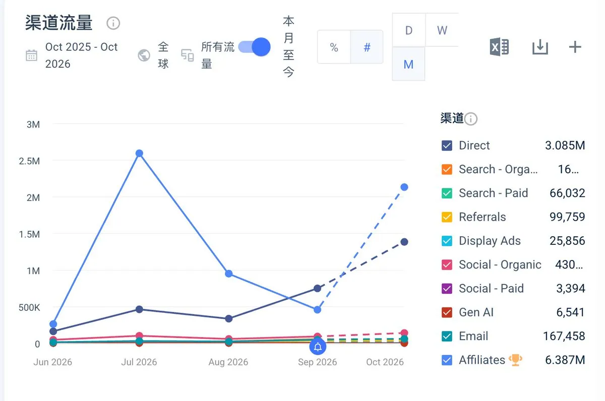
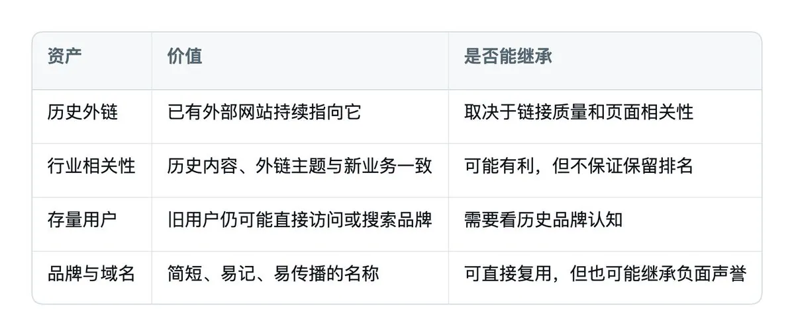
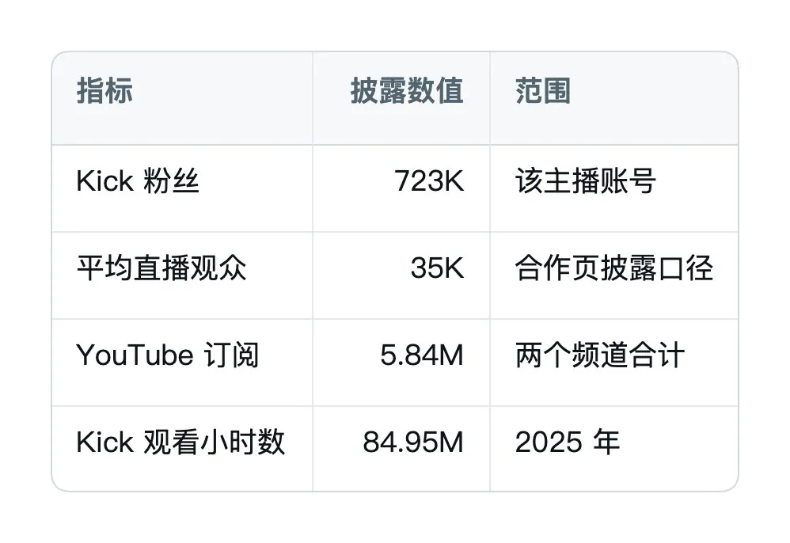
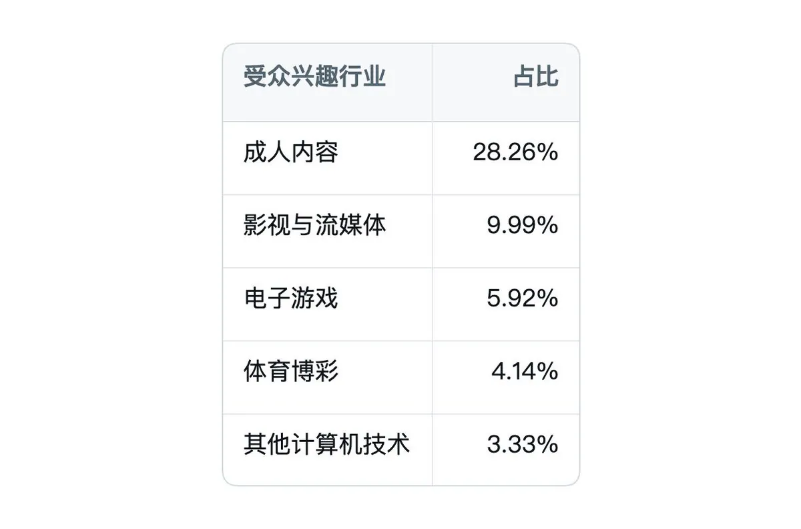
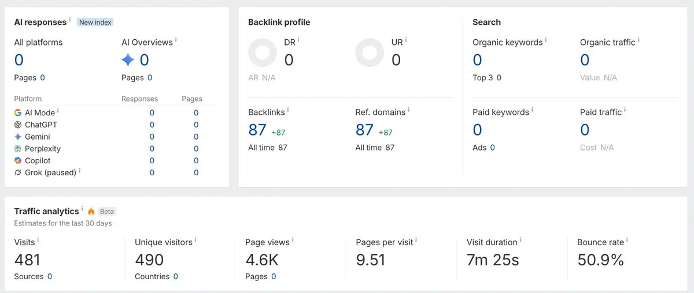
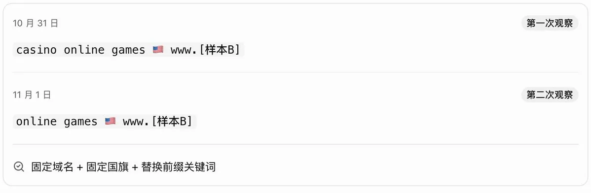
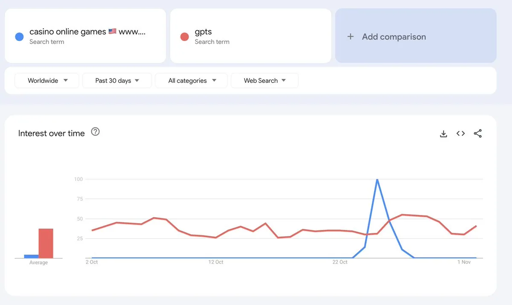
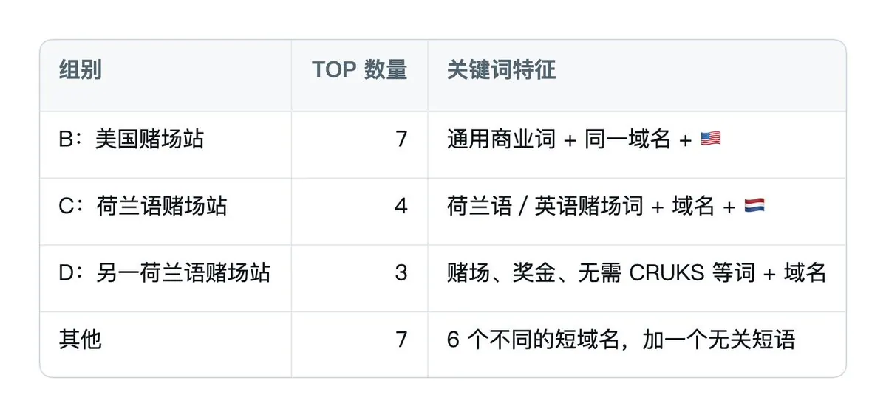

# 百年 AI×出海（@bainianAI）：灰色站的百万流量是怎么拉起来的？收购老域名 301 迁移与 Google 趋势刷词套利拆解

> 深度复盘两类灰色站点暴力拉升百万级流量的底层操盘手法：案例 A 通过收购高 DR/高外链停运精品老域名，先用高佣联盟推广（Aff）短时间暴力洗出数百万流量建立品牌心智，后期靠直接访问平稳承接；案例 B 利用自动化脚本将自身域名绑定动态博彩新词暴力刷爆 Google Trends 关联查询截流。

<!-- more -->

一个停了大半年的精品老域名，新团队接手后，一个月就打到了百万流量。今天的日课，我们研究一批更迅速、更暴力的灰色站。流量从哪来，又是怎么拉起来的？

具体域名就不发了，下面用案例 A、B、C、D 代称。

## 接手老域名后，Aff 先拉量，直接访问随后反超

先看案例 A。打法上就非常暴力，使用了一个超短的精品老域名。

我们查了它的历史：原业务在 2025 年 10 月停止运营，新团队在 2026 年 5 月接手，然后迅速在几个月内打到了百万流量。

再看 Ahrefs，这个域名还有一大批历史资产：DR 54，42.3K 条外链，4K 个引荐域名。Ahrefs 预估自然搜索流量是 5.5K。

但把流量渠道拆开，来源就极不寻常了。

6 月先靠暴力的 Aff（联盟推广）拉量。到 7 月，图上的 Affiliates 单月已经冲到约 260 万，直接访问还在约 47 万。随后 Aff 回落，直接访问开始往上走，9 月已经反超了 Aff。

我的理解，前面是在用 Aff 培养用户心智，后面再靠直接访问承接。它这轮起量，主力显然不在自然搜索。

## 收购老域名，买到的不只是一个名字

这里也顺着看一下老域名玩法，包括灰帽 SEO 常用的过期域名。

传统新站要逐步建立索引、外链、搜索曝光和用户认知。而收购一个历史资产，理论上可能一次拿到四类东西：

灰帽 SEO 里常见的一种做法，就是买过期域名，再 301 到目标站上，冲着它原有的权重和外链去。

当然，谷歌从 2024 年开始，就明确打击利用过期域名声誉发布低价值内容、操纵排名的行为。

那正常的域名迁移怎么用 301？一个场景是买到了新的、更好的域名，给原站做整站迁移；另一个场景是收购了另外一个资产，两家公司并购，把一个站合并到另一个站。

同样是 301，背后买的是什么资产、怎么接到新业务上，就很值得拆。

## Aff 很难追，但主播合作和受众兴趣能看到线索

Aff 渠道很难找，不过我们找到了一些对应的数据，比如主播合作。

案例 A 的公开合作页，披露了一位大型直播创作者的数据：

这些是品牌方公开合作页里的主播数据。这个合作在 2026 年 6 月 就已经正式达成，正好对应案例 A 的新业务启动。

再看受众兴趣行业：

我猜测，这些行业的 Aff 是占大头的。

这里也记一下 Adsterra。这个平台大家常用，但里面实际上是有黄赌相关广告的，即使在后台关闭了成人内容，也可能碰到。这类广告可能会被谷歌认出，遇到这种情况，就要和客服交涉，关闭对应的行业广告。

## SEO 数据基本为零，域名却绑着新词进了谷歌趋势

另外一个案例是刷新词。我们能捕捉到案例 B，就是因为它把自己的域名和日常监控的新词绑在一起，刷上了谷歌趋势。

打开 Ahrefs，SEO 数据基本为零：DR 0，自然关键词 0，预估自然搜索流量也是 0，外链和引荐域名各有 87 个。

但下面的 Traffic analytics 仍然估出了访问：最近 30 天，481 次访问，4.6K 次页面浏览。

再看我们连续两次捕捉到的词，变化就很有意思。

10 月 31 日是：

casino online games 🇺🇸 www.[样本 B]

11 月 1 日变成：

online games 🇺🇸 www.[样本 B]

域名没变，国旗没变，换的是前面的关键词。

## 和 gpts 放在一起，异常词的尖峰更明显了

拿这个异常词和 gpts 去比较，刷得非常高。

Google Trends 这张图选的是全球、过去 30 天、网页搜索。异常词的蓝线大部分时间贴着底部，突然冲到相对热度 100，峰值超过了同图里的 gpts，随后又迅速落下去。

继续查 Related queries，看看和它一起出现的还有什么。

## 21 个 TOP 关联查询，20 个直接带着域名

Related queries 里出现了 21 个 TOP 查询，基本是同一模板：

也就是说，21 个 TOP 关联查询中，有 20 个直接带有域名。

基本可以认为是某种自动化刷量的行为了。

这种手法，短期应该能冲一波量，但是识别和找后账是很容易的，成本也必然不低，只有灰黑产 Aff 的利润能够维持。

## 相关页面

- [[sources/xiaofeiyang-new-site-google-traffic-simulator]]
- [[sources/kkkeric-seo-new-site-gsc-and-300-backlinks]]
- [[concepts/gefei-seo-keywords]]
- [[concepts/kgr-keyword-golden-ratio]]
