# 百年 AI：SEO 日课 003——一页吃下全站 78% 流量，Web Aloha 的 Font Checker 改版还原

> 从 checker 词根的 Rising Queries 追到 php version checker，SERP 里非品牌的 webaloha.co 引出了这次反查。全站 95 个工具，Ahrefs Top pages 显示 Website Font Checker 单页 11,763/月，占全站自然流量的 78.2%；第二名只有 301。拐点在 9 月不是 10 月（9 月 4 日从 114 跳到约 1,500）。用 Ahrefs Page Inspect 逐日快照还原三次改版：7 月 27 日核心工具不动，重做技术内容、把泛 FAQ 换成贴工具真实能力的问答、收紧垂直专题内链；8 月 5 日加字体预览与可编辑 Preview text，并新增 H2「Find and Identify Fonts From Any Website」，在已有排名的 URL 上把语义扩到 font detector / finder / identifier 这些更大的词；9 月 27 日才转向商业承接（案例、佣金、服务入口）。外链 7—8 月一直是 0，201 条内链里 183 条在 7 月 27 日前就存在——基础早就有，拐点前发生的是对一张已上线工具页的连续两次深入改造。

<!-- more -->

今天早课还是从经典词根开始。先刷 generator / maker / creator / builder / editor，再切到 converter / calculator / checker / detector。

checker 的 Rising Queries 里冒出一批 PHP 相关需求。最近 PHP 漏洞传播很广，php2shell checker 和 php version checker 都值得看一眼。

把这两个词放进 Trends，7 天图上有明显的热度；拉到 12 个月，基本就是突发脉冲。我的感觉，这类漏洞事件可能会把一部分人带到长期的 PHP 版本检测需求上，不过现在追这波热点已经有点晚了。

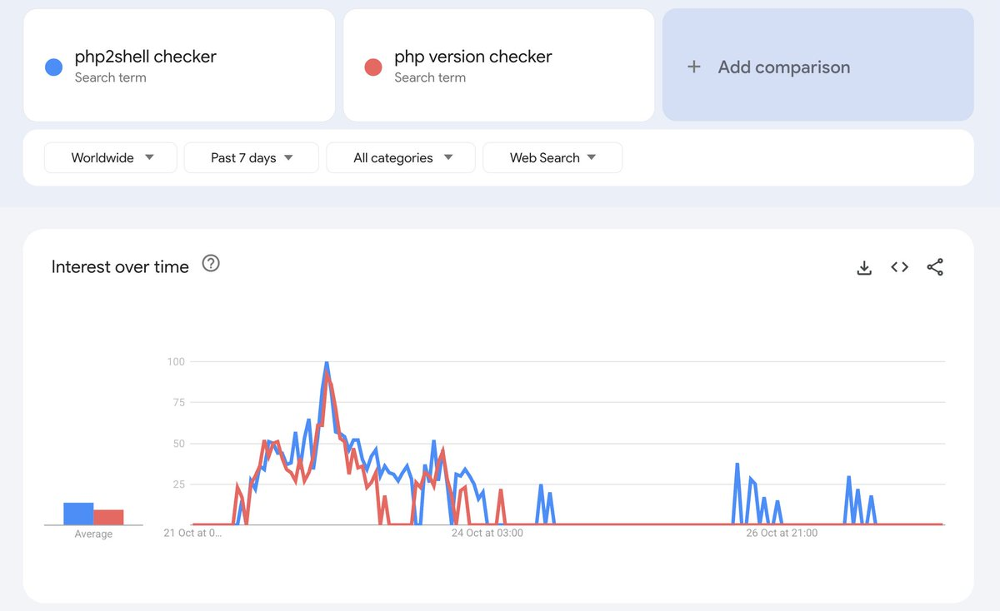

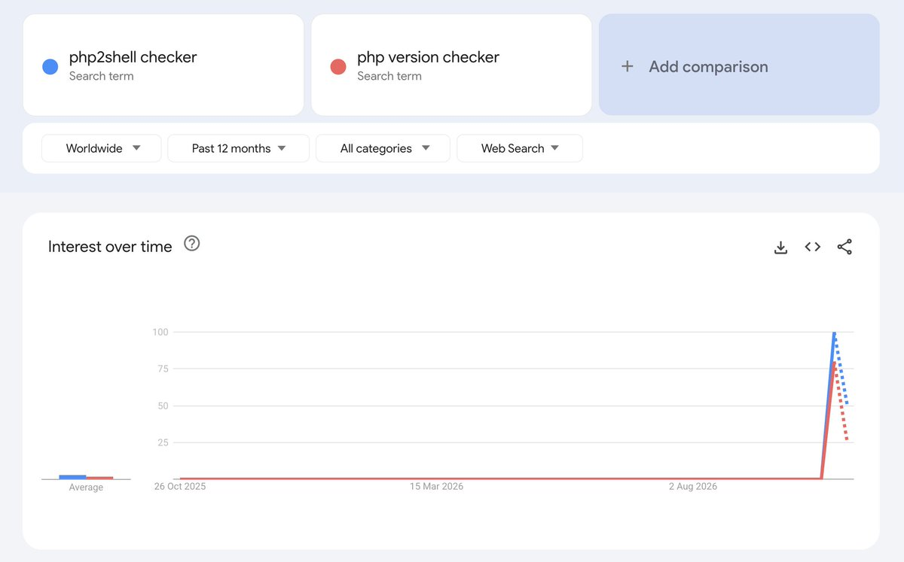

于是转去 Google 搜 php version checker。SERP 里基本都是大站的内页，没看到明显的新站机会，但排在前面的 webaloha.co 引起了我的注意。它不是那种一眼就认得出来的大品牌，这个位置怎么拿到的？

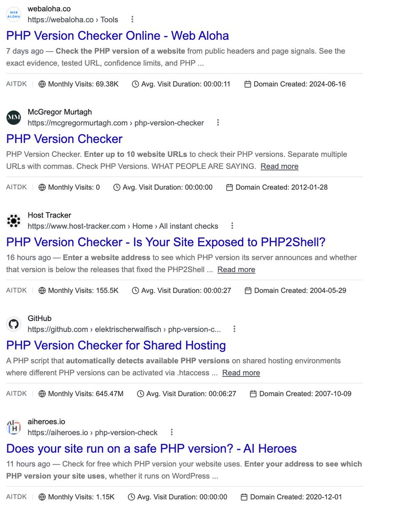

## 从一个 PHP 工具追到 Web Aloha

打开 [webaloha.co](https://webaloha.co/)，发现它是一家做网站设计、SEO、GEO 的 Agency。站点做得相当完整，工具、文章、服务、客户案例都有，内页大约 324 个。页面基础指标也都处理得很到位。

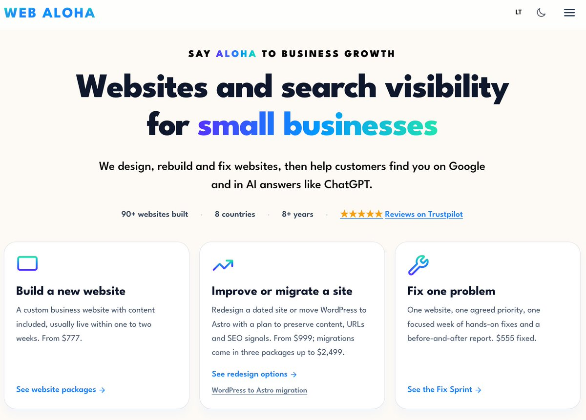

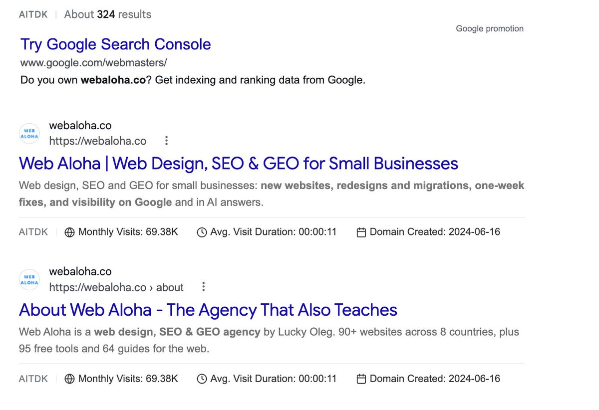

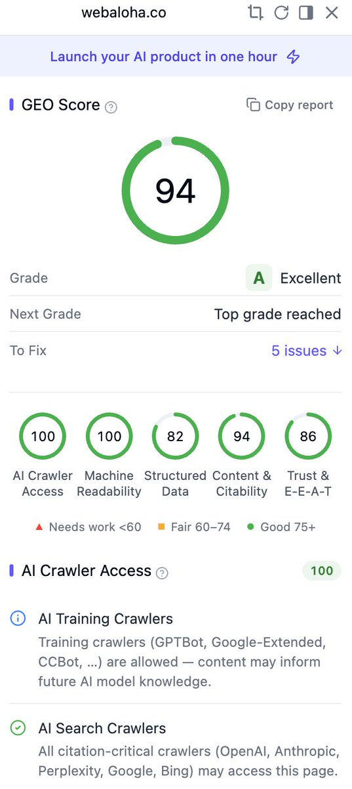

再看 Ahrefs。网站 DR 在 59 左右，自然搜索关键词约 695 个，已经不是一个靠运气起量的小站。最开始我还以为它是很短时间就把 DR 做到 50 多的新域名；往历史翻，2024 年 7 月它就已经有 DR 54。这个基础需要记住，后面研究页面增长，不能把它当成 DR 0 冷启动。

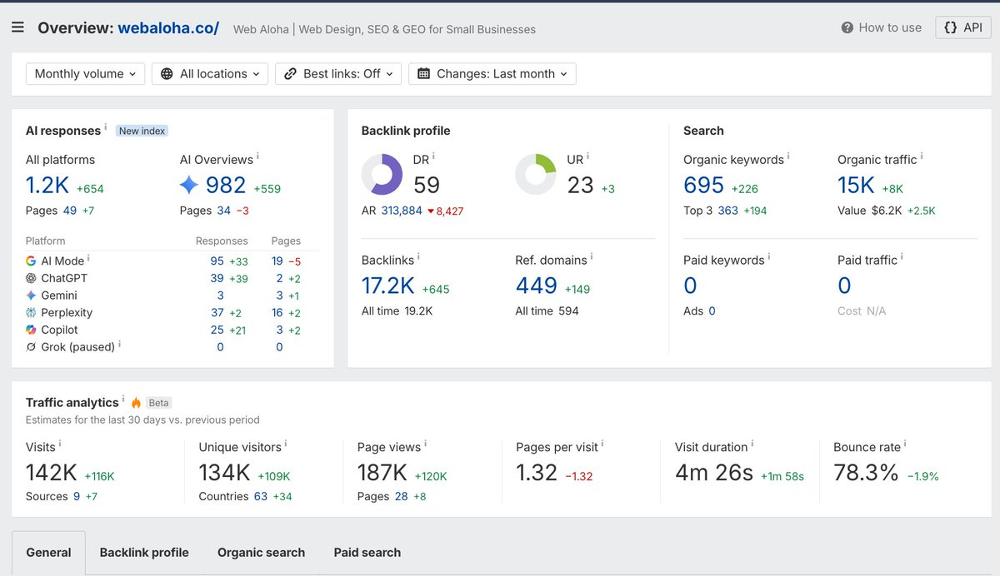

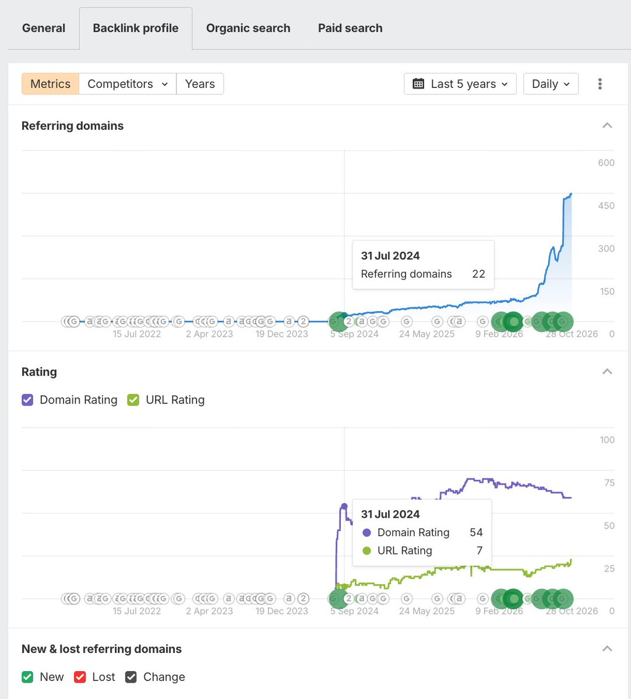

再看 AITDK 的历史访问量：2026 年 3 月约 1,717，4 月开始上升，到 9 月已经接近 7 万/月。这个增长斜率很明显。

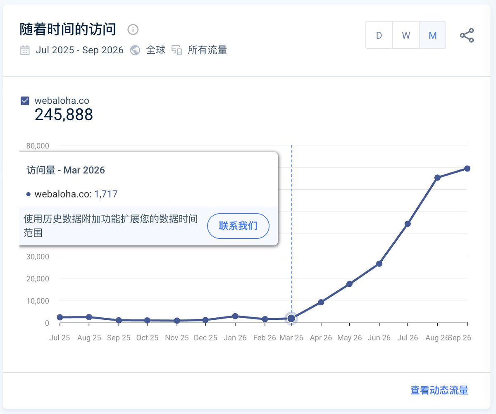

它一定做对了什么。

第一反应是研究今年春季的内容扩张。网站在 4 月几次集中发布 SEO 文章，工具数量也已经相当多。我猜它吃到了这一批工具词，再反哺品牌。网站整体的组织方式也值得学：工具解决具体任务，指南覆盖相关问题，原创研究提供独特数据，商业服务承接潜在客户。

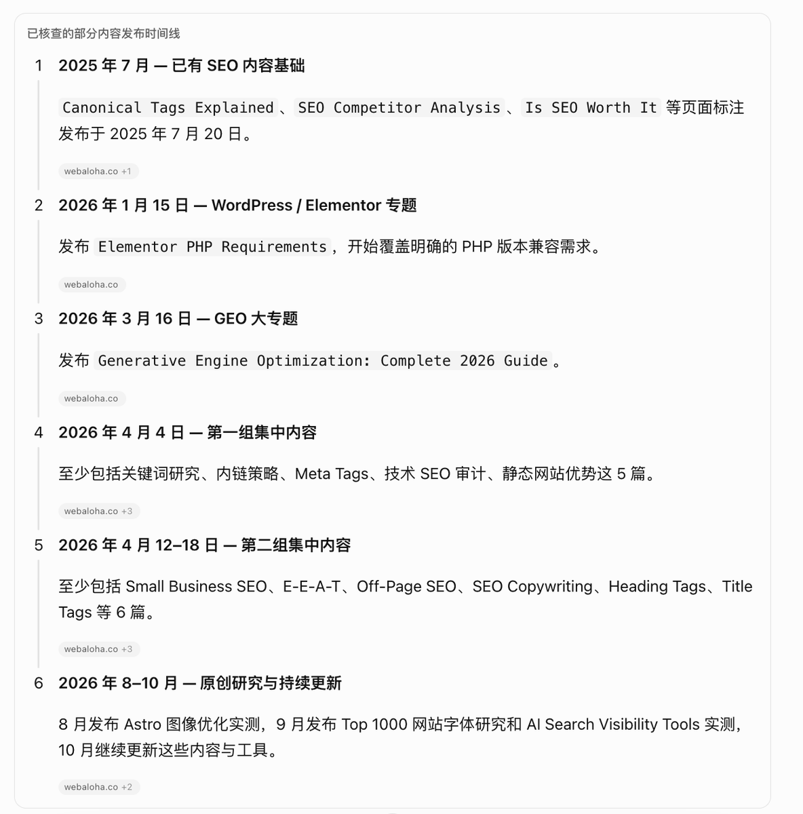

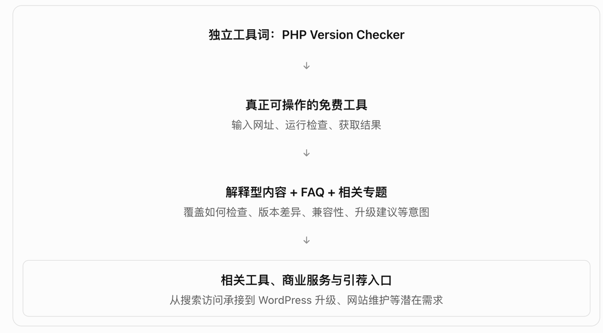

不过，判断它靠什么涨起来，不能停留在首页和内容目录。直接打开 Ahrefs 的 Organic search → Top pages。

## 95 个工具，最后却是一张页面拿走了 78.2%

结果很有意思。

10 月 28 日 Ahrefs 估算全站自然搜索流量约 15K/月，其中 [Website Font Checker](https://webaloha.co/tools/website-font-checker/) 单页就有 11,763，占 78.2%。第二名 Schema Markup Validator 只有 301，Website Technology Checker 284，最初把我们带进来的 PHP Version Checker 只有 275。

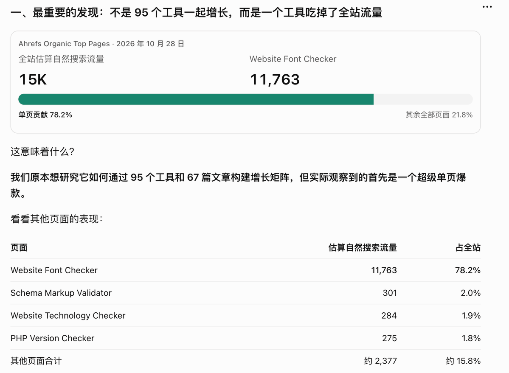

这就把刚才「工具矩阵一起带动增长」的想法改掉了。网站确实做了大量工具，但 Google 自然搜索的主要收益集中在一个 URL。

继续反查这个 URL 的 Organic Keywords。font identifier、font detector、find my font、font search、font finder，全部都是搜索量相当大的词。仅 font identifier 一个词，在全站关键词报告里就有约 4,432 估算流量；font detector 约 2,382，find my font 约 1,002。

而它的工具原本是输入一个网址，检测该网页声明了什么字体。这和从图片里识别字体并不是完全相同的任务。一个具体的 Website Font Checker，最后却在 font identifier / detector / finder 这些更宽泛的词上拿到了排名。

即使是 DR 50 以上的大站，找对一个工具词、正确上一个内页的 ROI，也是所有行为中最高的。

但这个页面不是上线就有 1.2 万流量的。接下来要把它的增长过程还原出来。

## 真正的流量拐点在 9 月，不是 10 月

把 Ahrefs 查询范围切到 Font Checker 单页，先看关键词数量。7 月 3 日，它在 Ahrefs 里只有 4 个排名关键词：1 个 Top 3、2 个 Top 4–10、1 个 Top 21–50。8 月下旬开始明显扩张，9 月进入持续增长，10 月的关键词覆盖更大。

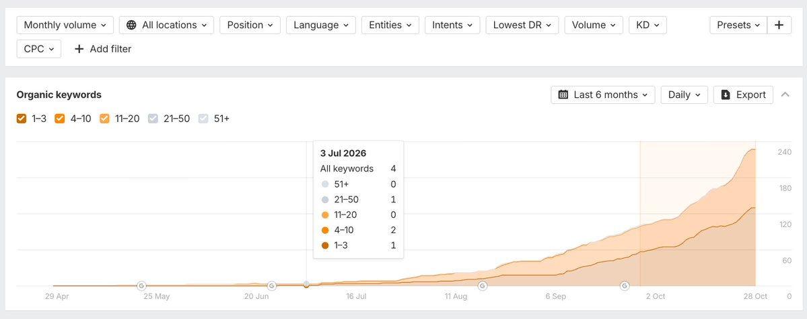

不过关键词变多，不等于流量真正起飞。再打开 Organic traffic by intent，这次才找到更准确的拐点。

9 月 3 日，图上 Informational 104、Commercial 6、Branded 4，合计只有 114 的估算月自然搜索流量。9 月 4 日前后突然跳到约 1,500，随后回撤；9 月 19 日前后又跳到两三千，中间再有波动。10 月上旬以后开始更稳定地往上爬，到下旬冲上约 1.2 万。

这样时间窗口就清楚了：8 月以前只有少量排名，9 月开始真正获得搜索流量。我们最关心的不是现在这张页面长什么样，而是起量前的 7–8 月做了什么。

打开 Ahrefs Page Inspect，直接比较历史文本。

## 7 月 27 日：先把老工具的内容重新做了一遍

在 Page Inspect 的历史日历里，8 月 2 日被标记为 Overhaul changes。拿 7 月 12 日的快照和 8 月 2 日比，页面自己的 Last updated 从 Mar 26, 2026 变成了 Jul 27, 2026。

这轮改动不是重新换词。H1 仍然是 Website Font Checker Tool Online，输入 URL、抓取 HTML/CSS、识别 Google Fonts、Adobe Fonts、自托管字体和系统字体的核心说明基本稳定。

真正变化的是页面下半部分。

Why Website Fonts Matter for Performance 原本只有比较简单的性能、CLS、隐私和可访问性说明。新版本把细节重新写了一遍：字体家族、字重和语言子集如何增加资源开销；回退字体的度量差异如何造成布局偏移；自托管字体为什么并不自动等于更快，还要考虑缓存、授权、子集化和分发。

Font Loading Best Practices 也是同样的处理。原来的建议比较绝对，新的内容加入了使用条件和技术权衡。不是机械地加字数，而是把技术事实写准、写深。

FAQ 变化更明显。原来是「这个工具做什么」「什么是 Font Stack」「免费吗」这些基础问题；新版本换成了更具体的技术问答：能否检测真正渲染的字体、最多检查多少 CSS 文件、为什么会漏掉字体、是否可能报告未实际使用的字体等。并不是单纯在原有十多个问题后面继续堆问答，而是把一部分泛问题替换成更贴近工具实际能力的问题。

上下文链接也收紧了。原来推荐的相关文章里有一些普通建站话题，改版后加入了更相关的 [How to Choose Fonts for Your Website](https://webaloha.co/how-to-choose-fonts-for-your-website/) 和 [Website Typography Guide](https://webaloha.co/website-typography-guide/)。这两个方向和字体检测几乎是同一个任务链条。商业入口则加入 Website Fix Sprint 等「检测完问题，直接有人帮你修」的承接方式。

第一轮改版的特征很明确：核心工具不动，重点补足技术内容、真实使用问题和垂直专题链接。

但还没完。继续把 8 月 2 日和 9 月 1 日放在一起对比，第二次改动更重要。

## 8 月 5 日：工具能力和搜索意图一起扩张

9 月 1 日的版本里，Last updated 已经变成 Aug 5, 2026。这一次不只是文案优化，工具本身也变了。

旧版主要是：输入网站 URL → 分析 HTML/CSS → 返回字体家族、权重、来源。

新版多了真实字体预览和可编辑的 Preview text。检测出字体之后，如果能匹配 Google Fonts 的开源字体，可以直接显示样本；用户还可以修改一段文字，看看它在该字体下的表现。工具输出也进一步描述了字号、字重、颜色、行高，以及 body / h1 / h2 / p / a / button 等元素的排版信息。

它从一个「告诉你这是什么字体」的检查工具，向「识别、查看效果、进一步分析怎么用」延伸了一步。

然后是一段非常关键的新增内容，H2 直接写：

> Find and Identify Fonts From Any Website

下面明确出现了 font detector、font finder、font identifier，并介绍字体家族、来源、字体栈、CSS 属性和可复制的样式信息。

这段 H2 就放在工具工作原理和字体最佳实践之间。原来的 Website Font Checker 定位没有放弃，却借着新功能把页面语义自然扩展到几个更大、更宽泛的词。不是为 font finder 单独再做一个内页，而是在原本有少量排名的 URL 上，继续向相邻需求进攻。

FAQ 又跟着产品变化：新增字体预览用不用目标网站的专有字体文件、能不能编辑预览文字、是否可以下载网站字体文件等问题。每个新增问答都对应具体的功能与使用边界。

网站导航也在这轮重组，工具分类从原来的四组调整为 SEO & Local、Crawl & Site Health、Performance & WordPress、AI & Site Intelligence 等。Font Checker 继续占据工具导航的位置。

我们现在看到的结果是：8 月初已经有了 Font Detector / Finder / Identifier 的语义和对应功能，9 月 4 日附近开始第一次明显起量。这组动作是整个案例里最值得学的部分。

## 9 月 27 日：流量已经起来，重点转向商业承接

再比较 9 月 1 日和 10 月 1 日，页面自标更新到了 Sep 27, 2026。

这一次，核心工具、Find and Identify Fonts 专题、字体预览和 FAQ 基本保留。明显增加的是商业组件：Portfolio、更多客户案例、See 19 client websites，以及面向 Freelancers & Agencies 的推荐合作。一次性项目给 10% 佣金、最低 $100；月度服务则是前六个月每月 10%。还有把检测结果发送给团队或通过邮件获取副本的入口。

这里的逻辑也很清楚。免费工具带来用户，用户检测到问题，接下来用服务、案例和推荐关系承接需求。只是 9 月 27 日已经晚于 9 月上旬和中旬的两次流量跃升，不能拿这次改版解释最初的起量。

三次改版连起来看，顺序很漂亮：7 月底重做技术内容与专题链接，8 月初升级功能并扩展大词语义，9 月底强化商业转化。

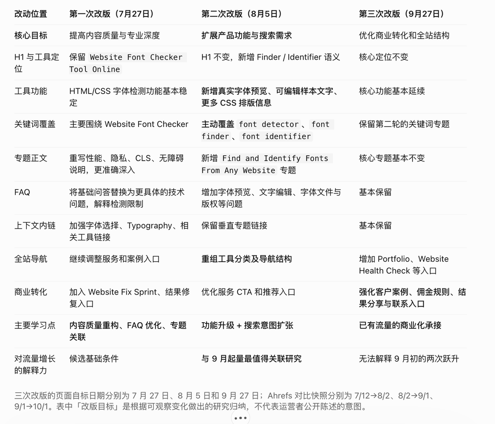

## 外链没有大动静，那 201 条内链呢？

到这里还差一个变量：外链。

把 Referring Domains 图拉出来看，Font Checker 7–8 月一直是 0 个直接引荐域名，9 月初第一轮流量跃升时也是 0。9 月上旬稍后 Ahrefs 才首次记录到 1 个；到 10 月下旬也只有 2 个。与此同时，域名 DR 约 59，单页 UR 长时间只有 6 左右。

也就是说，这个内页并没有伴随增长获得一批明显的直接外链。那会不会是内链集中倾斜？

再查 Internal links → Incoming，Ahrefs 一共列出 201 条。我们把前两页的 200 条都导出来按 First seen 重新统计：其中 183 条在 7 月 27 日之前就已首次发现，8 月首次发现的只有 1 条。大多数用的是统一锚文本 Font Checker，显然大量来自网站导航或公共模块。

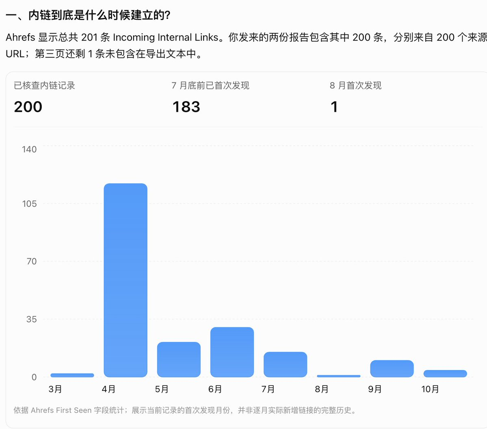

这个结果也很有意思。我们本来怀疑 8 月会不会突然给核心页加了很多内链，事实并不是这样。站内支持早就存在：光首页在 4 月就被发现有指向 Font Checker 的链接，首页本身还有 400 多个引荐域名。

真正值得注意的只有 7 月 30 日前后两条高度相关的内容链接：字体选择指南和网站 Typography 指南都链接到 Font Checker；而 Font Checker 的 8 月快照中也出现了指向这两篇文章的相关链接。这是少量但更聚焦的专题关联，而不是一次大规模内链灌注。

所以，到 7 月初，这张页面已经拥有相当多的内链和一个 DR 50 多的域名基础，却仍然只有极少量关键词排名。7 月底到 8 月初，两轮改版把技术内容、FAQ、专题链接、工具功能和相邻大词一起做了上去；9 月才真正开始获得流量。

我们原先怀疑它靠大量加内页、加外链或堆站内链接起飞。一路反查下来，最值得注意的反而是：那些基础早就有了，真正发生在流量拐点之前的，是对一张已经上线、已有初始排名的工具页连续两次深入改造。

## 相关页面

- [[patterns/long-tail-reverse-eating-main-keyword]]
- [[patterns/ai-automated-internal-link-seo]]
- [[patterns/competitor-research-four-step]]
- [[sources/gefei-game-site-vs-tool-site-roi]]
