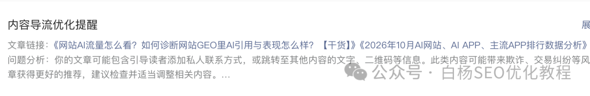
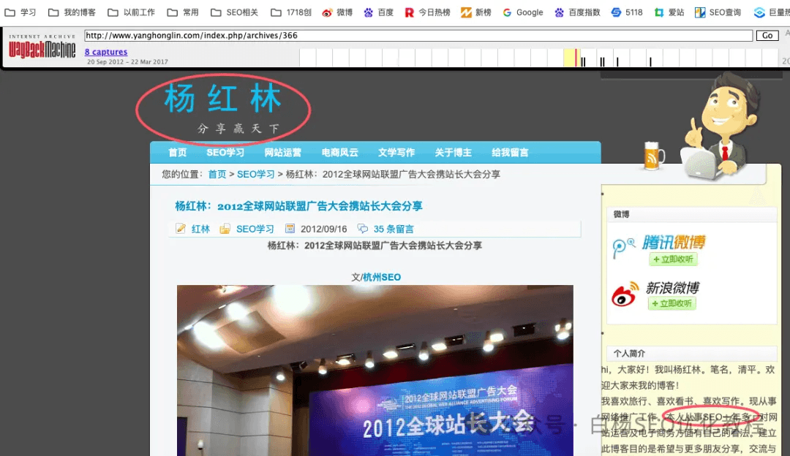
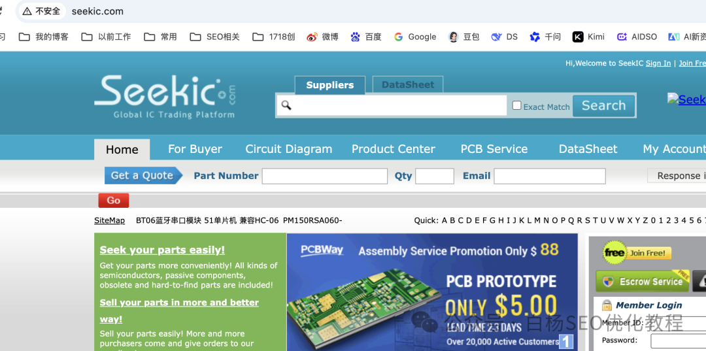

# 流量在平台，钱在出海里

大家好，我是白杨 SEO

为什么说流量在平台，钱在出海里呢？

下面就来说说看到的和个人观点，仅供参考。

流量在平台，这里有两层意思：

一层是指流量都在平台手里，要去研究平台规则搞流量；

另一层是指流量在平台手里，要建立品牌，拥有自己的渠道。

先说说国内流量变化，

哪里有流量？流量就像【集市】，线下农村的每月固定那些些赶集天，城里的什么商业中心，节假或周末就很多人流，还有比如像某某展会，国内国外一样，也会聚集流量。

上面说的是线下人流量，来说说线上人流量在哪？

搜索引擎未诞生之前在各种论坛里，在四大门户里。然后搜索引擎诞生后，国内搜索就以百度为首，流量主要去到搜索里了。

有人会说，电商，游戏，影市的流量没从搜索来，真的吗？在他们把自己打造成平台之前，都从搜索里买流量，比如分直接或间接罢了。

移动互联网兴起，腾讯率先靠微信拿到第一张移动互联网船票。从那时起，流量入口就不再只是搜索引擎了。

移动互联网，流量分割，各 APP 成孤岛，以百度为首的搜索引擎再难抓取其它平台信息。

再后来短视频平台为代表的抖音崛起，以年轻人真实分享生活的小红书起来。

用户去哪里，搞流量就去哪里。

最近这两年，国内以豆包为首的 AI 工具崛起，传统搜索引擎的流量江河日下。并且，还有更大的问题是人口流量红利的消失。

前几年，我们去各个平台做流量，因为平台本身需要拉更多创作者或者商家企业，所以规则相对较松，甚至有时睁一只眼，闭一只眼。

只要你了解平台规则，懂搜索流量玩法，搞到流量还是轻松的，不管你是用矩阵还是做单账号。比如有人听到过“某某霸屏”、“郑州帮”，甚至 AI 投毒之类。

现在呢？都在存量里竞争，所以各平台搞流量严了、买流量贵了

上面流量都在平台里的第二层意思，我举个例子大家就清楚了。

前几个月，一直做流量生意的盘石崩盘了。十四年前的九月，我第一次参加全球站长大会就是这个盘石他们搞的，那时我还没白杨 SEO 这个网名，用自己本名参加的。

为什么呢？

这个曾经号称与百度联盟、阿里妈妈联盟的盘石网盟三大联盟的公司，曾经也以为自己掌握了流量，殊不知，一直都没有自己的流量壁垒。

最开始盘石是百度网盟代理，靠百度流量，后面自建了网盟，说是有很多中小企业网站流量。但用户进入了移动互联网，用户进入 APP 和短视频，流量就转向微信，抖音，小红书为主了。

据说他们又向微信、抖音买流量，其实就是流量中间商。当然最本质肯定不是做中间商倒的，而是做了重资产数字产业园。

回过来说，流量现在依旧还是在平台手里。不管国内还是国外。

只是有个区别就是，国内现在搞流量和做生意卖产品一样，也是极度卷。哪怕现在最新的这个 AI 搜索推广 GEO 一样。

白杨 SEO 说为什么流量在平台里，我们要建立自己品牌，要把渠道拿到自己手里？

因为有品牌才有议价权，有自己渠道，不管是老带新还是什么，才不会把自己的命脉完全交在别人手里。

对于企业来说，什么才是自己的渠道，你的官网就是很好的一个。而你在某某平台的店铺，某某平台的账号并不是！

在 AI 时代，做好自己的官网更重要。看我写过的以下 2 篇：

钱在出海里，什么意思？

钱在出海里，白杨 SEO 说可以指三个方面。

1. 同样是赚一块钱，如果后缀是美元，那至少是 6 倍；

2. 同样是赚一块钱，哪怕是美元，但投入成本没有国内的 6 倍；

3. 不管是品牌方还是服务方，都比在国内卷要好一些。

白杨 SEO 其实最开始进入互联网做的就是出海相关的，不过我是做销售的。

我在《采访白杨 SEO，从职场小白到运营总监经历和感悟》提到我 2011 年进第一家互联网公司维库，我最开始做的是 SEEKIC 平台电话销售，最开始了解的搜索引擎排名原理的是谷歌。

后面进入 SEO 做的是这些平台的外链建设，开始自学 SEO，虽然没有花过钱，但有英英师傅引进门，同事分享交流，后面还有整个公司 SEO 负责人洪师兄指导，成长还是算快的。

2015-2017 年近三年间，带团队做日本市场流量，B2B、B2C 平台，甚至开店运营都做。

从 2018 年开始写本公众号来，因为职业回归国内市场，所以建了付费 SEO 圈交流群、知识星球，现在很多人以为白杨 SEO 只是做国内市场 SEO 的，甚至我自己也这样认为了，哈哈哈。

其实，这些年我从来没有放弃过海外 SEO 和社媒等，只是更多是以企业顾问的方式在做，也在跟进平台的变化。

出海赚钱，搞海外流量已经是一个趋势了！

就像我在一个别的群看到有个人说，在国内搞就像在什么垃圾找 XXX，我本想反驳下，算了，大家能自我判断。

当然，我这边说钱在出海里更有机会，并不代表白杨 SEO 国内市场的流量也完全不搞了，该做会做，该分享继续。

就像有人说国内根本没有什么 GEO 之类，全是骗子之类，我是完全不认同的。

不能因为自己做什么，就完全否定别人做什么不行，

没有深入，没有付费过，就不要乱发言，说爆论容易，小心回旋镖到自己身上，对不对？

也不喜欢国内为了流量互踩这种营销方式，杀敌一千，自损八百，何必呢？

好了，今天这篇二千多字，没分享什么搞流量干货，只是说一下感受。你有不同看法或建议，欢迎在评论区交流。

## 相关页面

- [[concepts/overseas-tool-stack]]
- [[patterns/overseas-website-conversion-loop]]
- [[concepts/selfmedia-compound-model]]
