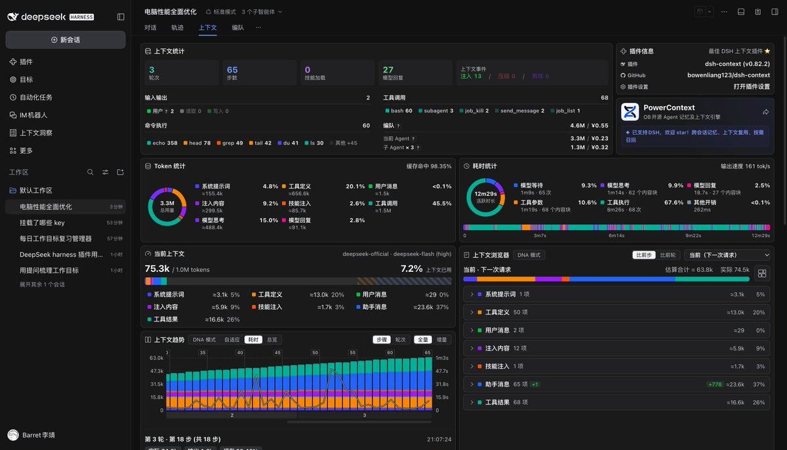
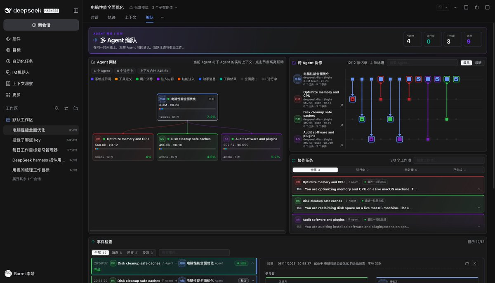

# Barret 李靖（@Barret_China）：Agent 时代的 Debug——从 Function Profiling 走向 Decision Profiling

> 以 DeepSeek Harness 的 Context 与 Agent-Team 两个插件为观察样本，指出 Agent as a Service 正在成为常态，调试 Agent 将成高频操作——执行太慢、效果太差、太费钱、同样的任务每次路径不同都成了需要 Debug 的问题；Agent 时代的调试关注点会从 Function Profiling 扩展到 Decision Profiling，即从 Context、决策条件与执行状态多角度还原执行过程。面向单 Session 的调试应支持在决策节点暂停、改条件、Fork 出不同路径再用 Replay 与 Evaluation 比较结果；面向 Agent 系统则需从大量执行轨迹中找出反复出现的低效决策、无效探索与失败模式，反过来改进 Context 组织、工具设计、执行策略乃至整个 Harness 架构。

<!-- more -->

比较推荐 DeepSeek Harness 的 Context 和 Agent-Team 两个插件，信息呈现和交互体验都做得相当不错。这俩插件结合起来，可以看清楚 Agent 执行过程的全貌，也让我意识到，AI 时代程序员的 Debug 基本功依然是一项有门槛的技能。

以前线上出了问题，如果不好复现，或者日志太少，我们会想办法 Attach 到线上的进程，通过断点调试，观察程序的执行状态、变量和调用路径，逐步定位问题。

现在 Agent as a Service 正在成为常态，调试 Agent 也将成为一项高频操作。例如，执行太慢了、效果太差了、太费钱了，甚至同样的任务每次执行路径都不一样，这些都会成为需要被 Debug 的问题。

Agent 时代的 Debug，关注点会逐渐从 Function Profiling 扩展到 Decision Profiling。从这俩插件的设计中就很容易感受到，调试工具正在尝试从 Context、决策条件和执行状态等多个角度，还原 Agent 的整个执行过程。

面向单个 Session 的调试，好用的 Debugger 应该支持在某个决策节点暂停、修改条件、Fork 出不同的执行路径，再通过 Replay 和 Evaluation 比较结果。

而对于 Agent 系统的调试，则需要从大量 Agent 的执行轨迹中，找到那些反复出现的低效决策、无效探索和失败模式，再反过来改进 Context 的组织方式、工具设计、执行策略，甚至整个 Harness 的架构。

这也是一项复杂且重要的工程。

## 相关页面

- [[sources/deepseek-harness-plugin-first-agent-runtime]]
- [[sources/dsh-complete-guide]]
- [[concepts/harness-engineering]]
- [[concepts/agent-autonomous-pipeline]]
