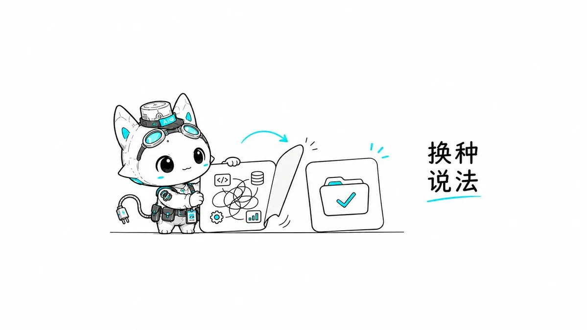
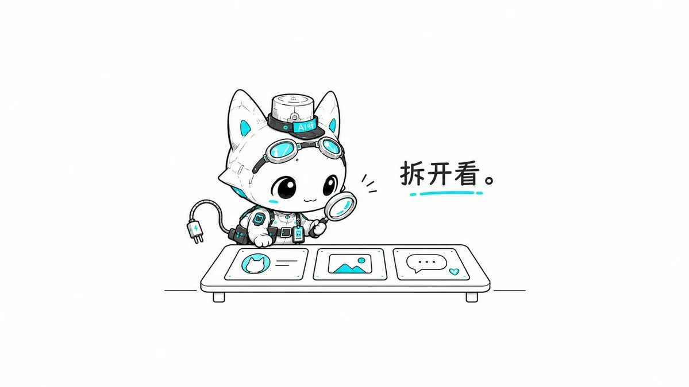
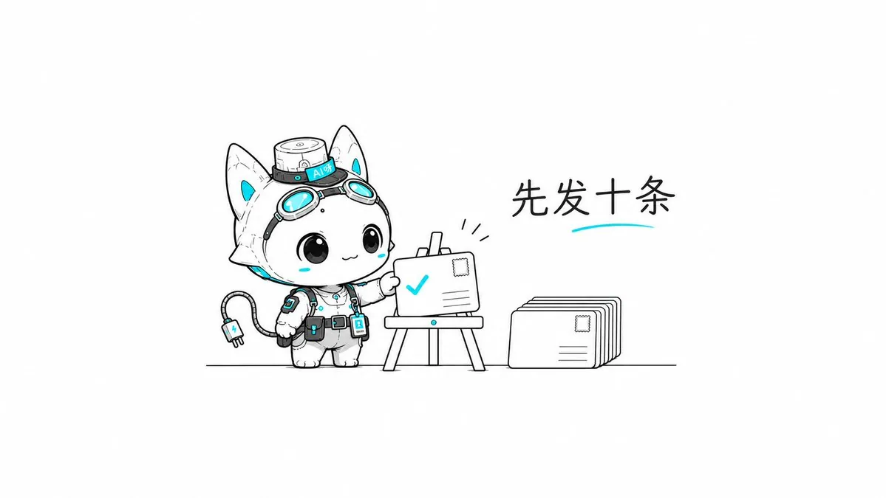
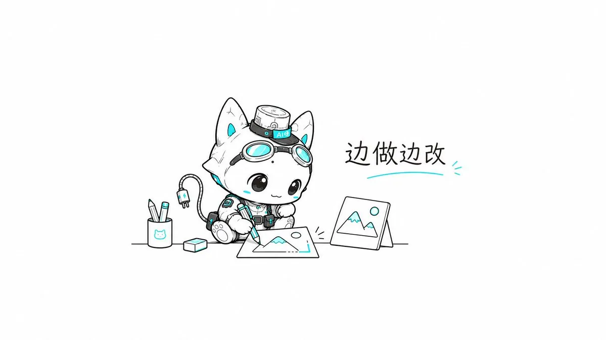
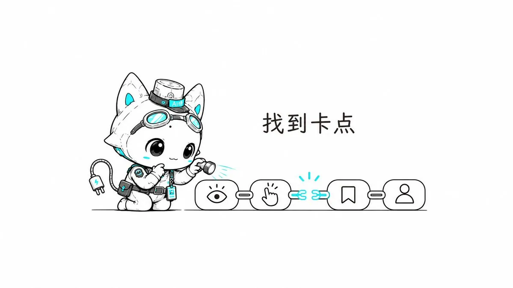
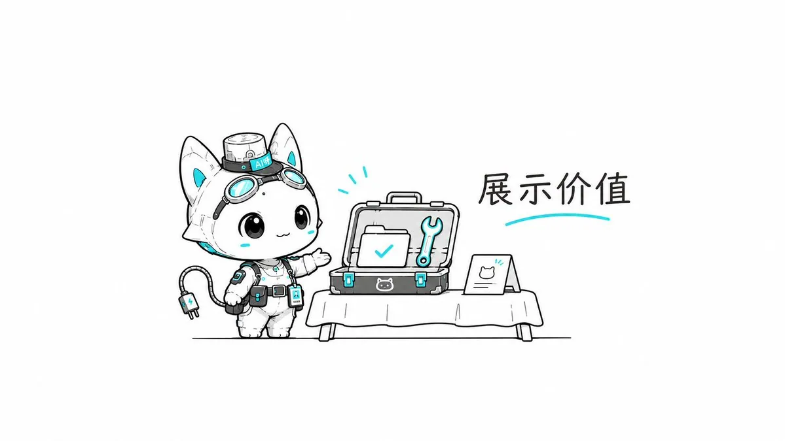
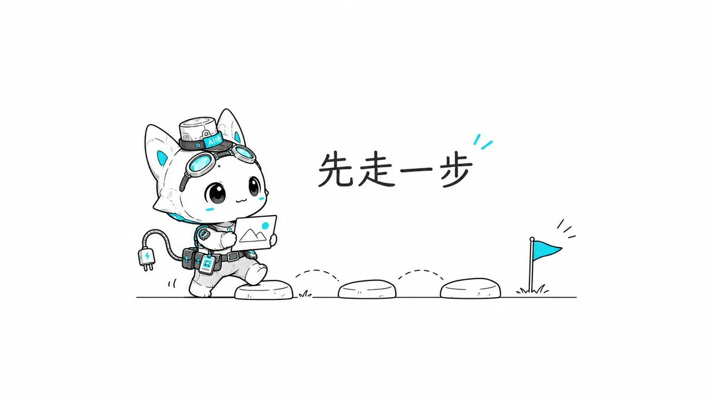

# 小晚不在（@bbkirstry）：小红书起号保姆级教程——从 0 开始找对标，坚持出摊、商业化

> 从 0 起步的小红书起号完整教程：如何找对标账号并拆解它们的内容与选题、如何设计自己的差异化定位、如何坚持稳定出摊（更新频率与内容配比）、以及起号后的商业化路径与常见误区。

<!-- more -->

我相信，哪怕再过三年，依然会有小白睁着无辜的大眼睛问我：

“小晚老师，自媒体到底怎么开始做啊？”

合着网上那么多教程，你是一篇都不看吗！！！

但这也合理吧。

因为一个完全没有做过内容的人，可能根本看不懂那些教程到底在教什么。

什么定位、对标、选题、钩子、完播率……

你连一条好的内容究竟好在哪里都不知道，又怎么知道自己该学什么？

有些朋友在 X 上已经有几千甚至几万粉丝，内容能力也不错，到了小红书、抖音却依然找不到头绪。

发工具、发资讯、发教程，积累了很多粉丝，换个平台生态之后也会不知道怎么更好地做下去。

我自己今年 6 月开始更新个人账号，一条 Codex 超小白教程带来了 1 万多粉丝，后来累计获得 20 万左右的赞藏。

从去年 5 月开始陆续帮助身边朋友做过内容策划，有朋友一条笔记从 100 涨粉到 8000，一跃成为 AI 博主签约 MCN，一些群友也一个月涨粉近一万。

所以今天，我想以一个有 8 年品牌内容营销、IP 策划经验的内容人视角，跟大家分享一套比较简单、可以直接对照操作的小红书起号方法。

不管你是 0 粉，还是已经有几千、几万粉丝，都可以用这套方法，直接实操上手，开始更新、运营小红书，并且初步进入商业化。

本文略长，如果没有耐心看完可以先收藏码住，也可以直接丢给 AI

后续我也会继续更新什么是好内容的标准、如何做出好的内容质感、拆解优质的社媒博主、做内容的技巧和运营策略，希望能帮到大家🍻

## 01｜首先，搞清楚小红书到底是什么平台

我之前写过一篇长文，拆解小红书、抖音和 Twitter 三个平台的区别：https://x.com/bbkirstry/status/2106604723738710380?a=zCXdtUh-IFf5zkQmQZo&s=20

如果一句话概括我对小红书的理解：

它是一个偏女性用户、小而美、重视精致感与真实体验的搜索种草、生活经验分享平台。

我觉得在这个平台做好内容，至少要理解两个核心要点。

第一，审美和质感。

这里的审美不只是封面漂不漂亮、视频拍得是否高级，还包括你说话的方式、表达的情绪、画面的干净程度，以及整个账号给人的感觉。

小红书有一种很微妙的精致。

有些人拍得很随意，但画面舒服、讲话自然、情绪饱满，带着一种恰到好处的松弛感。

你会觉得这个人很会生活、很会表达，甚至很会跟人相处。

这是一种潜在的质感。

但这不意味着你必须要把自己包装成精致的博主。，你完全可以很幽默、很抽象、很有个性，但需要学会考虑：别人看见你的内容时会有什么感受。

第二，内容到底有没有价值。

这里说的价值非常广泛。

一手资讯、实用教程、经验分享、独特观点、认知刷新，以及审美、创意、情绪价值，全部都算。

有人关注你，是因为你的教程好用；有人是觉得你的审美特别好；也有人觉得你很会思考、很有趣，愿意听你继续讲话。

你至少得有一些能够让别人产生兴趣的东西。

所以如果你是一个习惯在 X 上分享 Skill、开源项目或者 Agent 工作流的技术人，来到小红书，一定要警惕一个问题：

你以为大家都知道的东西，他们可能根本不知道。

你在 X 发一个配置架构，圈内人一眼就知道含金量。但小红书上的普通用户，可能连 Skill 是什么都不知道。

所以你得换一种说法。

别一上来就“构建多 Agent 自动化协作系统”，不如先告诉大家：

“我让 AI 帮我自动整理了一周的工作文件。”

你还可以拍视频，展示操作效果，再一步一步教他们怎么做。

同样一项专业能力，换到另一个平台，需要调整的可能是选题表达的切入点、语言、画面和解释程度。

我觉得 AI 领域其实特别适合做这样的延伸。

AI+办公、AI+设计、AI+美学、AI+创意、AI+商业化、AI+生活方式……

你擅长的东西完全可以进入不同场景。

重点是，这个东西能不能用平台上的人需要、愿意听的方式表达出来。

如果你本来就拥有顶级的创意、审美或者极强的内容能力，优秀作品跨平台也很容易获得很好的反馈。

但大部分人，还是得先学会适应平台。

💡本章的实操思路：

找一条自己想发的内容，找一个完全不懂这个领域的朋友，问他：

- 他能看懂标题和正文吗？
- 知道学会了有什么用吗？
- 看完能得到什么？

如果答案不清楚，先把表达改明白。

## 02｜找 5—10 个对标，看看优秀的账号到底长什么样

我一直觉得，新手特别容易犯一个错误：

还不知道什么叫好内容，就已经开始闭门造车了。

所以不管你是纯小白，还是准备从 X 转到国内社媒的创作者，我都建议先找 5—10 个已经做得不错的账号。

可以优先看看 1 万—5 万粉丝左右，与你想做的方向比较接近的博主。

不要上来就研究百万大 V，因为他们绝对已经拥有非常成熟的粉丝基础、内容团队和资源，你未必能直接复制他现在的玩法。

而一些已经跑通起号、内容又比较成熟的中小博主，反而更方便我们研究和学习。

找到以后，千万别只是收藏！

请你认真地、尽可能细颗粒度地拆解他们。

我通常会看三个地方：

① 账号主页

头像、昵称、简介是什么风格？

他怎么介绍自己？这里可以拆成职业、专业领域、履历和成绩...

置顶内容是什么？你点进去的前 30s 秒钟，能不能快速知道他是谁、擅长什么、他以后会发什么？为什么值得你关注？

比如一个 AI 设计博主，简介可能就包含：

AI×设计｜X 年经验的设计师｜做过什么项目、拿过什么奖项｜持续分享什么内容。

去学的这套信息结构，然后把自己的真实经历填进去。

② 内容和视觉

封面是什么构图？标题放在哪里？使用 l 什么字体、色调和视觉元素？图文怎么分栏？视频开头怎么讲、怎样配演示画面、剪辑节奏怎么样？

尤其小红书的双列信息流，单独看一张封面觉得很好看，缩小到首页以后，效果可能完全不一样。

主体是不是太小？文字会不会挤成一团？一眼能不能看见重点？

另外，我之前也建议大家尽量让主页保持视觉一致性。

比如固定字体、主色调、版式，或者持续出现一个原创 IP。

我曾经用 30%—50%的视觉重复度来帮助群友理解这个概念，这只是一个模糊的比例。

只要让用户连续翻几页你的主页作品的时候，能帮助你快速形成辨识度就好了。

还有一个小技巧：

封面大字和发布标题尽量提供不同的信息。

比如封面写“不会编程，也能让电脑自己干活？”

发布标题就可以补充“Codex 新手教程｜手把手教你用 AI 整理电脑文件”。

封面负责吸引注意力，标题解释具体价值，也可以自然包含用户会搜索的关键词。

两个信息位置，不要重复同一句话。

③ 评论区和内容反馈

这个地方我特别建议你们多研究！！！

用户在讨论什么？为什么点赞、收藏？有没有人追问具体操作？哪些内容明显比平时表现好？

你看得多了，会慢慢感受到这个账号的用户真正喜欢什么。

如果你本来就是 X 上的成熟创作者，我还有一个建议：

找那些已经在不同平台都有一定成绩的同类博主，对比他在 X 和小红书分别怎么做。

同一个选题是如何重新制作的？

内容形式、口吻、封面、更新频率有哪些变化？

然后结合自己的时间、能力和资源，判断哪些东西可以学习。

注意啊！

像素级拆解，不等于像素级抄袭。

你可以学习别人的构图、信息层级、表达方式，但别直接拿人家的设计换几个字，就当成自己的作品了。

💡本章的实操思路：

找 5 个对标，每个账号尽可能详细地拆解记录这 3 个维度：

他是怎么介绍自己的？哪种内容做得最好？有什么是你现在就能学着做的？

然后先把自己的头像、简介和封面调整一版。

## 03｜账号搭好了，先发十条再说！

好，平台了解了，对标也看过了。

下一步呢？

发啊！！！

我知道很多人到这里又开始纠结：

应该做什么赛道？定位会不会太宽？

未来靠什么赚钱？能不能形成商业闭环？

够了🫷我建议你先别想那么远。

有些信息在你真正开始发布、获得反馈以后才会出现，你怎么可能提前把所有事情规划完整？

如果完全没有方向，可以先从三类内容开始。

- 第一类：资讯、信息与观点。

比如新工具、新产品、新功能、行业动态，以及你最近看到的一些有意思的判断。

AI 领域更新很快，特别适合。

但不要只是把 X 上的英文资讯翻译一遍，就觉得自己完成了内容创作。

至少告诉大家：这是什么？有什么用？适合谁？

- 第二类：实操和教程。

比如你今天用 Codex 做了一套 PPT、用 AI 设计了一张图，或者解决了工作里的某个麻烦。就把这个过程整理出来，告诉大家怎样操作、哪里容易出问题、最后得到了什么结果。

小红书有很强的搜索属性，所以我特别建议做教程之前，先去搜索一下用户平时会怎么提问。

比如“AI 做 PPT”“Codex 做 PPT 教程”“AI 自动生成工作汇报”。

看看搜索联想、相关笔记，以及评论区里大家反复问的问题。把这些真实的需求放进选题，再在标题和正文里自然使用相关关键词。

不要机械地堆词，重点还是让别人搜到以后，真的能解决问题。

- 第三类：真实经验、案例和复盘。

你做过的项目、作品、失败经历、最近刚刚搞明白的一件事，都可以分享。

我尤其建议希望做个人 IP 的朋友，多尝试这种内容。

因为这些经验来自你自己的生活和实践，不需要每天等着别人发布新工具。

如果你还是不知道第一条怎么做，那就选一件自己最近已经完成的事情。

先展示结果，再讲清楚过程，最后补充其中最容易踩坑的地方。

如果不愿意露脸，可以先做图文、录屏教程；如果觉得自己写作不好，甚至可以先像跟朋友聊天一样，把想讲的话录下来，再整理成稿子。

我自己就很喜欢口述。

因为很多时候，你真实讲话时的表达和情绪，比坐下来硬憋一篇标准文章自然得多。

AI 可以帮你整理，但别把自己那些有趣的口头禅、真实经历和情绪全部洗掉。

另外，AI 博主还要注意一个问题：使用 AI 生成或合成内容时，应当按照平台现行规则如实标识。不要拿 AI 生成的虚假效果冒充真实体验，也不要洗稿、伪造案例或未经授权使用他人素材。

前十条的目标，就是先找到一点创作手感。

💡本章的实操思路：

从三类内容里选一个自己最熟悉的方向，先列出十个具体的选题。

每次只解决一个问题，能图文就图文，适合演示就录屏，需要表达就拍视频。先把第一条发出来。

## 04｜边发边学，慢慢培养自己的内容手感

我觉得这一章特别重要。

很多人找完对标、做完第一条内容，就开始闷头创作。

发出去数据不好，又不知道应该改哪里。

但其实，你完全可以在每一次创作过程中，继续学习那些已经做得很好的人。

举个例子。

假设你今天准备做《如何用 Codex 制作 PPT》的教程。

我会建议你从三个方向研究：

① 同需求

看看其他 AI 工具制作 PPT 的教程，别人怎样展示最终效果、怎样组织操作步骤。

② 同工具、同任务

看看其他 Codex 做 PPT 的内容，为什么他的数据更好？

是选题的切入点更巧妙？标题更容易理解？还是教程真的讲得更清楚？

③ 同工具、不同任务

看看别人用 Codex 教 Excel、整理文件等其他职场技能时，怎样把复杂操作解释给普通人。

尤其去看看评论区，用户到底在哪里有问题，还在问什么。

你看，这样研究一圈，再回来制作自己的内容，是不是突然就有思路了？

做完封面，可以和优秀案例放在一起比较。

缩小到手机屏幕上，标题还清楚吗？

第一眼看到的重心是什么？好不好理解？

主体会不会太大？

文字有没有挤在一起？配色和留白舒服吗？

视频也是一样。

自己完整看一遍，哪里拖沓、哪里没解释清楚、有没有不必要的气口和停顿？BGM 会不会抢走注意力？是不是需要补充操作画面？

我自己做访谈和教程时，会特别在意信息密度和观看节奏。

但也不是让你把所有停顿都剪光。

有些停顿本身就是人物的情绪和反应，删掉反而不好看。

所以你需要慢慢去感受：

一条好的内容，到底是什么地方做得好？哪些细节让你觉得特别舒服？

我以前做品牌内容也是这样，看到好的创意、设计和文案，会下意识研究它到底为什么成立，以及能不能把其中的方法用到自己的作品里。

这个过程其实就是在培养你的审美、表达和内容判断力。

AI 可以帮你做图、写稿、剪辑、排版，但如果你自己连一个结果好不好怎么评估都不知道，又怎么判断 AI 交出来的东西到底能不能发？

💡本章的实操思路：

发布之前，找 3 条同类优秀内容。

分别学习一个选题或标题方法、一个视觉或表达细节、一个内容组织方式。

改完再发，每次争取比上一条进步一点就行。

## 05｜发完十条，学会复盘，找到长期更新的抓手

假设你已经发了十条内容。

接下来可以把它们放在一起，看看哪几条表现比较好。

思考一下：为什么它数据好？哪个数据指标更好？这背后有什么原因？

是刚好踩中了一个热门工具或讨论话题，还是这个需求本来就很普遍？是你的封面特别吸引人，还是你真的把事情讲得很清楚？

再去看看评论区：

用户到底被什么打动了？

有没有人因为这条内容关注你？

他们还在问什么新的问题？

如果后台可以看到搜索来源，也可以检查哪些内容在发布一段时间后，仍然能够通过搜索带来用户。

数据可以证明用户做出了什么反应，但你还需要结合内容、趋势和反馈，判断结果为什么出现。

我之前帮一个朋友分析过类似的问题。

他做了一条工具推荐，点赞、收藏都不错，却没有带来多少新粉丝。于是他问我，是不是不应该继续做这种内容？

我就很奇怪呀。

你现在遇到的问题，是这条内容有人看却不涨粉。

为什么第一反应是放弃这个选题？

我们不是应该先研究，别人为什么没有关注你吗？

可能用户只需要这一个工具信息，也可能是你的主页没有更多相关内容，让他不知道关注以后还能得到什么？

所以我特别建议大家，把一条内容从发布到产生结果的过程拆开分析：

- 曝光少，先检查发布状态、选题和分发情况。
- 有人看到却不点开，检查封面、标题和用户相关性。
- 有人看完、收藏，却没有关注，继续检查主页和长期可关注的价值。
- 有粉丝但是没有商业机会，再去研究受众、信任和产品。

诊断方向之后，继续验证具体原因。

不要把所有问题都归结成“平台不给流量”。

那如果你已经有几千粉丝，还是找不到长期方向呢？

这可能是很多从 X 转到小红书的创作者，正在遇到的问题。已经知道怎么发教程、推荐工具、分享资讯，也有了一批粉丝，但总觉得没有抓手。

我觉得这时候可以先把过去的二三十条内容拿出来，分开看。

- 哪些内容主要依靠热点和外部资讯获得流量？
- 哪些内容来自你自己的实际项目、专业经验和独立判断？
- 哪些内容既有用户需求，你自己又愿意一直研究、持续分享？

比如你原本只是一个分享各种 AI 工具的博主。

做着做着，发现自己很喜欢研究 AI 怎样帮助独立创作者提高工作效率。

那这个方向就可以继续延伸出工具测评、真实案例、教程、工作流程，以及你自己不断更新的判断。

工具每个月都在更新，但你长期研究的主线可以一直延续。

当然，如果你本来就想做资讯号，而且能够长期提供稳定、可靠、高质量的信息，那也完全可以。

重点是找到你擅长、用户需要，而且自己能够持续生产的东西。

这才是下一阶段真正值得投入的方向。

💡本章的实操思路：

- 新手看最近 10 条，有内容积累的创作者看最近 20—30 条；
- 找出反馈最好的 3 条、自己最愿意持续做的 3 类主题，再看看有没有重合的方向；
- 下一轮继续做几条验证，不断迭代拖后腿的因素。

## 06｜关于商业化：你到底准备让账号为你带来什么？

很多人聊到商业化，就开始研究多少粉丝能接广告、品牌商单报价多少、什么时候可以卖课。

但我想先问一句：

你到底想通过这个账号获得什么？

对于大多数个人创作者，可以先理解两条主要路径。

第一条，品牌商单。

如果你希望品牌找你合作，那就得研究品牌为什么愿意为你的内容付费。

可能因为你的受众精准、画面质感好，也可能是你特别擅长讲解产品，能够把一个工具或者商品的价值，清楚地传递给目标用户。

比如你想做 AI 工具类商单。

那平时就可以有意识地打磨工具测评、产品演示、视频口播和视觉包装。

让品牌看到，你确实有能力把一款产品介绍得清楚、有趣，而且符合他们希望触达的用户群体。

第二条，个人产品和专业服务。

比如咨询、课程、付费社群、设计服务或者专业项目合作。

这条路径更依赖别人对你实际能力的理解和信任。

- 你是设计师，就通过作品证明审美和专业能力。
- 你做 AI 工作流，就展示自己真正解决过哪些问题。
- 如果你提供咨询，就通过真实经验和案例，让别人知道你擅长判断什么、能帮助他解决什么。

我上一篇写过一句话：

你有价值，不等于别人认为你有价值。

做内容，很大一部分工作就是把你的价值变成用户能够看见、理解和相信的东西。

这也是为什么我觉得做内容的人，多少都需要有一点销售思维。

但这不意味着每条内容都得卖东西。

你可以先认真分享自己的经验、作品和判断，让别人逐渐认识你。

至于商业合作，等真正出现需求，再结合自己的能力和目标去选择。

不用把 1000 粉、1 万粉当成所有商业化方式的统一门槛。

不同业务、不同账号、不同用户群体，商业机会完全不一样。

💡本章的实操思路：

想清楚自己更希望获得品牌商单，还是销售个人产品与服务。

然后回头看看最近十条内容，有没有真正展示对应的能力和价值。

如果没有，下一轮就有意识地补充。

## 写在最后

看完你会发现，这里面好像没有什么神乎其神的爆款秘诀。

是的，因为对于一个刚开始做自媒体的人来说，最初需要完成的事情，本来就没有那么复杂。

先理解平台，去看看优秀的创作者在做什么。

找几个对标，把自己能够学习的部分拆出来。

搭好账号，先发十条，一边做一边观察、修改。

再从数据、用户反馈和自己的真实体验里，找到值得继续做下去的方向。

对于已经有几千甚至几万粉丝的朋友，也可以重新检查自己到底卡在哪里。尤其是跨平台创作，别忘了适应新的用户和内容环境。

我以前还说过一句话：

在发够 100 条之前，你我都还只是在互联网的岸边。

这不是说发够 100 条一定能火，也不是要求每个人都得完成 100 条任务。

而是希望大家不要在连第一批真实反馈都还没有拿到的时候，就着急给自己下结论。

而且，坚持出摊真的很难啊！！！

你会遇到工作太忙、状态不好、没有灵感、数据不理想的时候，也会忍不住觉得自己现在做的东西怎么这么烂。

但我觉得，先完成、再慢慢变好，本来就是很正常的学习过程。

今年六月，我只是想把自己刚学会的 Codex 分享给身边的朋友，没想到一条教程后来让我认识了那么多原本生活中不会遇见的人，也带来了新的交流、合作和机会。

有时候你真的不知道，自己哪一段看似普通的经验，对别人来说可能特别有用。

所以先别想那么多了。

一部手机，一件你想告诉别人的事情。

试着把它讲清楚，然后发出去。

我们先完成第一条，剩下的边做边学。

——

我是 @小晚不在 🙋

AI 时代的内容营销践行者

更多内容欢迎移步主页

我的思考助手 skill「赛博小晚」：https://github.com/cyberxiaowan/cyber-xiaowan

我的长图文排版 skill：https://github.com/cyberxiaowan/xiaowan-wechat-layout-skill

所有内容仅为个人经验与观点分享，感谢阅读！

## 相关页面

- [[sources/jessicao-xiaohongshu-0-to-1-operations-guide]]
- [[sources/hytidel-xiaohongshu-ecommerce-operations-and-10x-scaling]]
- [[concepts/selfmedia-compound-model]]
- [[concepts/xhs-product-selection]]
