# 冰河（@binghe）：Codex 插件 AI-Canvas 全能无限画布终极版发布

> 为 Codex 配备的无限画布插件 AI-Canvas 终极版：支持画布选区局部重绘与指哪改哪、多图多元素图层拖拽编排、提示词多版本对比与历史溯源，解决在纯文本聊天窗口中反复确认生图细节的痛点。开源仓库：binghe1980/AI-Canvas。

<!-- more -->

前不久，我发布了一个 Codex 插件：AI-Canvas，主要功能就是为 Codex 配上无限画布功能，指哪改哪功能！（初始版）

这个插件的灵感来自推特博主：钟二信

我是利用他发的视频，倒推出来了插件设计逻辑，并且认出无限画布使用的是开源的 tldraw，但我没有抄袭博主的代码，完全按自己的思考重新架构了这个插件！（6 月 20 号那天，他还没有发布他的插件 Cowart）

再次感谢钟二信提供的思路和指导！当天 我用了五个小时就复刻出来了。

有图有真相！

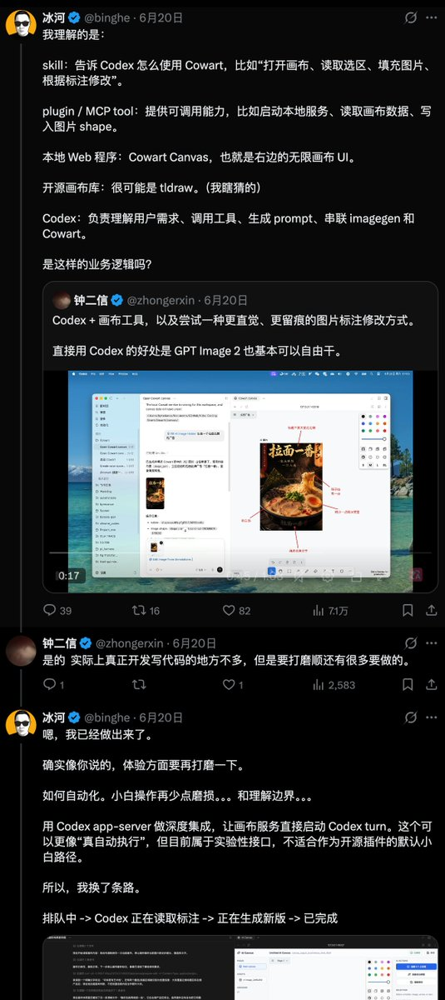

做出来后，其实我和大多数人一个想法：

为什么要做个画布？用图画板，或打开 excalidraw 网站也可以做标注，再回传给 Codex 来做修图啊！

它的意义在哪里？

其实很多人忽视了一个无限画布最大的扩展性：

它可以用来做电商套图，产品详情页，短剧分镜（9 宫格，或 12 宫格），亚马逊套图，UGC 宣传图等！

如果只拿来改个图，那真是暴殄天物！

为此我做了以下的升级：

1，你可外部生图，导入画布，进行二次编辑（省 Codex 的 Token）

2，画布调用 Skill 生成各场景下的配图及业务类套图，与我们工作业务相关。

3，可选 Web API 代理，AI Canvas 调我们的代理服务，我们再调用外部生图服务。（正在开发中）

为此我做了六个 Skill 工作流在其中：

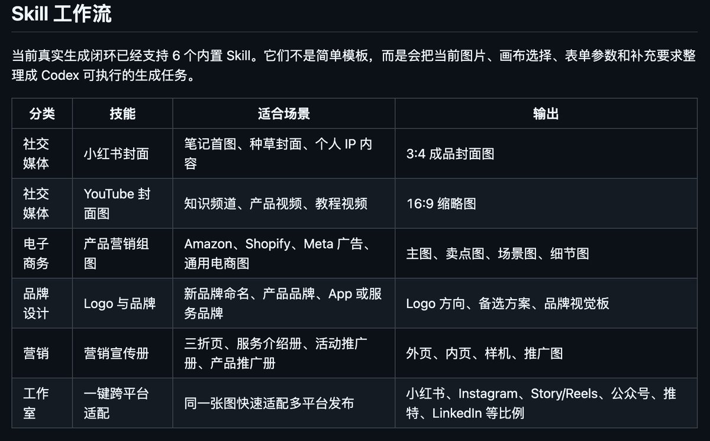

这六个常用图片场景基本可以满足你 95% 的生图需求！

而操作起来却非常的简单！

首先，请你先让 Codex 或 Claude Code 帮你安装 AI-Canvas 插件！

方法如下：

第一步：打开 Codex 或 Claude Code，新建对话（建议不要在项目内，新开普通对话窗口）

```
说：帮我安装这个插件，网址是 https://github.com/binghe1980/AI-Canvas
```

然后静等安装结束！

第二步：输入：@AI Canvas 打开 AI 画布

然后等待打开服务，点击里面的链接，侧边栏会自动打开

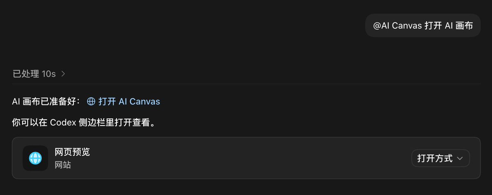

侧边栏即我们的工作区！

这时为了方便操作，你可以隐藏 Codex 侧边栏，或全屏，这样画布展示页更大！

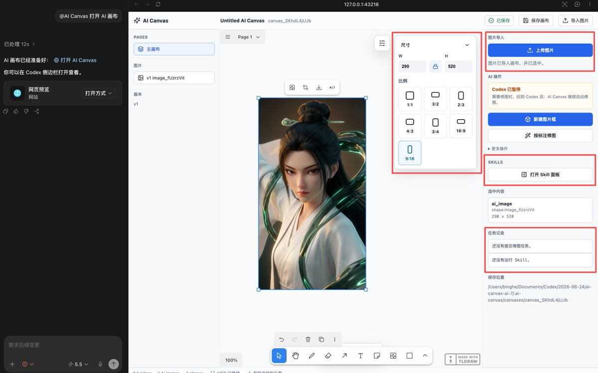

上图中，请注意红框几个区域

1，尺寸区，点击任意比例即可改变图片尺寸，但这时只是图片的展示尺寸有变化，而不是图真的已经自适应地变到那个尺寸。需要到时让 Codex 转成对应尺寸的正常比例。

2，上传图片，这里你可以自行上传本机内的图片，也可以拖拽式的拉入一张图片。

3，Skill 画板，有些 Skill 比如小红书，YouTube 封面图两个用图场景，需要你点击图片后，再打开 skill 面板开始操作，还有一些，比如下图：

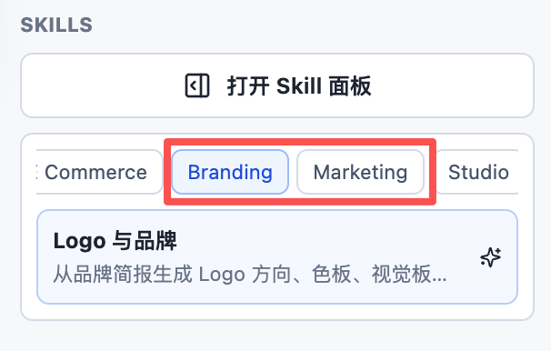

你不用点击图片，也可以使用，就是因为需要你提供需求才生成图片的逻辑。

不用担心了，到时你使用时自然就知道我说的注意细节了！

4，任务记录区，这里是你在完成了 Skill 一系列的操作后，会有个“提交给 Codex 生成”的按钮时，产生的状态内容。


状态内容是给 Codex 看的，你只要知道这里已经有内容了，就可以回到和 Codex 的对话框里，让它执行 Skill 了，上图中给到了你提示，比如输入：AI Canvas 继续处理 Skill

经我自己测试，直接说：处理 Skill！

其实就行了！

然后坐等出图！

嗯，完了，就是这么简单！

不过每个 Skill 对应的内容属性是不同的，这里有我自己的从业经验，因为自己做了 20 年电商了，所以里面的电商类配图还有各营销配图，设计和尺寸逻辑我都懂。

无偿写入了这套 Skill 机制里了！

接下来，我们看一下具体的 Skill 实操的界面概况：

小红书封面：

选中一张图片，进入 Social Media 分类，选择 小红书封面。填写内容类型、主标题、标题风格、标题位置和必须保留的元素后提交。结果会直出包含字体、配色、版式和中文标题的完整 3:4 封面图。

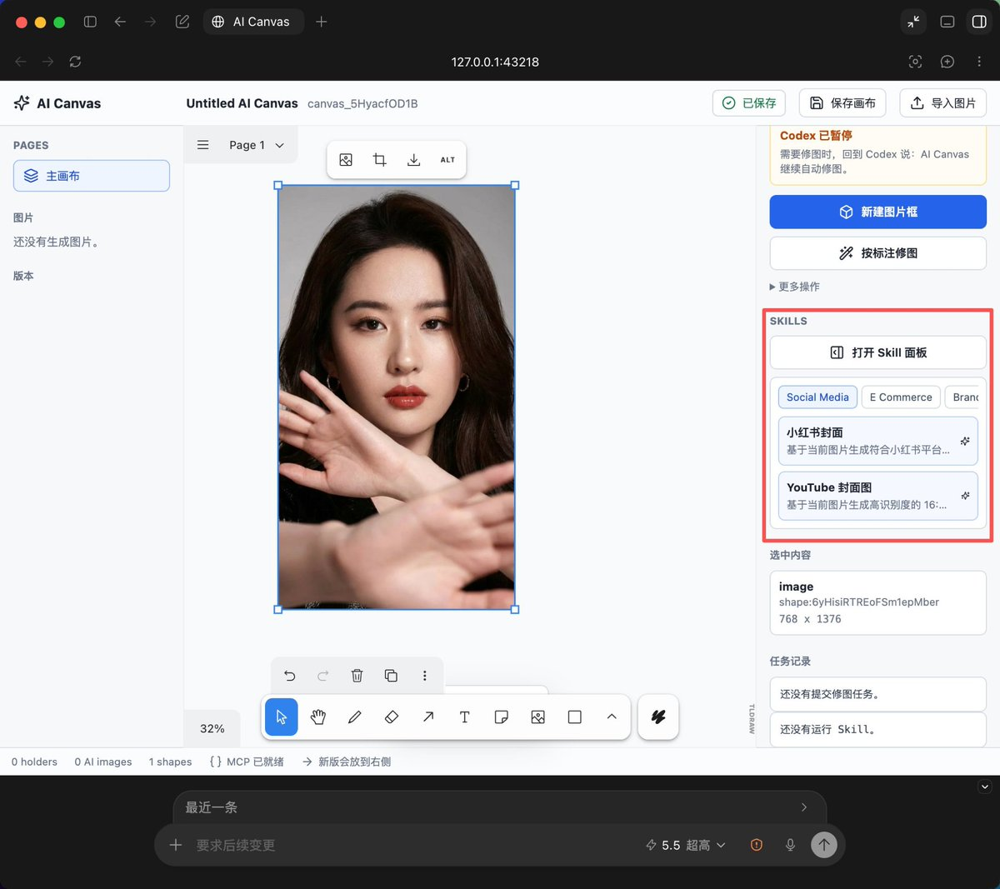

YouTube 封面图

选中图片后选择 YouTube 封面图。输入视频主题、大标题、目标观众、缩略图风格、标题位置和保留重点，Codex 会生成更适合 16:9 展示的高识别度缩略图。

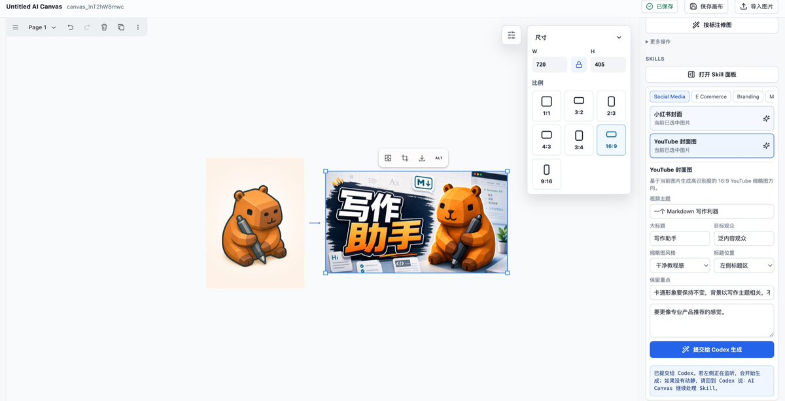

产品营销组图

在 E Commerce 分类选择 产品营销组图。可按 Amazon 商品页 / A+、Shopify / 独立站、Meta 广告、Google 展示广告或通用电商套图生成多张物料，适合把一张产品图扩展成完整销售视觉。

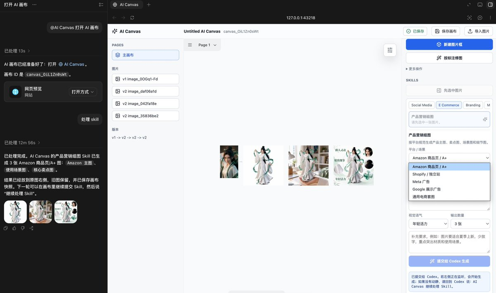

Logo 与品牌

在 Branding 分类选择 Logo 与品牌。填写品牌名、行业、目标受众、定位差异点、品牌人格、Logo 风格和使用场景，Codex 会生成 Logo 概念、备选方向和品牌视觉板。

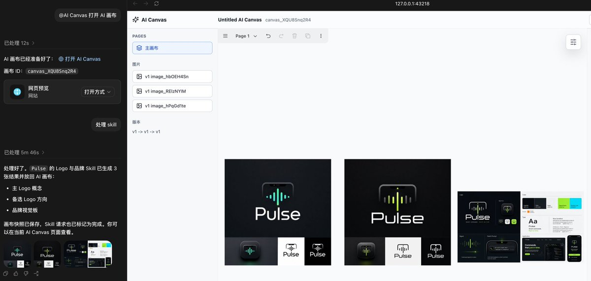

营销宣传册

在 Marketing 分类选择 营销宣传册。支持三折页宣传册、服务介绍册、活动推广册、产品推广册，适合把活动、课程、服务或产品说明整理成可展示的多页营销物料。

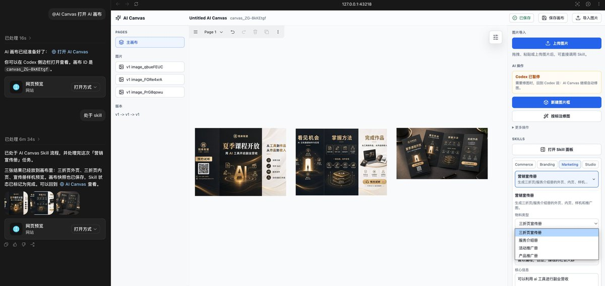

一键跨平台适配

在 Studio 分类选择 一键跨平台适配。选择发布平台、内容类型、文字处理、必须保留元素和背景策略后，Codex 会按平台比例、安全区和展示场景重构图片。

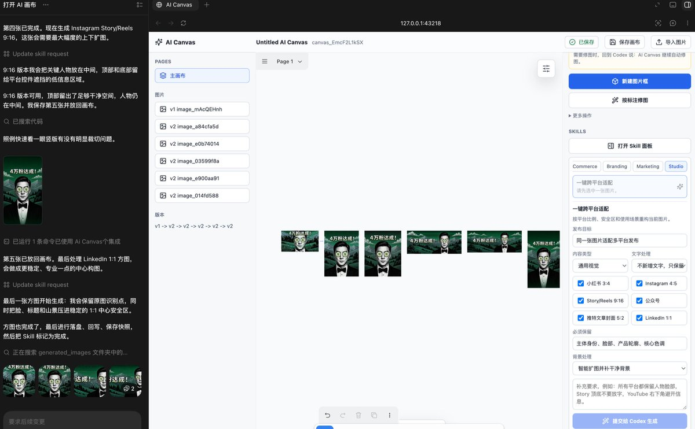

这套无限画布的实用场景展示完毕，我想已经把 Lovart 作图部分的全部功能基本复刻完成！

上面内容全是原创行为！请大家使用，或二开的时候，记得遵守 MIT 协议！

在此也要公开向钟二信表示感谢，画布第一版灵感来源此博主，感谢博主的无私分享精神，所以我也将把这项目开源造福各位朋友！

愿我们不断学习，永不停止！感谢各位的阅读！

冰河敬上！

## 相关页面

- [[sources/codex-excalidraw-whiteboard-video]]
- [[sources/canghe-codex-obsidian-wechat-workflow]]
- [[concepts/codex-app]]
