# 冰河（@binghe）：公众号排版工具 Skill V2.0——从写完到发布双 Skill 联动

> 公众号排版工作室 Skill V2.0 实践沉淀：写稿与排版发布双 Skill 协同，支持 Markdown 源码直出公众号格式、自动化配图对齐与样式预置，附百度网盘资源链接。

<!-- more -->

本 Skill 免费分享，感谢大家的支持，一个小工具而已，如果能给大家提供些便利就是我的荣幸！

下载链接地址在评论区里，要一个浏览量不过分吧？哈哈哈，正篇开始！

上次发布的公众号排版工作室 Skill V1.0 得到了大家的使用反馈，表示还不错，我心里还是很欢喜。

本来是为了方便自己制作的小工具，能让大家在写作上面节省点时间这也算是功德一件。

不过也有同学提出来，功能太简单，如果能加上图片样式就好了。

是的！这个建议很正确，其实第一版就应该加入的，但因为填加图片时的样式一直出现问题，而且在公众号编辑器使用时容易样式丢失，没调教好就没放出来。

说句题外话，公众号的编辑器真的挺难用的！在调取外部资源的方面也控制的非常严格。

没关系，经过几次调整和我实际使用后，感觉这版终于可以拿出来给大家用了。上个版本，请查看：

引用推文：冰河 (@binghe)

这次 V2.0 版本的操作过程，不会直接告诉大家如何用，我们用多个 Skill 联动一下，完整的跑一次流程，以后可能你们的写作场景就要换一下啦。

第一步：把排版 Skill 2.0 : mp-article-studio.zip （别点这个，这不是下载链接）解压缩，放到 Claude code 全局 Skills 目录里，因为以后会经常用就放全局吧！

第二步：老规矩在电脑的其它地方，先新建一个文件夹，当成是文件存储位置！然后在本文件夹位置打开 Claude Code

MAC 用户：在文件夹上右键→ 新建于位置终端窗口

Windows 用户： 在该文件夹空白处右键 → 在终端中打开，输入：claude

这次我们不直接调用 skill 了，先写个小文章吧，还记的我们以前的写公众号的 skill 吗？

这个公众号写作 Skill 最全网功能最帖心、功能最全面、最懂你的！没有之一！

如果你安装了，直接在终端里呼唤神龙吧！

没看过这公众号写作 Skill 的文章的请移步：

引用推文：冰河 (@binghe)

简单点，直接在 CC（Claude Code 缩写，后面就 CC 代替了）里输入：我要写公众号文章！

它会自动调取我们的公众号写作 Skill

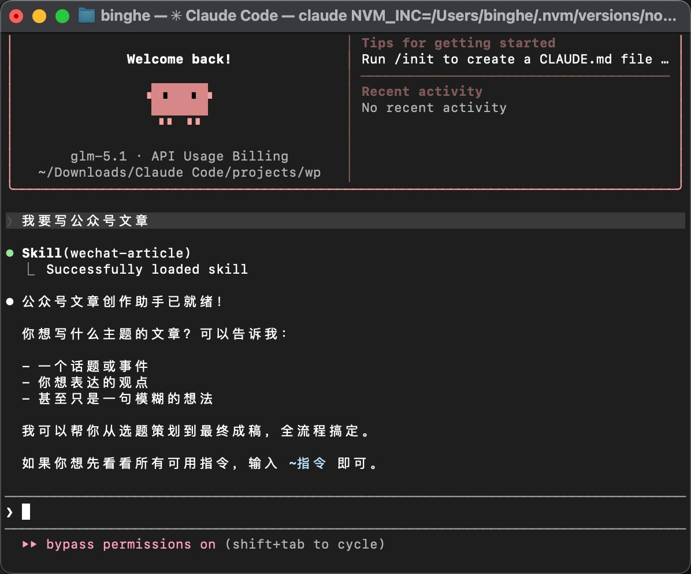

这个 Skill 很强大，也很全面是我们多年的经验沉淀，你们自己看上面的文章研究去吧。

这里我只是用来做简单演示，就不做全过程演练了。随便让他写篇文章。

我直接输入一句模糊的想法：我想写一篇关于“如何无痛自律”的文章！

然后交给公众号写作助手，开始忙活吧！

当然，根据我们以前的设置，他肯定要问你一些问题，不然上来就写的是假把式，不科学嘛！

经过几轮的调研和你喜欢的写作风格（这个可以模仿风格也可以投喂语料写的像你），先整一篇文章尝尝咸淡！

记的实际你们生产环境下，要看一下文章大纲，和情绪逻辑这类的细节，因为好的文章都能写，但能打动人心的文章需要你的耐心和手动润色！

写作调研的这个过程，我就省略了！你们知道的太多，我还得灭口！

注：Opus 4.6 写的非常好，Sonnet 的其次，然后是 Gemini ，GLM，最差的是 ChatGPT 它把功能全用在写代码上了，AI 味很重！自行参考！

写完后，一般会保存在当前项目目录下 output/article_无痛自律.md

再在 cc 里输入：“~标题”随便选一个作为文章标题！默认是 10 个，你去 output/titles_无痛自律.md 这里可以看到所有标题！

我选择了一个标题：「每天只做 5 个深蹲的人，比跑 5 公里的人自律多了」-- 反直觉，勾好奇心

写完后，我们就要排版啦！

直接输入：我要排版！

他会自动找到我们最新的公众号排版 Skill ，并且自动弹出中控台！

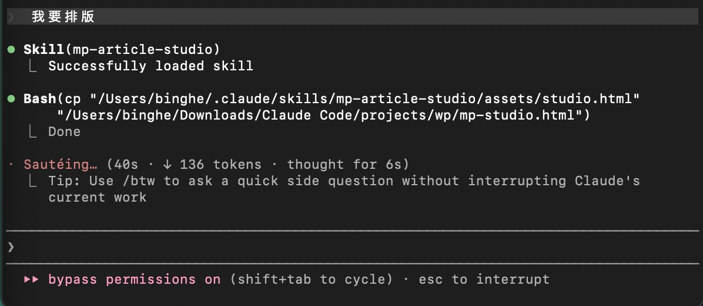

如果中控台没有你的文章内容（因为默认的是样例内容），你可以直接让 CC 把文章内容直接填进去。

并且要求它按内容做好排版设计，再替换原有内容。如下图：

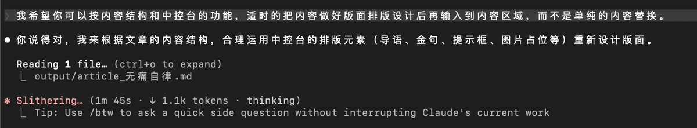

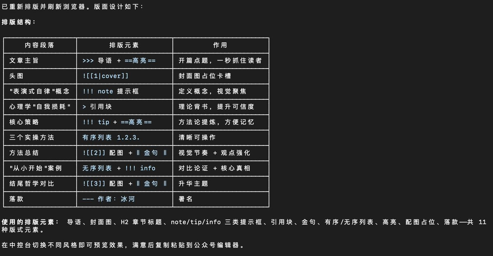

如果你的大模型不那么聪明的话，你就自己去把文章全文复制，再回到中控台手动粘贴也行啦！只是不优雅还需要自己手动调节嘛。哈哈哈。

如下图，文章内容自动进来啦！还做了一些他认为的排版设计！我们可以在这个基础上精修一下！少了很多自己干的步骤！

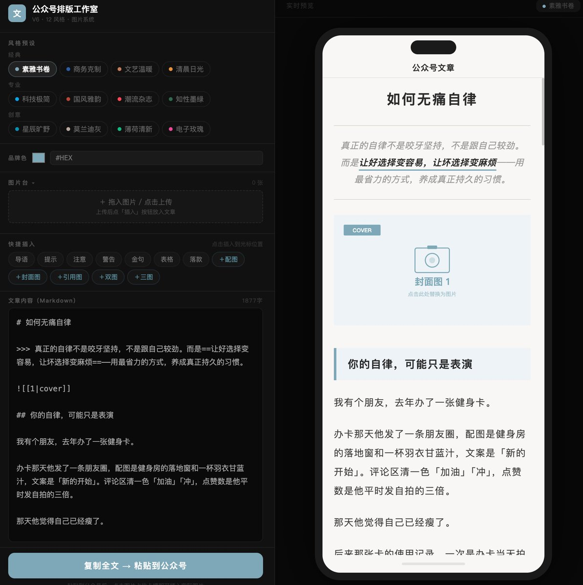

接下来，我就要测试一下新功能啦，以前的文字，品牌色，12 个风格样式，我就不说了。

只看图片样式！

控制台关于图片上传和快捷插入里有了一些新变化

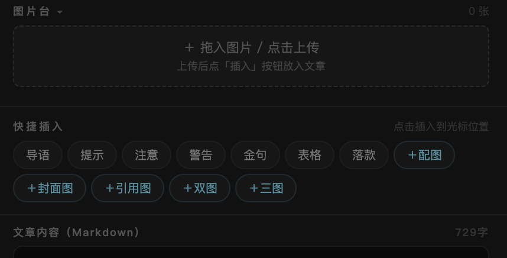

图片上传这里你可以上传，为了看最终效果！但是，无法保存后直接到公众号里！因为你是本地内容！这点注意！

配图：这里就是插入图片，不需要你上传，只是个占位图！全复制后，到了公众号编辑器里替换就好。

封面图： 也就是文章上面最大的图，就像杂志封面。整张图满屏铺开，没有边框，只有一个小小的“COVER”标签提醒你这是封面。适合放在文章开头定调子。

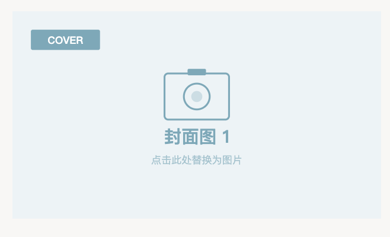

引用图：专门用来放“别人的东西”。比如你截了一段别人的文章、一条微博、一张对话截图。

它会带一个明显的 “QUOTE · 引用” 标签和左侧色条，告诉读者：“这不是我自己的内容，是引用来的”。

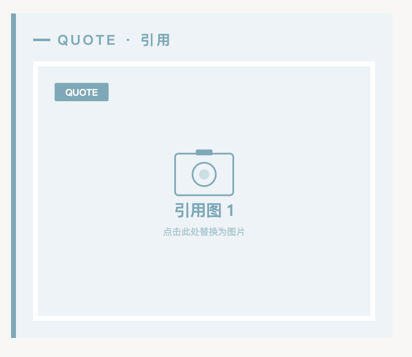

双图、三图 ，顾名思议就是多图类型啦！两张或三张图挨在一起显示。

适合做对比（修图前后对比）、多角度展示（产品的正面侧面背面）、或者连续画面。

这种场景比较少！适时使用！

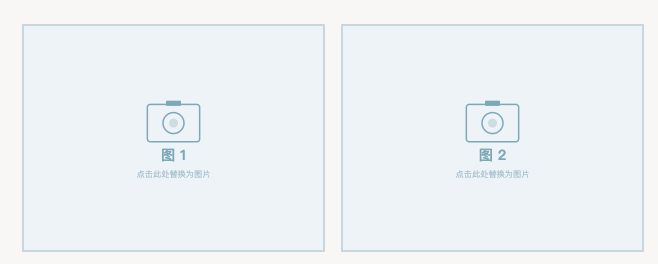

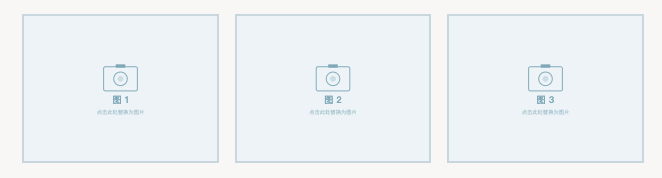

其它的几个快捷方式，大家自行研究吧，挺好玩的！

但有个快捷方式要注意：就是落款！没错，我比较自恋，这里默认的是我的名字和公众号！你们记的修改，别一不小心把我给宣传出去啦。哈哈哈！

这个内容区域，大家可以自由编辑，添加删除内容！最后，记的要点击下面的“复制全文 粘贴到公众号”

接下来，就是打开公众号平台 -- 文章

我们新写一篇看看效果！粘贴刚才的内容到微信编辑器区域：

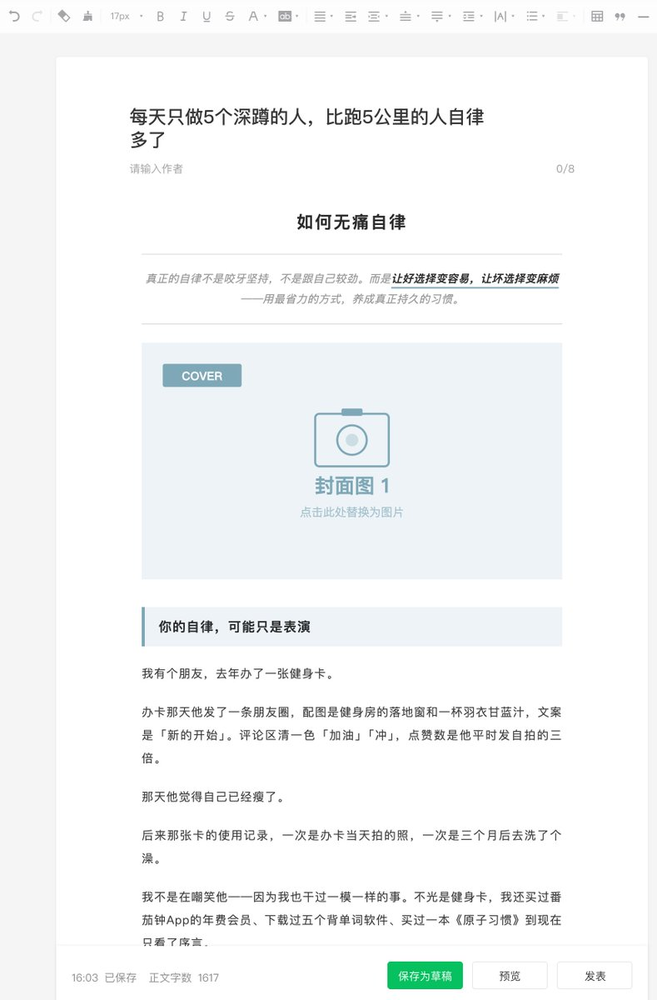

其实这里，我们只要调整的只有图片替换问题

因为这里是占位符，如果你要删掉再上传图片替换，就会丢失掉样式，怎么办？

点击图片占位图-- 选择“替换”

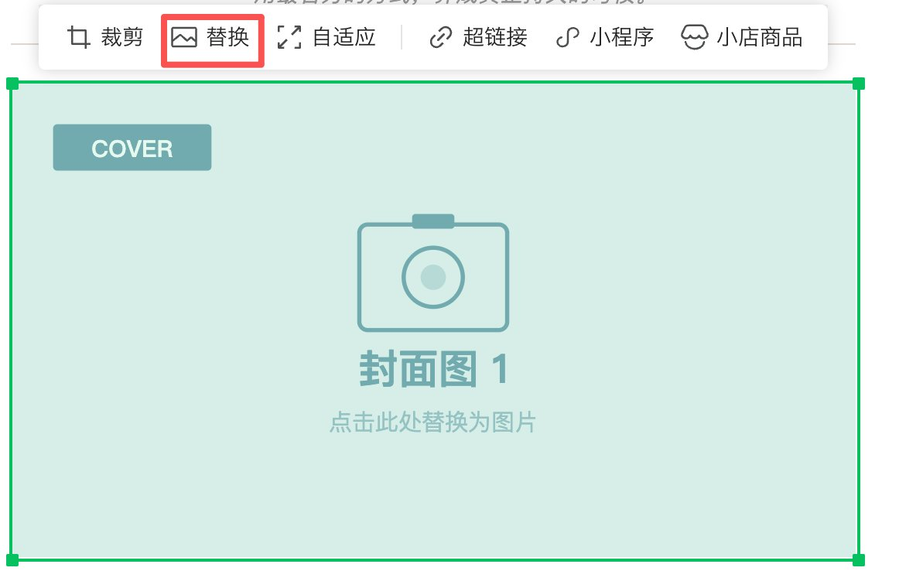

然后找个图片直接替换，就可以了。样式完美保留！

还有的样式中，图片是有边框！

但是替换了图片后，图片的边框没有完整的与图片相对齐，这个时候只要在图片上点击“自适应”，就可以啦！

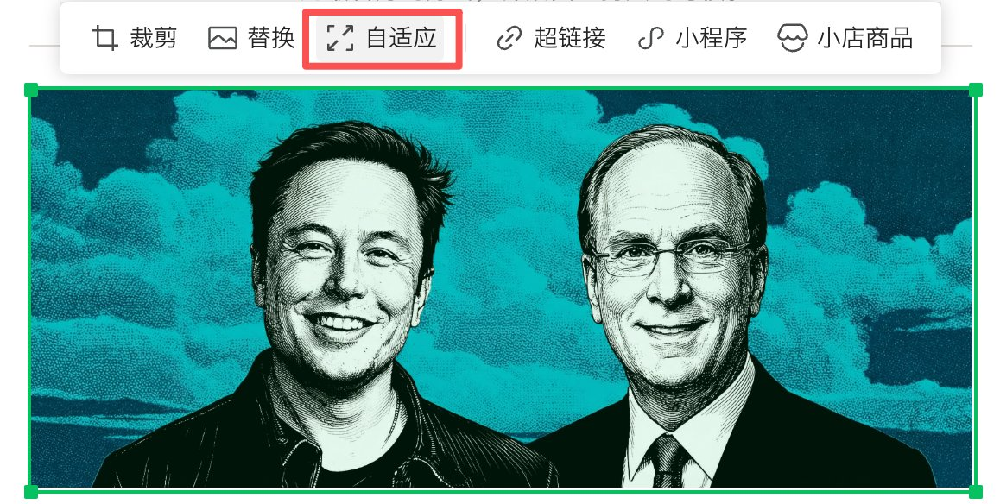

这只是个操作小提醒！

其它方面的功能就比较简单，你们可以在中控台快乐的玩耍了！

去试试吧！这样我们的写作到排版流程就算是全打通了！

如果有任何问题，欢迎向我反馈！感谢大家的支持！

本 Skill 我会免费分享给更多的人，让大家都能节约点时间。

直接下载吧，有些人不想给给我送个浏览量，那就别送了。

链接：

https://pan.baidu.com/s/1xHYbsMdxE-3UtNGrcArNDg?pwd=9zjv

## 相关页面

- [[sources/canghe-codex-obsidian-wechat-workflow]]
- [[sources/zhouluobo-workbuddy-skill-wechat-article-pipeline]]
- [[patterns/wechat-image-post-account-sop]]
