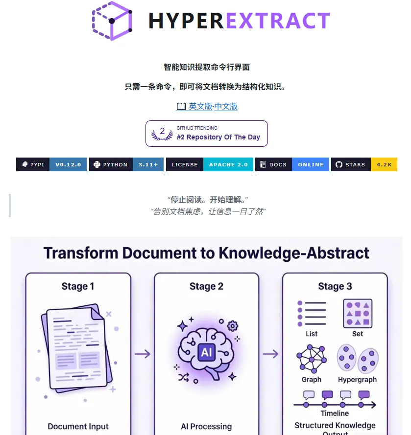

# lumxss（@bkdgiffug）：Hyper-Extract——用 LLM 把无结构文档自动提炼成结构化知识库

> 针对「手里一堆没结构的文档怎么变成能查、能追溯的知识库」这一问题的开源方案：Hyper-Extract 用 LLM 把文本自动提炼为结构化知识，支持普通图谱、超图、时空图谱等约 8 种结构，内置 80 多个领域模板（金融、法律、医疗、中医等均有覆盖），支持增量演进并可一键导出到 Obsidian；文档丢进去关联信息自动抽出，适合大批量文档场景。

<!-- more -->

手里一堆没结构的文档，怎么变成能查、能追溯的知识库？Hyper-Extract 拿 LLM 把文本自动提炼成结构化知识。

普通图谱、超图、时空图谱这些结构，它支持大约 8 种；内置 80 多个领域模板，金融、法律、医疗、中医都覆盖到了。增量演进没问题，还能一键导出到 Obsidian。

文档往里一丢，关联信息自动就抽出来了，大批文档的场景挺合适。

🔗https://t.co/6cp80aH4aB

## 相关页面

- [[concepts/knowledge-graph]]
- [[sources/canghe-codex-obsidian-wechat-workflow]]
- [[concepts/knowledge-graph]]
- [[concepts/agent-skill]]
