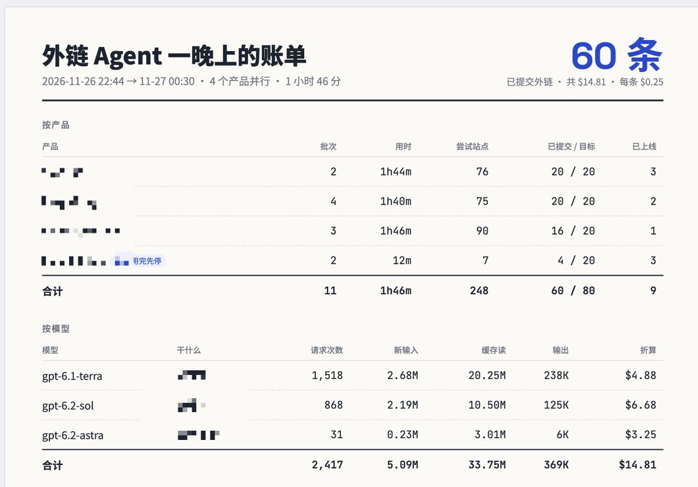

# bozhou：基于 Pi 搓专用外链 Agent——垂类 agent 比通用 Agent 更适配

> GrokBot 发外链消耗巨高：100 美金套餐一天提交 60 个、周限最多坚持 5 天。于是基于 Pi 做底座搓专用外链 Agent，针对单场景优化：今晚不到两小时提交 60 个，且不怎么占电脑内存、token 消耗巨低。**垂类 agent 前景很大——通用 Agent 能完成任务，但绝对做不到那种非常适配。**

<!-- more -->

我的外链 agent 终于要成了

grokbot 来做发外链的事情，消耗巨高，100 美金的套餐一天提交 60 个，周限最多坚持 5 天，于是乎我决定直接基于 pi 作为底座，搓一个专门干外链的 agent，针对单独的场景做优化，效果甚佳

今天晚上这个版本，不到两个小时就提交了 60 个，主要是不怎么占用电脑内存，同时 token 消耗巨低

突然觉得做一些垂类的 agent 还是非常有前景的，通用 Agent 可能能够完成任务，但是绝对是做不到那种非常适配

## 相关页面

- [[sources/jerry-galaxy-openmausbot-magpie-unlimited-token-multi-bot]]
- [[patterns/content-arbitrage-pattern]]
