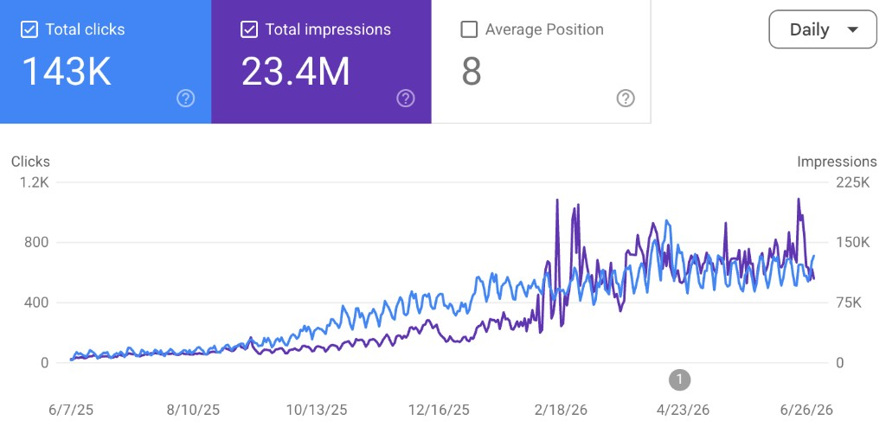

# Kourosh Ghaffari（@BuildingWaves）：$10k MRR 零运气、纯技能——可复制的想法→产品→营销→hustle 四步公式

> 作者自述花了 2 年才做到 $10k MRR，没有病毒帖、没有投放广告、没有受众，他自己的业务目前做到 $12k MRR；他早年硬做一个全新问题，4 年才到 $5k MRR、光验证就耗掉数月。主张是不要找新问题，要挑人们已经在付费的已验证问题：他点名 Jack Friks 的 Post-bridge.com（社媒排程，$40k/m）和 Marc Lou 的 Datafa.st（分析应用，$30k/m），并列出他认为能保证 $10k MRR 的品类——联盟营销追踪软件、错误追踪工具（Sentry 太臃肿）、邮件营销应用、热力图工具（更好 AI 的 Microsoft Clarity）、AI SEO 工具。产品层用 AI 写码、Mobbin 做 UI/UX，差异化只靠更便宜、agent-first、开源、更易用或极窄利基（他的 Voicy 瞄准残障市场），首版必须设 1 个月硬期限、到期就停止改代码；他做 RomeoSEO 是周一开工、周五就 onboard 第一个用户。营销要先找出 MOC（most obvious channel）且只能选一个，直接抄竞品选题只做「1% better」，因为客户选的不是最好的产品而是他们看到的第一个：他抄 Dragon Dictate 的博客路线做到每月 25k Google 点击。hustle 才是 $0 与 $10k 的真正差别，他用 MrBeast 的规矩作标尺——做完 100 条视频才准抱怨，并把 100 videos / 100 blog posts / 1,000 TikToks / 10,000 cold emails 当作及格线。

<!-- more -->

No audience needed. No lucky viral posts.

This is what I learned about SaaS while building my business to $12k MRR. + everything I see from REAL builders.

- Why I think $10k MRR is not special
- Why it doesn’t need any luck
- Why some people can seemingly get $10k MRR with everything they build

*For the love of god, read this yourself instead of giving it to an agent.

### Why are there people who just can’t miss?

Not talking about folks like [@levelsio](https://x.com/@levelsio) or [@marclou](https://x.com/@marclou)

It’s people that I’ve met IRL in London, Portugal, Dubai etc.

Zero online presence.

Multiple companies.

All making very good money.

It’s because there’s a formula to it.

Let’s go through each bit.

1. The idea
2. The product
3. The marketing
4. The hustle

## The idea - the part most people get wrong

In startup world, you don’t have good or bad ideas.

You only have good or bad problems to solve.

Good problems:

- A lot of people/businesses feel the problem
- People are happy to pay for a solution
- It’s possible to find the people that feel the problem

If you are looking for a ’new’ problem to solve, you’ve already lost.

Look, I get it. We all want to change the world.

But that requires real luck.

When you come up with a ’new idea’ for a new problem, you don’t know:

- If that idea is validated (i.e. “Are you actually solving a problem?”)
- If people will pay for your solution
- If the market is big enough

I’ve done this mistake before.

I built something brand new. It got to $5k MRR after 4 years.

The validation part took MONTHS.

Never again.

Entrepreneurship is hard enough already.

Do that for your 5th startup. Not today.

Today, we will find an idea that CAN MAKE MONEY.

### How to find ideas that make money.

Think about the big indiehackers on X.

Jack Friks - [Post-bridge.com](https://post-bridge.com/) is social media scheduler + $40k/m

Marc Lou - [Datafa.st](https://datafa.st/) is an analytics app = $30k/m

Neither of the two apps are new ideas.

Then think about bigger players like Posthog or Notion.

We had data analytics before PostHog. We had Apple Notes before Notion.

That doesn’t matter.

You don’t need a new idea. You need a proven idea that people already pay for.

Look at big products you (and million other people) use & pay for every day. Which ones are great?

Which ones suck?

Pick one that sucks. Build it better. That’s it.

THIS IS SUPER IMPORTANT

We can have 1 million different profitable CRM platforms because EVERY. BUSINESS. NEEDS. A. CRM.

My own app Voicy is a dictation app.

Hundreds of competitors.

Hell, Apple and Microsoft offer it for free in their hardware.

MILLIONS OF PEOPLE NEED DICTATION EVERY DAY.

To make it easier, here are some guaranteed $10k MRR products you can build:

- Affiliate tracking software (most suck & are expensive)
- Error tracking tools (Sentry is bloated)
- Email marketing apps (Marc Lou literally just copied beehiiv)
- Heatmapping tools (Microsoft Clarity with better AI)
- AI SEO tools (Like RomeoSEO.com)

Build it. It doesn’t even have to be better than the competiton.

But more about that later.

### “But there are so many competitors”

That’s perfect. You want many competitors.

Many competitors = many customers.

In these huge markets 10k MRR can easily be less than 0.01% of the entire market.

You only need 10k. Let your competitors have the other $100 million.

Additionally your competitors will:

- Give you marketing ideas
- Give you feature ideas
- Give you a million unhappy customers who will jump over to your solution instead

## The product - the easy part

You now have a validated & big problem to solve with your product.

The building part is easy. AI for coding. Mobbin for UI/UX. That’s that.

But you obviously don’t want to build a copycat.

You want to differentiate yourself somehow.

So you can do any of these:

- Make it cheaper than the competition (not great, but okay)
- Make it agent-first
- Make it open-source
- Make it easier to use
- Build it for a very very specific niche (highly recommend)

Example: My app Voicy targets the disability market.

That’s my niche.

My product is the exact same as the other competitors.

My app RomeoSEO uses funky branding. That’s the only differentiation.

Tbh, you don’t even really need to differentiate yourself.

We’ll talk about that in the marketing section.

### Important note in the age of AI

MVPs are dead.

But you still can’t spend 6 months on a first version.

For RomeoSEO, I sat down to build the product on a Monday and onboarded my first user on the following Friday.

That’s a bit too intense, but you need to set yourself a time limit.

I’d say 1 month is enough to make a very nice, functioning, product.

Whatever it is.

After 1 month, pull the plug.

That’s the product you’re going to be marketing now.

Do. Not. Touch. Code. Anymore.

## The marketing - pick the obvious route

Nobody will buy your product if they don’t know about your product.

Yes, you can start from zero.

Yes, you can start with zero skills.

We’ve all done it.

It sucks. It’s tiring. It’s disheartening. But you have to do it.

First off: Please stop building products for indiehackers.

They are a terrible market.

1. They have no money
2. They are tech bros with crazy high standards
3. They think they can build everything themselves

### Here’s what you need to do instead

This is the real benefit of picking an existing problem/idea with A LOT of competition.

Somebody else has already done the marketing homework for you.

You need to find the MOC (most obvious channel). What is the most obvious way to reach your customer?

See what the competition does

- Do they have amazing TikTok accounts? You probably need to do UGC.
- Do they have 5 million blog pages? You probably need to do SEO.
- Is the founder weirdly active on LinkedIn? You gotta build a personal brand.

E.g. for Voicy, my competitors are Wispr Flow and Dragon Dictate.

Wispr Flow does a lot of VC-hype startup marketing on socials and paid ads. I obviously can’t do that. Dragon Dictate does a lot of blog posts. They get nearly all of their traffic from SEO.

So that’s what I did. And I did that until I got 25k clicks per month from Google.

For RomeoSEO, most users come from founder-led content on LinkedIn/Twitter. That’s why I’m writing this article now.

You can only pick one channel!

If you try to master SEO & YouTube & UGC all at once, you will fail.

But if you just try one of them. Like really really try hard.

You’ll still probably fail.

But you’ll fail faster. You’ll learn quicker. You’ll master it sooner.

### Copy the competition. Be the first one your customers see.

Later on, you will have original marketing ideas.

But in the start, just copy the competition.

If your competitor has a blog post titled: “Top 10 Best Affiliate Marketing Apps”, then you need to have a blog post with the same title.

Just make it 1% better. Add more data, more examples, better copy.

Do they have a wildly viral UGC format? Copy it.

Chances are, one customer will see your video first!

And that’s the whole game.

The craziest thing I learned about marketing is this:

Customers don’t pick the best product. They pick the first one they find.

My competitors have way better products than I do.

A lot of my users have no idea who my competitors are.

They just never got to that point.

They saw my blog posts first. They saw my YouTube videos first.

They stay with me because my product solves their problem.

## The hustle - the real differentiator

The real difference between $0 and $10k is the hustle. It’s a lot of work. Like a lot.

But here’s the good news

If you follow my idea-selection & marketing process, you will never waste time on useless stuff. You know exactly:

- What to build
- How to market it

All you need to do is... do stuff.

But you need to do more. Way more than you think you do.

The best founders I know don’t write one blog post per day. They write 5. They don’t record one YouTube video per day. They do 3.

A mindset that helped me through the tough times:

MrBeast teaches a lot of new YouTubers how to grow their channels. He tells them that they’re not allowed to complain until they’ve done 100 videos.

The bare minimum amount of effort before you actually deserve success is 100 videos.

Or 100 blog posts. Or 1,000 TikToks. Or 10,000 cold emails.

Please don’t give up on a marketing channel until you’ve really really tried.

Example: If UGC works for your competitors, then it can work for you.

Please don’t give up before you figure it out.

Be honest with yourself.

Do you want to stop because it doesn’t work, or because you’re tired of it not working?

But I know you can do it.

You clearly care enough about this that you read the article all this way. Go out and do stuff.

Don’t make these mistakes:

- Don’t try to find a new problem to solve. Pick an existing one.
- Don’t market to indiehackers. Get off Twitter.
- Don’t reinvent the wheel when it comes to marketing.
- Don’t stop marketing until you’ve done your 10,000 hours.

## 相关页面

- [[patterns/solo-startup]]
- [[concepts/app-idea-validation]]
- [[patterns/competitor-research-four-step]]
