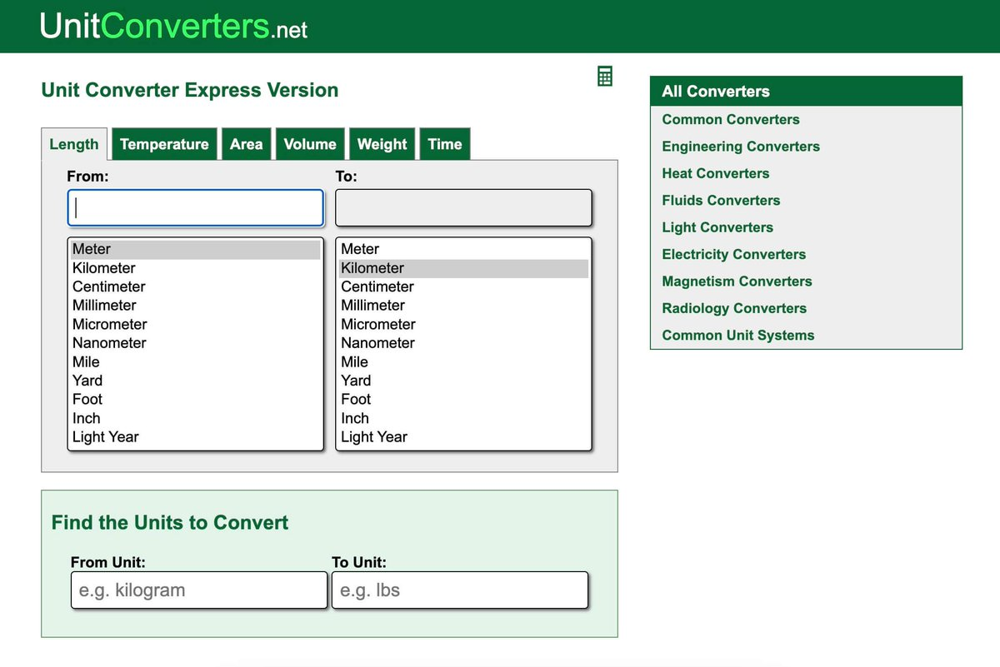

# UnitConverters 案例：公斤换磅这类无聊工具站，靠 AdSense 年入 25 万美元

> 「独立黑客都在做无聊网站。」Jiang Zhu 整理的 10 个最意想不到却很赚钱的项目中，第 7 个是 UnitConverters——公斤换磅、厘米换英寸这类纯换算工具站，靠 AdSense 做到年收入 25 万美元。

<!-- more -->

*图 1：UnitConverters 案例截图（Revenue: $25 万/年）。*

---

## 案例核心

| 项目 | 细节 |
|---|---|
| **站点** | UnitConverters |
| **做什么** | 公斤换磅、厘米换英寸这类**单位换算工具** |
| **怎么赚钱** | **AdSense**（广告） |
| **年收入** | **$250,000** |

---

## 为什么「无聊」反而是好生意

这个案例的价值在于它挑战了一个常见假设：**工具站必须做「有意思」的需求才有钱赚**。

UnitConverters 的产品形态极其朴素——单页输入、点击、给结果。但它同时满足三个条件：

1. **需求永续且稳定**——单位换算是跨语言、跨行业的通用需求，搜索量不随热点退潮；
2. **搜索意图极其明确**——搜「公斤换磅」的人就是要换算，不需要教育；
3. **变现路径最短**——用户用完就走，AdSense 展示即收入，不需要处理支付、不需要账号体系、不需要客服。

> 这与 [[sources/jiang-yunhe-first-100-usd-new-word-playbook]] 中蒋云何的教训形成鲜明对照：他做的是**有热度的梗站**，7 天红利期后流量腰斩 69%；而单位换算类需求虽然不性感，却是**慢速复利型资产**。

---

## 落到选词上的启示

结合 [[sources/wavborn-keyword-screening-playbook]] 的三板斧看，UnitConverters 这类词的选词逻辑与「梗词」正好相反：

| 维度 | 梗词（新词） | 换算类词（无聊词） |
|---|---|---|
| 趋势 | 快速上涨后迅速下滑 | 长期平稳，无退潮风险 |
| 竞争 | 低（还没人做） | 高（老站占位，需要长尾拆分） |
| 收入形态 | 一次性峰值收入 | 稳定复利 |
| 上站速度 | 决定生死 | 不急，但要做全长尾矩阵 |

**两者不是替代关系，是组合关系**——用梗词吃第一波现金流，用无聊长尾词沉淀长期资产。这正是 [[sources/vinsin-hu-four-sites-four-roles]] 里「主站 vs 流量站」角色分工要解决的问题。

---

## 相关页面

- [[sources/vinsin-hu-four-sites-four-roles]] — 子正：4 个站不是 4 份工作，是 4 种角色
- [[sources/wavborn-keyword-screening-playbook]] — wavborn：选词三板斧与 72 组词验证率
- [[sources/jiang-yunhe-first-100-usd-new-word-playbook]] — 蒋云何：副业出海小白首日破百刀，5 天破千刀
- [[sources/adsense-english-site-guide]] — 英文站 AdSense 赚钱入门
- [[concepts/adsense-english-site-guide]] — 流量思维 + 单域名单词策略
- [[sources/ancle-z-site-ads-reality]] — Ancle_Z：给网站接广告，比我想的简单，比我想的不赚钱
- [[patterns/adsense-site-auditor]] — 广告站点合规审查与变现排雷
