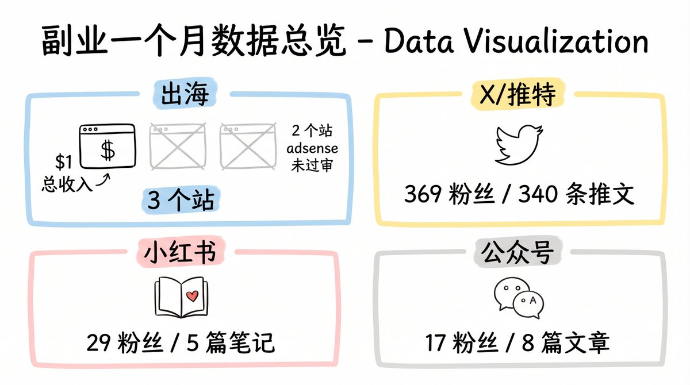
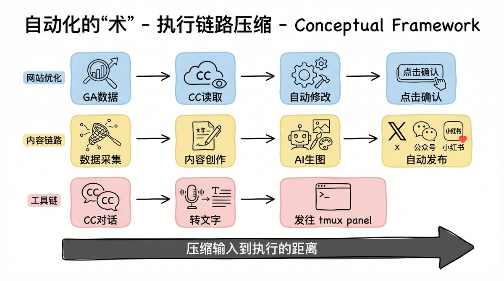
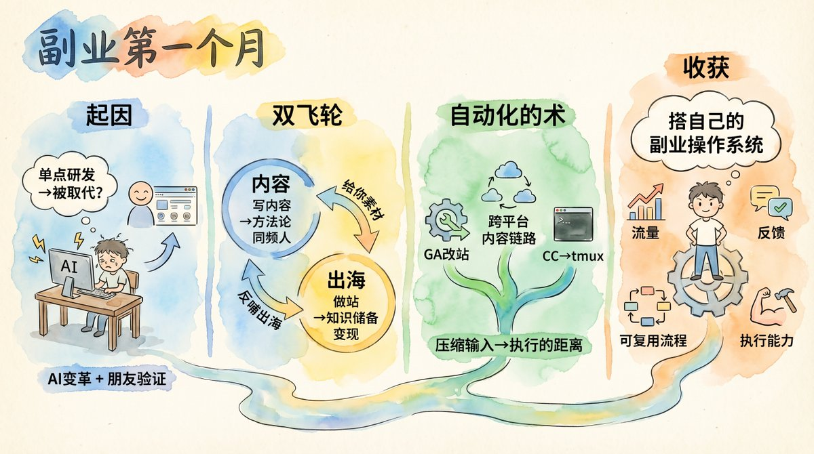

# 阿策（@Bytec99）：这个月我只赚了 1 刀——副业要把内容、出海和自动化拧成一个系统

> 上一篇复盘一个月后的账本：上了 3 个站、总收入 1 刀，其中 2 个站 adsense 还没过审；推特收获 369 个粉丝、发推 340 条；小红书收获 29 个粉丝、发了 5 篇笔记；公众号收获 17 个粉丝、发了 8 篇文章。他的结论是副业不能只靠一条腿走路：只做内容容易停在表达和自我感动里，流量数据一波动心态也跟着波动；只做出海、做站、做产品又容易掉进没有流量、没有反馈、没有稳定外部输入的坑。两条线其实互相咬合——出海为内容输出提供知识储备，写内容又倒逼把零散经验提炼成方法论。他在社群里认识一位做博客外链 Chrome 插件的老哥，与自己正在研究的新词发现和外链投放自动化碰撞后，得到了一条相对清晰的博客外链自动化路径。另一半是自动化的「术」：让 CC 读取 GA 数据、数据驱动自动改网站，自己只需要点击确认；搭了一条把 X、公众号、小红书串起来的跨平台内容链路。这个月真正的收获不是那 1 刀，而是开始把内容、出海和自动化拧成一个副业操作系统。

<!-- more -->

## 我为什么开始做副业

我开始做副业，不是因为突然想折腾一下。

而是我越来越明确地意识到：AI 这波发展太猛了，它会对整个岗位结构产生根本性的变革。如果你只是链条上的叶子节点，单点做研发，那对不起，迟早会被取代。

也就是在这个节点，我接触到朋友在出海建站上的路径——他已经拿到了确定性的结果，而且路径有迹可循。

一边是不得不变的压力，一边是看得见路径的机会。两件事叠在一起，让我决定尽快下场。

## 这一个月的结果

如果只看结果，数字其实不大：

- 上了 3 个站，总收入 1 刀
- 其中 2 个站 adsense 还没过审
- 推特收获 369 个粉丝，发推 340 条
- 小红书收获 29 个粉丝，发了 5 篇笔记
- 公众号收获 17 个粉丝，发了 8 篇文章

这些结果拿出来，甚至有点寒酸。

但也正因为动作做得足够密，我反而越来越看清了一件事。

## 我看清的一件事

副业不能只靠一条腿走路。

如果只做内容，很容易停在表达和自我感动里，流量数据一波动，心态也跟着波动。

如果只做出海、做站、做产品，又很容易掉进另一个坑：没有流量、没有反馈、没有稳定的外部输入，最后只能闷头猜。

所以我越来越相信，副业更合理的跑法其实是：

内容和出海一起做。

## 为什么要内容 + 出海一起做

内容这条线，帮你持续表达、积累信任、拿到反馈；

出海这条线，帮你承接需求、验证产品、尝试变现。

两件事分开看，好像各干各的；但真做下去你会发现，它们其实是互相咬合的：

出海为内容输出提供了足够的知识储备——你做了什么、踩了什么坑、学到了什么，这些都是内容素材；

而写内容本身又倒逼你把零散的经验提炼成方法论，分享出去，遇到同频的人，互相交流，又反哺出海实践。

比如我在社群里认识一个老哥，他是做博客外链 Chrome 插件的。我当时正在研究新词发现和外链投放自动化，跟他碰撞之后，马上就有了一条相对清晰的博客外链自动化路径。

新的认知、新的工具、新的路径，往往就是这么来的。

这时候我才慢慢理解，所谓飞轮，不是一个漂亮词，而是你真的感觉到两条线开始互相推动了。

## 另一个关键：自动化的“术”

飞轮要转起来，还有一个现实的前提：

很多人不是没方向，而是执行成本太高。

想法有了，内容也知道该发什么，站也知道该怎么改——真正卡住人的，往往是中间那一大段又碎又重的执行链路。

所以我越来越觉得，创业前期除了找方向，还要不断打磨自己的“术”，也就是自动化能力。

尤其现在 AI 发展这么快，以前很多只能靠人一点点堆出来的动作，已经可以被拆成流程、工具和工作流。

这段时间我也在持续沉淀自己的 skill 和工作流，比如：

- 让 CC 读取 GA 数据，数据驱动开发自动改网站，我只需要点击确认
- 搭了一条可复用的跨平台内容链路，把 X、公众号、小红书串起来，数据采集、内容创作、生图、发布尽量做成一体化流程
- 还用 CC 做了一个对话转文字，直接指定发往 tmux 某个 panel 的便捷小工具，本质上就是继续压缩输入到执行的距离

## 这个月真正的收获

所以对我来说，这个月真正的收获，不是那 1 刀。

而是我开始感觉到，自己不是在零散地做几件事，而是在慢慢搭一个属于自己的副业操作系统。

这个系统现在还很小，收入也很小，很多环节也还很粗糙。

但只要它开始转起来，我积累的就不只是某个平台上的几个数字，而是：

- 流量
- 反馈
- 可复用的流程
- 以及越来越强的执行能力

这也是我做完这一个月之后，越来越相信的一件事：

副业不是等一次爆发，而是持续把内容、出海和自动化一点点拧成一个系统。

## 相关页面

- [[concepts/ai-content-pipeline]]
- [[sources/gefei-friends-20-advice-for-indie-devs]]
- [[concepts/selfmedia-compound-model]]
