# 苍何：Codex + Obsidian 多平台同步与一键分发（WeSight 升级实录）

> 从 Obsidian 一键同步 9 个平台、长文转多平台图文、公众号排版与数据复盘、GitHub 多设备同步，到 Claude Code / Codex / OpenCode 三引擎切换不丢上下文的完整升级实录。

<!-- more -->

大家好，我是苍何。

还记得之前那篇 WorkBuddy/Codex + Obsidian 搭建自生长个人知识库的文章吗？

里面我分享了自己做的 WeSight 插件，当时很多小伙伴直呼有用。

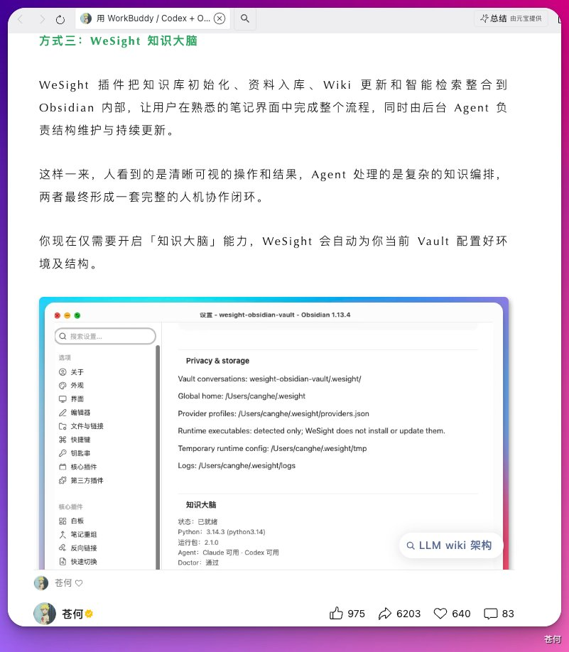

现在已经有 32k 下载量了，撒花撒花❀

自己做的东西有这么多小伙伴在用，还是很开心的😊

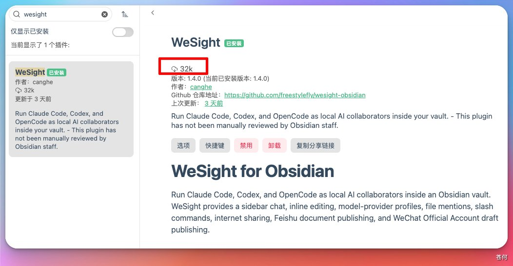

我自己日常创作也离不开它，最近又给它进行了重磅升级🆙

GitHub 地址：https://github.com/freestylefly/wesight-obsidian

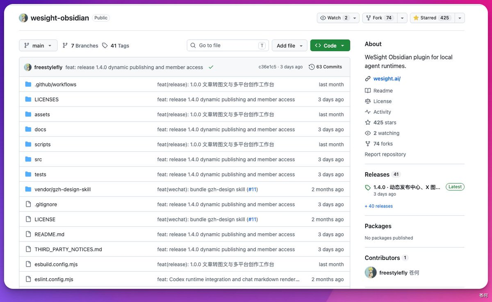

## 多平台同步：WeSight 发布助手

之前文章写完，想发到几个平台，还得一个一个复制，图片也得重新传。

好不容易写完了，结果还没完。

发一个还好，多发几个，同样的事就得再做几遍，真挺烦的。

于是我做了一个 WeSight 发布助手，现在直接从 Obsidian 上传，选好平台，就可以同步过去了。

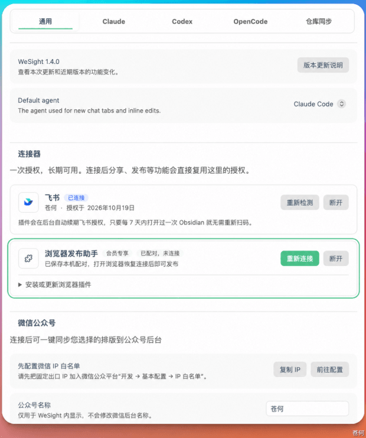

连接好浏览器扩展，在 Obsidian 里点击「多平台」，这篇文章就会传到发布中心。

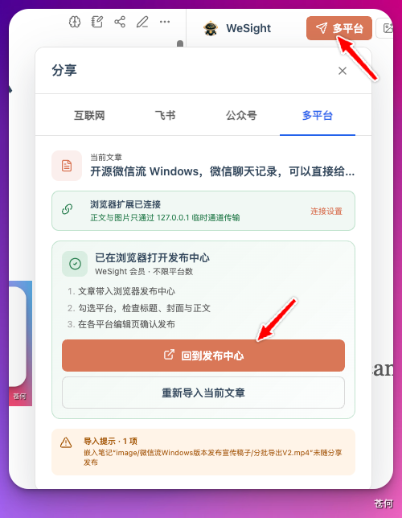

回到发布中心，就能看到刚才导入的文章。

标题、摘要、封面、正文预览都有，预览时看到哪里有问题，可以切换到 Markdown 修改。

目前支持动态和长文，支持小红书、即刻、知乎、CSDN、掘金、B 站、今日头条、微博、X 平台。

比如这里，我选择 CSDN 和掘金，点击同步，内容就会自动传到这两个平台。

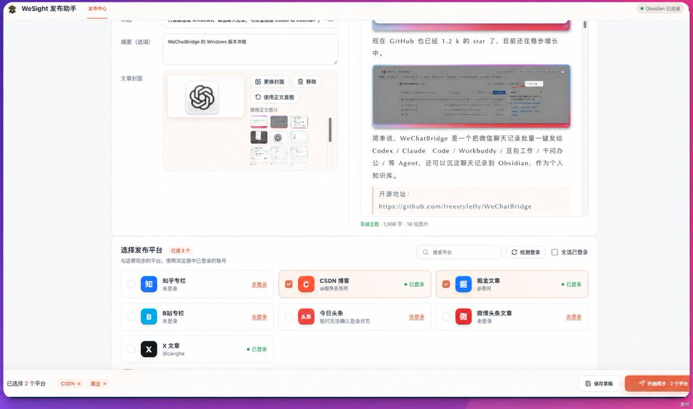

看它自己往两个平台传，终于不用我在几个网页之间来回切了，舒服。

安装的话，先下载 WeSight 发布助手的 ZIP 安装包，解压。

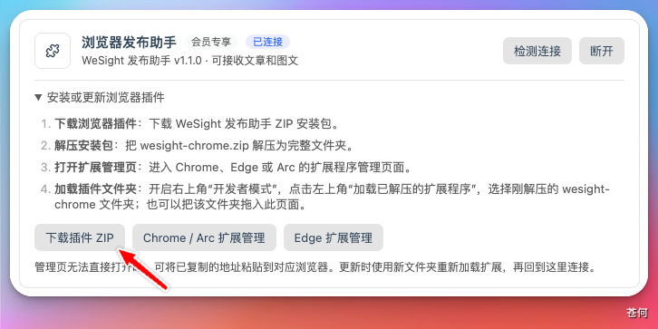

打开浏览器的扩展管理页面，开启开发人员模式，加载刚才解压的文件夹。

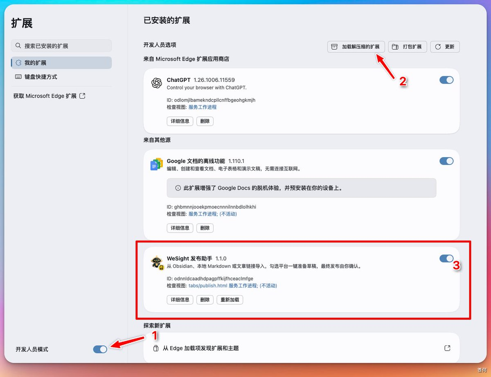

点击浏览器里的插件，就可以看到各个平台的登录状态。

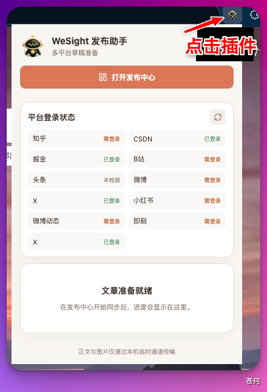

## 长文一键转多平台图文

不过，发到小红书、微博、X，又是另一回事了。

长文章不能直接往上搬，文案得改，图片得配。要是每个平台再重写一遍，想想都累。

于是我做了一个快速转为图文的功能。

可以选择小红书、微博、即刻、X 多个平台，也可以只选一个。

文案可以统一生成后单独调整，也可以按平台风格分别生成。

比如这里，我按照不同平台的风格，把一篇文章转成了三个平台的文案。

文案生成后，还可以配图、检查、推送到草稿箱，整个流程都在 Obsidian 里进行。

超级丝滑，爽歪歪！!！

配图有文字排版、实拍摄影、杂志拼贴、插画叙事、信息图解、截图增强等风格，可以按自己的喜好选。

设置好后，还可以保存为模板，下次直接复用。

这个就很舒服了，好不容易调出来的风格，总不能每次都从头再来一遍吧。

WeSight 也会自动分析内容，推荐配图风格，点击查看依据，还可以看到推荐的原因。

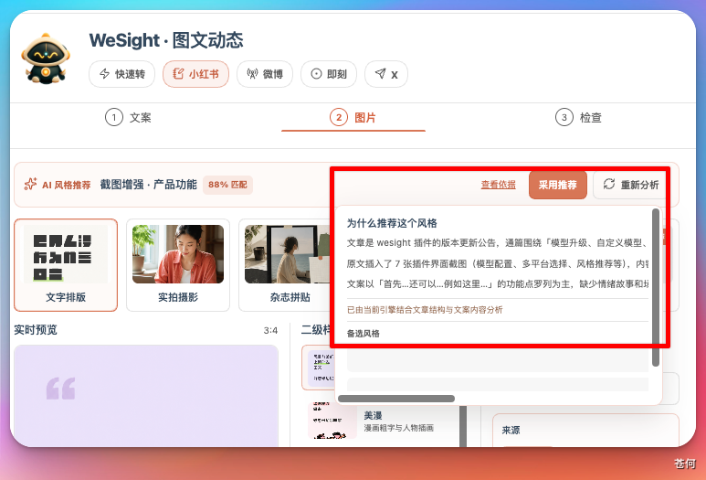

生成的图文文案和图片，也可以通过发布助手同步到对应平台。

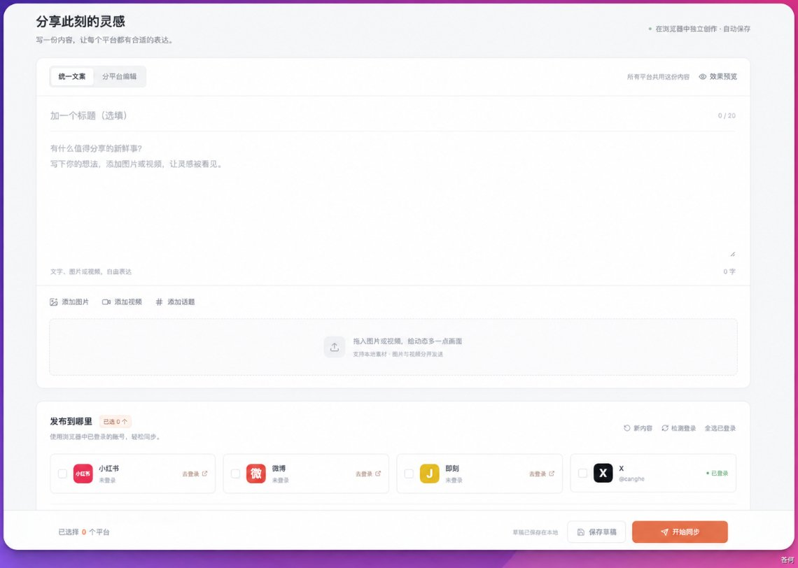

比如这里，我让它把文章转成 X 图文，生成文案、选好图片后，点击「一键发布到平台」。

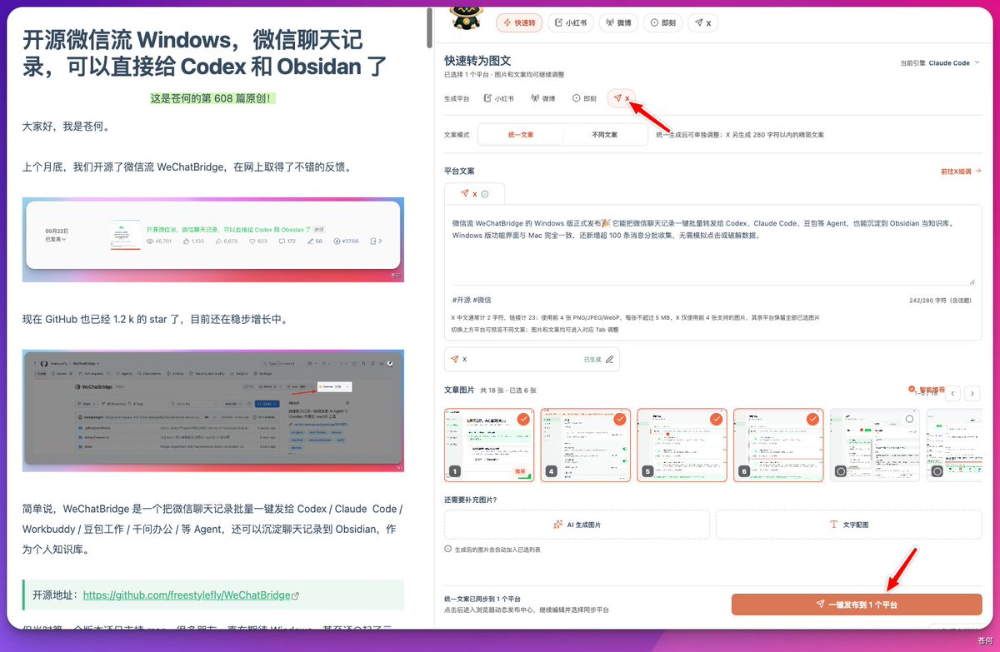

文字和选中的图片会直接上传到发布中心，文案 tag 都给我写好了。

点击「开始同步」。

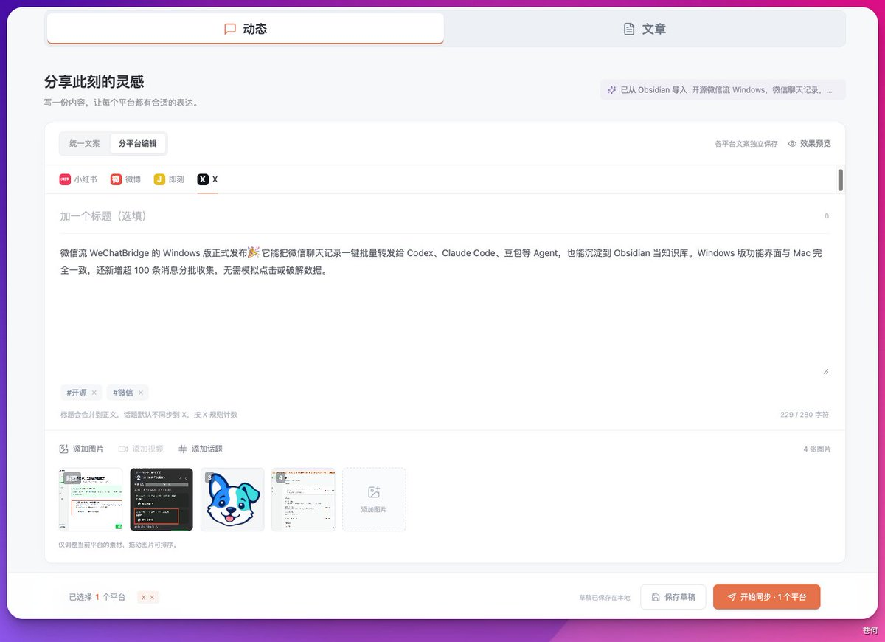

同步完成后，它会跳到 X，我一看，好家伙，文案和图片都过去了。

从文章改成图文，再同步到平台，不用自己再来一遍了。

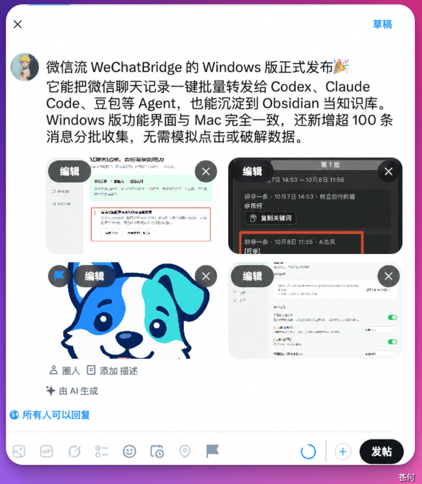

## 公众号排版与数据复盘

公众号也可以直接在 Obsidian 里预览，点击「公众号」，右侧就能看到排版效果。

发布设置中，可以用 AI 生成标题、摘要、图片，还可以一键 GET 苍何同款。

添加发布链接后，还可以获取到数据复盘，阅读量、点赞、转发、评论都有。

这下舒服了，发完就想看看有没有人看，总算不用再挨个平台点开了，对于懒人太友好了。

## 一键分享到互联网与飞书文档

之前把 Obsidian 的内容分享给小伙伴，还要复制到飞书，设置权限，生成分享链接。

我就想发给朋友看一眼，还得折腾这么一圈。

干脆把这些流程做成了一个按钮。

通过 WeSight Cloud 就能分享到互联网，小伙伴还可以评论。

整体的浏览效果，和在公众号上看到的差不多了。

也可以一键上传到飞书文档，先安装飞书 CLI，完成授权。

上传时可以选择保存位置，后续文章有更新，还可以同步到同一篇飞书文档。

点击链接就可以查看文档，文字、排版、图片都一起上传了。

## GitHub 同步：多设备接续写作

文章发出去之后，知识库怎么存档，几台电脑之间怎么同步，我也一直在想这个问题。

之前 iCloud 和 OneDrive 都试过，但是设备一多，有时候这边改了，那边还没同步过来。

想接着写，还得先看看同步好了没有，挺扫兴的。

于是我做了 GitHub 同步，现在可以把知识库绑定到 GitHub 仓库。

它会自动拉取仓库的更新，也可以自动推送修改的文件，还能设置同步间隔。

缓存这些不想传到 GitHub 的内容，把路径填到「自动提交排除路径」里，WeSight 就会跳过。

最近提交了什么、拉取了什么，都可以在同步记录里看到。

如果本地还有没提交的修改，也会提醒，避免没注意就直接拉取。

写到一半最怕的就是这个，刚才明明还在，怎么没了？😭😭😭😭😭😭

再重新写一遍，那个思路可能就找不回来了。

所以没提交的修改，得提醒我一下。

想手动同步的话，点击头像，再点「立即拉取」或者「提交并推送」就行。

这样 Windows 和 Mac 之间也能同步了。

Mac mini 上也配一个，平时积累的内容同步过来，出门就不用再开远程去看了。

## 多引擎与模型切换

有时候写到兴头上，额度没了，换个模型又得说一遍，OMG，此时气的想骂 AI 了。

于是模型这次也升级了，支持 Claude Code、Codex、OpenCode 三个引擎，其中 Claude Code 支持本机配置和自定义配置。

最重要的是，切换模型不会影响上下文 ! ! ！

也就是说，让 WeSight 进行创作的时候，一个模型额度没了，可以让另一个模型快速顶上。

不用换个模型，再把刚才聊过的内容交代一遍。

自定义配置里，可以接入自己的模型服务，比如 TokenDance、DeepSeek、Kimi、Qwen、GLM 等。

还可以自己导入导出模型配置，DIY 走起。

OpenCode 也支持多个模型配置。

## 写在最后

说实话，创作这件事，我们要拥抱 AI，把人从重复劳动里捞出来，专注创作本身。

但也不能全信 AI，AI 生成的内容有时候就是不如自己的创意，得自己把关。

以前是写一小时，搬运俩小时，妥妥的数字佃农。

现在把搬运的活全交给工具，省下来的时间就可以玩了，真的爽歪歪。

AI 负责搬砖，你负责惊艳😎😎

## 相关页面

- [[sources/canghe-codex-obsidian-wechat-workflow]]
- [[sources/indie-hub-10-content-skills]]
- [[concepts/ai-content-pipeline]]
