# 米开朗基杨（@CarsonYangk8s）：违背祖宗的决定——手把手教你用 FastGPT 搭建微信/飞书社群 15 节点全自动客服流

> 产品社群高频提问、日常闲聊与销售转化的全套自动化生产级工作流：基于 FastGPT 拆解 15 个关键节点与 28 条连线，解决机器人在非 @ 消息下的静默与意图识别、产品 FAQ 精准出处召回、商机自动留资表单推送，以及超出范围时无缝流转人工客服。

<!-- more -->

在国内做产品社群运营非常消耗精力，每天都有很多人问这个产品怎么安装、报错怎么解决、企业版要多少钱，运营同学每天都在贴链接，研发同事经常在群聊中被频繁 @，工作节奏容易被打断。

如果直接接入未经调校的机器人，每句日常闲聊都触发回复，反而会造成群内信息刷屏；当遇到复杂的权限故障或售后退款时，一旦机器人给错了承诺，又会增加后续的人工沟通成本。

将机器人设置成被 @ 才回复，也不合理，因为有些用户在社群里提问的时候根本就不会 @ 机器人。

[FastGPT](https://fastgpt.cn/?utm_source=x&utm_medium=social&utm_campaign=c20261012-01&utm_content=article) 官方自己的社群就接入了一个可控的解决方案：

- 在消息入口先结合上下文完成意图识别，对无关闲聊保持静默；
- 遇到产品咨询时再调用结构化知识库生成带出处的回复建议；
- 商业采购意向自动推送留资表单，超出知识库范围的复杂问题则完整交接给人工客服。

以飞书为例，如果用户发的消息不是在提问，或者问的问题与产品无关，便保持静默不回复：

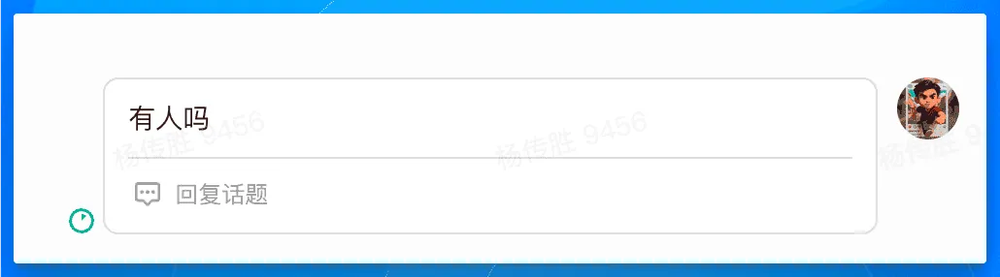

只有识别到意图才会触发回复：

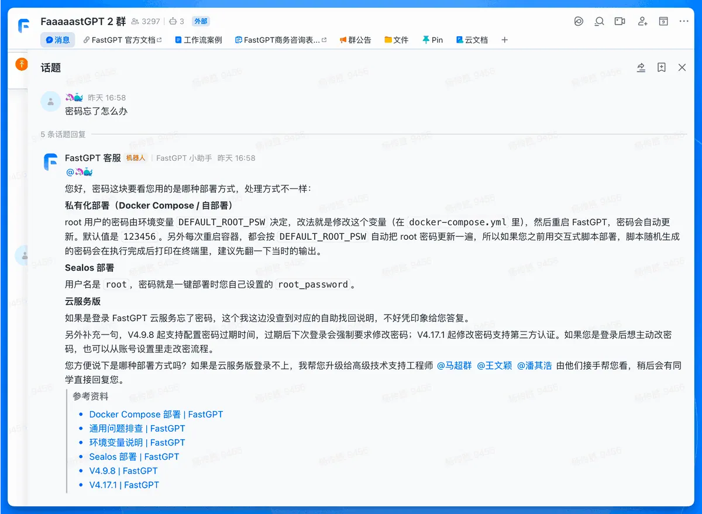

今天我要做一个违背祖宗的决定，把这套工作流毫无保留直接全部公开出来！

本文面向负责社群运营、技术支持与客户服务的团队，结合实际搭建中沉淀的工作流方案，拆解 15 个核心节点的配置逻辑，并说明如何将通用流程适配至自有产品、知识资产与服务规则。

## 社群客服的核心任务与阶段目标

推进社群客服自动化，首要原则是建立明确的服务分级标准。首个版本应当集中精力解决最消耗日常工时的问题，分步提升自动化水平。

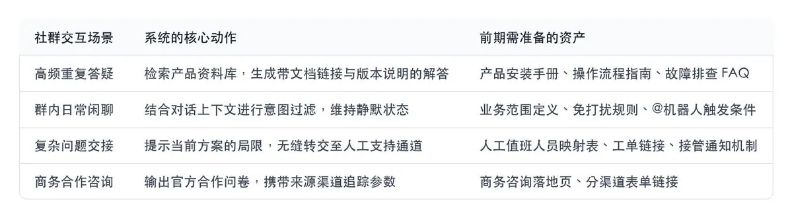

以实际提问为例：

- 群成员咨询“如何重置登录密码”，系统快速检索账号支持文档并给出规范步骤；
- 群成员询问“企业版包含哪些增值功能”，系统输出规格对比与销售咨询入口；
- 群成员探讨午餐食谱，系统保持静默；
- 群成员明确要求“请人工客服介入”，系统迅速推送专属客服通道并通知值班同事。

将知识库与群聊平台直接打通，仅能实现简单的文本问答。要让机器人适应群聊生态，还要通过工作流叠加消息过滤机制与渠道适配逻辑。

## 理解 FastGPT 的基础能力

[FastGPT](https://fastgpt.cn/?utm_source=x&utm_medium=social&utm_campaign=c20261012-01&utm_content=article) 是一套基于大语言模型与向量数据库的可视化应用开发平台，提供了知识检索增强（RAG）、工作流编排以及工具调用能力。

掌握以下两项核心要素即可开始搭建：

- 知识库：沉淀业务事实与技术资料的专用数据池。上传的文本、文档或在线网页会切分成标准数据块并完成向量化索引，在回答过程中精准召回最吻合的参考片段。
- 工作流：通过有向无环图（DAG）驱动的任务执行链。工作流中的每一个方块代表一个具体功能（接收消息、逻辑判断、检索数据库、调用大模型等），节点之间的连线确定了数据传递与逻辑流向。

在工作流中扮演主干输出角色的 Agent 节点，本质上是具备工具决策能力的处理中枢。它负责综合多轮对话生成最终答复，同时根据用户意图自主决策是否触发挂载的知识库搜索工具。

## 搭建前准备：梳理知识资产与创建应用

### 第一步：整理高清晰度的知识源数据

知识库的质量直接决定最终回答的准确率。初次搭建应优先提取社群中出现频率最高的前 20 个高频问题，并确保每项条目给出最新、经确认的权威结论。

每个知识条目应当明确包含问题描述、适用版本、标准执行步骤、官方文档 URL 以及有效维护时间。独立段落必须具备完整的上下文语义。如果缺少官方参考链接，模型在被要求给出出处时可能会发生格式断裂。

推荐的单条知识录入格式示例如下：

问题：如何配置团队成员权限？

适用版本：FastGPT v4.8 及以上商业版本

操作步骤：登录管理后台 -> 进入“团队管理” -> 点击“成员列表” -> 选中成员分配对应角色权限。

参考来源：[https://doc.fastgpt.cn/guide/admin/team](https://doc.fastgpt.cn/guide/admin/team?utm_source=x&utm_medium=social&utm_campaign=c20261012-01&utm_content=article)

更新日期：2026-10-09

初期建议聚焦经过团队审定的公开帮助文档与操作规范。历史社群提问记录可以提炼成测试验证集，标准答案应由产品及运营人员统一确认后再录入知识库。

### 第二步：注册平台并构建核心知识库

访问 [FastGPT 官网](https://fastgpt.cn/?utm_source=x&utm_medium=social&utm_campaign=c20261012-01&utm_content=article)，按照引导完成组织注册与账号登录。在控制台中确保团队内已开通可用的对话模型服务及相应的渠道发布功能。

在左侧菜单点击“知识库”，根据业务分类新建资料库，例如“核心产品手册”“高频故障处理”与“商业合作指引”。通过界面的“导入数据”入口上传 Markdown 或 PDF 格式的手册，导入完成后在分块预览界面抽检切片效果与命中召回表现。

初期将资料规整至单一核心库能够快速跑通链路。随着业务规模扩大，可进一步按照基础百科、深度文档与售后案例进行分库管理。FastGPT 的数据组织遵循“知识库—数据集（集合）—数据块”三层体系。

FastGPT 的知识库非常强大，你甚至可以直接接入一个网站作为知识库，FastGPT 会在后台定期同步网站内容转化成向量知识库，非常方便。

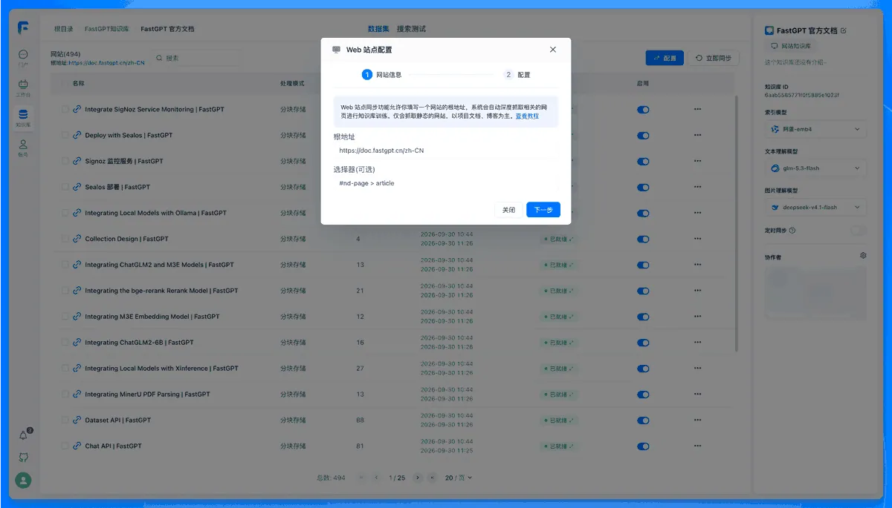

### 第三步：新建工作流类型应用

在工作台点击“新建应用”，模式选择“工作流”，并设定明确的应用名称，例如“产品社群智能客服”。

进入画布后，推荐的落地策略是先搭建“流程开始 -> 知识库搜索 -> AI 回答”的最小链路进行单轮调试。确认基础检索效果稳定后，再逐步扩充消息过滤、多渠道分流、商机留资与人工交接节点。

下文详细拆解由 15 个节点、28 条连线构成的完整生产级方案架构。

## 客服工作流 15 个关键节点全流程拆解

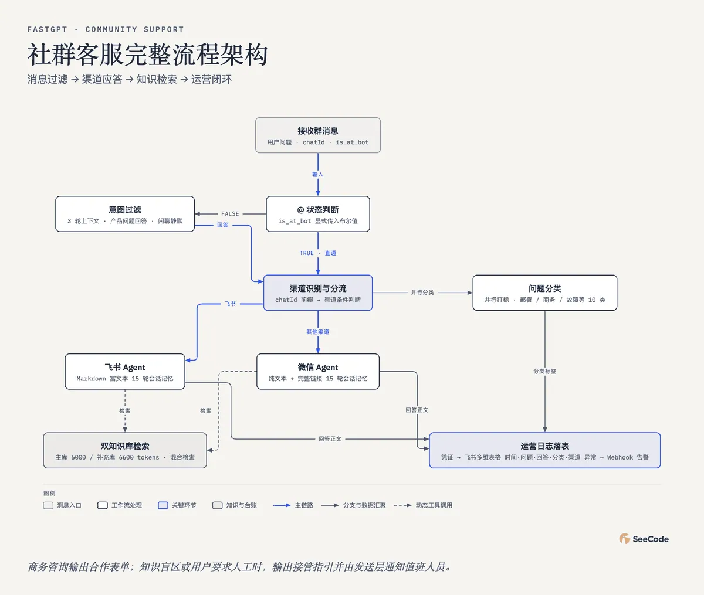

上图为社群客服完整流程架构示意图。主链路负责消息识别与业务应答，下半部分分支独立负责问题分类与运营日志沉淀，虚线部分代表 Agent 节点动态调用的知识库检索工具。

### 阶段一：流程开始节点统一接收输入

“流程开始”是工作流的数据总入口。当即时通讯网关接收到社群消息时，会将问题正文、会话标识（chatId）、上下文对话历史以及自定义变量传递给此节点。

用户问题为后续所有检索与判断的核心变量，全局变量 is_at_bot 负责标记此消息是否专门 @ 机器人。

在接入层对接时，必须确保客户端能够稳定传入用户的原始提问文本，并显式透传 is_at_bot 的布尔值。若为普通群聊发言，该变量赋值为 false；若用户明确 @ 机器人，该变量赋值为 true。变量命名的严谨性是后续所有分支正确路由的前提。

### 阶段二：通过 @ 状态与意图理解实现消息智能过滤

该阶段由条件判断节点与 AI 过滤节点协同处理，确保群内沟通秩序与响应效率。

第一道屏障是条件分支节点“判断是否艾特机器人”：

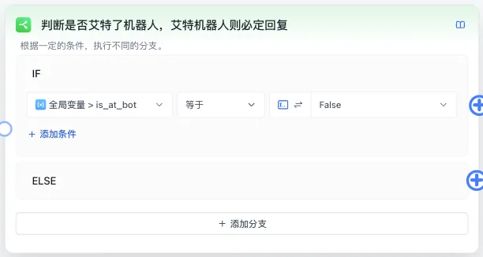

当 is_at_bot 等于 False 时，流程流入回复过滤节点；若等于 True，则直接绕过过滤，直通后续渠道与应答处理流程。

第二道屏障是 AI 意图判定节点“判断机器人要不要进行回复”：

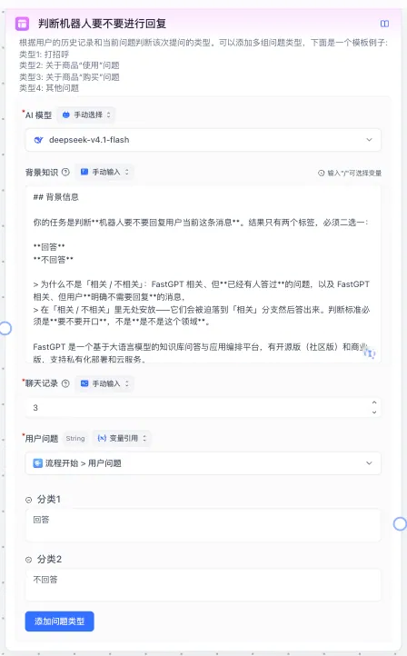

输入参数引用“流程开始”的用户问题，同时引入前 3 轮会话记忆，以确保对诸如“那具体怎么收费”等上下文指代问题做出连贯判断。

当模型判定该消息属于产品咨询或技术求助时，输出字段为“回答”，流程继续向后执行；遇到日常闲聊、灌水表情或已解决事项时，输出“不回答”，对应的连线保持断开，机器人保持静默，维护群内正常的沟通秩序。

推荐配置的高稳定性判定提示词如下：

你是一名专业的产品社群支持助理，职责是判断当前群消息是否需要技术客服介入。

结合用户最新提问与最近 3 轮聊天记录进行判断：

1. 遇到产品功能咨询、故障报错求助、系统使用疑问、商务采购意向时，判定为需要回复。
2. 遇到群友日常问候、与产品无关的闲聊、纯表情符号、已解决的重复追问时，判定为无需回复。
3. 仅输出两个选项之一：“回答”或“不回答”，保持格式精简。

### 阶段三：根据会话特征分流处理渠道

该阶段由自定义代码节点与渠道判断器串联实现。

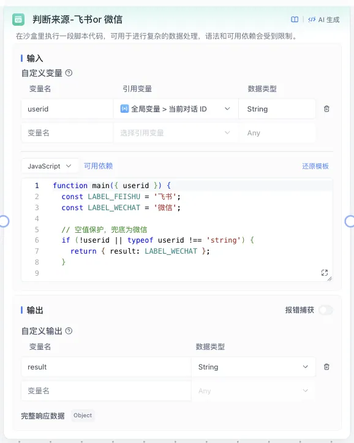

代码节点输入会话标识字段（此处映射为 userid），运行轻量 JavaScript 脚本提取客户端前缀，并将结果写入 result 输出变量。

不同沟通平台的富文本渲染规范各异。飞书深度支持标准 Markdown 与卡片组件，微信客户端则推荐简洁易读的纯文本及完整超链接。通过代码节点识别出渠道标识后，流程将进入“渠道判断器”。

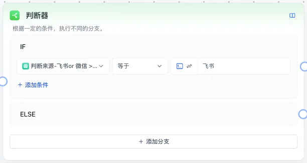

当 result 判定为“飞书”时，触发飞书专用的 Agent 节点；其他条件则流转至微信专用的 Agent 节点。

### 阶段四：针对不同客户端定制 Agent 应答规则

回答层部署了“飞书机器人”与“微信机器人”两个独立的 Agent 节点。两者依托同一套底层知识库，但在格式呈现与排版上做出了明确划分。

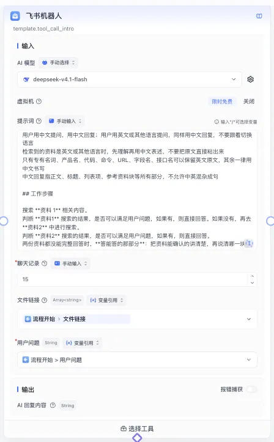

节点选用理解能力强的基座模型，配置 15 轮长上下文记忆，并挂载两组知识库检索工具。

飞书 Agent 提示词要求输出层次分明的 Markdown 格式，合理使用加粗小标题、有序步骤列表与引用标注，便于 PC 端大屏阅读。

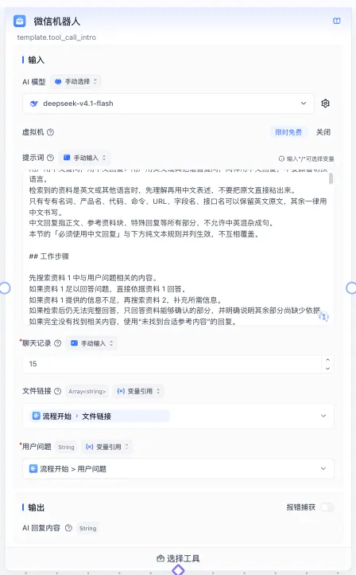

微信端展示以段落清晰的纯文本为主，官方文档链接以完整的 https://... 明文形式展示，保障移动端点击跳转的顺畅性。

两套 Agent 提示词均内置了统一的商业转化与人工兜底规则：识别到企业采购或定制需求时，输出商务合作表单链接；识别到知识盲区或用户强烈要求人工时，给出清晰的人工接管指引，并在发送层配合 @特定值班人员。

### 阶段五：挂载双知识库检索工具确保回答依据

业务数据的精准提取依赖于挂载在 Agent 节点下方的两个检索工具。

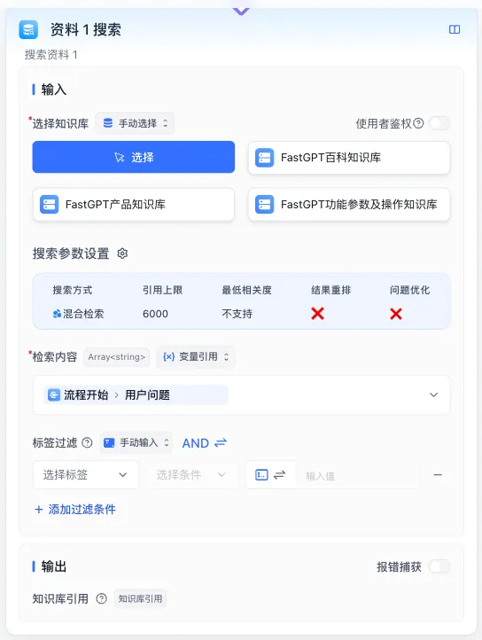

检索内容直接绑定“流程开始”的用户问题，采用向量索引结合全文匹配的混合检索算法，单次检索上限设定为 6000 tokens。

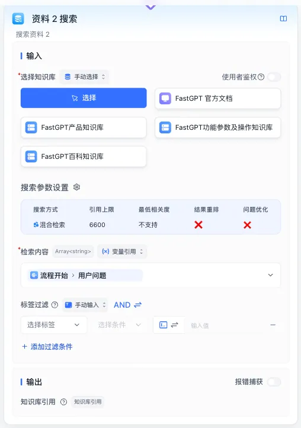

此节点聚合了全量官方文档，检索上限设定为 6600 tokens。

双工具设计实现了“高频 FAQ 核心库”与“系统级技术手册库”的分级查找。Agent 可以根据问题深度自主选择调用单一工具或合并双库结果，既保障了通用配置步骤的高命中率，又控制了单次交互的上下文 token 开销。

### 阶段六：问题分类打标与服务数据沉淀

为持续优化产品与知识库，系统设置了独立运行的问题分类与数据落盘分支。

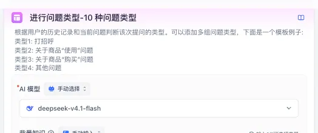

该节点与渠道路由并行触发，依托独立模型对用户问题进行多维度标签化分析。

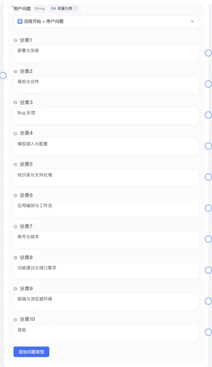

总共 10 类具体分类标签：系统部署、商务咨询、系统故障、模型调用、知识库维护、工作流搭建、账号权限、功能建议、环境配置及其他类别。

在分类节点下游，流程串联了“获取应用凭证”与“写入飞书多维表格”节点，将提问时间、提问内容、回答正文、分类归属与渠道来源实时记录至运营台账。当下游接口调用失败或系统出现异常时，通过内置 Webhook 向内部运维告警群推送警报，形成完整的数据复盘闭环。

## 接入飞书社群：权限配置与富文本消息渲染

### 第一步：完成开放平台应用凭据配置与事件订阅

完成工作流搭建后，在应用管理页选择“发布渠道”中的“飞书机器人”。FastGPT 原生飞书集成在商业版 4.8.10 及以上版本提供完整支持。[FastGPT 飞书渠道集成文档](https://doc.fastgpt.io/zh-CN/guide/build/publish/feishu?utm_source=x&utm_medium=social&utm_campaign=c20261012-01&utm_content=article)

具体开通顺序如下：

1. 登录飞书开放平台，创建“企业自建应用”并开启“机器人”功能。
2. 在开发配置中获取 App ID、App Secret、Verification Token 与 Encryption Key，并回填至 FastGPT 飞书渠道面板。
3. 将 FastGPT 生成的回调请求地址配置到飞书开放平台的“事件与回调”页面，完成 URL 有效性验证。
4. 订阅接收消息事件 im.message.receive_v1。
5. 申请所需权限并提交版本发布，审批通过后将机器人拉入目标社群。

权限申请涉及两项关键范围：

- im:message.group_at_msg:readonly：仅允许接收群内用户明确 @ 机器人的消息。
- im:message.group_msg.include_bot:read：允许读取群内所有正常文本消息。要让工作流中的“回复过滤节点”正常工作，必须成功开通此项群消息通读权限。

### 第二步：正确封装飞书 Post 消息中的富文本结构

要在飞书客户端获得规整的排版效果，发送层需按照飞书规范构造富文本结构。飞书支持在 post 类型消息中使用 md 标签解析 Markdown 文本。

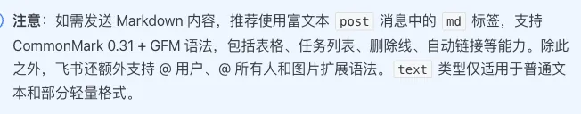

发送层的消息体参数示范：

const requestPayload = {

  msg_type: “post”,

  content: JSON.stringify({
    zh_cn: {
      title: “产品技术支持”,
      content: [
        [
          {
            tag: “md”,
            text: generatedMarkdownAnswer
          }
        ]
      ]
    }
  })

};

content 必须传输标准 JSON 序列化字符串。若回复中包含图片附件或特定人员的 @ 提醒，需遵循飞书开放平台的富文本格式进行多元素拼接，确保客户端平稳展示。

## 接入微信生态

微信生态内存在三种不同属性的接入形态。在搭建前需要明确社群用户的实际沟通场景，选择合规稳定的技术路径。

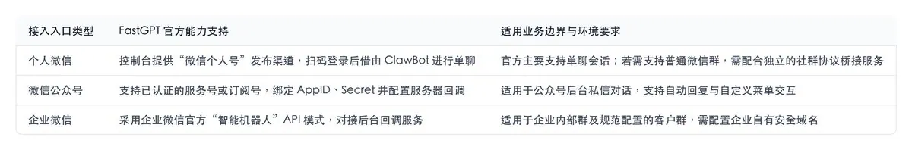

### 个人微信对接

在 FastGPT 渠道管理中新建“微信个人号”，按照引导使用微信扫描屏幕二维码完成授权，随后即可在微信端与 ClawBot 机器人进行单聊测试。[FastGPT 个人微信对接指南](https://doc.fastgpt.io/zh-CN/guide/build/publish/wechat?utm_source=x&utm_medium=social&utm_campaign=c20261012-01&utm_content=article)

需要注意的是 ClawBot 机器人是无法加入群聊的，所以无法用来管理微信群。

### 微信公众号对接

官方支持已认证服务号与订阅号的原生对接，商业版要求版本在 4.8.10 及以上。管理员在公众号后台获取开发者凭据，并在 FastGPT 平台配置对应参数；同时在公众号平台配置服务器地址（URL）、Token 与 EncodingAESKey，并将 FastGPT 服务器出口 IP 加入微信白名单，完成双向验证。[微信公众号渠道接入指南](https://doc.fastgpt.io/zh-CN/guide/build/publish/official_account?utm_source=x&utm_medium=social&utm_campaign=c20261012-01&utm_content=article)

### 企业微信对接

FastGPT 默认对接企业微信的模式是接入企业微信 Bot，采用的是企业微信官方“智能机器人”API 模式。但是这种方式的局限性很大，这个 bot 是无法加入企业微信外部群的，普通微信好友也无法和这个 bot 对话，无法用来管理社群。

## 企业级接入微信方案

FastGPT 同时还提供了一套企业级接入微信生态的方案，该方案可以直接接入个人微信和企业微信的账号，深度融入销售、运营、交付、品宣等多个对外场景中，帮助企业用更少的人力管理更多的运营账号。自产品发布以来，已成功助力百余家企业实现业务价值的提升。随着市场对 AI 大模型认知的日益加深，以及行业 AI 多模态、AI 智能体等前沿技术的持续创新，我们有信心为企业和行业带来更为深远的价值和影响。

什么叫直接接入个人微信和企业微信的账号？我解释一下，比如你可以直接把你的个人企业微信账号接入机器人，让机器人代表你去回复别人的消息。个人微信也是同理。

由于该方案过于强悍，我们不便对外公开，如果您对这个方案比较感兴趣，可以填一下咨询表单给我们留一个线索，我们的商务同学会很快联系您：

- 👉[ 商务咨](https://fastgpt.cn/contact?utm_source=x&utm_medium=social&utm_campaign=c20261012-01&utm_content=article#consultation)询

下面以企业微信为例，展示如何将企业微信账号接入 FastGPT 充当智能客服：

步骤 1：打开 ShellBot 平台，点左侧“我的机器人 -> 企业微信”，点“创建机器人”。选 WeAssist 模式，扫码登录企业微信账号。

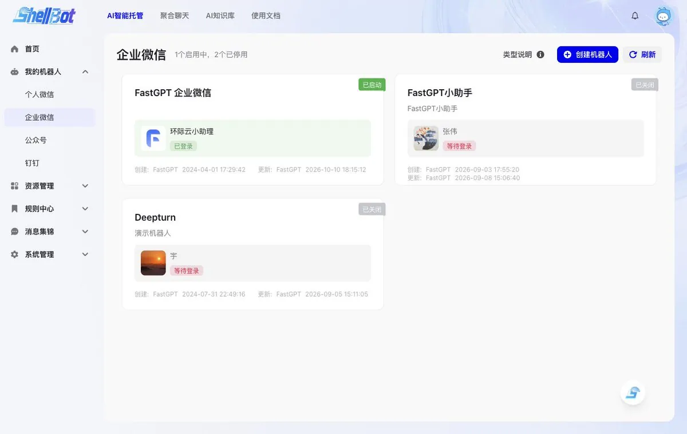

列表中能看到已启动的企微机器人实例。

步骤 2：在 FastGPT 应用的“发布渠道”里建好 API 密钥，把接口地址和 Key 绑到 ShellBot 的知识库渠道，打通对话链路。

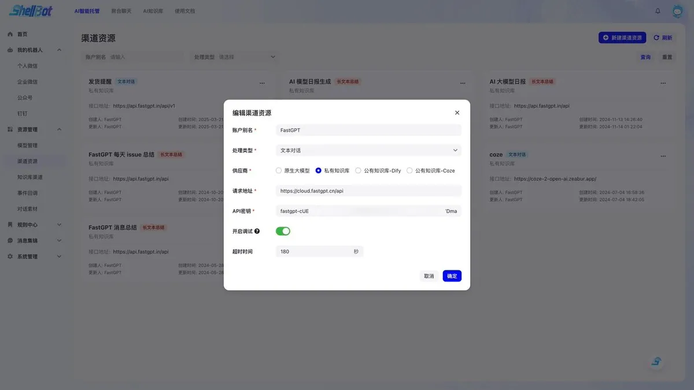

步骤 3：点进机器人卡片，在“功能应用”里打开“智能回复”开关，点击右侧进入配置。

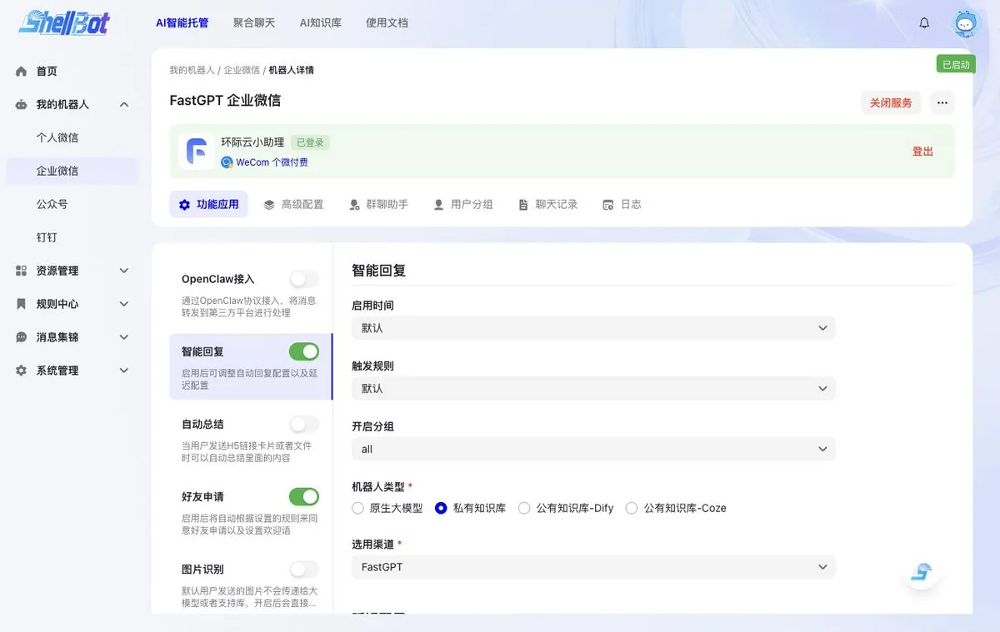

选用渠道选 FastGPT，配置触发规则和延时接收时间。

最终效果：

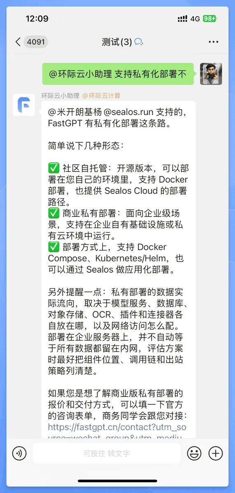

接入企业微信之后，可以帮我们自动管理很多事情，举个例子。

### 自动通过好友并拉群

大家都知道微信群的二维码只能拉 200 个人进群，超过这个数字就只能手动邀请别人进群了，非常麻烦。

通过下面这种方案就可以破解这个难题。

首先打开【好友申请】选项，设置固定欢迎语，提醒对方发送关键词拉群：

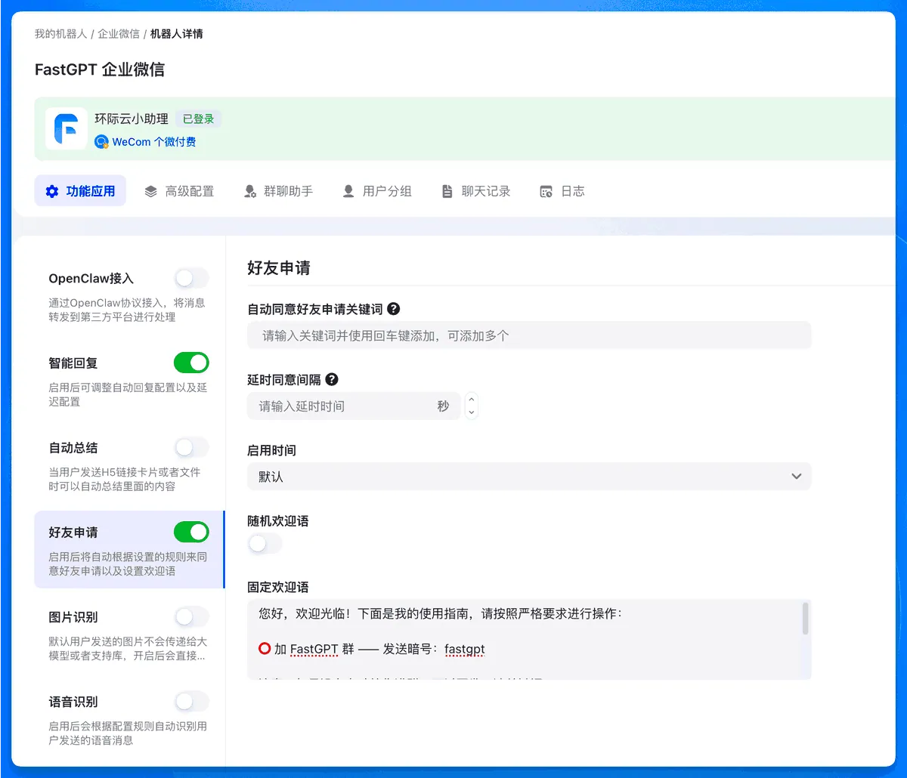

然后再添加一个关键词拉群：

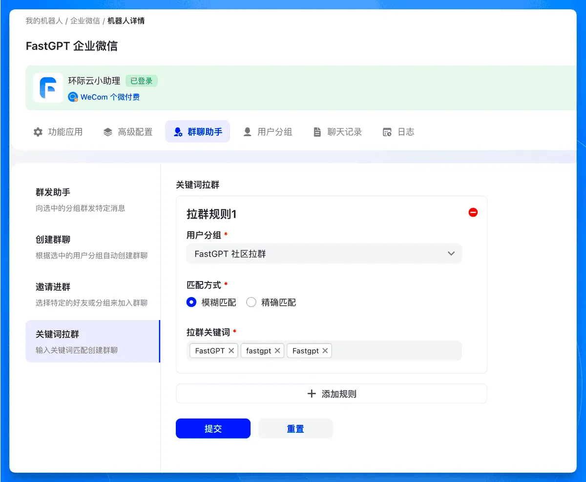

最终效果是这样的：

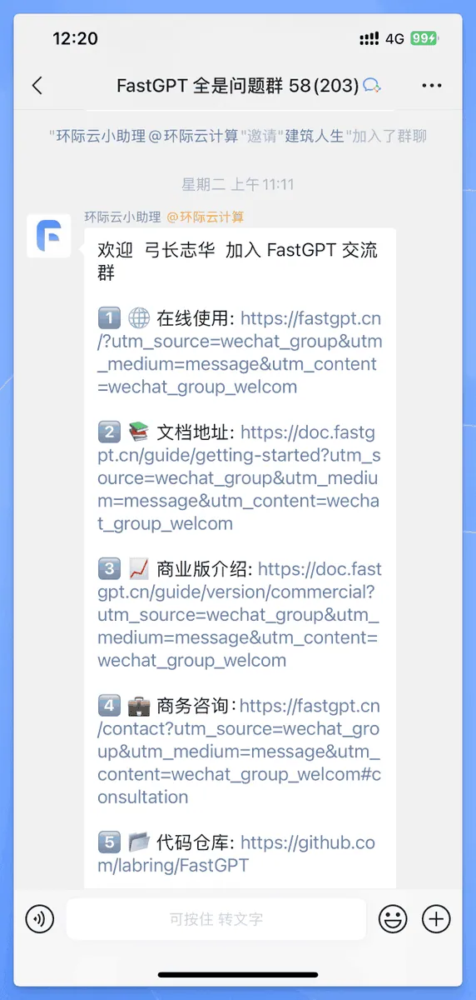

## 最后

企业自动化正处在一个决定性的历史拐点。以执行固定规则为核心的传统机器人流程自动化（RPA）时代已然落幕，一个由具备感知、推理和自主行动能力的 AI 智能体（AI Agents）驱动的、以成果为导向的“智能体自动化”（Agentic Automation）新纪元已经来临。对于国内环境来说，最先发生变革的应该是微信群管理😄

最后，如果想获取完整的 FastGPT 工作流，可直接在 X 后台私我发送：【fastgpt 客服】

## 相关页面

- [[sources/aichuhai-mika-phone-agent-cross-border-station]]
- [[sources/ryan-muse-wechat-longform-and-tietu-automation-review]]
- [[concepts/rag]]
- [[concepts/agent-autonomous-pipeline]]
