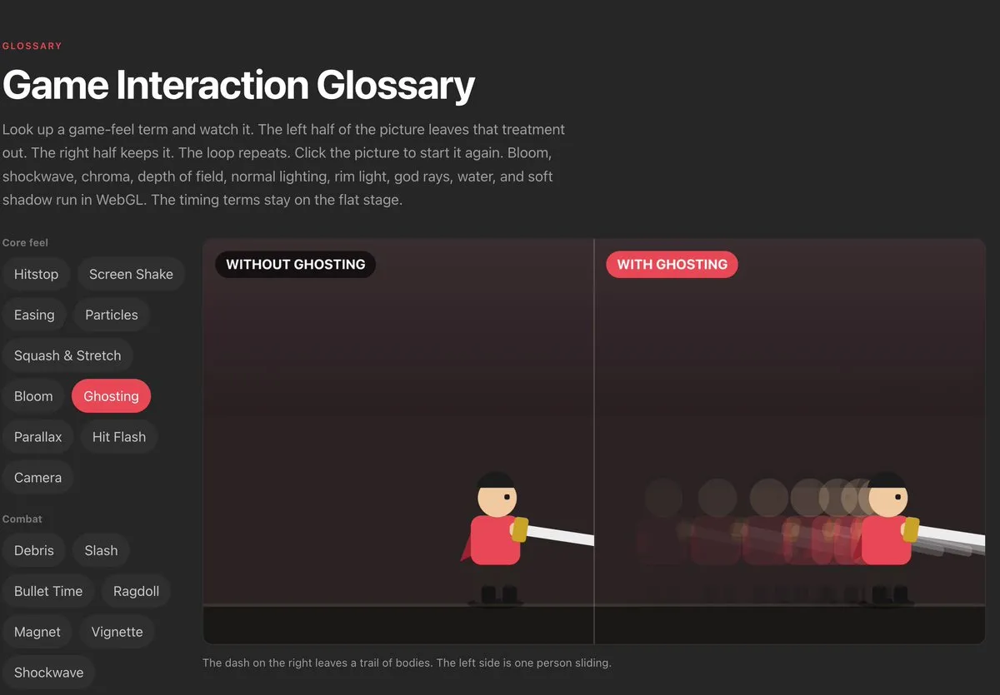

# Roland（@ChainEpic）：给我的游戏网站加了一个游戏交互动效名词展示——AI 辅助原创页面的案例

> Roland 给自己的游戏网站加了一个游戏交互动效名词展示页面：方法是①先去 Gemini 4 搜索游戏交互名词并让它写出代码 ②将 Gemini 给出的代码交给 Cursor 转换成适配自己网站代码的版本 ③进一步优化展示效果 ④提交搜索引擎——一个 AI 辅助原创页面的案例。

<!-- more -->

给我的游戏网站加了一个游戏交互动效名词展示：

具体的方法是：

1. 先去 Gemini 4 搜索游戏交互名词，并且让他写出代码
2. 将 Gemini 给出的代码让 cursor 转换成适配我网站代码的版本
3. 进一步优化展示效果
4. 提交搜索引擎

## 相关页面

- [[concepts/ai-friendly-backend]]
- [[sources/chainepic-overseas-moneymaking-ultimate-guide-2026]]
