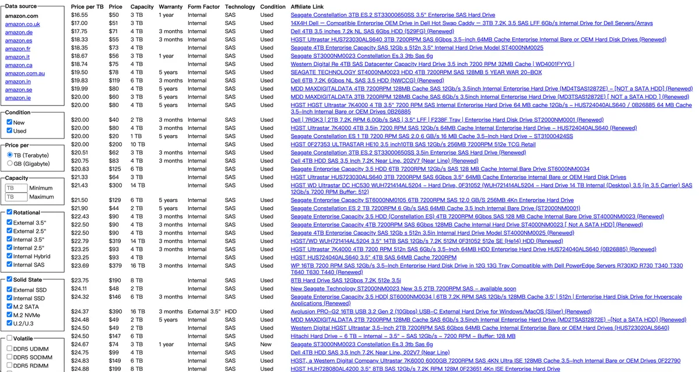

# Roland（@ChainEpic）：神器的网站——全是文本的 DiskPrices，亚马逊在售硬盘价格/容量/每 TB 单价全量对比

> DiskPrices：全是文本，列出亚马逊所有在售硬盘的价格、容量和每 TB 单价。变现方式：亚马逊 AFF 联盟赚取佣金——买硬盘的极客和企业采购极看重每 TB 性价比，这个网站成了装机圈和 NAS 玩家的必看工具，转化率极高、且几乎零维护成本。

<!-- more -->

神器的网站！全是文本

他叫 DiskPrices，列出了亚马逊上所有在售硬盘的价格、容量和每 TB 单价

怎么赚钱：通过亚马逊 AFF 联盟赚取佣金。因为买硬盘的极客和企业采购非常看重每 TB 性价比，这个网站成了装机圈和 NAS 玩家的必看工具，转化率极高，且几乎零维护成本

## 相关页面

- [[sources/chainepic-tractordata-dinosaur-site-case]]
- [[concepts/open-source-seo-tooling]]
