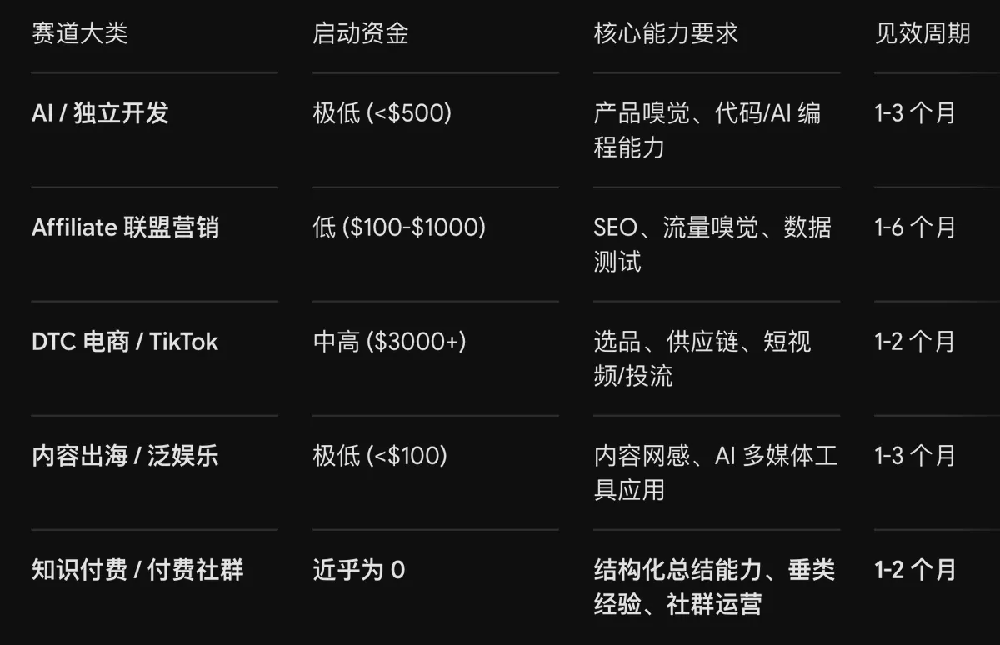

# Roland（@ChainEpic）：2026 全球化搞钱终极指南——普通人如何从 0 到 1 构建海外美金印钞机（亲身经历，万字手码）

> Roland 亲身经历的出海搞钱框架：AI 抹平语言/文化/研发/客服壁垒是根本原因；三大底层套利逻辑——①汇率与购买力（赚美元花人民币）②付费意愿（欧美更强）③时间差与模式（中国互联网商业模式降维打击西方）；五大赛道——AI 与数字产品出海、流量变现与 Affiliate 联盟营销、跨境电商、内容出海与泛娱乐生态、知识付费与付费社群；配有启动资金/核心能力/见效周期表格。

<!-- more -->

这篇文章只解决一个问题，如何出海赚钱？

为什么现在普通人能够实现出海赚钱，就一个根本原因：AI 抹平了语言、文化、研发和客服壁垒。

需要实现出海赚钱，必须知道出海赚钱的三大底层套利逻辑：

1. 汇率与购买力套利。 也就是我们说的，赚美元，花人民币。
2. 付费意愿套利。欧美用户有着更强的付费意愿，中国用户更喜欢免费的入场。
3. 时间差与模式套利。中国互联网的商业模式和发展程度是金字塔顶尖的存在，放到西方互联网是降维打击。例如：私域、直播切片、微短剧

## 出海搞钱的五大核心赛道

### 赛道一：AI 与数字产品出海

一、游戏与高粘性垂直应用： 去搜下点点互动，去了解下无尽冬日。就这一款游戏，2025 年收入 40 亿美元，后续还有 kingshot 等爆款，游戏出海界的扛把子

二、浏览器插件和 Shopify 插件类型：Monica AI，听过吗？一款浏览器插件形式的多合一 AI 助手，如果你没听过，那么我告诉你，后来的 Manus 就是在他的基础上衍生出来的，创始人肖弘。

Shopify 插件虽然体量没那么大，但是也能稳定贡献可观的现金流。

三、iOS / macOS 产品：字节跳动 CapCut，用户数超 6.6 亿，覆盖 170+市场/地区，支持 30+语言。你知道这什么概念吗？可以说是字节凭借一己之力，让整个互联网进入了短视频时代。不仅仅 tiktok 所向披靡，连短视频的创作工具都能做到 6.6 亿用户。

四、Web AI 工具与 微型 SaaS：植物识别 PictureThis，我在无数投资人那里听过这个产品的故事了，这是出海产品的典型代表，很好的抓住了海外用户的种植花花草草搞园艺的需求，但是放到国内，你想让人使用这种产品，别说让人付钱，你还得倒送他几盒鸡蛋。

## 赛道二：流量变现与 Affiliate 联盟营销

联盟营销，也就是常说的 AFF（CPS 分销）。核心形式：商家获得产品宣传、用户通过流量变现赚佣金。

这其中主要包含：

SaaS 与基建类分销：域名主机、AI 软件、建站工具的 CPS 推广。

高暴利垂直行业：你们从很多人跟简介里面看到一个交易所的注册链接就属于这种。还有一些金融，电竞，德扑相关的东西都属于，但是这块存在一些法律风险，我希望用户一股脑投进去之前，先做好功课，规避好法律风险。

程序化 SEO 与工具站矩阵：目前 X 上用户最喜欢切入的一块赛道。但是目前已经很卷了，新人机会很小，不过对于形成规模的站长来说，依然是最佳赛道，没有之一。

小众垂直 Blog，这块是 Roland 我最推荐新人用户入场的赛道。因为赛道足够多，赛道竞争最小。满足这两点，我相信就不需要什么其他理由了。 有人可能不懂这是怎么玩的，例如你深耕一个极窄领域（如户外露营装备、特定软件教程），靠深度内容建立信任变现。你甚至可以更加细分，仅仅做户外露营装备里面户外帐篷，或者生火设备，你很容易做到该领域的前几名。

## 赛道三：跨境电商

Roland 在每一个赛道都有已经在赚钱的业务在跑。跨境电商也不例外。

这块主要分三种。

一、品牌独立站：Roland 的潮玩店就是这种。利润高，产品迭代快。通常使用 Shopify 搭建，前三个月只要 每月 1usd 的店铺费用。当然，我只负责提供站点和域名还有品牌授权，所有的选品，物流，仓储，直播带货，售后都是有其他合作伙伴管理。

二、内容电商与本土化店群：这里面主要是 达人建联分销等等。像 Roland 我的独立站的经常就会收到这样的邮件：“我是 xxx 平台主播，专注做潮玩盲盒开箱领域，这是我的主页地址……我很喜欢你们的产品，我想跟你们合作，我期待的佣金比例是…………”

三、纯数字商品电商：卖 Notion 模版、Figma 设计素材、Procreate 笔刷、Prompt 提示词库，成本为零，纯利 95% 以上。我们最近在 X 看到有些人卖 skill，卖网站模板其实都属于这一类。

四、直播带货：直播带货其实不是一个适合普通人玩转的赛道，光一个 tiktok 账号美区环境直接就拦住了 99% 的人了，更别说你需要熟练的英文和镜头表现力，口条清晰，直播间运营，布景，配货等等各方面配合。目前我的独立站是和一个专业的 tiktok 直播团队合作的，直播带货收入归他们，独立站流量收入归我。非常良性的利益分配方式。

写到这里，可能你们也发现了，出海搞钱的方式居然有这么多，但是所有的一切，都需要你深入挖掘，我很喜欢用一个词叫做 keep digging,keep grinding. 一定要深挖，一定要深磨，

你在国内都能卷出来，你有这个品质，你出海就是降维打击。

## 赛道四：内容出海与泛娱乐生态

YouTube / TikTok 全球创作者基金与商单：但凡你能看到这篇文章的，你之前肯定没少看过什么李子柒那些人在 YouTube 的收益。但是这条路 Roland 不推荐，因为他不适合大多数人。做内容创作是地狱难度级别的赛道，需要你的积累和网感，而这东西和性格以及你的认知绑定，他不像我上面提到的 digging 和 grinding 就有用，说白了就是要天赋。

短剧出海与小说出海：承接国内短剧分销，或用 AI 辅助翻译/创作狼人、霸总网文投放到海外阅读平台。通常来说，这个赛道至少要工作室才能良好运转，并且需要极其高效的工作流，门槛相对来说高一点，我就不过多推荐了。

玄学与身心灵赛道： 这块通常需要配合短视频平台去做，八字风水、塔罗牌、水晶疗愈、冥想音频在欧美年轻群体中的高客单价变现，基本就是流量→独立站/私域 的玩法。考验的也是多方位的能力了，意味着你不仅要有高流量的能力，还要有做私域的能力，对新人来说，也是要求高了点。之前 @fanshifu 推荐的信仰类 app 实际上就是赛道一和赛道四结合的。

## 赛道五：知识付费，付费社群

有时候你们经常会想，出海这么赚钱，为什么还有人要做付费社群？

因为付费社群可能比上述这些更加赚钱。

X 上有几大付费社群群体，可以说是暴利印钞机，前几天出现的 Stanley 付费社群丑闻相比大家都看了。一个入群门票可以做到 9999 元，这是你卖多少网站模板，卖多少个你 AI 工具订阅才能赚到的呀？

引用推文：Alin A (@Alinsees)

花一万块进群没被转过一条推，核心团队倒贴半年一分没拿，全员活在他编的阴阳剧本里。万字长文「中推第一韭菜群」125 分钟连麦掀桌现场实录

https://x.com/Alinsees/status/2116319434981720480

连面向国内用户的付费社群都这么赚钱，那面相国外用户的付费社群岂不是得起飞？

另一种做法是免费社群 + 高客单价陪跑与 1v1 咨询——在知识付费里属于「高客单价陪跑与 1v1 咨询」这个赛道，通过丰富的经验协助品牌或企业实现 AI 接入，也帮一些传统企业主提升前沿认知。

付费社群里面玩法也有很多。 例如：跨境选品情报、德州扑克高阶策略复盘、独立开发增长黑客、甚至健身私教群，收 $49/月 的会员费，只要攒够 200 个铁杆会员，就是每月近万刀的被动现金流。

这里做个小科普：普通人如何“无中生有”切入海外知识付费呢？

搬运与重构：互联网整天都是在搬运和重构中，不仅仅是人在这么做，AI 也在这么做，就像你们拿 Roland 这篇文章去重构洗稿，我也完全不会反对。你们完全可以收藏好，去闲鱼上卖这份出海赚钱指南，你卖个 9.9 不过分吧？实在卖不出去你卖个 2.99 不过分吧 ?

诱饵漏斗：先做一个极高质量的免费小工具或速查表，要求用户输入邮箱免费领取；拿到精准邮箱后，通过邮件一步步培育信任，最终转化进高价社群。一个可复制的做法：放出一份德州扑克起手牌玩法的免费 PDF，用邮箱即可领取。这个方法让我获得了几千个德州扑克玩家的精准邮箱，然后通过邮件沟通，最终获得了一个几百人的德州扑克私域社群。

最后，我还做了个表格，汇总了一下这几个出海赛道的启动资金，核心能力要求以及见效周期，大家保存好！

这些全是 Roland 本人的亲身经历，都是压箱底的干货知识。希望大家看到这里的能够收藏和分享。

## 相关页面

- [[sources/chainepic-self-hosted-search-console-dashboard-opensource]]
- [[sources/chainepic-tool-site-competitor-keyword-seo-formula]]
- [[sources/chainepic-tld-domain-arbitrage-musically-ly]]
