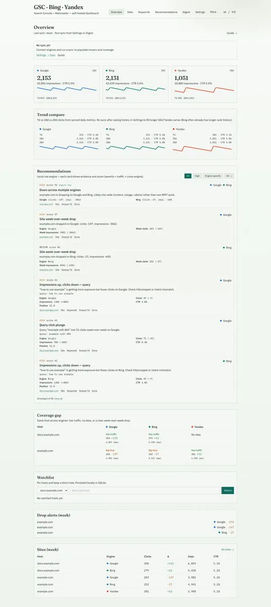
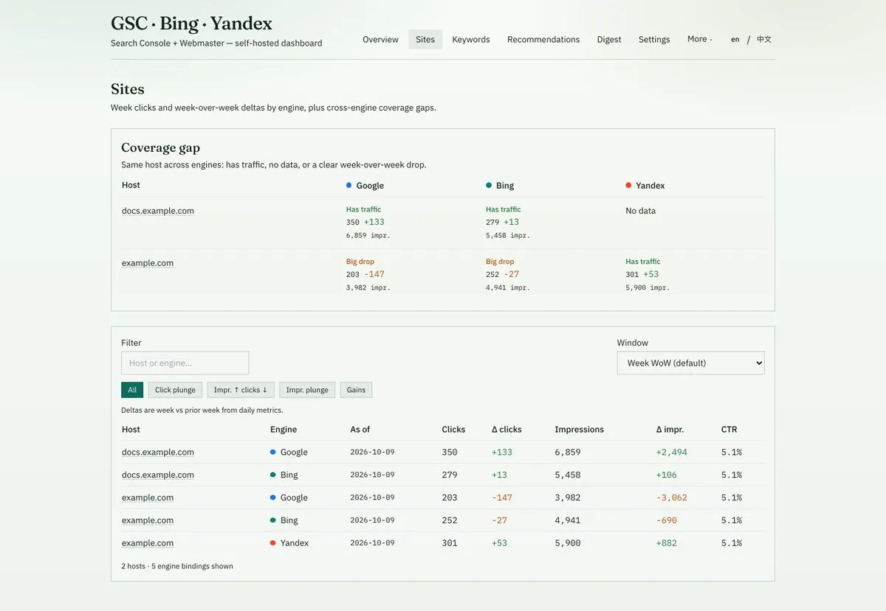
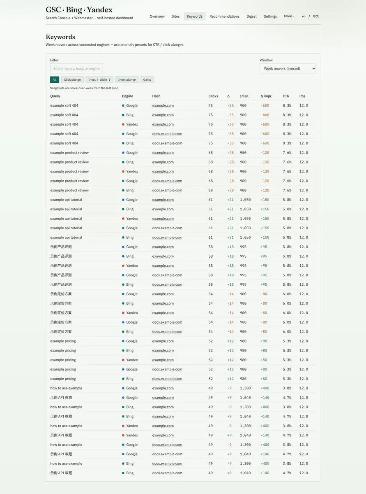
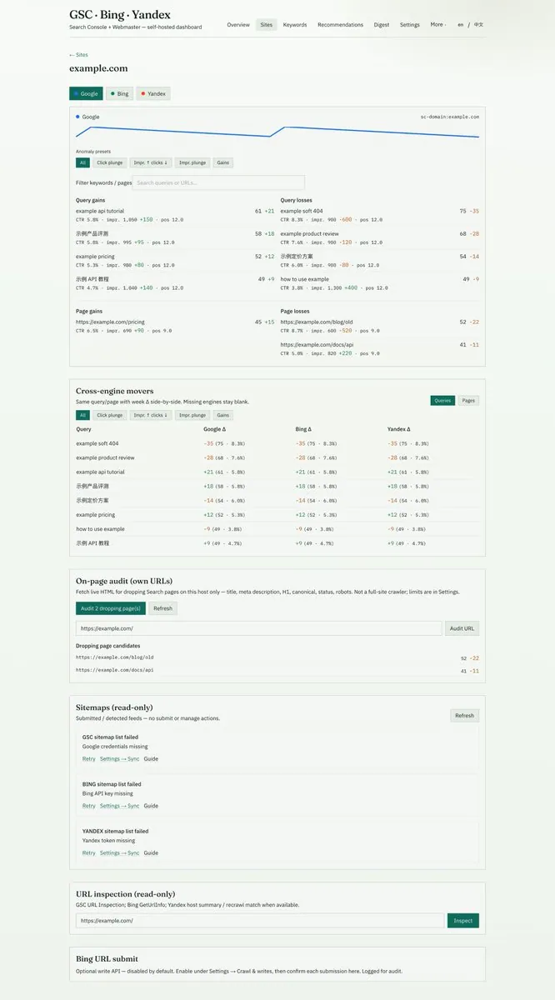
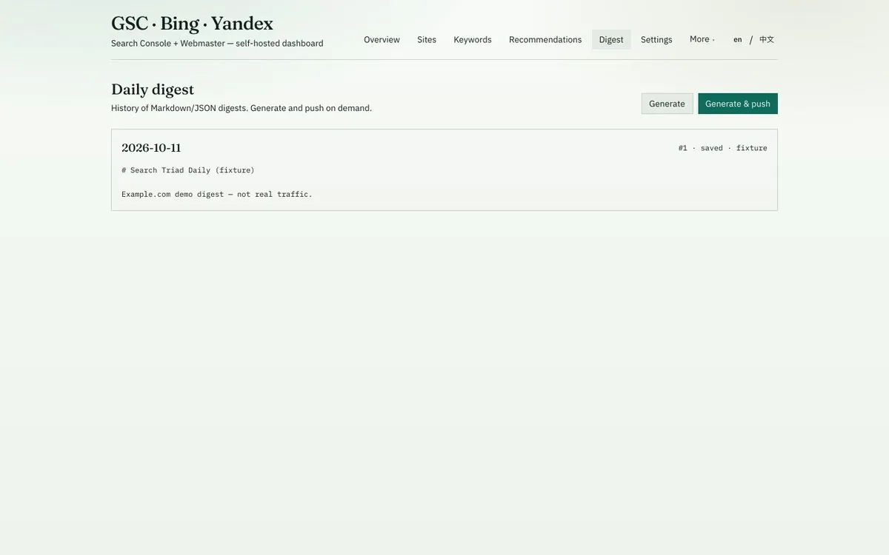
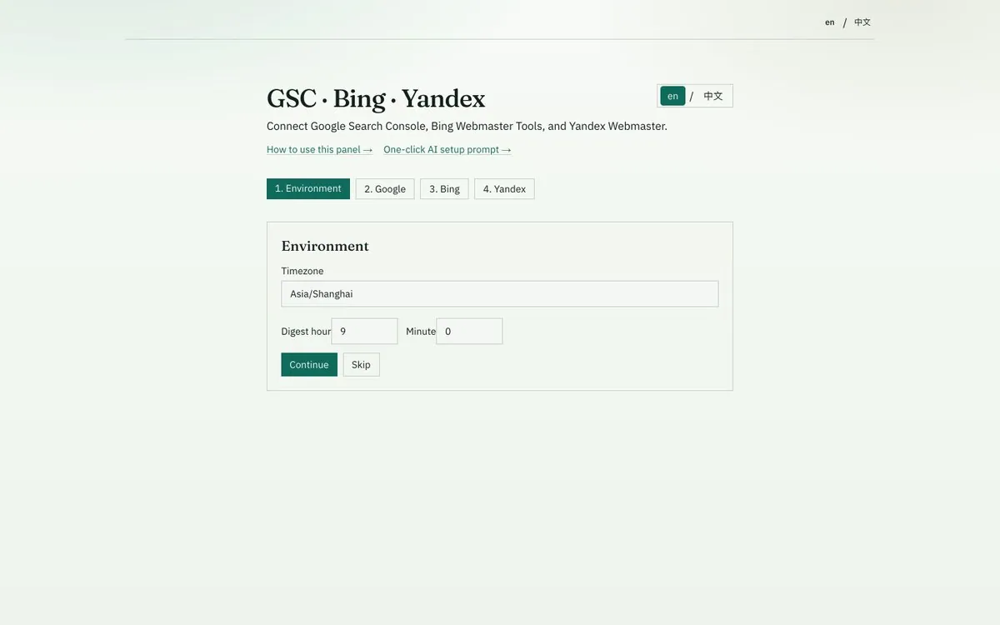

# Roland（@ChainEpic）：开源多搜索引擎控制台仪表盘——Google、Bing 与 Yandex 数据聚合

> 独立站站长必备的自部署开源 SEO 监控看板：一站式聚合 Google Search Console、Bing Webmaster 与 Yandex Webmaster 核心数据；打破 GSC 仅显示前 1000 个查询词的限制，将全量搜索点击、展现、CTR 与关键词排名变动持久化存入自备数据库，方便进行跨引擎横向分析。

<!-- more -->

One panel. Three official webmaster APIs. Zero SEO SaaS in the middle — and your API keys never leave your machine.

If you run more than a couple of sites, you already know the ritual: open Google Search Console, check clicks, open Bing Webmaster, check again, then — if you care about RU / CIS traffic — open Yandex Webmaster and do it a third time.

I got tired of that. So I built a small self-hosted panel that pulls the three of them into one place, syncs about 28 days of metrics, surfaces movers, and can push a daily Markdown/JSON digest to a webhook or email.

Today it’s open source under MIT, maintained by Chainepic LTD:

GitHub: [github.com/chainepic/gsc-bing-yandex-dashboard](https://github.com/chainepic/gsc-bing-yandex-dashboard)

## Why self-hosted?

Most “unified SEO dashboards” want your Search Console OAuth and Bing API key in their cloud. That might be fine for a marketing team. It’s a non-starter if you manage many properties, or you simply don’t want another vendor holding the keys to your traffic data.

This project takes the opposite path:

- Talks only to the official GSC / Bing / Yandex APIs
- Stores metrics in a local SQLite file
- Encrypts secrets with your own APP_SECRET (AES-256-GCM)
- Optional panel password for public hosts; open by default on localhost

Upgrade the code with git pull. Your data stays in ./data. Nothing is uploaded to us.

## What it looks like

The Overview gives you per-engine KPIs, sparklines, week / 28-day compare, coverage gaps, and a watchlist — without hopping consoles.

Overview — Google · Bing · Yandex in one glance (demo data: example.com)

Sites view shows week clicks and week-over-week deltas side by side, plus where an engine is missing or dropping hard.

Sites — coverage gaps and WoW deltas by engine

Keywords are unified across engines: query, host, clicks, impressions, position, and deltas, with client-side filters for plunges and “impressions up / clicks down” patterns.

Keywords — movers across GSC, Bing, and Yandex

Drill into a host and switch engine tabs for trends, query movers, and page movers.

Site detail — engine tabs, trends, query & page movers

## Daily digest, not another dashboard tab you’ll forget

Every morning (default 09:00 in your timezone) the panel can sync, build a digest, and push it via webhook or SMTP. You can also generate on demand from the Digest page.

Daily digest — history, preview, generate & push

## Setup in minutes

There’s a four-step wizard. Connect any subset of the three engines — one is fine, three is better — pick properties, sync, done. UI is available in English and Chinese.

Setup wizard — connect Google, Bing, and/or Yandex

What’s free, what’s not (yet)

The self-hosted panel is MIT. Sync, movers, digests, rule-based recommendations — all yours to run on your metal. I’m exploring an optional hosted cloud and metered AI assists later; neither is required to use the open-source app. Details live in the repo under docs/OPEN-CORE.m

## Who this is for

- Indie hackers and operators who already live in Search Console
- Agencies / site portfolios that also care about Bing (and maybe Yandex)
- Anyone who wants a morning digest instead of three browser tabs
- People who refuse to paste webmaster credentials into another SaaS

It’s not Ahrefs, Semrush, or a keyword-research suite. It’s a thin, honest control plane over the data you already own in the official webmaster tools.

## Try it / break it / star it

Screenshots in this article use fictional example.com demo data — no customer sites. If you self-host, your real numbers stay on your disk.

Repo, docs, and EN/ZH screenshots:

[https://github.com/chainepic/gsc-bing-yandex-dashboard](https://github.com/chainepic/gsc-bing-yandex-dashboard)

Issues and PRs welcome. If you run Bing + GSC (or all three) and this saves you a tab, a star helps more people find it — and tell me what you want next.

— built by @chainepic

## 相关页面

- [[sources/gosailglobal-ai-tools-seo-checklist-15-pitfalls]]
- [[sources/taowithsaas-bing-webmaster-free-competitor-backlinks-export]]
- [[concepts/open-source-seo-tooling]]
- [[concepts/gefei-seo-keywords]]
