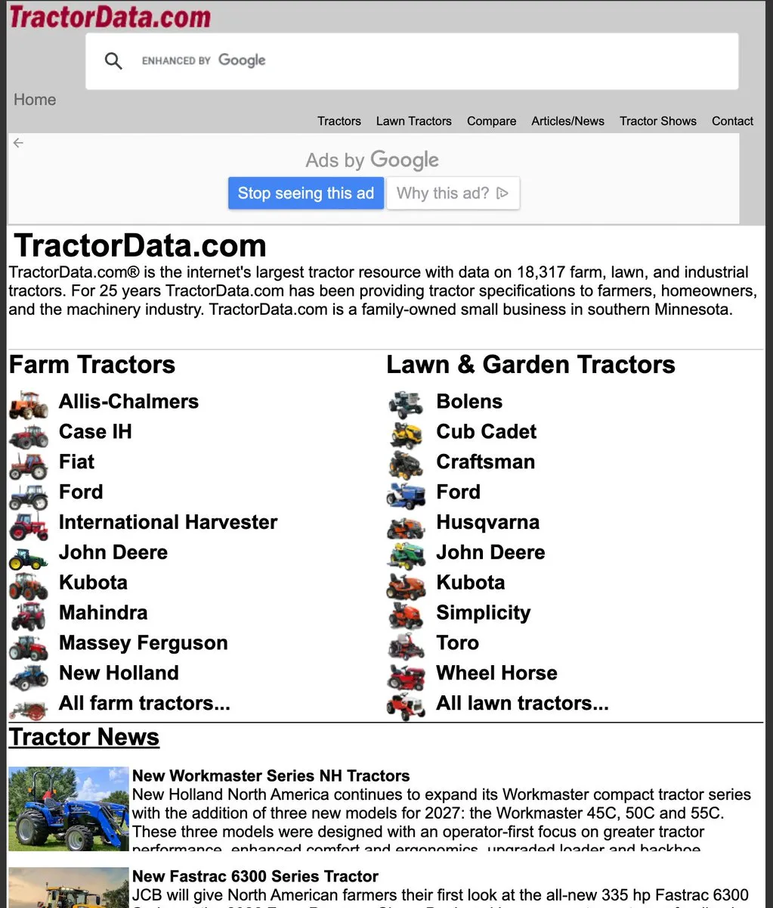

# Roland（@ChainEpic）：运行了 20 多年、界面 90 年代末风格——TractorData，每天 6 万访客年入约 55 万美元

> TractorData：运行 20 多年，界面停留在 90 年代末的 HTML 风格（满屏纯文字、蓝色超链接、像素极低的缩略图），每天 6 万访客，年收入大概 55 万美元。农场主、二手农机商和维修工每天都在上面查数据，靠庞大的长尾搜索流量挂 AdSense 广告和农机配件导流变现——长尾 SEO 与行业刚需数据库的经典案例。

<!-- more -->

这个网站运行了 20 多年，界面停留在 90 年代末的 HTML 风格，满屏都是纯文字、蓝色超链接和像素极低的缩略图。

每天 6 万访客，年收入大概 55 万美元左右。

这就是 TractorData

农场主、二手农机商和维修工每天都在上面查数据，靠庞大的长尾搜索流量挂 adsense 广告和农机配件导流变现。

## 相关页面

- [[concepts/seo-basics]]
- [[sources/chainepic-overseas-moneymaking-ultimate-guide-2026]]
