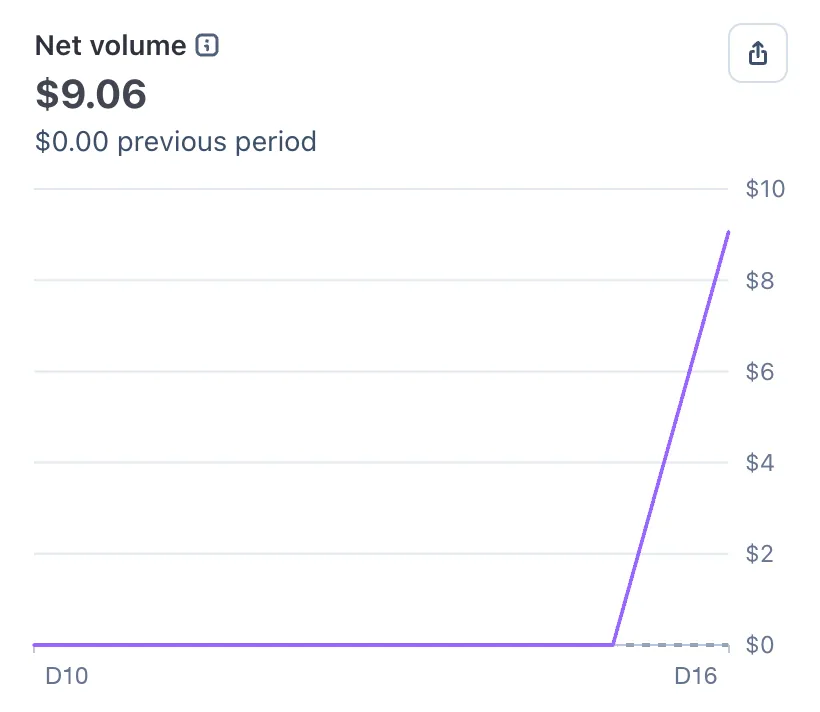
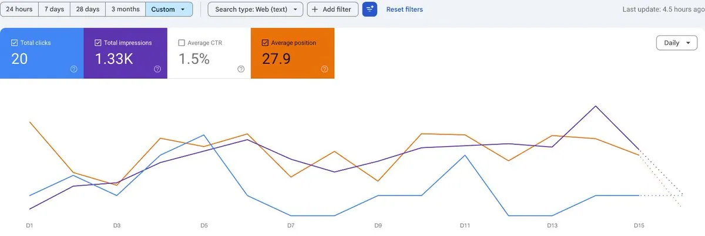
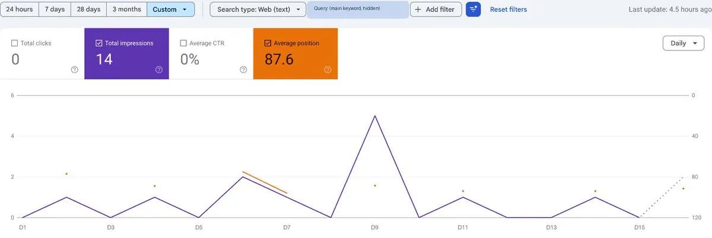
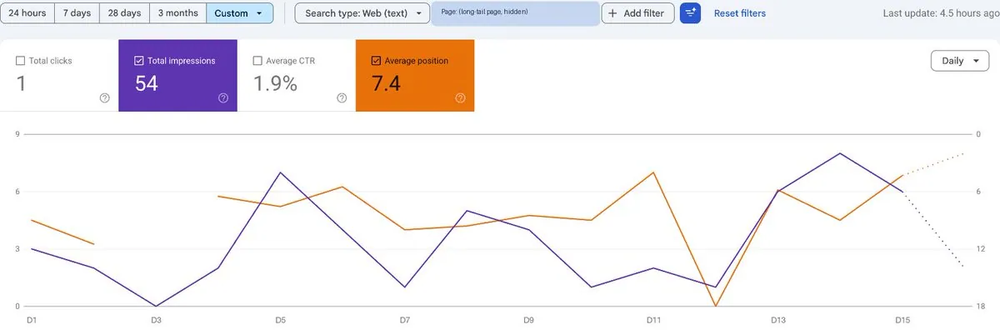
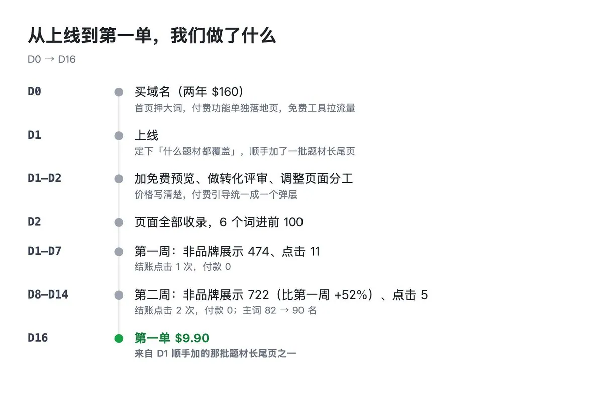

# 硅谷超哥（@chaogetalks）：18 小时上线，16 天开单——这一单是怎么来的？我把每一秒都扒出来了

> 出海 SaaS 从上线到第一单的全过程逐帧复盘：18 小时完成从想法到可访问站点、16 天拿到首个订单，作者把每一秒的决策、投放与转化动作都拆出来讲——展示如何用最小可行版本快速验证需求、在流量几乎没有的时候靠精准长尾词与内容矩阵撬动第一批真实用户，以及首单背后的选品、定价、信任构建与转化路径选择。

<!-- more -->

兄弟们，我开单了！！！

史上第一单！

不仅是我这个 AI 视频站的第一单，更是我做网站以来，有史第一单！！

## 故事开演

一觉醒来，睡眼惺忪地瞄一眼邮件，『xxx 网站收到付款：9.90 USD！』

我还以为眼花了！马上跳起来登录 Stripe 确认！

支付后台的收入曲线，一直平在 0，到第 16 天一根线暴拉！

抽丝剥茧一番，原来是一位素不相识的波兰人，在中午与朋友聚会后，估计突发奇想要做个 AI 视频，然后在 手机 Google 上面划到了我的站，觉得『诶，有意思』，然后浏览了 7 分多钟，『靠谱！』，毅然下单，终于促成我 0 单的突破！

我太开心啦！

## 说实话，我已经不抱希望了

已经做过十几个站，流量有过，收录有过，排名也有过，就是没有一个人付过钱。

当然，我支持支付的也就几个站。

这个站刚做完之后，我真的满心期待。

结果第一周：Google 收录飞快，页面第二天全进了，6 个词进前 100。然后呢？付费漏斗几乎一片漆黑，一周只有 1 次结账点击，付款 0。

第二周更扎心：展示涨了一半，ChatGPT 都开始给我带人了，结账按钮又有人点了 2 次。付款：0。主词还从 82 名掉到了 90 名。

真是心灰意冷，我是不抱希望的了。

我给自己定的规矩是 D28 前要见到第一笔钱，D90 还是每月 0 单就转维护。

然后第 16 天，突破了！

## 这一单是怎么来的？我把每一秒都扒出来了

好不容易的第一单，我当然要把各种蛛丝马迹都查个底朝天！

我要复盘！

我要复制成功！

首先，用户不是从我押的大词进来的。

是 Google 上一个冷门题材的长尾页。这个页面开单前只有 46 次展示，0 次点击，排在第 7 名左右。是上线那天按「什么题材都要覆盖」的思路顺手加的。

就是这个不起眼的页面，带来了第一个付费用户。

其次，用户在站里的轨迹：

- 波兰时间 12:38PM 从 Google 点进这个题材页，看了 7 分钟
- 12:45 PM 注册
- 注册后 11 秒，点了结账！
- 第一次打开结账页，关了
- 第二次打开，又关了 - 我猜用户手机是不是有问题？我后台没有看到任何失败记录。估计犹豫了。。
- 12:53 PM 第三次，付款成功，积分 1 秒到账
- 9 秒后，开始生成视频，成功

前两次打开结账页都关掉了，第三次才付。看到这里我手心都是汗，估计差点就失之交臂。

这一单的账： 标价 $9.90，用本币付，加上当地增值税，合 $12.18。平台代缴税 $2.28，手续费 $1.27，到手 $8.63。

$8.63，不多，还得刨开成本，但这是我的第一笔真金白银入账啊！

## 是不是盗刷？查了

我最担心是不是盗刷！因为客户尝试了两次！

注册 11 秒就付款，前两次还没付成，看起来有点像试卡，所以专门查了支付后台：风控评分正常，银行直接批准，CVC 通过。卡、持卡人、账单地址、付款 IP 全部对得上。前两次结账页根本没提交过卡，不是被拒，应该就是犹豫了。

## 18 小时上线，16 天开单

这一段我必须嘚瑟一下：这个站不是从零写的，是用我自己攒的上站模板起的。

登录、支付、积分、生成任务、后台、来源统计……全是模板里现成的。

站点这一层，只放自己的文案、页面和配置。

我的时间账：

- D0 傍晚：第一份研究出来，结论是「不开新站，放进老站当一个页面」
- 一个半小时后：第二份研究改成「单独起站」
- D0：买域名
- D0 晚上：第一个建站提交（开始开发），直接用上站模板起的站
- D1 中午：上线，Google 当天就收录了
- D2：大改版一轮，集中干活到这天就停了（3 天一共 251 个提交）
- D2 晚：第一次被 AI 搜索引用
- D3：第一次进 Google 前 100
- D6：日访客到 10
- D16：第一单！

从第一份研究到上线：18 个小时。从上线到开单：16 天。

第一单里的每一环：Google 登录、本币结账、积分 1 秒到账、生成视频、后台看到用户从哪来，全都是模板自带的。这个站自己没为支付写过一行代码。

模板三周发了一百多个版本，改一次，所有站一起升级。这是我最自豪的地方！

## 好吧，是时候看看我们的成长曲线了

## 第一单教会我的 5 件事

1. 长尾比大词先成交。 我押的是主词，钱却是从一个没人注意的题材页来的。搜具体题材的人目标非常明确，进来就是要这个。
2. 想买的人是真急。 注册 11 秒就点结账。第一周我们改的那些：价格写清楚、付费引导统一成一个弹层，全都没白做。
3. 结账页是最后一道坎。 三次才付成。本币价加上税，比页面上写的贵了 20% 多，可能就是犹豫的原因。
4. 归因别全信 GA。 这一单在 GA4 里被归成 Unassigned，真实来源和落地页只在站点后台和支付记录里。
5. 别太早给自己判死刑。 第二周我已经不抱希望了。结果 D16 就出单，比我自己预测的 D28 还早了 12 天。

## 最后

非常感谢 @qianshuixia2026 和 他群里的大佬们，还有 @AI_Jasonyu 的群，每天刺激我和没开单的群友。小声说，我也在 @gefei55 哥飞 的群里，好几年了，大佬的教程没少看，算是最不成器的弟子，没脸认是哥飞群的。。。

希望我年底能靠网站开单把群费挣回来 。。。向日入万刀出发！

最后的最后，想对看到文章的朋友说，如果你也在上站，还没开单，别气馁，很多时候，也许就是。。。转角遇到爱。。。就是运气啦。。。坚持！

你永远不知道第一单会从哪个不起眼的页面里冒出来。

从 0 到 1 最难。我终于到 1 了。

继续加油！

最后啰嗦一句： 分享真实经历，多少都有暴露自己网站的风险。如果大佬猜到了我的域名，请不要公开留言。。。谢啦！

## 相关页面

- [[sources/xbaodao-shopify-3-months-one-sale-cc-built-site]]
- [[sources/yaohongan2025-hardest-part-of-overseas-site-is-deciding-what-to-build]]
- [[concepts/indie-product]]
- [[concepts/b2c-conversion]]
