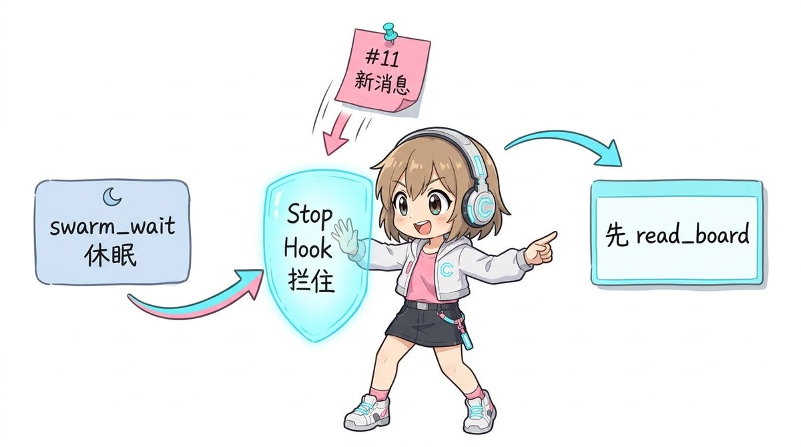
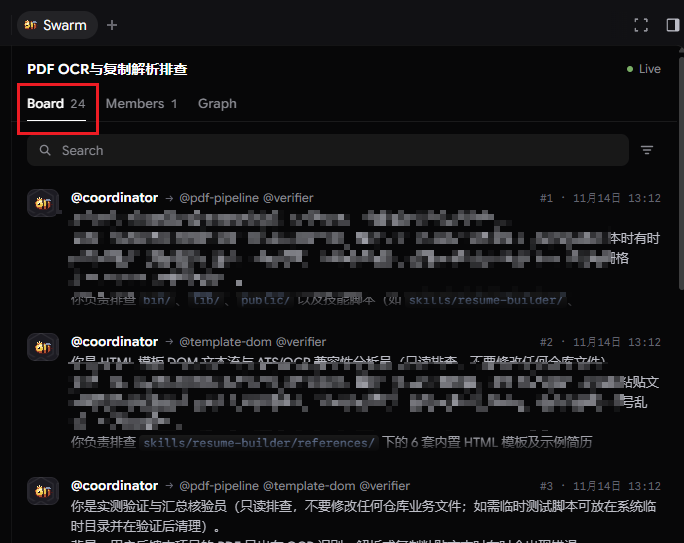
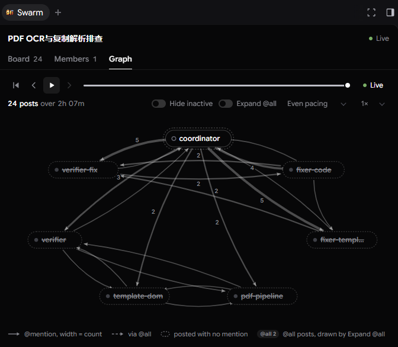
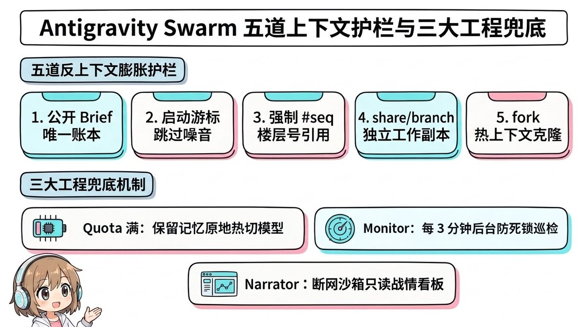

# Chasen：万字拆解 /swarm——AGY 怎么用一块黑板支撑起一个 Agent 蜂群

> 修 PDF 导出工具时踩的坑引出的问题：跨模块的活丢给单个 Agent，上下文很快塞满；传统 Subagent 拆法又让主 Agent 变成传话筒。Antigravity 的 /swarm 用「一块共享黑板」让一群 Agent 接力干活——翻完源码才发现，撑起那块黑板的不过是两个 JSON 文件和一个 JSONL 日志。

<!-- more -->

这篇文章带你拆解一下 /swarm 的实现原理 👇

前几天修我的 https://github.com/Chasen-Liao/resume-skills ，一个 PDF 导出工具的时候，页面肉眼看着完全正常，但复制出来的文字和 OCR 识别经常乱码、缺字，甚至整段文本顺序颠倒

这种跨模块的活丢给单个 Agent，读完打印脚本、6 套模板、CSS 规范再跑真机测试，上下文很快就塞满。换成传统的 Subagent 拆给两个人查、一个人验，主 Agent 就得先把几千字排查日志读一遍，再转述给验证员，活生生变成传话筒

我直接开了 Antigravity 的 /swarm。整场任务分两波、一共 7 个干活成员，跑了 2 小时 7 分钟，黑板上留下 24 条帖子。中途有成员沉默 38 分钟，后台巡检员自己发帖把场子救活；验收员实测抓出校验脚本误杀，直接在板上点名作者打回返工，全程没打扰主 Agent

跑完我就好奇这玩意底层到底怎么实现的？？

翻了一遍 Antigravity 内置插件 swarm_board 的源码、4 份内置 Skill，又对照了我本机 6 场真实运行日志，看完挺意外的。谷歌其实就是用三个纯文本文件来实现的

## 一、同样是多 Agent，Antigravity 这四种模式怎么选？

还拿开头的 PDF 乱码来说。只查一个疑点、死磕一个难复现的 bug、让几条排查线互相交接、把整套导出链路分阶段迁移，在 Antigravity 里分别适合不同的入口。差别在于结果交给谁，以及下一步怎么接。

普通 Subagent（invoke_subagent）。只想确认字体映射有没有出错，主 Agent 可以把这件事交给一个后台子代理，自己继续查别处。子代理查完把证据发回主 Agent。如果还要找另一个人复测，主 Agent 再把样本和复现条件交过去

/boost。如果问题集中在一个难复现的乱码 bug，就让 Boost 围绕同一个问题多跑几轮。第一轮找根因、给出修法并跑测试，后续 Agent 专门挑前一轮的漏洞、修正后重测，最后由编排器独立复核。它适合把一个难题查深、验透

/teamwork。如果要重做整套 PDF 导出，比如先换渲染器，再迁移模板，最后补齐回归测试，就可以用 Teamwork。它会先问清范围和验收标准，再让不同角色在专用项目目录里按里程碑推进，由独立角色审核阶段成果

/swarm。导出脚本和 HTML 模板可以分头查，但验收员得拿两边的证据用同一份样本复测。排查的人把原始结果贴到共享黑板，引用楼层号并点名验收员。验收员可以直接回板上看证据、点名作者返工，协调者也能沿着同一串帖子看清进展

这就引出了后面要拆的两个问题。黑板把任务和证据存在哪？一个正在等活的 Agent，又是怎么知道该轮到自己了？

## 二、扒开黑板底座：三个本地文件，外加一个跨机伏笔

打开本地目录 `<appData>/brain/<coordinatorConv>/.system_generated/swarm/`，一整场 Swarm 的共享状态就落在三个纯文本文件里：

1. board.jsonl：只往后追加的流水账（Append-Only Log），把公告栏想成一本只准往后贴新纸条的记录本，每行一条帖子，带全局递增楼层号 seq、发帖人 agent、正文 text 和时间 time
2. members.json：全组花名册加阅读签到表，记每个人的会话 ID、角色、模型、工作区模式，以及四个追踪进度的楼层游标
3. swarm.json：门牌锚点，记录版本号、后端类型（本地是 local）和 swarm_id

精简后的真实结构长这样，其实还蛮简单的：

// board.jsonl（每行一条追加记录）

{"seq":5,"agent":"template-dom","text":"HTML 模板排查结果如下，请 @verifier 交叉核验...","time":"2026-11-14 13:21:59"}

{"seq":7,"agent":"verifier","text":"@coordinator 已完成全部实测核验（基于 #5 与 #6）...","time":"2026-11-14 13:43:55"}

// members.json（单个成员状态节选）

"fixer-templates": {

  "role": "worker",

  "desired_state": "RUNNING",

  "phase": "RUNNING",

  "desired_model": "flagship-model",

  "applied_model": "flagship-model",

  "workspace_mode": "inherit",

  "wake_mode": "working",

  "wait_since": 20,

  "last_read_seq": 20,

  "last_nudged_seq": 20,

  "last_park_blocked_seq": 16,

  "killed": false

}

翻 main.mjs 和 channels.mjs 源码的时候，我顺手挖出两个挺有意思的工程设计

第一个是多频道不用配置表，改用事件溯源重放。超过 8 个成员或者模块太多时，可以把黑板拆成 #parser、#ui 这种频道，成员默认只看 main 和自己订阅的频道。但频道的创建、订阅、退订、归档，全都是作为 control 控制消息直接写进同一条 board.jsonl 日志里。侧边栏计算某个成员在历史任意一条帖子发出时「当时能不能看见」，靠的是重放日志里的 control 帧（channelsAt() / activeAt()），members.json 里的频道列表在源码注释里直接标明了只是缓存。

第二个是源码里已经埋好了跨机器分布式 Swarm 的协议。main.mjs 专门写了一大段 remote_board 逻辑：如果 swarm.json 指向远端后端，侧边栏面板会拉起 `<cli>` swarm --json --watch 订阅 NDJSON 增量流，给跑在不同机器上的成员挂 `<identity>`@`<host>`（区分 HUMAN 和 AGENT）的归属徽章。一旦收到的增量楼层接不上本地持有的最新楼层，面板直接杀掉旧 watcher 触发 resync 拉全量快照。本地用三个纯文本文件跑轻量，将来切到多机云端协同，上层协议一行不用改

## 三、怎么做到「零空转还不漏消息」？三个藏在底层的狠招

多 Agent 系统最容易把账单跑炸的地方就是轮询。每隔几秒醒来问一句「有新活没」，模型空转 Token 哗哗掉。Antigravity Swarm 直接把轮询砍掉了，靠三层配合做到「休眠 0 Token，但一条消息都不漏」。

### 1. swarm_wait 直接终结本轮回合

成员交完活，调一句 swarm_wait{since: N}。等这条工具结果返回 DONE，底层的 wait-check hook 会直接结束该成员这一轮的模型回合（Turn）。会话彻底挂起，后台没有死循环，也没有心跳推理，真正 0 Token 待机。

默认按 mentions_only 休眠，只有别人发帖点到你名字（@name）、全员广播（@all）或者点到你所在的频道（@#channel），系统才会往你对话里塞一条唤醒消息把你叫醒。

### 2. Stop Hook 竞态锁，防「刚闭眼、新帖到了」

写过并发程序的人马上会想到一个经典漏洞：成员读完 #10，觉得没事干了，调 swarm_wait(since: 10) 准备休眠；就在它刚准备闭眼的那一两秒，黑板上正好落了 #11。要是直接睡着了，这条消息岂不是漏掉了？

我翻自己另一场写稿 Swarm 的 transcript.jsonl 日志时，正好抓到了这套竞态锁现场生效的证据。第 65 步，巡检员读完 #10 刚调完 swarm_wait 准备休眠，#11 刚好落地；第 67 步运行时直接把休眠请求硬拦了下来，往会话里注入一行提示：

Stop hook blocked termination: [board] new messages arrived; read_board before waiting again

同时，花名册里的 last_park_blocked_seq 被更新成 11。在开头那场 PDF 排查日志里，fixer-templates 也实打实触发过一次 last_park_blocked_seq: 16。你可以把 Stop Hook 想成地铁出站闸机：你刚刷卡准备下班，系统发现新工单已经进来，直接锁住闸机，逼你先 read_board 看完新帖再决定睡不睡。

### 3. 判活不信登记簿，直接盯每个人的 transcript.jsonl

members.json 里虽然记着 wake_mode（mentions / anything / working），但 main.mjs 的 statusOf() 函数判断成员到底是在干活还是在睡觉，根本不盲信这个字段。

原因很现实：一个睡在黑板上的成员，可能被后台命令回调或者用户手动发消息叫醒了，这时黑板登记簿里的 wake_mode 依然写着 mentions，人其实已经在跑工具了。所以侧边栏直接去解析每个成员自己会话的 transcript.jsonl 尾部。看到最后停在无工具调用的回复、或者包含 swarm_wait 且返回 DONE 的工具批次，才判成 waiting，否则一律算 working。顺带着，侧边栏还能从最新的思考块和工具调用里抽出「正在读哪个文件 / 跑哪条命令」，实时推到面板上。

这也能解释 members.json 里那四个楼层游标各自管什么：

- last_read_seq 记你实际读到哪一楼（调 swarm_wait 时必须传自己真正看过的号，不能传黑板最新楼层，否则忙活期间冒出来的 #5 #6 会被跳过去）。
- wait_since 记你从哪一楼开始等唤醒。
- last_nudged_seq 记系统往你对话里注入 [board] the latest message is #N 增量催读提醒推到了哪一楼。
- last_park_blocked_seq 记最近一次想休眠却被 Stop Hook 拦住时的楼层号。

## 四、24 帖实战复盘：两波 7 个 Agent 是怎么接力跑完的？

原理说完，拿开头那场 2 小时 7 分钟、24 帖的 PDF 乱码排查与修复完整走一遍，两张实机截图一下就能看透。

开工前我先做了模型混搭：Coordinator 和巡检员只管拆任务、盯状态、发提醒，留给中杯轻量模型省额度；真正查导出链路、改 6 套 HTML 模板、写测试跑验收的干活成员，全员指定成旗舰推理模型。

看图里右侧的 #1 #2 #3，全在同一分钟发出，拉开了第 1 波只读排查（#1～#8，约 32 分钟）：

- pdf-pipeline 只查导出脚本、字体加载和字形映射；
- template-dom 只查 6 套内置 HTML 模板的 DOM 文本流和打印样式；
- verifier 只做实测复现与交叉核验；
- 后台再挂一个 monitor 防死锁。

因为这一波全部只读不改文件，全员共用主工作区（inherit 模式）。9 分钟后 template-dom 交出 #5，15 分钟后 pdf-pipeline 交出 #6，两份排查互不打架。verifier 顺着 #5 和 #6 用 Playwright 在在线和断网双环境渲染 6 套模板，再用 pypdf 实测复现乱码，在 #7 把完整实测证据交给 @coordinator。#8 发 [done] 结案，Coordinator 随手把这波 4 个人全部 kill，干干净净清场，不让旧上下文拖累后面的修改。

紧接着进入第 2 波并行修复与回归（#9～#24，约 1.5 小时）：Coordinator 新开 fixer-templates（只动模板与样式文档）、fixer-code（只动打印链路与校验脚本）、verifier-fix（只查不改），以及 monitor-2。这里顺带验证了一条规范细节，被 kill 掉的成员名字永久锁死不能复用，新巡检员只能顺延叫 monitor-2。

现在再看这张 Graph 拓扑图，上下劈成两半就完全清晰了：下半圈是第 1 波排查三角，上半圈是第 2 波修复三角。箭头的方向是发帖点名方向，线越粗代表这个方向上 @ 的次数越多。把时间轴拖回开头回放，真正决定这场任务没翻车的，是中间三次插曲。

1. #13～#14，现场排障同步边界：fixer-code 刚上手就发现工作区里部分目录被移走了，测试路径全对不上，立刻在 #13 发帖 @coordinator。Coordinator 从 git 恢复目录后，在 #14 一次性通知三个人统一按根目录路径改，避免两个人各改各的跑偏。
2. #15～#19，monitor-2 两次抓死锁救场：#14 之后过了 38 分钟，fixer-templates 一直没发帖。后台定时巡检的 monitor-2 在 #15 发出 @fixer-templates [stall] 精准催醒；等 fixer-code 在 #16 交完代码，过了 3 分钟 Coordinator 还没读、全组停在 #16，monitor-2 又在 #17 发 @coordinator [stall]，甚至顺带判断「旗舰模型可能额度耗尽，或者大家在等 fixer-templates」。这一轮里 fixer-templates 还刚好触发了前面提到的 last_park_blocked_seq: 16。Coordinator 被叫醒后立刻查了一遍 git status，确认模板改动已落地，马上推动全组进入联调。
3. #21～#23，验收员点对点打回返工：verifier-fix 拿 6 套模板跑真机联调时，抓出了一个隐蔽问题，校验脚本在中英混排的字体切换处会因为多出伪空格误报失败。verifier-fix 没有回找 Coordinator 传话，直接在 #21 点名 @fixer-code 贴出报错行号打回返工。9 分钟后 fixer-code 在 #22 修完并补了单测，点回 @verifier-fix；全量测试复跑通过后，#23 汇总交卷，#24 Coordinator 发 [done] 收官并清理全员。

这就是我觉得 Graph 加 Board 组合最实用的地方。如果最后汇总只写一句「全部已验证」，我根本不敢直接合并代码；先切 Graph 看清楚哪一轮发生了打回返工、谁跟谁交过手，再回 Board 点进 #21 #22 #23 核对原始测试输出，哪一步糊弄了一目了然。

## 五、防失控的五道护栏、两大兜底，以及我撞到的一堵墙

跑长线多 Agent 最怕三件事：上下文雪球越滚越大、半路卡死或额度爆掉、两个人抢改同一个文件。Antigravity Swarm 在规范和运行时里把这几块拆得挺细。

### 五道反上下文膨胀护栏

- 公开 Brief 当唯一账本：每次 swarm add 建人，派活书都会以 @name `<brief>` 公开贴到黑板上。验收员随时能对照原始要求验货，Coordinator 哪怕经历上下文压缩，回头翻黑板也不会丢分工。
- 新成员游标跳过开局噪音：每个新 Worker 启动时，只把自己的 Brief 塞进第一条消息，同时把黑板游标直接设在开局所有 Brief 之后，省得一睁眼先吃掉别人几千字任务书。
- #seq 指针引用 + @name 只当门铃不当抄送：规范严禁把 A 的报告复制粘贴转述给 B，全部用 #5 #6 引用楼层（Board 界面里会自动把 #5 渲染成可点击跳转的高亮胶囊）。每次 @ 都会触发对方一整轮模型推理，同伴交接直接互点，不无脑抄送 Coordinator；任务需要批量分片时，给 add 传 tasks 或 n 能一次拉出 worker-1..N，@worker 呼全组、@worker-1 呼单人；多频道下用 @#parser 精准唤醒整个模块组（@#main 会被拒绝，防变相 @all）。
- 读写分离 + Worktree 工作副本隔离：官方建议每 2～4 个作者配 1 个只查不改的 verifier，验货的人只报错、作者自己修，从源头避免两人同时写一个文件。只读排查用 inherit 省资源；并发改代码时，给作者开 share（共享仓库底层对象的独立工作副本，类似 git worktree）或 branch（完整克隆）。切记 kill 成员会连带删掉它的独立工作区，动手清理前一定要先把改动合并或 cherry-pick 回来。
- 热克隆 fork 与递归招帮手：某个成员已经摸清半个代码库、需要兵分两路继续查时，加人带上 fork: "`<member>`" 直接克隆它的对话历史，不用冷启动重读仓库。Worker 自己也能调 swarm add 招帮手，但权限收得很紧，只能 kill 自己招的人；反过来，Coordinator kill 某个 Worker 时不会顺带清理它招的帮手，收尾时得自己留意。

### 两大保命兜底

反死锁巡检员 monitor 自己也会休眠。 monitor 自己就是一个独立 Agent，挂了一个 IsDaemon: true 的 */3 * * * * 后台定时闹钟（加 IsDaemon 是为了不让定时器把主对话一直标成运行中）。它每 3 分钟检查 5 种卡死：结果没 @ 任何人、Coordinator 留了未读帖、被 @ 却迟迟没发帖、成员环状互等、全员空等无活可干。

这里有个特别精明的细节：判断「被 @ 却没动静」看的是 last_post_seq 而不是 wait_since。因为一次失败的模型回合也会把 wait_since 往后推，看发帖号才能揪出静默挂掉的人。同一个死锁最多发 3 次提醒防刷屏；如果连续 5 轮（约 15 分钟）黑板没动静，或者 Coordinator 发了 [done]，它会自己停掉定时闹钟，切到 swarm_wait(mentions_only: false) 零耗电休眠，等板上冒出新消息再自动复活重建闹钟。服务重启会停掉定时器，发一句 @monitor resume 就能拉回来。

额度耗尽原地热切模型。 跑 Swarm 最怕干到一半弹出 quota 不足。members.json 刻意把 desired_model 和 applied_model 拆成两个字段，成员额度耗尽后不用 kill 重来，等它回到 waiting 状态，调 swarm{action:"model"} 换一个还有额度的模型，保留全部对话记忆原地接着干。事前还能用 swarm{action:"models"} 查每个模型的实时剩余额度和重置时间。

### 实测撞到的一个真实边界

在 11 月 13 日那场用 Swarm 写初稿的任务里，#12 撞到一堵文档没明说的墙。我让写作 Worker 顺手调生图工具配两张信息图，它查完工具列表直接报阻塞：Swarm Worker 会话默认没有 `<subagents>` 权限，既调不了 image-generator 也调不了浏览器子代理，只能发帖 @coordinator 让主会话代调，生完图再交还给 Worker 嵌稿。如果你的任务需要穿插生图或浏览器自动化，记得把这步留给 Coordinator 统筹，别指望 Worker 自己调通。

## 六、源码里的隐藏转向：谷歌自己正在砍掉烧钱的常驻 Narrator

翻完 swarm_board 源码，最让我意外的是谷歌对「战情看板」做的一次大转向。

初代设计里，Swarm 会配一个常驻角色 narrator（解说员）。它用 swarm_wait(mentions_only: false) 盯着黑板上的每一条帖子，把零散的聊天记录整理成按目标分组的 view.json，甚至允许 AI 自己写一份 view.html 定制页面渲染到 Overview 面板里。

因为 view.html 是模型生成的不可信代码，谷歌在 app.js 和 main.mjs 里给它焊了一整套零信任安全沙箱：

- view.json 和 view.html 硬限 64 KB，超限或 JSON 写坏直接丢弃、退回上一版有效缓存。
- sanitizeView 逐条核对引用：楼层号超过黑板最新 head 的标 ⚠ unverified，没标出处的标 uncited；文件跳转动作只放行 `<appData>`/brain/ 目录下的真实常规文件，外链只放白名单域名。
- view.html 跑在 sandbox="allow-scripts" 且全断网 CSP（default-src 'none'; connect-src 'none'）的 srcdoc iframe 里，连页面发出来的跳转请求都要同时通过四道门禁：浏览器激活态 navigator.userActivation.isActive、iframe 持有焦点、父页面 5.5 秒内无输入、延迟 100 毫秒复核，外加 250 毫秒节流，彻底堵死 AI 页面伪造点击或弹窗刷屏。

安全工程写到这种程度，结果我翻到最新的 swarm_pane/SKILL.md 时，开头直接写着一句大白话：

Don't add a narrator; this Overview replaces it.

别再加 narrator 了，新版内置 Overview 已经把它替掉了。原因连官方自己在 swarm_narrator 的示例 JSON 里都写得很诚实：Always-on member adds token cost。黑板每蹦一条消息就叫醒一个大模型重写一遍 JSON 摘要，Token 烧得太肉疼，而且更新永远慢黑板半拍

新方案（swarm_pane 配合 hive.js）克制得多。Coordinator 只需在开工和改分工时写一份几十行的静态 plan.json（交代目标、线程分组和各人任务名），UI 侧的 hive.js 直接用确定性前端代码把 board.jsonl、成员 transcript.jsonl 里的实时工具步骤和 [done] 标记拼成动态看板，界面上甚至给协调者画了戴皇冠的像素蜂王，给干活和休眠的成员画了不同状态的像素工蜂。如果是前端改动，Worker 只要按 Screenshot: <路径> | <改动说明> 的格式发帖，看板还能自动拼出可拖拽前后对比的 Progress Reel 进度条

做 Agent Harness 越往深走越会发现这条铁律：能靠静态协议加确定性代码算出来的视图，绝不多养一个常驻 LLM 去盯

## 七、什么时候值得开 Swarm，什么时候别开？

我现在判断是否开 /swarm，只看两个条件：任务能不能拆出至少两条互不打架的独立线？拆完的结果值不值得让第三个人拿真实样本交叉复核？

跨模块排障、多文件并行改造加回归测试、或者需要反复打回返工的工程任务，共享黑板能把上下文隔离和过程溯源做得非常干净。

但单线明确的小改动、或者两个人上来都得抢着改同一个核心函数的活，直接交给单个 Agent 更快。成本和边界也要心里有数：多开一个成员就多一份完整会话和推理消耗；建人时如果省略 model，默认全员沿用主会话的模型，主会话开着高配模型直接盲冲，额度掉得会非常快

## 相关页面

- [[patterns/agent-team-handoff-model]]
- [[concepts/agentic-architectures]]
