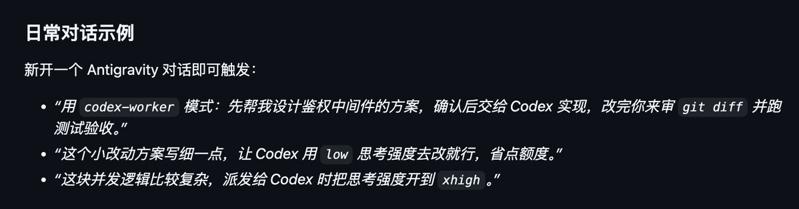

# 大 Huang：用 Antigravity 指挥 Codex 干活的 skill——GPT 只干活不说话

> GPT「不说人话」已经人神共愤，有程序员被折磨出一个 skill：**用 Antigravity 指挥 Codex 干活，GPT 只负责执行而不需要说话，Gemini 负责跟人沟通**（作者戏称有种 NTR 的感觉）。附 GitHub 项目地址 antigravity-codex-worker 与截图。

<!-- more -->

GPT 不说人话这件事情已经人神共愤了。

你看看给程序员折磨出啥宝贝了？直接干出来一个用 Antigravity 指挥 Codex 干活的 skill，完美解决 GPT 不说人话的问题。

GPT 只负责干活，不需要说话，Gemini 负责跟人沟通（有种莫名的 NTR 的感觉 hhh）

项目地址：https://github.com/lbc9168/antigravity-codex-worker https://x.com/realchendahuang/status/2124875589480014284

## 相关页面

- [[concepts/magpie-local-model-gateway]]
- [[sources/khazix-claude-gpt-gemini-collaboration]]
