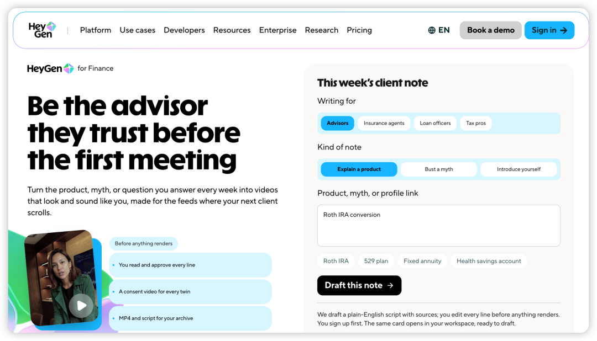
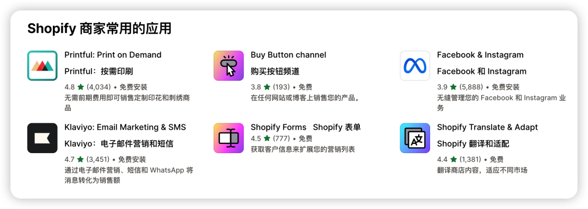
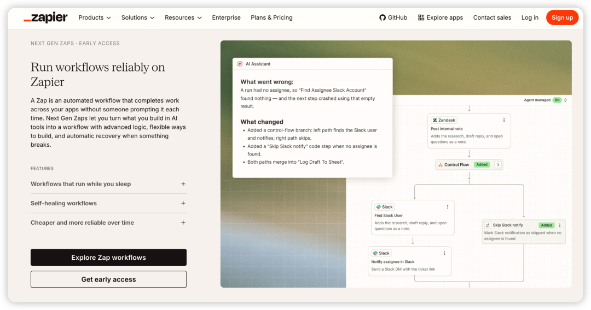

# 收藏！出海搞钱 10 个赛道，哪一个适合你？

大家好，我是橙哥！

前两天跟一个做 AI 视频的朋友吃饭，他吐槽了一句话，我到现在都还记得。

他说，数字人口播这玩意，国内已经卷到几块钱一条了，免费的工具满大街都是，你跟客户报个价，人家第一反应是，这个不是免费的吗？

然后我就顺手给他看了一眼 HeyGen。

一个华人创始团队做的 AI 数字人视频产品，在海外按月订阅，几十美元一个月，企业客户照样排着队付钱，成了出海 AI 应用里被拿来举例最多的样板之一。

同样一个东西，在这边卷成白菜价，换一片土壤，就能按月收美金。

橘生淮南则为橘，生于淮北则为枳，这话我们从小背到大。但出海这件事有点骚，它经常是反过来的，有些东西在国内长成了枳，挪到海外，反而结出了橘子。

我自己也是挪过一次土的人。

这三年我见过、试过、踩过的出海方向，大概是 10 条赛道。

先说最硬的那几条，做产品。

1、游戏和高粘性应用

很多朋友可能不知道，莉莉丝的《万国觉醒》，一款中国团队做的 SLG，在海外策略游戏的收入榜上常年挂在前面。

玩过 SLG 的兄弟都懂，这类游戏的命根子就是长线运营，赛季怎么排、联盟怎么打、氪金点卡在哪个节奏上，全是精细活。

它证明了一件事，我们在国内被逼出来的精细化运营和快速迭代，放到海外不叫卷，叫稀缺。

2、浏览器插件和 Shopify 插件

沉浸式翻译，一个浏览器插件，就干一件事，把网页变成中英对照。靠着口碑，在全球攒下了数以百万计的用户。

插件这个东西我觉得特别被低估。

它不用跟你抢桌面上那个宝贵的图标位，它就安安静静待在你每天都要打开的浏览器里。离用户的工作流越近，就越不容易被卸载。

Shopify 插件体量小一些，做评价、做邮件营销、做库存提醒。但它的客户是商家，商家付钱不看心情，只看账，你帮我多赚一块，我就愿意分你一毛。

这种现金流，稳得跟收房租一样。

3、桌面和移动端工具

万兴科技的 Filmora，深圳团队做的视频剪辑软件，收入的大头一直在海外。

大家都盯着内容平台有多火，很少有人注意到，做内容的那几亿人，每个人都得用工具。

这让我想起淘金热那段历史。十九世纪加州淘金，真正发财的很多不是淘金的人，是卖铲子、卖帐篷、卖牛仔裤的人，李维斯就是那时候起家的。

一个时代起来的时候，卖铲子的人往往比挖金子的人活得更久。

4、Web AI 工具和微型 SaaS

开头的 HeyGen 就在这一类。

它是大团队，但这条赛道，我是真的觉得最属于普通开发者，一个人，一台电脑，一个周末，就能开始。我自己的主线也在这，一个 29 美元一个月的长尾关键词工具。

判断你要不要走这条路，其实就问自己一句话。

你的时间，能不能卖第二次？

接单写代码，卖的是这一个小时。做成产品，卖的是这一个小时的复印件。前者越干越累，后者越干越轻。

做产品这几条说完，再聊聊不用自己做产品的玩法，做流量。

5、联盟营销，圈里叫 AFF

逻辑很简单，商家出产品，你出流量，带人过去成交了，分你佣金。

Hostinger 这种主机商，Semrush 这种 SEO 工具，都有很成熟的联盟计划。这类东西用户一旦用上就很难换，所以商家舍得给高比例，有的还是按月持续分成。

6、程序化 SEO 和工具站矩阵

教科书级别的案例是 Zapier。它给每一对能互相连接的软件，都批量生成了一个页面，几十万个页面，硬生生吃下了海量的长尾搜索。

这条路现在在 X 上讨论得特别多，也已经卷成了红海。

我不是说它不行，而是说，规模化的游戏，只奖励已经有规模的人。新人冲进去，大概率是给别人当分母。

7、小众垂直 Blog

这条，是我最想推荐给新人的。

理由就两个，细分领域足够多，竞争足够少。

你想想看，挑一个极窄的领域往下扎。手冲咖啡太宽？那就只写磨豆机。还宽？那就只写手摇磨豆机。窄到什么程度算对？窄到你认真写上半年，就能挤进谷歌搜索的前几名。

大市场里你是一粒沙，小市场里你可以是一座山。

选题这块我自己踩过坑，后来摸出一个笨办法。别去搜产品名，去海外社区搜用户抱怨的句式，「is there a tool that……」「tired of doing……」这种。我当年每天泡 20 分钟 Reddit 社区，攒了 100 多条用户原话，后来我的产品方向，就是从这堆抱怨里扒出来的。

说完流量，再说做货。

8、品牌独立站和达人分销

看看泡泡玛特。Labubu 在海外火到排队抢购，靠的从来不是低价走量，是品牌、是 IP、是一个又一个达人的开箱视频带出来的溢价。

这条路，我是真的交过学费的。

后来复盘的时候，我盯着那几页账单想了很久，病根其实就一句话。

我一直在问什么好卖，从来没问过，谁在为什么问题付钱。

9、纯数字商品

Etsy 上的可打印手帐，Lightroom 的调色预设，Framer 的网站模板。成本几乎为零，一份做好，卖一万次，没有库存，没有物流，没有退货。

听着是不是特别美。

我之前写过一篇出海赚美金清单，罗列了上百种数字产品，每一种单拎出来，都确实有人在赚钱。

但有人在赚钱，和你能赚到钱之间，隔着三道墙。你不知道该卖哪一个，做出来了没人买，有人买了美元收不回来。

尤其是第三道墙，这是中国开发者最冤的一段，产品都有人买了，卡在收款上半年的，我见过不止一个。

零成本，从来不等于零门槛。

最后一条，也是最热闹的一条，做内容。

10、内容出海和泛娱乐

YouTube 上的滇西小哥，拍云南乡下做饭，圈了上千万粉丝。看着真的很让人心动。

但这条路，我不推荐大多数人走。

内容这东西要网感，而网感跟你的性格、审美、认知是死死绑在一起的。别的赛道你肯磨，总能磨出点东西。这条赛道，努力能让你及格，天赋决定你能不能被看见。

10 条说完了。

最后我想说一句，可能有点刺耳，但我是真的这么想的。

很多人觉得出海是在逃离内卷。

我反而觉得，出海是把你在国内卷出来的那股劲，拿到一个没那么卷的地方去用。每条赛道表面上都写着简单，往下挖三层，全是细节，而抠细节，恰恰是我们最擅长的事。

keep digging，keep grinding。

你在国内都能卷出来，出海就是降维打击。

回到开头那句老话。

橘生淮南则为橘，生于淮北则为枳。

我们总以为自己是那个被困在淮北的枳。

但其实，你只是还没换过土。

## 相关页面

- [[concepts/overseas-tool-stack]]
- [[patterns/overseas-website-conversion-loop]]
- [[patterns/content-arbitrage-pattern]]
