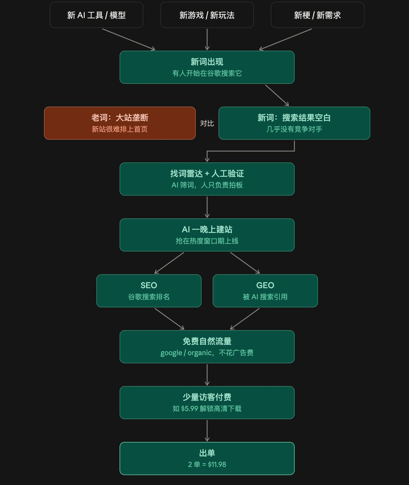

# 新词是什么：从新词到出单的完整链路

> 「新词」指刚出现、搜索量正在上涨、但还没什么像样网站去满足的搜索关键词。野径用一句话串起了从新词到出单的链路，同时也泼了两盆冷水：热度去得快、成功率不高且存在幸存者偏差。

<!-- more -->

*图 1：新词到出单的链路示意。*

---

## 一、新词的三条定义

> 「**新词**是指刚出现、搜索量正在上涨、但还没什么像样网站去满足的搜索关键词。」

三个条件缺一不可：

| 条件 | 含义 | 反例 |
|---|---|---|
| **刚出现** | 是新出现的词，不是老词换皮 | 「pdf 转换器」不是新词 |
| **搜索量正在上涨** | 需求在增长 | 常年持平的老词不是 |
| **还没什么像样网站去满足** | 供给侧有缺口 | 已被大站占满的词不是 |

### 三类典型的新词来源

1. **一个新发布的 AI 模型或工具名**；
2. **一款新游戏、新玩法、新梗**；
3. **某个突然流行的需求**——比如「XX 风格图片生成器」或「XX 格式转换」。

---

## 二、新词和出单怎么联系起来的

> 新词出现 → 有人开始搜索 → 搜索结果里几乎没对手 → AI 帮你一晚上建好站 → 谷歌很快给你排名 → 获得免费的自然流量 → 一部分访客为付费功能买单 → 出单

这条链路的每一环都在**降低摩擦**：

| 环节 | 摩擦为什么低 |
|---|---|
| 有人开始搜索 | 需求已被验证，不用再做需求调研 |
| 几乎没对手 | 不需要外链和权重积累 |
| AI 一晚上建好站 | 建站成本接近零 |
| 谷歌很快给排名 | 新站 + 低竞争词，最容易拿第一页 |
| 免费自然流量 | 不需要买量 |
| 一部分访客付费 | 意图明确的人群会为省事买单 |

---

## 三、两条冷静提醒

### 1. 热度来得快去得快

> 「很多新词**几周后搜索量就掉了**，或者**大站很快跟进把你挤下去**。所以玩家通常是**批量做站，靠『广撒网』取胜**。」

这解释了为什么新词玩家都是**批量上站**而不是死磕一个词——单点押注的期望收益太低。

### 2. 成功率不高，以及幸存者偏差

> 「但是**成功率不高以及幸存者偏差**！」

> 「但是想出海赚钱，总归是要值得一试的！」

---

## 四、把这条链路接回本批其他文章

野径的链路图，正好是另外几篇文章的**总和**：

| 链路环节 | 本批对应文章 |
|---|---|
| 新词出现 | [[sources/jinjingx3-new-word-speed-war]] — 盯热度源头，词还没进搜索框就搭站 |
| 几乎没对手 | [[sources/wavborn-keyword-screening-playbook]] — 前十被大站占满就直接扔 |
| AI 一晚上建好站 | [[sources/sitin-overseas-toolchain]] — GitHub + Vercel + Supabase 全家桶 |
| 谷歌很快给排名 | [[sources/jiang-yunhe-first-100-usd-new-word-playbook]] — 铺长尾内页，第 3 天日活 83 |
| 免费自然流量 | 同上 — 9/25–10/15 GSC 695 次点击 |
| 一部分访客付费 | 同上 — 生成过视频的 210 人里 59 人付费（28.1%） |
| 批量做站、广撒网 | [[sources/vinsin-hu-four-sites-four-roles]] — 测试站用来试错，做不出来就砍 |
| 成功率不高 + 幸存者偏差 | [[sources/harries-steele-efficiency-vs-profit]] — 一个月上 20 个站但全都不赚钱 |

> **野径提供链路，wavborn 提供漏斗，JK3 提供时差，蒋云何提供数据，Harries 提供反例。** 这批文章拼在一起，正好是一个新词站的完整操作手册 + 风险提示。

---

## 相关页面

- [[sources/jinjingx3-new-word-speed-war]] — JK3：抢新词拼的不是工具而是谁更早动手
- [[sources/wavborn-keyword-screening-playbook]] — wavborn：选词三板斧与 72 组词验证率
- [[sources/jiang-yunhe-first-100-usd-new-word-playbook]] — 蒋云何：副业出海小白首日破百刀，5 天破千刀
- [[sources/harries-steele-efficiency-vs-profit]] — Harries：一天上线一个网站，真的值得骄傲吗
- [[sources/vinsin-hu-four-sites-four-roles]] — 子正：4 个站不是 4 份工作，是 4 种角色
- [[sources/yikun-seven-hot-word-site-types]] — yikun：出海做热词站的 7 种形态
- [[sources/sitin-overseas-toolchain]] — sitin：一个人独立跑完出海项目的完整工具链
