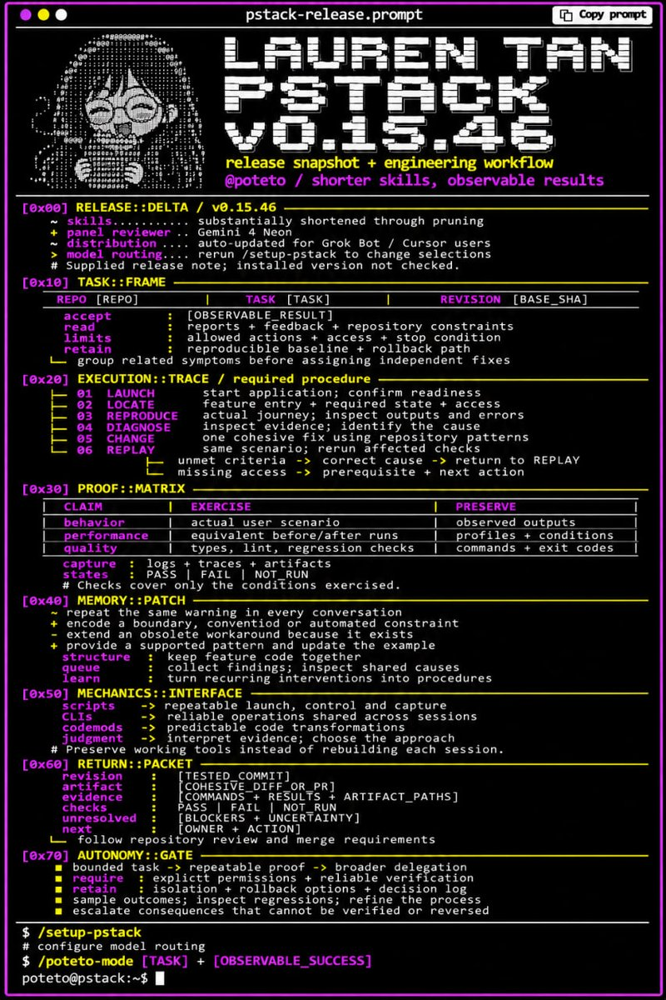

# 0xChonsy：Lauren Tan 的自检守卫 Prompt——把重复失误变成可执行的验收规则

> 一条推文串起三件事：SpaceX AI 工程师 Lauren Tan 更新她的 GitHub repo、可直接粘给 Agent 的 recurring_failure_guard 策略（bind / repo / task / accept / scope）、以及从一个 GitHub issue 走到并行 worktree 与草稿 PR 的 7 步流程。

<!-- more -->

holy sh*t...

SpaceXAI engineer Lauren Tan released an update for her GitHub repo

paste this into your agent to catch recurring mistakes with automated checks

Prompt:

```text
policy recurring_failure_guard {
  bind {
    repo := [REPO]
    task := [TASK]
    accept := [OBSERVABLE_RESULT]
    scope := [ALLOWED_PATHS_AND_ACTIONS]
    access := [AUTHORIZED_TOOLS_AND_PERMISSIONS]
  }
  preserve {
    unrelated_edits
    reproducible_inputs
    existing_authorizations
    rollback_path
  }
  baseline.capture -> {
    revision := tested commit
    worktree := staged + unstaged changes
    environment := runtime + dependencies + build config
    read repository rules and relevant reports
    inspect existing verification commands
    reproduce the reported failure before editing
    case := {
      fixture: exact input or saved request
      initial_state: required application state
      execute: command or ordered user actions
      expected: observable completion criterion
      observed: actual output or state change
      evidence: logs + errors + artifact paths
    }
  }
  baseline.result |> match {
    REPRODUCED => trace the faulty execution path
    NOT_REPRODUCED => inspect inputs and revision differences
    BLOCKED => return missing prerequisite + next action
  }
  cause.resolve -> {
    trace input -> calls -> state changes -> output
    compare observations with the suspected cause
    inspect related failures for a shared mechanism
    require evidence before declaring a root cause
    retain uncertainty where competing explanations remain
    avoid speculative changes outside the failing path
  }
  https://t.co/KDxbbZYm4Q |> match cause {
    forbidden_dependency => {
      enforce import or module boundaries
      report the forbidden edge and supported dependency
    }
    invalid_state => {
      constrain construction with types or validated APIs
      reject invalid inputs at the relevant boundary
    }
    unsupported_usage => {
      provide a supported operation
      migrate obsolete examples and affected callers
      add lint or compiler diagnostics where appropriate
    }
    behavioral_regression => {
      preserve the failing input or user scenario
      add an assertion on the incorrect observable result
    }
    repeated_mechanical_work => {
      reuse or extend a tested script, CLI or codemod
      expose a reproducible invocation
    }
  }
  check.define -> {
    name := [CHECK_NAME]
    location := [EXISTING_SUITE_OR_POLICY]
    command := [EXACT_INVOCATION]
    rejects := [ORIGINAL_VIOLATION]
    permits := [VALID_NEIGHBORING_CASES]
    diagnostic := [REQUIREMENT_AND_SUPPORTED_CORRECTION]
  }
  check.validate -> {
    faulty := original implementation + proposed check
    fixed := corrected implementation + same check
    controls := permitted inputs and neighboring behavior
    assert faulty detects the original violation
    assert fixed satisfies the requirement
    assert controls preserve supported behavior
    inspect assertion failures, outputs and exit codes
    distinguish a detected defect from broken setup
    isolate historical comparisons from the active worktree
    record unavailable comparisons as NOT_RUN
  }
  candidate.exercise -> {
    behavior => replay the affected UI, CLI or API scenario
    performance => compare equivalent measured runs if relevant
    quality => run types, lint and relevant regression checks
    inspect the actual result of each operation
    bind every artifact to its revision and configuration
    invalidate affected results after relevant code changes
  }
  check.status |> match {
    PASS => retain evidence for the stated requirement
    FAIL => correct the cause and rerun affected checks
    NOT_RUN => retain the missing prerequisite and next action
  }
  repository.update -> {
    integrate the safeguard into the existing check path
    document the supported command or API
    replace examples that reproduce the obsolete pattern
    preserve reusable launch, control and capture tools
    verify the combined candidate after integrating changes
  }
  return {
    revision: [TESTED_COMMIT]
    worktree: [TESTED_CONTENT_STATE]
    change: [DIFF_OR_PR]
    cause: [CONFIRMED_MECHANISM_AND_EVIDENCE]
    safeguard: [BOUNDARY_TYPE_RULE_OR_REGRESSION_CHECK]
    commands: [INVOCATIONS_AND_EXIT_CODES]
    proof: [FAULTY_FIXED_AND_CONTROL_RESULTS]
    artifacts: [EVIDENCE_PATHS]
    checks: [PASS_FAIL_OR_NOT_RUN_PER_CHECK]
    limits: [UNCOVERED_CASES_AND_BLOCKERS]
    next: [OWNER_AND_ACTION]
  }
  complete only when required checks support acceptance
  follow repository review and merge requirements
  keep permissions and stop conditions explicit
```
}

Opus 5.5 can become your own AI development team

One GitHub issue becomes coordinated assignments, parallel work in Git worktrees and a draft PR with test results attached.

Here’s how to build the team in 7 steps: https://x.com/i/article/2109705772569423873



## 相关页面

- [[patterns/agent-iteration-environment]]
