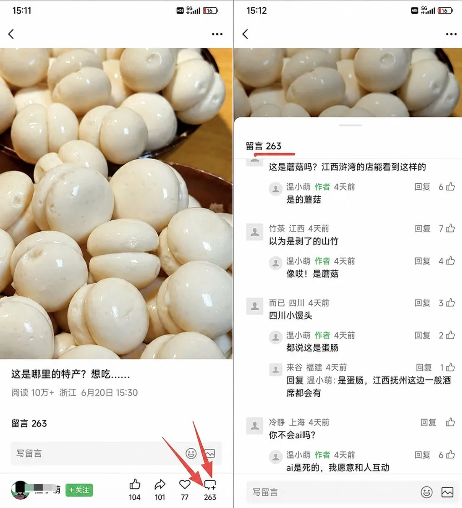
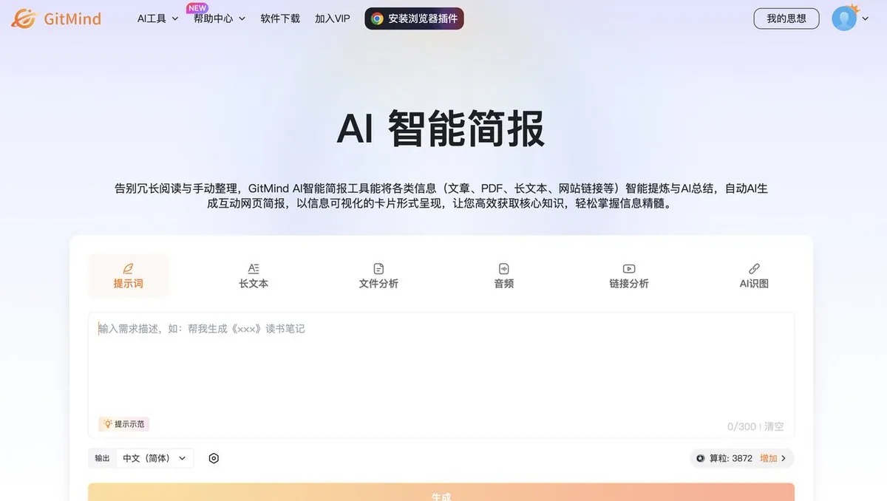
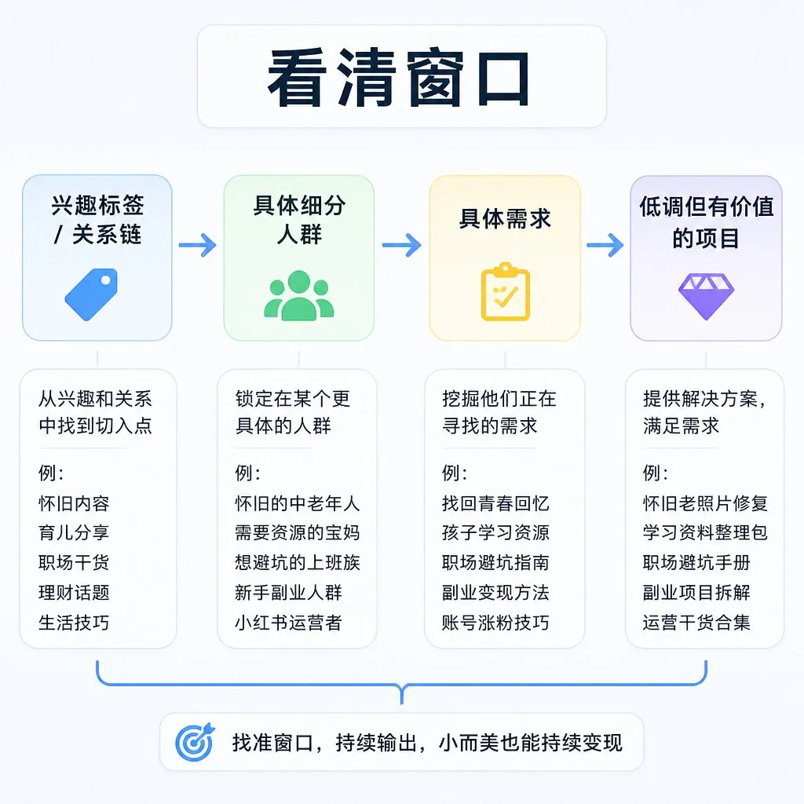
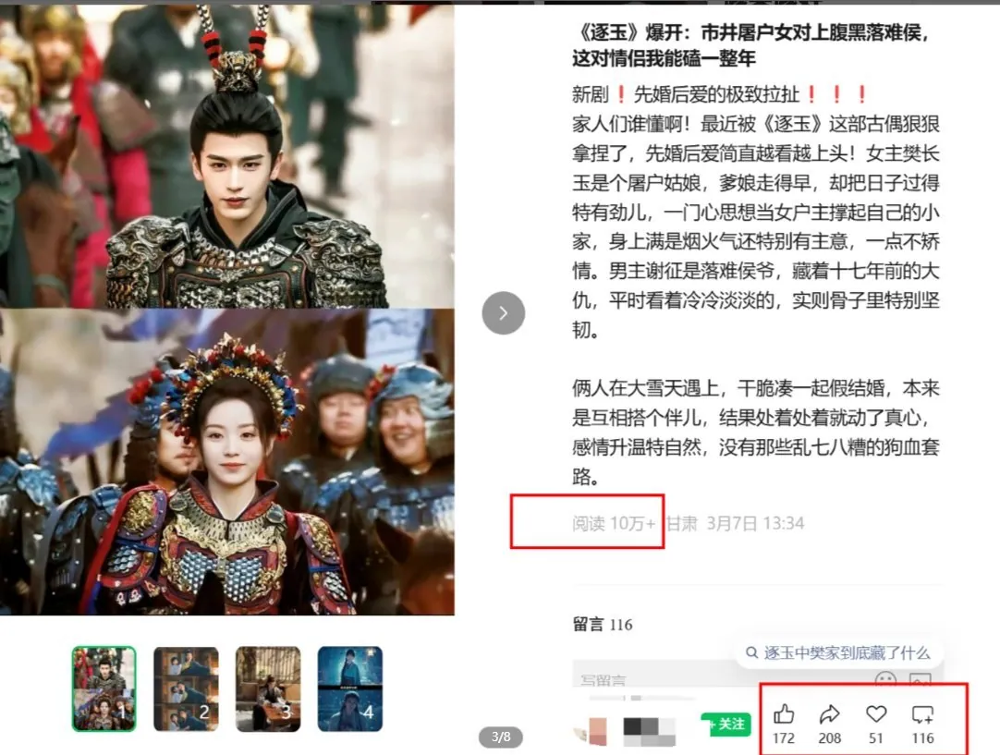
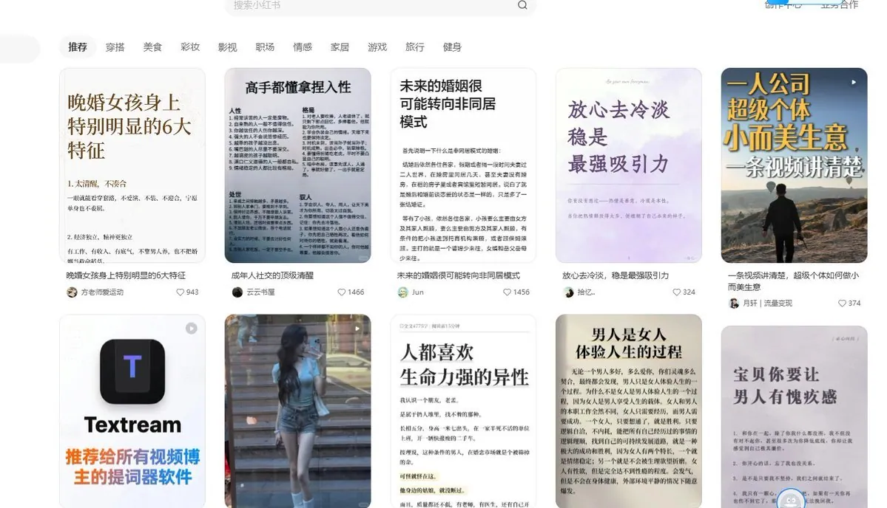
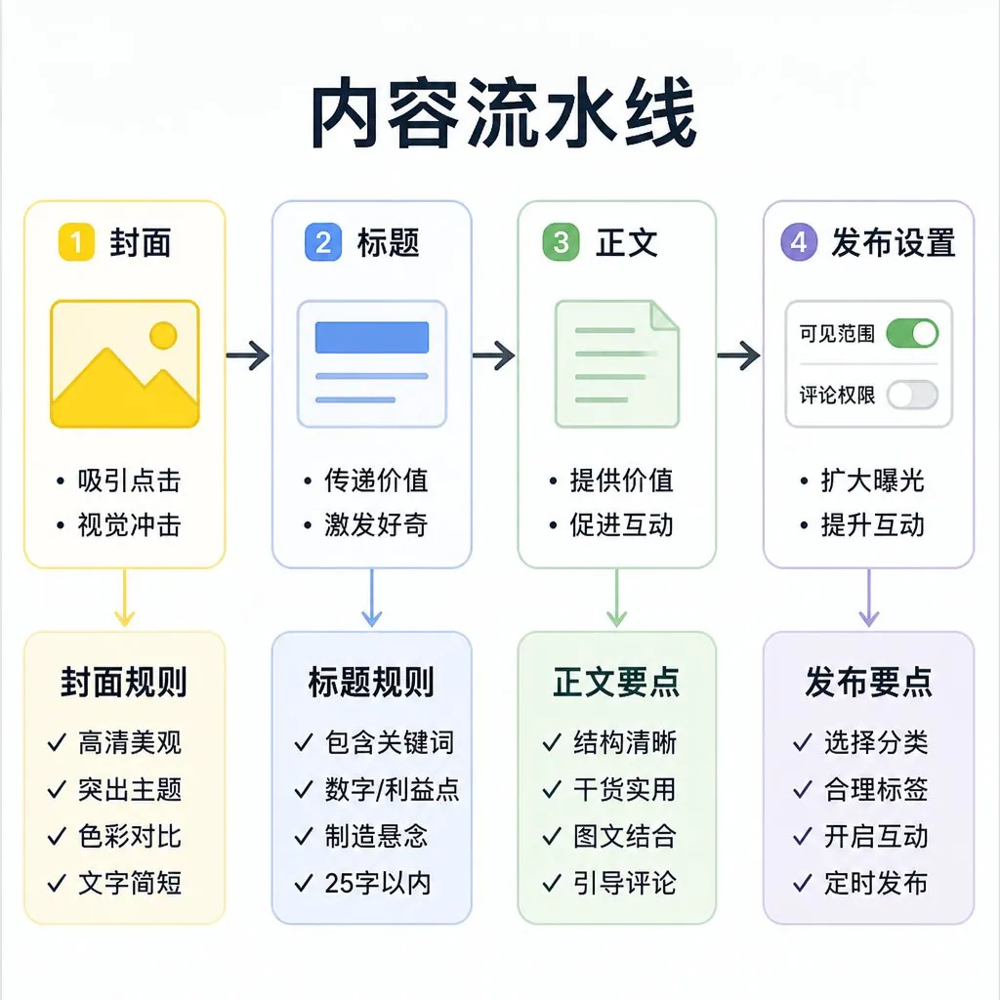

# 科技混子 Chris（@ChrisSlacker）：公众号贴图，3 天收入破百，1 篇收入破千——附 5 步实操 SOP

> 微信公众号「贴图（图文）」赛道快速起盘实战方案：零粉丝依靠「看一看」公域智能推荐算法获客，无需露脸拍视频；详细拆解「高点击率选题库挖掘 → AI 批量出图与版式组合 → 流量主开通与电商挂车变现」的 5 步低门槛搞钱 SOP。

<!-- more -->

🚨 公众号贴图，3 天收入破百，1 篇收入破千

不用露脸、不拍视频、不占群发次数

0 粉也能上推荐，靠看一看推荐

【附 5 步：选题 → 出图 → 变现】

必备工具

这套流程用这几个👇

1. GitMind 🔗
   https://t.co/mRqGk3pVcl
   用它的简报功能，材料丢进去，可按需拆出对应模块
   ✅ 一份简报拆成 3–6 张，当贴图内页
   ✅ 变现链路、避坑清单，连内容一起填
   ✅ 导出图片，直接发贴图

2. 小红书 / 同类图文平台
   只用来拆低粉爆款，不当你的发布主场

3. 微信公众号贴图
   选题验过了再发，先把结构跑通，再谈日更

第一步：看清窗口在哪

2026 年 2 月 公众号图文改名叫贴图，发布不占群发次数

系统不主动推给全部粉丝，靠看一看、搜一搜、信息流 0 粉也有机会起量

推荐跟关系链、兴趣标签绑在一起

你不是那个人群就刷不到那些号，中老年怀旧、宝妈资料、职场避坑

外面看着土、小、不起眼 目标用户那儿就是刚需 https://t.co/ib8E2XFSj1

第二步：选人群

别一上来做宏大主题，越宏大越难收口，越细分越容易找到人

公式就一句： 主题细分 + 人群细分 + 场景细分

❌ 美食 → ✅ 上班族 10 分钟快手菜

❌ 育儿 → ✅ 挑食宝宝爱吃的辅食

❌ 职场 → ✅ 新人入职前 30 天避坑

❌ 养生 → ✅ 中老年人能看懂的日常习惯

越靠近钱，越要合规 别承诺疗效，别打包票

第三步：拆爆款

别凭感觉写，去拆已经被市场验证过的题

👉 在图文平台搜垂直词

👉 停留、点赞、看评论

👉 连刷同一类关键词 把推荐系统训练到你的赛道上

重点看低粉爆款，大号爆了可能只是粉丝多， 粉丝少还能高收藏、高评论，说明选题本身击中了需求 https://t.co/Ekmv5pcbmi

第四步：把一条内容做成流水线

封面就 5 件事：字少、直击痛点、关键词一眼能读、字大、一图一主题。

标题抓人性——金钱、情绪、反差、数字、具体人群

正文 3 到 5 句：一句观察、一个方法、一个评论钩子。发之前把推荐、留言、商品、标签勾上。 https://t.co/eghhRuSDAi

第五步：贴图只是赚钱的开始

GitMind 简报从结构到卡片一条线跑完 ，内容直接复制即可

🔗 https://t.co/MUgJ08RbUp

只靠单篇广告，赚的钱通常有限

完整链路是： 曝光 → 涨粉 → 货/资料 → 私域 → 复购

你只需要做三件事：

1｜前端：流量主当筛子

看哪类标题、封面、话题有人动 别盯着几毛几块

2｜中端：内容和货必须同痛点

育儿接教辅、绘本 职场接简历模板、沟通课 家居接实测好物 怀旧接相册、听书设备

3｜后端：资料包 / 清单把人留下

先给价值，再测低门槛产品 别一加微信就群发链接

闲鱼也能接代做贴图的单 挂：知识卡片日更套餐，有人给主题，你出卡交付

[video](https://video.twimg.com/amplify_video/2093160394756128768/vid/avc1/2878x1404/uOvbdMmCpWcfP3yM.mp4?tag=29)

## 相关页面

- [[sources/kongge-space-10-skills-daily-explosive-wechat-article-system]]
- [[sources/kimberly-ai-one-click-content-generator-for-xhs-and-wechat]]
- [[concepts/selfmedia-compound-model]]
- [[concepts/b2c-conversion]]
