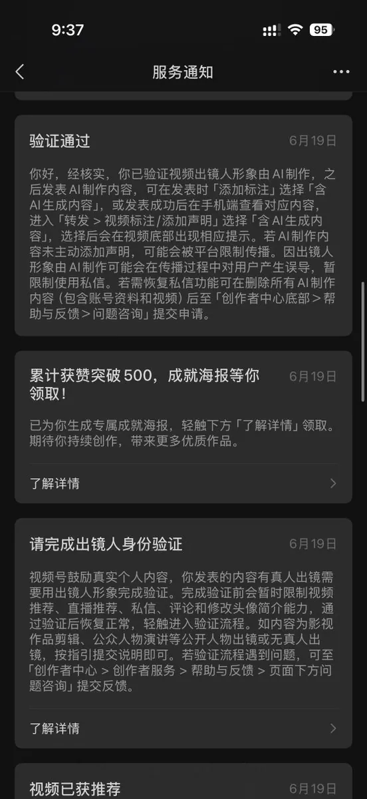

# clanhj（@clanhj611）：微信视频号中老年 AI 赛道踩坑复盘——祝福短视频流水线与防真人验证技巧

> 实战探索微信视频号 10-15 秒中老年知性女性祝福与关心视频赛道：基于 Codex 搭建「脚本生成 → 首帧图 → 人物图 → 即梦/Seedance API」自动化管线；分享人物图加画网线绕过视频生成模型真人脸侵权拦截的小技巧；复盘次日收到「出镜人身份验证」弹窗后进行真人验证反被平台断崖式降权的惨痛教训，以及冷处理策略与后续橱窗变现前景。

<!-- more -->

再跟大家讲一个我的视频号踩坑经验：

我在 6 月尝试做过微信视频号的中老年赛道，看了几个竞品账号发现只要 10s 左右的祝福视频/关心视频就能有不错的流量，然后想着自己也能做，后续做成功就能带货挂橱窗。

由于整个视频在 10s~15s 之间，所以我直接用 codex 搭建了一个工作流。

脚本生成-->首帧图-->人物图-->调用即梦 API

一天生成 10 多条视频都很容易，后续我在剪映再对视频加上统一的字幕、封面，就可以直接上传了。

这里有个小 tips：你把 AI 生成的真人形象直接给视频生成模型（我用的是 seedance)，他是不会帮你生成的，因为涉及侵权，解决办法就是在人物形象上画很多“网线”，再把这个人物形象发给视频生成模型，这时候他没办法检测出真人脸，但是最后生成视频的时候模型会自动把“网线”去掉，最终视频中的角色和原角色是一样的

至于发布频率，我是一天早中晚发三次。

第一天的数据就很可观：

可以看到有很多的大爷大妈的点赞，甚至有些大爷直接回复“美亲”，由此可见一位知性优雅的中老年女性形象还是很吸引大家注意的。

好景不长，就在第二天，我后台收到一个【请完成出镜人身份验证】的提示

我去网上搜了一些信息，发现三类可能会弹出这种验证的：

1. 发明星的剪辑片段
2. 发自己的日常自拍
3. AI 真人视频

像第一个和第三个基本都会被卡在这一步，还好我有当时生成 AI 真人形象的原始图片，就去做了验证，最后通过了验证，但也被平台发现是 AI 出境，之后的流量就断崖式下滑。

我跟一些大佬交流了这件事，他们说如果弹出真人验证你可以不用管，一段时间后他就会消失，并且流量也不怎么影响，所以我觉得这个路子现在还是值得去尝试的。中老年在视频号的消费水平算是不错的，做这种中老年账号，前期跟用户养成信任后，后期挂车、开橱窗应该也能赚一笔。

关注我，后续分享更多创业踩坑经历！

## 相关页面

- [[sources/ryan-muse-channels-wechat-reading-video-automation]]
- [[sources/xionghuanwei-wechat-official-account-traffic-monetization-rules]]
- [[concepts/wechat-image-post-account]]
- [[concepts/selfmedia-compound-model]]
