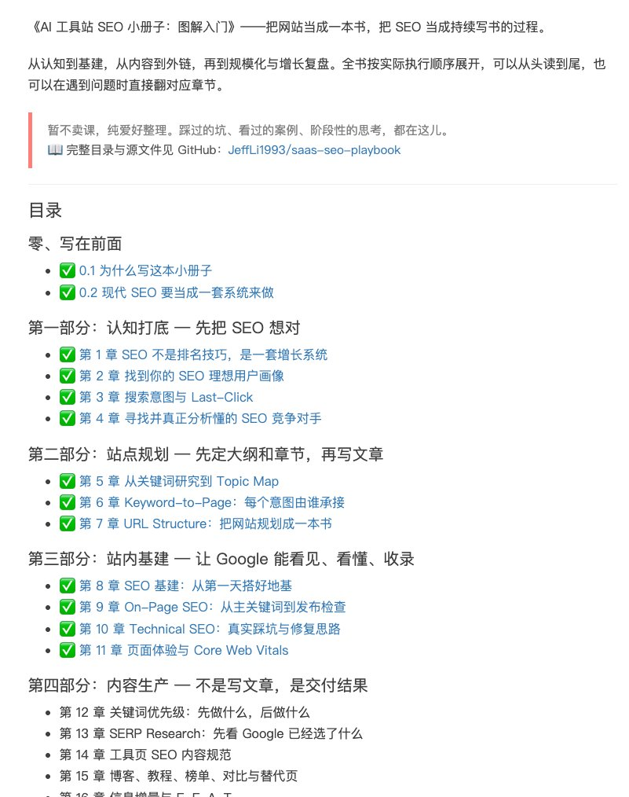

# 写增长的子木：《SaaS SEO Playbook》第三部分——站内基建，让 Google 能看见、看懂、收录

> AI Coding 时代「1 是 1，2 是 2」的问题好解，难的是 AI 不知道「还有你不知道的东西」。子木开源 saas-seo-playbook 站内基建部分，涵盖多语言实现的正确做法与 seo audit 开源 Skill 的能力边界。

<!-- more -->

《SaaS SEO Playbook》连更 4 篇 - 第三部分：站内基建 — 让 Google 能看见、看懂、收录

关于基建，现在 AI Coding 时代，1 是 1 ，2 是 2 确定性问题很好解决。所以我当时也做了 seo audit 的开源 Skill

但实践当中，其实有难度，就是你不知道这个东西，你直接让 AI 修改 SEO 的基建，它不可能面面俱到。再比如让它实现多语言，好家伙给你复制几份代码实现，我麻了

https://bysocket.com/saas-seo-playbook/

完整目录与源文件见 GitHub：https://github.com/JeffLi1993/saas-seo-playbook

## 相关页面

- [[sources/aaronyi-open-topic-radar]]
- [[patterns/ai-automated-internal-link-seo]]
- [[sources/solo-cream-1m-ai-site-case]]
