# 程序员 Left（@coder_left）：解读 DeepSeek Super Agent——打破传统人机交互范式，从消灭会话到工程底座全景拆解

> 以资深工程视角全面剖析 DeepSeek Super-agent 架构设计：为什么人类注意力成了瓶颈、底层 Session 容器与用户交互的解耦逻辑、Trigger+Router/Worker 双层派发与多对多 Thread 订阅、两级噪音过滤与静默复现，以及支撑 24 小时无感运行的三大工程底座（上下文按需翻阅、云脑端手分离与独立 Watchdog 巡查员）。

<!-- more -->

都 2026 年了，为什么我们在用 Agent 干活时，交互方式还停留在旧的 Chatbot 时代？

你是否也厌倦了一个人肉管理多个会话窗口的日子？每次找历史记录就像抽奖，在五六个对话标签页之间来回横跳，人脑的上下文切换费劲到了极点

近一年来，大模型的长程任务能力突飞猛进。以前得手把手教它每一步怎么走，现在只要交代清楚目标、给够上下文，它自己就能把活干得七七八八

当模型越来越强，阻碍效率的瓶颈反而变成了人自己。人在不同窗口间来回切换的注意力开销，极大拖慢了整体进度。怎么把人从繁琐的会话管理里解放出来，成了工程上需要解决的新课题

DeepSeek Harness 团队最近也盯上了这个痛点，专门做了一套新的人机交互探索。Left 帮大家啃完了他们发出来的 Super Agent 技术报告，今天咱们就从工程落地的角度，拆解一下他们是怎么解决的

## 一、传统人机交互的问题

咱们平时在 Agent 的使用场景中，体验下来其实槽点非常集中：

1. 场景割裂：咱们干活天然绑在 IM、GitHub 和 IDE 上，不绑在 Agent 聊天框里。在工作软件和聊天窗口之间来回复制粘贴，切换成本太高

2. 窗口灾难：任务一多就要开十几个 Session，人脑在多个会话间频繁切上下文，精力很快就被耗光了

3. 信息难给：人肉提供上下文信息太麻烦，给少了 Agent 懵逼，给多了大模型乱来

4. 从不主动：Agent 不主动，人交代的事才去做，没交代的事情绝不主动做

5. 任务跑偏：Agent 任务常常跑偏，经常需要人工纠偏

说白了就是，传统人机协作模式下，人类的注意力成了最紧缺的效率瓶颈

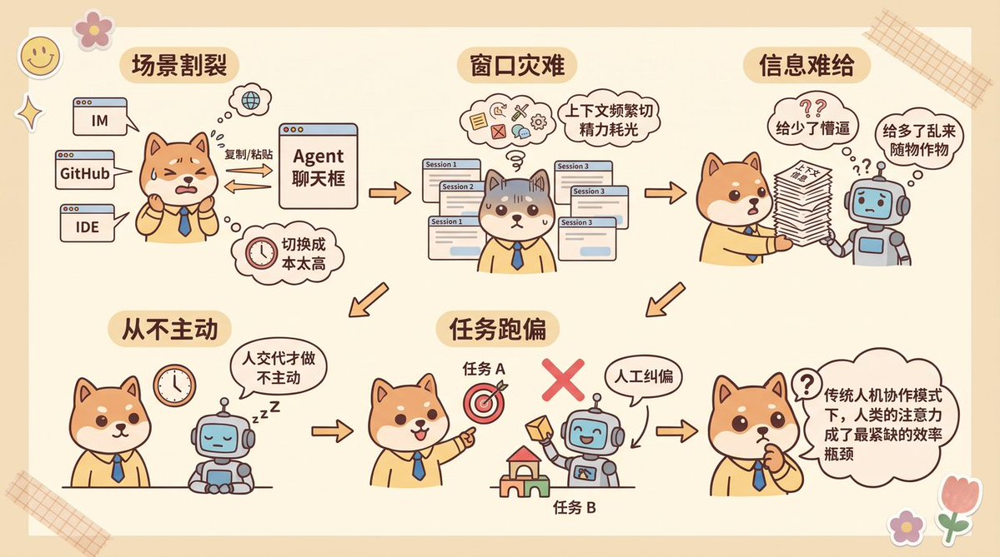

## 二、一个大胆的想法：“消灭” 会话，让 Agent 融入到工作场景中

“既然管理会话这么反人类，为什么会有会话（Session）这个东西存在？”，团队中有人提出了一个尖锐的问题

想要搞懂这个问题，就要知道会话（Session）这个设计当初是怎么来的

这其实要追溯到底层大模型的运行机制。大模型本质上是个“无状态”的函数，你调它一次，它回你一句，转头就忘了你是谁。为了让模型能联系上下文连续聊天，工程师在底层维护了一个消息数组（Messages List），每次提问都把历史聊天记录打包一块发给模型。这个用来装上下文的底层技术容器，就是 Session

问题就出在，后来的 AI 产品在做界面时，直接偷了个懒，把这个底层的“技术容器”原封不动地推给用户，让用户自己去管理

在现有的产品设计里，一个前台会话既要充当底层的“上下文隔离框”，又要被用户拿来当“任务文件夹”使。你每开启一个新任务，就得手动点一下“新建会话”，怕上下文串味还得手动切窗口。这种纯粹从底层 API 延续下来的设计惯性，把本该由系统在后台搞定的技术细节，粗暴地甩锅成了用户的认知负担

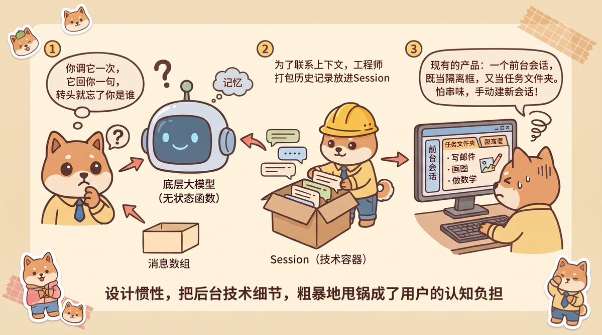

看明白这一层，DeepSeek 团队提出的“消灭会话”就非常好理解了：核心是把面向用户的交互界面，与底层的技术 Session 彻底解耦

在用户视角里，界面上彻底没有了“新建会话”和“会话列表”这两个概念。Agent 就像一个常驻在公司群、代码库和邮箱里的真人秘书：你在飞书或 Slack 群里 @ 它一下，或者在 GitHub PR 底下留个评论，再或者到邮件收发消息，面对的永远是同一个拥有全局记忆的 Agent

至于为了完成你的交代，它在底层偷偷新建了几个技术 Session、拆了几个并发线程，完全属于后台自己的事，用户根本不需要了解

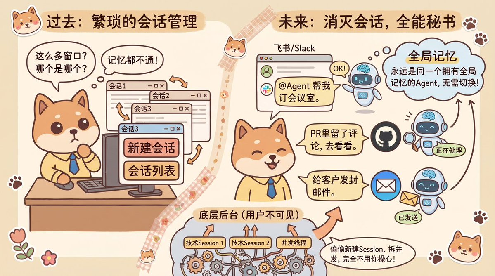

从“人去聊天框里找会话”转变为“Agent 融入办公场景找人”，交互上确实爽了，但工程落地的担子就全压到了后台系统身上。要撑起这套无感交互，系统立马会撞上五个棘手的工程难题：

1. 并发与记忆的冲突：多个相关任务同时推进，底层怎么做到既共享全局上下文，又能并发执行、互不打架？

2. 海量噪音过滤：真实的办公群里 95% 都是日常吹水和表情包，没有了明确的聊天框，Agent 怎么精准捕捉到真实任务并主动干活？

3. 高密度上下文组装：历史消息散落在各个群聊和代码库里，怎么把关联信息聪明地捞进上下文，还不撑爆 Token 窗口？

4. 全天候在线与本地资产的矛盾：电脑一合盖本地进程就休眠，怎么让 Agent 24 小时不间断运行，同时还能安全操作本地未提交的代码？

5. 长程任务防跑偏：没有人在聊天框里实时盯着，怎么防止 Agent 在后台长时间执行时陷入死循环或偏离目标？

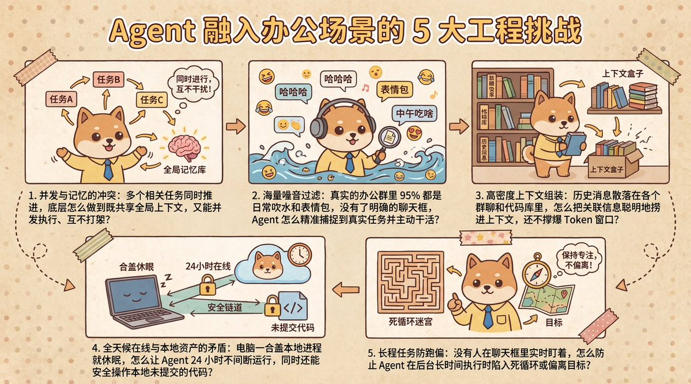

面对这些问题，我们看 DeepSeek 团队是怎么见招拆招的

## 三、Trigger + Router-Worker 双层架构

在多任务并发时，底层架构面临着“全局连续性”和“高吞吐量”的天然矛盾

如果所有事情都在同一个底层 Session 里串行处理，虽然记忆最连贯，但只要遇到一个跑单测的耗时任务，整个 Agent 就卡死了，你在群里喊它半天都没反应

反过来，如果每收到一条消息就无脑新开一个独立 Session，并发是拉满了，但各个窗口成了信息孤岛，甚至会出现三个窗口同时向你汇报同一件事的精神分裂场面

为了鱼和熊掌兼得，DeepSeek 团队搭了一套 Trigger + Router-Worker 双层架构。咱们拿公司的日常办公协同打个比方，一下子就清楚了：

1. Trigger（触发事件）：将场景中的信息以半结构化的消息形式存储，比如 GitHub CI 结果、邮件、IM 消息等

2. Thread（事件流）：同一 IM 话题、同一个 Pull Request 或往来邮件下的连续事件

3. Router（全局调度层）：常驻的全局路由会话，充当系统的全局记忆与协调点。它统一承接所有入口的人类交互，但自身绝不直接执行具体任务，甚至不配 Bash 工具，只负责跨任务的高层关联与任务分派

4. Worker（并发执行层）：具体任务的执行器，各个 Worker 彼此上下文隔离，挂载完整的执行工具去操作代码库或工作环境。Worker 绝不直接向人类的聊天信道输出冗长的推理过程，也不与其他 Worker 直接点对点通信，执行完后统一向 Router 汇报关键结论

说白了，Router 就是个常驻前台的秘书，只管接需求、记全局台账和摇人派活，但自己绝不亲自下场。Worker 则是被拉来具体干活的同事，在各自的工位上埋头干活，干完活统一找秘书交差，由秘书汇总后出面跟你同步

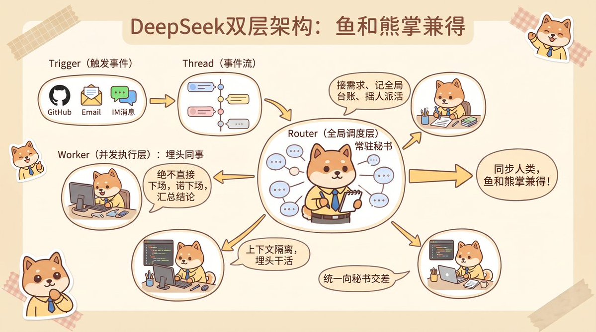

此外，为了不让耗时操作阻塞前台响应，这套架构还做了三个关键的并发与路由设计：

1. 异步 ReAct Loop

系统将传统的同步工具调用改造成了异步模式。耗时调用启动后立即返回“已启动”状态，后台跑任务的同时，前台依然能随时响应新指令，任务跑完后再把结果作为一条新的 Trigger 事件投递回来

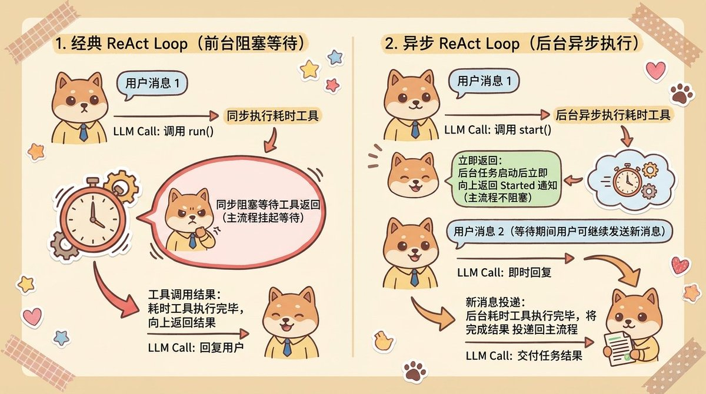

2. 快慢双路径路由

当一条新事件诞生时，系统的路由分发分为慢路径和快路径：

慢路径：针对新话题的初始事件，此时还没有任何 Worker 订阅该 Thread，事件会先交给 Router 进行全局判断，并创建对应的 Worker

快路径：一旦 Worker 订阅了该 Thread，后续所有事件都会走直通机制，由程序直接投递给已订阅的 Worker，无需再绕道 Router 转发

用日常修 Bug 的场景来理解：

你在群里第一次反馈订单接口报错了，因为是个新话题，消息会走慢路径先递给秘书 Router，由秘书摇一个研发同事 Worker_A 来跟进这个话题串

半分钟后你在同一话题下补了一张报错截图，系统识别到该话题已经有具体干活的同事在跟进了，直接走快路径把截图递给 Worker_A，不用每次都找秘书传话，省去了唤醒 Router 的推理延迟与 Token 开销

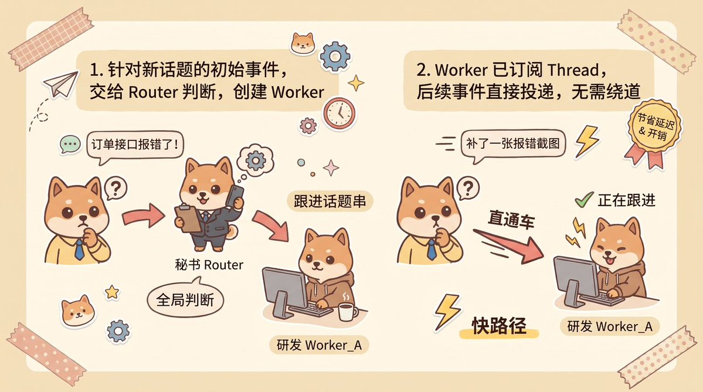

3. 多对多事件流订阅

Thread 与 Worker 之间是多对多的订阅关系：一个 Worker 可以同时订阅多个关联的 Thread，同一个 Thread 也可以被多个 Worker 同时订阅

还是拿上面的例子来理解：

具体负责修订单的同事 Worker_A 可以同时盯住“飞书报错讨论串”和“GitHub 订单分支 PR”两个事件流，两边一有动静他都能收到。而如果同一个 PR 里还有负责改前端的同事 Worker_B 也在干活，PR 下的新评论会同时广播给 Worker_A 和 Worker_B

两个干活的同事在各自的上下文里都能实时看到对方的操作，大部分代码冲突自己就能顺手化解，只有搞不定的跨任务复杂协同，才会升级找秘书 Router 居中协调

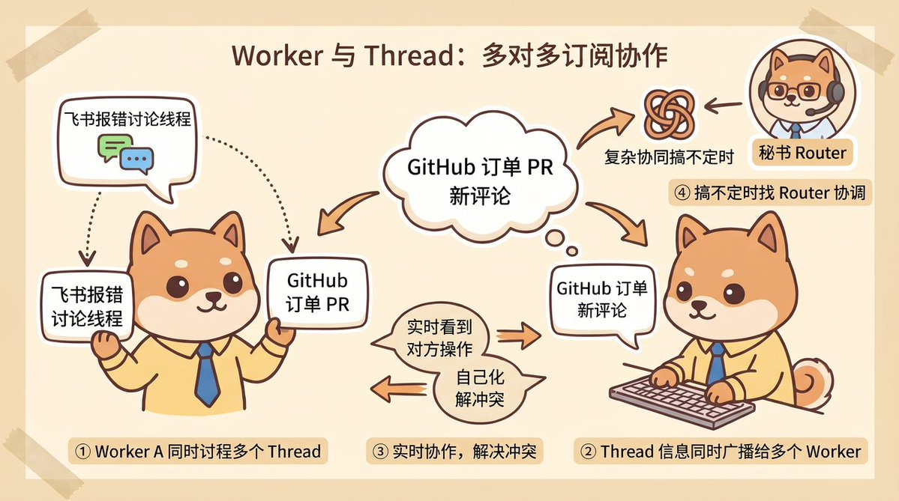

##

## 四、如何从海量噪音中找出真正有价值的事件，并主动出击？

搞定了并发调度，紧接着就会撞上第二个难题：把 Agent 拉进真实的工作群和代码仓库后，95% 的消息都是日常闲聊和无关通知。如果每条消息都调大模型去判断要不要接话，延迟和算力账单根本扛不住

为了低成本过滤噪音，团队设了两道关卡：

第一道是程序层过滤：直接用写死的代码规则做初筛，比如检查消息来源、群白名单、有没有带 @。靠传统的 if-else 就能把九成以上的无关消息直接拦在门外，一分钱 Token 都不用花

第二道是语义层过滤：过了初筛的候选消息，再交给大模型结合上下文判断是不是真有活要干。更妙的是，这里的判断规矩直接用自然语言写在提示词里，团队想改触发条件或者加个新策略，改两句 Prompt 就能随时生效

解决了噪音问题，团队还顺手做了一个解决“Agent 不主动”的设计：后台静默复现

比如在内部群配置一条策略：当群里有人反馈 Bug，大家还在讨论复现步骤或修改方案时，Agent 捕捉到聊天信号，不用等人正式提单，Agent 就已经在后台悄悄拉起干活的 Worker 尝试复现问题、编写修复代码了

这里最讲究的是分寸感，如果后台没复现出来、发现只是误报，或者代码没修好，Agent 会直接把半成品丢掉，全程在群里保持安静；只有当它确认修好并跑通测试后，才会把现成的修复 PR 甩到群里。用后台廉价的冗余算力，去换取人类零打扰的体验

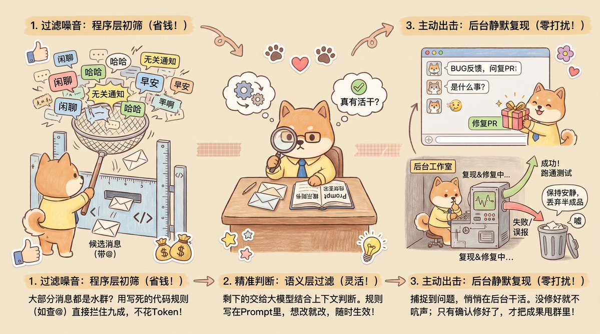

## 五、撑起无感体验的三大工程底座

解决了并发调度和噪音过滤，Agent 已经能像模像样地在群里接活了。但要填平前面剩下的三个工程坑（上下文组装、全天候在线、长程防跑偏），让它在后台 24 小时稳定运转，还得靠三个底座设计来兜底：

1. 上下文组装：打包前后文 + 渐进式翻阅目录

Agent 运行时常常会遇到一个棘手的问题，重要信息散落在各处，塞少了模型看不懂前因后果，一股脑全塞进去又会撑爆窗口。针对这一问题，DeepSeek 在组装上下文时用了两招：

第一招是顺手捎带周边信息。就像咱们看聊天记录不能只看孤零零的一句话，必须连着上下文一起看一样。系统在提取某条群消息时，会自动把它的前后几条相邻消息、引用的原消息，或者某个 PR 评论前后的关联评论，顺手打包塞进上下文里

第二招是渐进式披露，专门对付跨度更大的历史记录。好比秘书给具体干活的同事交接资料时，不会把几百页的历史聊天记录全打印出来堆他桌上，只会先给一张写着关联任务编号和一句话简介的“目录清单”。干活的同事看目录觉得哪条历史记录有用，再顺着编号去数据库里按需翻阅原文，既保住了全局视野，又省下了海量 Token

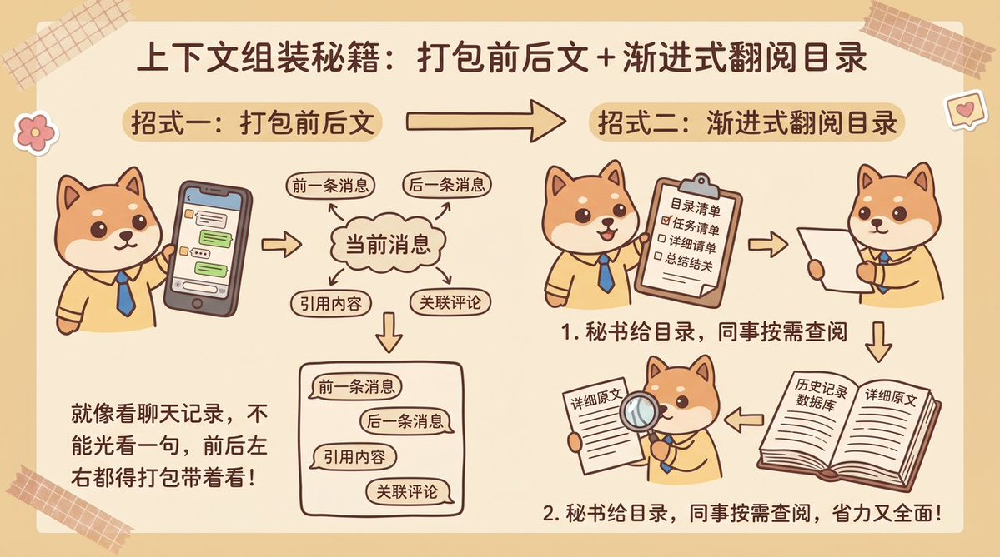

2. 全天候在线：云端大脑 + 本地手

想让 Agent 24 小时待命，最直接的想法是上云。但这里有个天然死结：算力可以轻松上云，用户的本地未提交代码、私有凭据和内网环境却很难同步到云端，硬要同步不仅代价巨大而且极其麻烦

为了解开这个死结，团队做了一套脑手分离的拆解：

首先把负责思考的“大脑”和记忆全部搬上云。Agent Loop 的核心推理逻辑本身不存数据，直接丢到云端方便随时扩缩容；聊天记录与任务进度则统一保存在云端数据库里，随时都能恢复现场

接着把操作的“手脚”留在本地。你的代码资产和开发环境依然留在本地电脑里一秒钟都不离开，只需要在本地装一个极轻量的守护进程。云端的大脑思考完要敲什么命令，就远程发指令让本地充当手脚的守护进程去执行，跑完再把结果传回云端。哪怕本地电脑合盖重启，云端的大脑也能在重新连上后无缝衔接任务进度

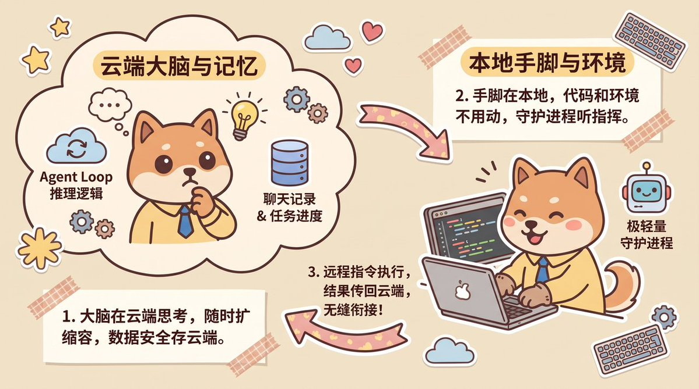

3. 长程防跑偏：专门配一个“督导巡查员”

在传统后端系统里，防故障靠的是进程心跳探测，也就是看程序还活着没有。但在 Agent 系统里这招不管用了，因为绝大多数异常是大模型“活着，但疯了”，在后台陷入了死循环，或者一步步偏离了最初的目标

指望一个正在钻牛角尖的 Worker 自己反省是不现实的。DeepSeek 的做法是在主系统外面，单独配了一个独立的看门狗 Agent（Watchdog），定时唤醒它来充当“督导巡查员”：

a、让看门狗既查基建，也查脑子

看门狗不仅负责处理接口报错、状态恢复失败这些传统故障，还会定时去抽查各个干活同事（Worker）的工作日志，用大模型去审计大模型：“这个同事过去十分钟有实质进展吗？执行方向偏离总目标了吗？”。一旦发现跑偏或卡死，看门狗就会当场介入重置

b、大白话运维

因为看门狗自己也是一个挂满工具的独立 Agent，系统维护者平时根本不需要写复杂的运维脚本，直接用自然语言问它“刚才那个任务怎么卡住了”，甚至直接口头吩咐它“把群聊触发的规则调严一点”，它就能在线帮你把主系统的提示词和规则给热修好

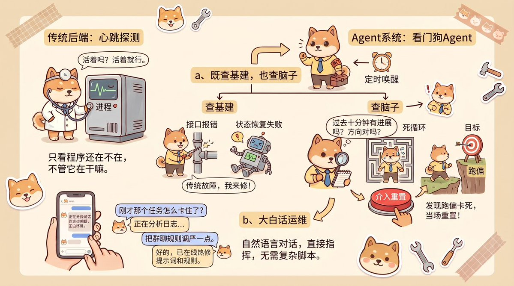

##

## 六、Super Agent 带给我们的思考

读完下来，Left 最大的感受在于 DeepSeek 团队对问题的敏锐捕捉

其实不管是之前的 Claude Tag，还是现在的 Personal Agent，市面上已经在探索新的 Agent 交互方式了，大家努力的方向很一致，就是把传统的会话窗口砍掉，让 Agent 直接融进咱们平时干活的软件里

可能很多朋友看完上面这套架构，会觉得 Super Agent 太重了，双层路由和看门狗花费的算力和基建成本都不低。但换个角度想，以前用户得自己管十几个会话窗口，是因为系统设计把复杂度甩给了人。想让交互变智能简单，系统设计就得替用户把这些复杂度扛下来

从这个角度看，Super Agent 最大的意义，就是对“砍掉会话、探索新人机交互方式”的方向上做了一次全新的工程探索。随着模型成本下降和基建成熟，相信未来会冒出越来越多这种形态的产品

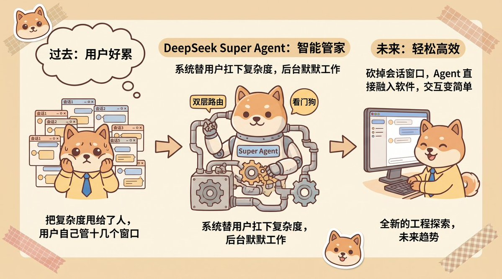

##

## 七、最后的话

这篇文章，Left 带大家拆解了 DeepSeek 团队在 Super Agent 上的最新探索。从为什么要“消灭会话”聊起，一步步扒开了背后的双层并发路由、两级噪音过滤，以及撑起 24 小时无感运行的三大工程底座，最后畅想了 Agent 时代的人机交互新方式

你认为未来的人机交互方式是怎样的？欢迎说说你的想法！

## 相关页面

- [[sources/criscxuan-deepseek-super-agent-architecture-teardown]]
- [[sources/xiaohu-deepseek-super-agent-experiments-and-security-cost]]
- [[sources/antivo-deepseek-super-agent-distributed-master-worker]]
- [[concepts/deepseek-harness-agent-formula]]
