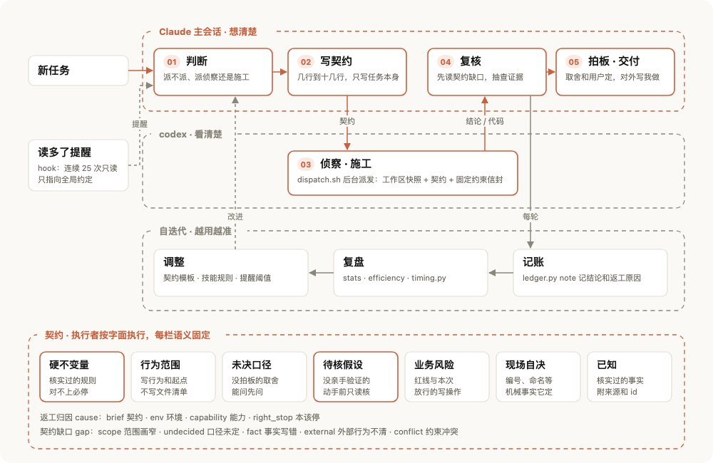
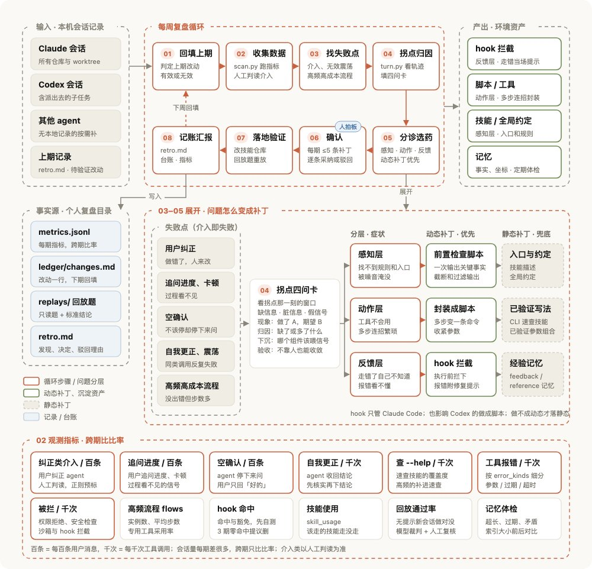

# Ricko Yu：claude-lead 与 weekly-retro 技能开源——都放进 rstack 仓库了

> 把之前分享过的 claude-lead 与 weekly-retro 两个技能整理成公开版本，放到 GitHub 的 cosmtrek/rstack 仓库里。

<!-- more -->

把之前分享过的的 claude-lead 和 weekly-retro 技能整理成公开版本，放到下面仓库里，欢迎 star 和 fork！

https://github.com/cosmtrek/rstack https://x.com/cosmtrek/status/2124154959747076526

## 相关页面

- [[patterns/error-notebook-pattern]]
- [[concepts/loop-engineering-thoughts]]
