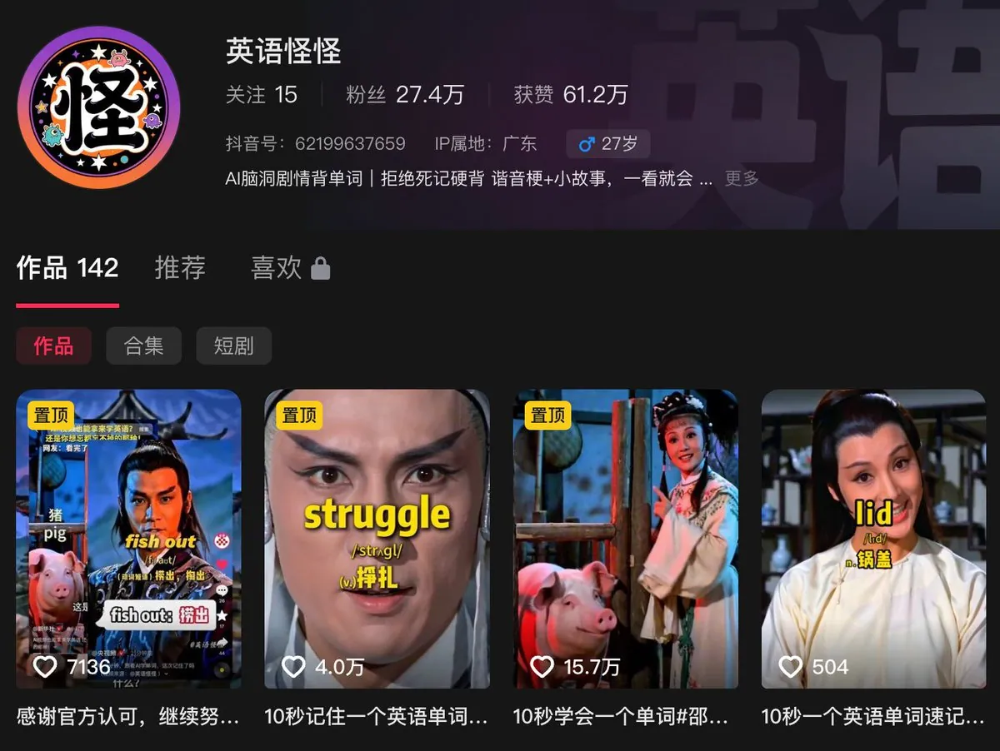
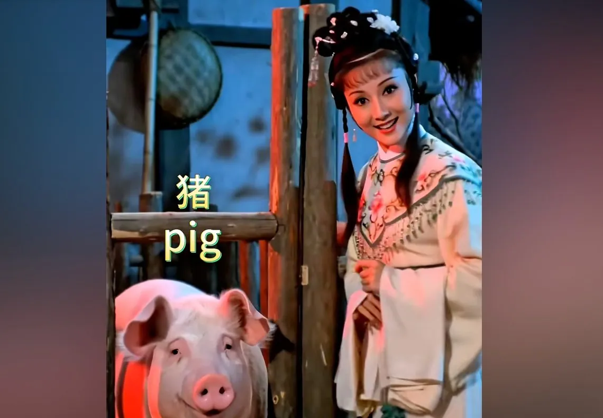
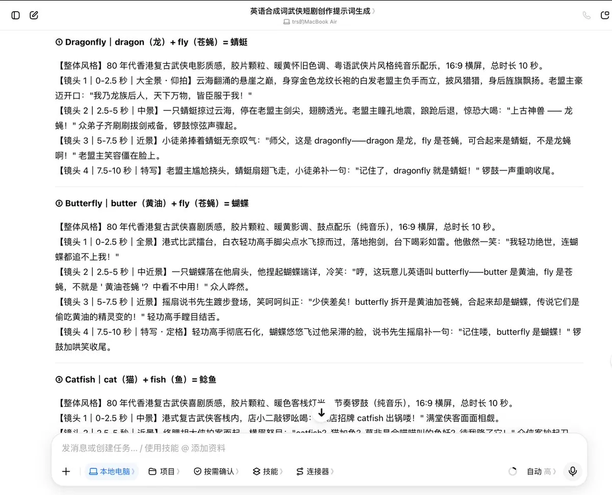
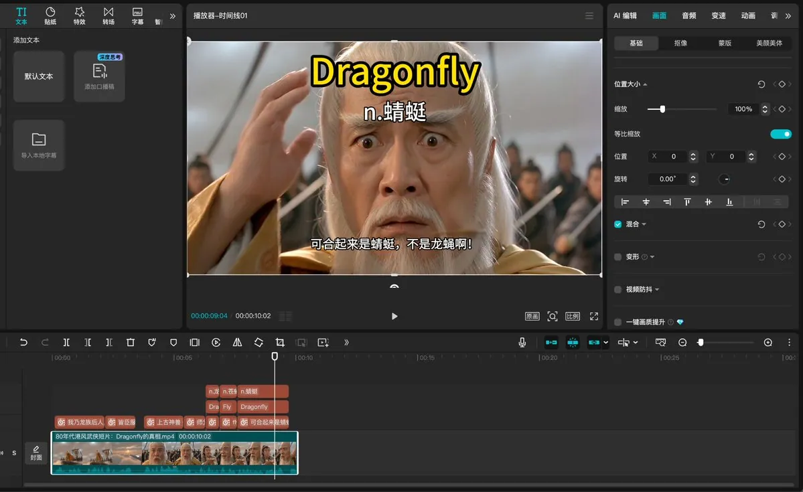
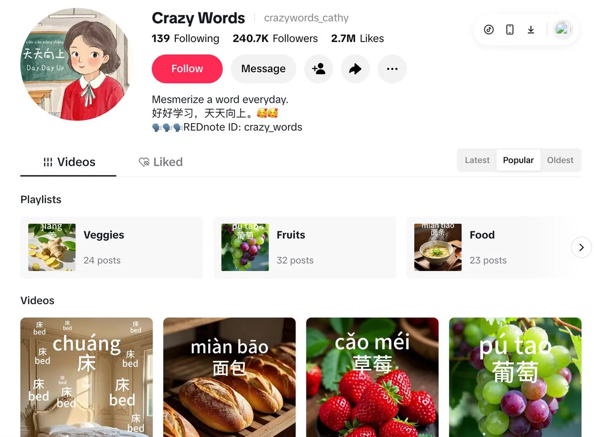

# 疯狂的烤妹儿（@CrazyKaomei）：爆款复刻｜月涨粉 5w 还能出海赚美金——拆透「古风武侠英语剧」的长青打法与搞钱闭环

> 拆解看似玩梗实则生命力顽强的长青赛道：把枯燥英语单词拍成 80 年代香港邵氏画风的「武侠情景微短剧」，单条视频狂揽 20 多万赞、半年涨粉 27.4 万；系统复刻该打法的选题公式、画风统一方法、批量生产流水线，以及同步出海英文版本赚取美金的搞钱闭环。

<!-- more -->

家人们好呀！又来到了熟悉的爆款拆解环节～

今天烤妹儿就专门来拆一个看似玩梗、实则生命力极其顽强的长青赛道：

把枯燥的英语单词，拍成浓浓 80 年代香港邵氏画风的「武侠情景微短剧」。

单条视频狂揽 20 多万赞，半年涨粉 27.4 万。



烤妹儿之所以拆解它，不光是因为数据好看——

而是因为这个方向只要你有脑洞和创意，每天只需要发布一条 10 秒短视频，就一定可以持续涨粉；甚至还能反向出海教老外学中文，赚美金。

今天这篇文章，我会先讲清楚为什么值得做、怎么避免做成烂梗；然后把任何小白用豆包都能直接跑通的完整 SOP 流程手把手拆出来。

最后再聊聊变现方式，以及现在还比较少人去尝试的可迁移玩法。

## 01 / 撕开偏见：为什么说这是自媒体里少有的 “抗周期长青树”？

很多人以为这只是个昙花一现的 “搞笑烂梗”，这完全是外行看热闹。

从商业和平台生态的底层来看，这个方向具备三个极其硬核的优势：

第一、绝无违禁词风险，平台真金白银扶持的刚需赛道。

做自媒体最怕什么？辛辛苦苦做起来的号，因为擦边、违规、搬运或者敏感词，一夜之间被封禁降权。

而语言学习是全人类永远的刚需。不管你是拆英语合成词，还是教汉语俗语，它自带 “教育科普” 的正向属性。

没有金融风险，没有封号焦虑，算法天天追着给你推自然流量。

第二、10 秒极简微剧，只要有创意和脑洞，涨粉极度稳定。

先抛一个扎心的问题：你上次下定决心背英语单词是什么时候？ 第一页的 abandon 背了多少遍？是不是每次翻到第二页就放弃了 🤣

但这套视频最大的绝招就是 “降维记忆”。短短 10 秒，把过去的死记硬背，变成了一个让人捧腹大笑的视觉段子。

用户刷到不是在受教育，而是在看武侠轻喜剧。节奏极快、反差极大，完播率随随便便就能冲破 40%。

只要你每天花 10 分钟更新一条，在这个细分领域里，抖音和视频号一个月少则大几千上万，多则稳稳收割三五万精准粉丝。

第三、变现模式清晰，而且可迁移到海外市场。

很多人做号最大的心病就是 “涨粉了但赚不到钱”。

这个赛道的好处是，你吸引来的不是泛娱乐乐子人，而是学生、考研党和鸡娃宝妈——天然的高付费意愿人群。

具体怎么搞钱、怎么出海，后面再单独讲～

## 02 / 为什么大部分人做成了烂梗，顶尖玩家却能打穿算法？

做这类视频，如果一开始的认知错了，后面全盘皆输。而最常见的误区，就是把 “知识交付” 做成了 “泛娱乐烂梗” 。

为什么很多人的视频只有几十赞？

因为他们纯粹为了搞笑去拼凑生造词，或者挑毫无日常痛点的冷僻词。

观众划过去当乐子看，笑完直接划走，不点赞、不收藏、不转发，算法直接判定为低质垃圾内容。

顶尖账号聪明的地方在于：它压根不是在让你 “背单词”，而是用具象化场景替你做 “记忆绑定”。

比如讲 pig out（大吃大喝），画面就是老武侠剧里女主站在猪圈旁幽幽地说：

“猪（pig）出去了（out）要大吃大喝，所以这是大吃大喝。”



画面、声音、字面释义三位一体打进大脑，观众的感受不是被灌输知识，而是“卧槽，老子这辈子都忘不掉这个词了！”

这种恍然大悟的获得感，才是促成用户主动截图、收藏和转发的底层动力。

此外，为什么武侠风格和学英语这两个明明完全不搭的东西，组合在一起反而成了爆款？

因为香港老武侠的胶片噪点、泛黄调色、沧桑配乐，天然带着极高的反差感与辨识度。

更关键的是，这种粗糙复古的电影颗粒，正好掩盖了 AI 视频偶有的轻微瑕疵，完全没有现代 AI 假人的恐怖谷效应，视觉体验极佳。

而且在所有短视频平台上，算法追求的第一指标永远是完播率。

10 秒总时长，分为 4 段、每段 2.5 秒极速硬切。前 2.5 秒白发老盟主霸气出场硬控视线，中间 5 秒极速反转揭晓谜底，最后 2.5 秒留白尴尬收尾。

节奏快到用户还没反应过来就播完了，完播率轻松拉到 40% 以上。

## 03 / 零基础小白，如何用 10 分钟快速复刻？

这套流程烤妹儿自己在豆包上试过，去掉 AI 生成时间，熟练后 5～10 分钟就能搞定一条。

每天有 5 条免费额度，成本无限接近为零～

Step 1：搭建专属“武侠英语/中文智囊”智能体（拒绝大模型造假词）

大模型最容易犯的毛病是 “幻觉造词”——为了凑字面搞笑，捏出根本不存在的假词，发出来直接翻车。

所以在开始之前，我们必须先用智能体把规则焊死。

打开豆包网页版或 App，切换到【工作任务】模式，直接把下面整段提示词复制进去，一键创建你的专属智能体：

```
【角色与目标】
你是一个精通短视频爆款逻辑、AI视频生成以及英语词源学的提示词专家。你的任务是根据用户的需求量，自动挖掘真实存在的英语合成词，将其拆解为合规、安全且搞笑的武侠剧日常桥段，并输出可直接用于 AI视频生成的10秒强剧情、高反差一体化中文提示词。

【选词绝对红线（防胡编乱造）】
必须为真词：你自动挑选的词汇必须是真实存在、收录于主流英语词典且被广泛使用的合成词或俚语。绝对禁止为了凑字面意思而生造英语单词。构词法必须是：基础词 A（可具象化的实物）+基础词B（可具象化的实物/身体部位）=合成词C（具有强烈反差的比喻义、引申义或现代网梗）。

【创作核心要求】
固定产出3个创意的10秒完整剧情脚本，分4段镜头拆分，每段时长2.5秒，画面适配16:9横屏，风格为80年代香港复古武侠风，剧情通俗易懂、趣味有反差，适配英语知识科普短视频，台词简洁易懂，兼具趣味性和知识性，输出内容仅保留可直接用于AI视频生成的完整剧情提示词。视频中不需要任何字幕出现。

```

智能体会批量产出 3 组标准化剧情脚本，如下图——

所有脚本均自带规范分镜、适配短视频、符合武侠风格与英语科普属性。



这里需要严格遵循英语情景剧 AI 创作铁律：先出脚本、核验词汇、再做视频。

确认脚本内所有英语合成词均被主流英语词典收录、为真实通用词汇，无 AI 生造虚假单词。

最终筛选出一组知识点准确、剧情逻辑通顺、趣味性强的脚本复制备用，即可进入后续视频制作环节。

Step 2：扔进豆包 Seedance 2.0 Fast 直接出视频

新开一个豆包对话，选择【视频生成】，模型选 Seedance 2.0 Fast，视频比例选 16:9 横屏。 直接粘贴刚才生成的提示词。

以经典词汇 Dragonfly 为例，dragon（龙）+ fly（苍蝇）= 蜻蜓

下面是烤妹儿实测成片的提示词——

```
【整体风格】
80 年代香港复古武侠电影质感，胶片颗粒、暖黄怀旧色调、粤语武侠片风格纯音乐配乐，16:9 横屏，总时长 10 秒。
【镜头 1｜0-2.5 秒｜大全景・仰拍】
云海翻涌的悬崖之巅，身穿金色龙纹长袍的白发老盟主负手而立，披风猎猎，身后旌旗飘扬。老盟主豪迈开口："我乃龙族后人，天下万物，皆臣服于我！"
【镜头 2｜2.5-5 秒｜中景】
一只蜻蜓掠过云海，停在老盟主剑尖，翅膀透光。老盟主瞳孔地震，踉跄后退，惊恐大喝："上古神兽 —— 龙蝇！" 众弟子齐刷刷拔剑戒备，锣鼓惊弦声骤起。
【镜头 3｜5-7.5 秒｜近景】
小徒弟捧着蜻蜓无奈叹气："师父，这是 dragonfly——dragon 是龙，fly 是苍蝇，可合起来是蜻蜓，不是龙蝇啊！" 老盟主笑容僵在脸上。
【镜头 4｜7.5-10 秒｜特写】
老盟主尴尬挠头，蜻蜓扇翅飞走。 锣鼓一声重响收尾。
```

💡 核心技巧： 固定 “80 年代香港复古武侠” 和 “四段镜头硬切”。

豆包生成的画面色彩统一，甚至连打斗和粤语武侠风纯音乐都一次性渲染到位，完全不用二次调色和到处找 BGM！

Step 3：剪映精细化收尾（决定收藏率的关键一步）

把视频导入剪映，接下来做三步核心动作：



- 一键识别字幕：中英文对照，修正错别字；
- 字体加描边（重点！）：字体选择复古楷体，务必设置成“白字黑边”。学习类视频用户极度喜欢截图保存，白字黑边在复杂的武侠背景下识别度最高；
- 核心知识点卡片化：在小徒弟公布答案的节点，屏幕正上方打出醒目知识点标签【Dragonfly ＝ Dragon（龙）＋ Fly（苍蝇）＝ 蜻蜓】。

整套流程跑顺之后，一条兼具电影质感和硬核知识点的爆款情景剧，10 分钟彻底搞定。

⚠️ 怎么避免脑洞断档？一套能持续复刻的 “弹药库” 搭建法

很多人做自媒体最大的瓶颈不是剪视频，而是更新了十条之后 “没词了”。

想要把这个赛道当成长线资产来做，你必须有一套源源不断的选题母体。

这里最好专门建立一个高频合成词与成语分类库， 按主题去扒词典：

- 动物拟人类（pig out 大吃大喝、chicken out 认怂胆小、cold turkey 突然戒断）
- 人体感知类（cold feet 临阵退缩、sweet tooth 爱吃甜食）
- 职场社交类（burn out 筋疲力尽、break a leg 祝你好运）
- ……

每一个分类拿出来，都能拍成一个几十集的武林门派连续剧！

选词的核心标准只有一条：这个词的 “字面画面” 和 “真实含义” 之间的反差感越大，视频就越好笑、越容易记住、越值得传播。

按照这个标准，你光靠一本《牛津高频合成词手册》就够拍大半年的。

## 04 / 这个赛道怎么搞钱？除了国内变现，聪明人已经开始反向出海了

很多人担心这类账号粉丝都是白嫖乐子人、变现无门，那是死脑筋的玩法。

只要你把定位从 “搞笑显眼包”，扭转为 “趣味英语学习工具”，搞钱路径其实非常垂直：

① 9.9 元虚拟单词卡（零边际成本，最好卖）

把视频里拆解的内容，用 AI 整理成《视频同款 100 个武侠无厘头图解英语合成词速记手册（高清打印版 PDF）》。

挂在主页小黄车或橱窗，可以标价 9.9 元甚至更低。

在大城市宝妈和考研学生眼里，这点钱连半杯奶茶都买不到，但能买到一份 “能让人看笑并记住” 的独家资料，冲动消费极高。

卖 1 单和卖 10000 单成本完全一样，全是纯利润。

② 挂车分销高佣金图书教辅（被动佣金收益）

视频跑出几十万播放后，直接在视频锚点和橱窗挂《中高考高频词汇漫画图解》、《四六级速记词典》、《小学英语自然拼读卡片》。

这类教育图书在平台的佣金比例都非常高，有的甚至能达到 50%~70%。

因为你的视频已经用事实向用户证明了 “具象化记忆有效”，顺水推舟引导下单教辅书，是自然而然的事情。

③ 私域沉淀 ＋ 单词打卡训练营

主页简介引导：“进粉丝群免费领 50 组武侠英语高清壁纸与纯正发音音频”。

把精准的高知宝妈和学生沉淀到私域微信，后端开设 21 天英语趣味打卡营、自然拼读提分班，或者分销在线外教课。

客单价瞬间从 9.9 元，拉升到几百上千元。

④ 反向出海教老外学中文（吃美金播放分成）

这是极少有人发现的蓝海降维玩法！ 下面是一个 TikTok 的案例 ⬇️：

这个博主采用非常简单的制作，直接一张插图➕不断洗脑重复，每段视频仅 8 秒，都已经积累了 24w 的精准粉丝。



更别说老外对 “Chinese Kung Fu” 和香港武侠有一种骨子里的狂热。

把这套视频反向制作：用老盟主武侠剧教老外学地道中文词（比如老盟主以为 “马上” 是骑在马上，其实是 “立刻”），直接发到 TikTok 和 YouTube Shorts。

老外会被这种武侠无厘头中文教学笑疯，直接吃海外创作者基金美金播放收益。

## 05 / 烤妹儿碎碎念：AI 时代，别样样通、样样松

前几天在评论区里，有个人留言说——

“烤妹儿，这种爆款复刻跑出来的很少。我已经试了三个号，一个都不行，变现没那么好……”

说实话，每次看到这种评论，我都觉得既真实又无奈。

无奈是因为，在这个 AI 工具大爆发的时代，太多人患上了 “三分钟放弃综合征”。

看别人发个什么爆款，自己兴冲冲注册一个号，随便喂两句提示词水了几条，发现没流量，立刻得出结论：“这赛道不行，都是骗人的。”

但他们根本没想明白： AI 时代，内容的平庸化和同质化是必然的。

大模型给了所有人 70 分的入场券，如果你只是机械地复制粘贴，你凭什么觉得自己能赢？

真正能拿到结果的，从来不是靠样样通、样样松的三分钟热度。

而是那些刚好踩在自己 “优势区和舒适区”，借着 AI 的杠杆把内容打磨到 85 分、90 分的死磕手艺人！

比如你本身就是有幼师经验，或者做过英语儿童辅导，那你在「儿童英语绘本」赛道就能敏锐地选出最容易让孩子记住的词汇，在审美和专业度上做出差异化。

如果你是老港片影迷，满脑子都是星爷的无厘头和邵氏的刀光剑影，那你写出来的分镜就能让用户捧腹大笑。

这些，才是你的护城河。

烤妹儿花那么多时间把这些 SOP 和避坑细节写出来，不是为了煽动每个人都盲目跟风——

而是希望这些武器能刚好递到 “对的人” 手里，让他们在自己的舒适区里如虎添翼。

至于其他人，哪怕你暂时不做这个方向也完全没关系。

仔细看懂背后的反差逻辑、流量思维和商业模式，说不定能给你正在做的赛道带来一个全新的思路。

好了，今天的拆解就到这里。

别让方法论只是躺在收藏夹里吃灰，找到你自己的舒适区，今晚花 5 分钟打开豆包，先跑起来，再慢慢校准！

👋 我是烤妹儿，这是「爆款复刻」专栏的第 07 期～

每一期我不光给你能直接抄的 SOP，更会拆透爆款背后的底层逻辑、搞钱闭环和认知差——帮你看懂别人为什么赢，又该怎么找到自己的优势区。

全网能落地的 AI 自媒体爆款，我会持续深扒下去。

如果你也喜欢这篇文章，可以看看往期同系列高赞合集汇总——

- [这个日本男人靠 “AI 美女” 5 天涨粉 1000，月入 12 万？（附暴力变现全套 SOP）](https://x.com/CrazyKaomei/status/2083033305142952235?s=20)
- [别再看不起 29.9 的小生意了！小红书卖爆 30w+，我把这套「生日祝福短片」工作流全开源了！](https://x.com/CrazyKaomei/status/2090670229869502497?s=20)
- [99% 的人以为是真人实拍！5 分钟手搓「超逼真生活感 AI 口播」实战攻略～](https://x.com/CrazyKaomei/status/2093669492920668657?s=20)
- [单条点赞 300w、5 个月吸粉 200w 的 AI 治愈号，我用豆包零成本做出来了（附完整 SOP）](https://x.com/CrazyKaomei/status/2097118468873351502?s=20)
- [抖音 30w+ 赞的电影级 AI 哭戏，用豆包 3 分钟做同款（全流程拆解 SOP）](https://x.com/CrazyKaomei/status/2097572079654813816)
- [单月营收过万，一年涨粉百万！儿童英语绘本 AI 工业化出片+变现全流程](https://x.com/CrazyKaomei/status/2099298080885530788?s=20)
- [月涨粉 5w 还能出海赚美金？拆透「古风武侠英语剧」的长青打法与搞钱闭环](https://x.com/CrazyKaomei/status/2099775364965061013?s=20)
- [YouTube 极简火柴人搞钱流水线，优质内容心法 + 全套工作流，被我一键开源啦！](https://x.com/CrazyKaomei/status/2102311241046008268?s=20)

最后如果你有想拆解的赛道，或在实操做号时遇到任何卡点，都可以直接后台私信烤妹儿。只要背景说得详细诚恳，我看到后都会一一回复。

平时我也会持续分享一些优质的提示词，期待大家在评论区交作业～

## 相关页面

- [[sources/yaohongan-18-days-10-sites-meme-traffic-playbook]]
- [[sources/aiwarts-awesome-seedance-463-ai-video-skills]]
- [[concepts/selfmedia-compound-model]]
- [[concepts/ai-content-pipeline]]
