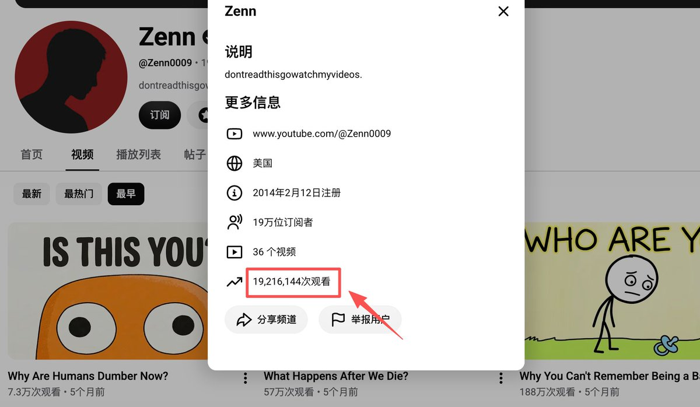
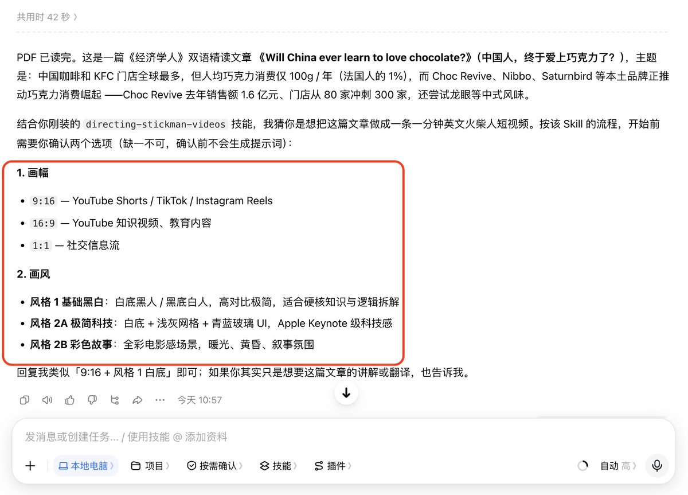
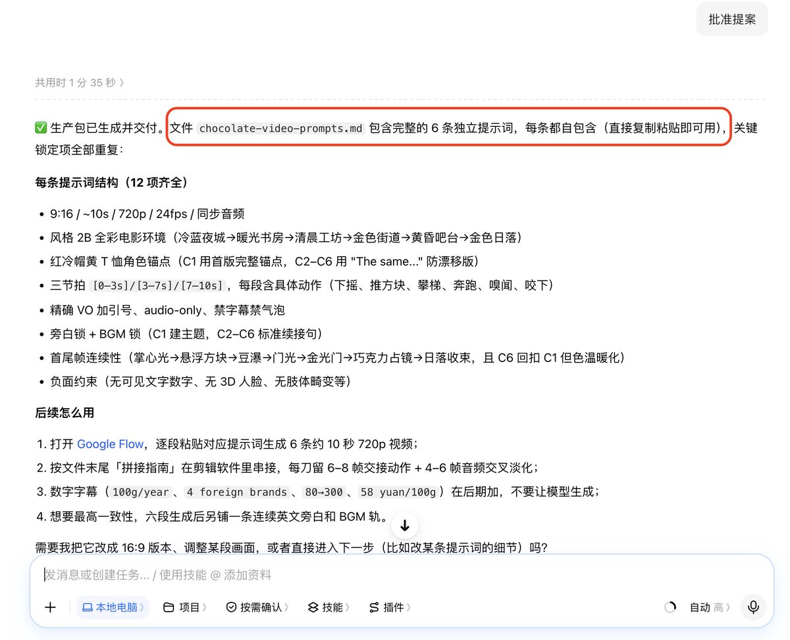
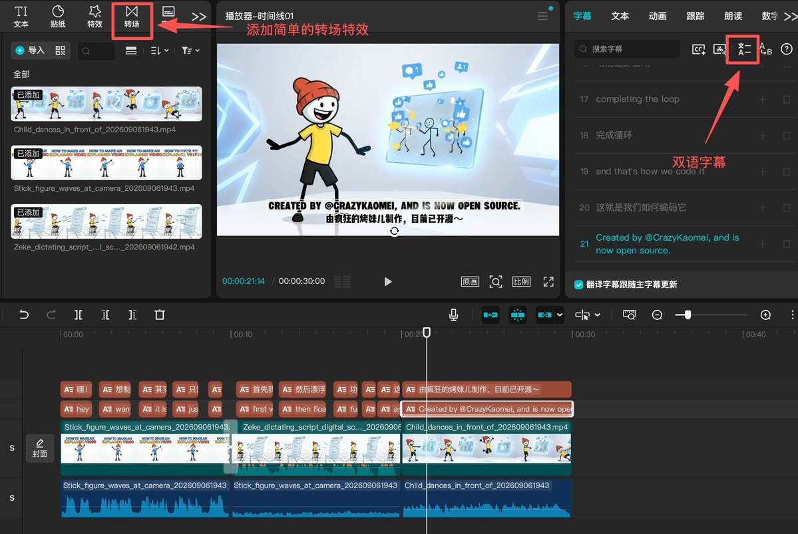

# 疯狂的烤妹儿（@CrazyKaomei）：爆款复刻｜YouTube 极简火柴人搞钱流水线，优质内容心法 + 全套工作流开源

> YouTube 极简火柴人动画短视频自动化出海实战：拆解国外百万播放极简动画背后的吸睛心法，开源从「选题爬取 → 故事脚本生成 → 极简线条图绘制 → 剪映草稿自动化生成与多语种配音」全套流水线，手把手教普通人玩转视频出海分成。

<!-- more -->

家人们，还记得前段时间烤妹儿连载的「火柴人系列」吗？

最早做 1.0 版本 的时候，我只是趁着周末好玩，把 YouTube 和 TikTok 上动辄几十万播放的火柴人工作流，复刻成了一个简单的 Skill。

后来，我发现了一个海外大神的油管账号：全频道只发了 36 个视频，就积累了 19 万粉丝，单条最高播放直接冲到了近 800 万！

引用推文：疯狂的烤妹儿 🩵 (@CrazyKaomei)

把之前很火的「火柴人动画」，又更新了一个版本。 准备把这个赛道的画风，开发到极致（虽然都是火柴人，但细节和辨识度完全不同）。 截图里的油管大佬，只发了 34 个视频就积累了 18w 粉丝，单条最高跑到了快 800 万播放。 同时还在优化配套的文案 skill，过几天全面开源，感兴趣的可以先 mark。 https://t.co/urWwnP1sUU

https://x.com/CrazyKaomei/status/2096758094386868518

为了搞明白他到底凭什么这么猛，我火速更新了火柴人 2.0，不仅调顺了极简科技风和彩色故事风，还把 IP 画风一致性彻底锁死。

[当时在 2.0 的帖子里，烤妹儿还给大家立了一个 Flag：](https://x.com/CrazyKaomei/status/2100533784462737711?s=20)

不仅要把画风做扎实，还要彻底帮大家解决优质内容来源——基于全网高赞内容精准筛选和分类，并针对性地复刻爆款结构。

发完之后，评论区被无数家人们疯狂催更。

今天，烤妹儿来给大家把这个最大的 Flag 彻底填上！

在这篇文章里，我会把这段时间结合 Codex + Flow + 剪映 彻底跑通的 “火柴人爆款出片 SOP”，完完整整交给大家。

喜欢这个风格的朋友，一定要先【转发 + 收藏】，方便后续随时对照～

但在正式动手前，烤妹儿要先带大家捋清一个最底层的逻辑。

## 01 / 画风这么糙，凭什么这个赛道能月入 5～6 万？

很多人第一次刷到这种视频，第一反应往往是不在意：

“这不就是很简单的画风吗？这也配叫优质视频？”

但现实是，太多做 AI 内容的人陷入了严重的 “技术自嗨” 里：追最新的模型工具，提示词调了三天三夜，特效堆得眼花缭乱……

结果兴冲冲发到网上，点赞寥寥无几，完播率惨不忍睹。

为什么？因为大部分人根本没搞懂短视频的注意力密码。

观众打开 YouTube 或者 B 站，看历史、商业、科普故事的时候，要的是 “高密度的认知爽感”，而不是看你炫技！

太华丽逼真的 3D 画面，反而容易引发 “恐怖谷效应”，大脑极易疲劳。

相反，白底黑线、圆头点眼的极简火柴人，对人脑几乎是零认知负荷。观众看一眼就懂，注意力会 100% 聚焦在你的悬念和故事推进上！

要知道，在 YouTube 做这种商业内幕、科学常识或冷门历史，1000 次播放的广告分成大约是 2 到 3 美元（约合 15-20 元人民币）。



还是以这个火柴人频道为例——5 个月的时间跑了 1900 万次播放，广告收益就是 3.8 万美元（约合 28 万人民币）

折算下来每月就是 5～6 万人民币的纯利润，对个人创作者来说真的很可观了！

以往做一条这种 8 分钟深度视频的成本有多高？

- 请英文专业配音：50～150 元 / 分钟
- 请专业文案：500～2000 元 / 条
- 找动画工作室做分镜：单条成本至少大几千，普通人根本不敢轻易试错。

而现在我跑通的这套工作流：用 Codex 跑选题和分镜脚本，用 Flow 一键生成地道配音和视频，最后在 剪映 里花 5 分钟加字幕和人工微调成片。

每个月的工具成本不到一顿火锅钱，一个下午就能把整条片子的所有素材和成片干出来！

考虑到有些家人们平时不用 Codex，老规矩，烤妹儿主打一个 “人人能上手”！

在接下来的实操演示里，我会以大家最常用的豆包 / Workbuddy 来举例。

虽然文生视频的「提示词效果」差点儿，但流程丝滑，照样能高质量出片！

## 02 / 小白也能跑通的 4 步「火柴人出片流水线」

在看具体步骤前，先记住烤妹儿的一句大实话——

在 AI 时代，真正能靠内容赚到钱的，从来不是 “把 AIGC 工具玩得最花哨的人”，而是「懂爆款标准、能把流程做成流水线」的人。

过去做内容，很多人每天困在屏幕前内耗：今天纠结讲历史，明天纠结讲商业，憋了一个星期搞出来的片子，发出去播放量不过百。

而在这套系统里，我们彻底告别盲目试错，只需要把控两端：

1. 输入爆款筛选规则，让 AI 找出被市场验证过的 “必火选题”。
2. 批量生成分镜脚本后，用 Flow 制作视频，并导入剪映流程化出片。

整套打法，我总结成了 4 个环环相扣的极简步骤：

- 侦查黑马 ➜ 专门挖掘 “作品极少但条条大爆” 的新账号
- 结构克隆 ➜ 扒下爆款的 “秒级叙事节奏”，批量出分镜脚本
- Flow 出片 ➜ 一键生成地道英文配音、背景音效与动态分镜视频
- 剪映组装 ➜ 5 分钟微调转场特效与字幕，把控最后的成片灵魂

接下来烤妹儿开始给大家详细拆解👇

1. 只盯 “少发高爆” 的黑马新号

做自媒体第一步也是最重要的一步：找对标。

千万别去抄那些发了几百条视频的早期大号，那些号有多年积累和优质权重，普通人去抄必死无疑。

真正有参考价值的，是 “仅发布少量视频，但单条播放极高” 的新号！

这种号能爆，根本不是靠粉丝基数，而是因为它的 “选题模型” 直接戳中了人性底层的猎奇心。

怎么在一堆视频里精准找出这些视频？根本不需要你手动去一页页刷。

直接复制下面这段提示词，让 AI 替你全网扫描：

```
请帮我在 YouTube 上寻找专门使用“火柴人或极简 2D 线条动画”讲解历史、商业内幕、科学常识或冷门杂学的高潜力频道，并整理成结构化表格。

【严格筛选条件】
1. 频道以英文（或目标语言）讲解为主，采用纯配音解说，真人全程不露脸。
2. 频道处于活跃状态，近 90 天内有持续更新。
3. 核心硬指标：总发布视频数在 30 条以下，但至少有 1 条视频播放量突破了 10 万次！

【输出表格规范】
请输出以下 6 列： 频道名称 / 频道主页 URL / 总视频数量 / 播放量最高的一条视频标题 / 该视频具体播放量 / 核心题材模型分类。

【注意事项】
1. 频道链接必须真实可访问，严禁虚构。
2. 提取完毕后，在表格末尾对这些爆款标题进行归纳，提炼出最通用的 3 大爆款标题公式。 找到 10 个符合条件的样本后，自动保存为 channels.csv。
```

经烤妹儿观察下来，Youtube 火柴人赛道最容易火的三大爆款模型，结尾几乎都是一个固定句式——“真正的理由”。

- 历史抉择型：“那位暴君被流放到孤岛的真正理由”
- 商业内幕型：“为什么新手机每年都在偷偷砍掉某些功能的真正理由”
- 认知颠覆型：“为什么那些被吹成健康食品的东西每年都在反转的真正理由”

如果你想主做国内平台，不碰海外，筛选低粉爆款的原理是一样的。烤妹儿这里再给大家分享两个借力打力的取巧小思路——

如果不想重新配音，直接去小红书搜 “精选外刊”，因为火柴人动画自带学英语的生动感，可以主攻英语学习粉。

专门挑那些几千上万高收藏的图文帖子，把原稿改写成火柴人双语小动画，涨粉极快且极具商业变现价值。


如果想做纯中文赛道，那就在视频号和 B 站锁定那些高赞的 “认知思维、人性洞察、励志成长” 账号当对标。

然后在剪映里选一个清爽的中文配音，火柴人的极简画风，能天然过滤掉传统说教的油腻感，把大白话讲得高级又耐看！

2. 像素级复刻爆款节奏，绝不自由发挥

能拿到大几十万播放的顶级文案，从来不是凭空硬憋出来的。

说白了，好文案更像是做填空题——

把一个被市场验证过的爆款骨架扒下来，保留它的情绪卡点，只把里面的故事换成你自己的赛道。

那些完播率能突破 60% 的爆款视频，情绪卡点和节奏极其精确：

- 黄金钩子：抛出一个反常识的致命追问，死死勾住好奇心；
- 打破常识：先说大家都以为的经验，再一句话彻底推翻它，制造认知冲突；
- 拉出内幕：讲一个鲜为人知的隐秘细节，把观众的好奇心彻底吊起来；
- 真相揭秘：给出合乎商业或底层人性的终极答案，认知爽感拉满；
- 引发互动：升华提炼，留一个让人忍不住去评论区发表意见的讨论题。

我们要做的动作非常简单：用提示词把爆款视频的字幕提取出来，照着上面这 5 个叙事节点切好。

它在哪一秒抛悬念、哪一秒做转折、哪一秒揭秘，我们就严格在相同的时间点，填入我们新题材的内容。

怎么让 AI 乖乖听话，老老实实按这个节点做？

可以试试我这套自用的【爆款结构一键克隆】提示词：

```
请参考给定的爆款 YouTube 视频，为我撰写一篇全新题材但节奏完全一致的深度解说视频台本。

参考爆款视频链接：[粘贴链接或直接输入其原台本文本] 本次全新题材：[输入类似“xxx背后的真正理由”的一句话选题]

【第一步：骨架深度解构】
请获取并分析参考视频的内容节奏，将其精准拆解为 5 大模块，并标出各自的时长秒数：
1. 悬念追问（0-X秒）
2. 现状与常识铺垫（X-Y秒）
3. 矛盾激化与剧情转折（Y-Z秒）
4. 深度揭秘与终极答案（Z-A秒）
5. 认知总结与互动收尾（A-B秒）

【第二步：注入全新血肉】
严格按照上述拆解出的【相同秒数配比与推进节奏】，为我的全新题材创作一篇完整台本：
1. 绝不抄袭参考视频中的任何原句，只借用其“铺垫-反转-揭秘”的情绪呼吸感。
2. 前 10 秒必须向观众抛出一个极具违和感、反常识的扎心追问。
3. 语言风格采用极短、地道、口语化的第一人称解说口吻，杜绝书面大词。
4. 凡涉及客观历史或商业事实，标注可查验的权威出处；存疑部分使用“据民间流传”表述。
5. 全文总时长严格控制在 8 分钟左右（中文约 1800-2200 字）。 完成后将台本保存为 scripts/全新题材名.txt，并在文末附上引用事实的核查清单。
```

整篇文案没有任何生硬的洗稿，更没有抄袭原文的一字一句。

但原片那种 “让人不知不觉看到底、根本舍不得划走” 的高完播率控场能力，已经被我们完完整整复刻过来了！

如果前期懒得打磨，烤妹儿把上面这套完整的爆款骨架，直接封装进了我的开源 Skill（stickman-video-director）里！

你只要安装好这个技能，连提示词都不用发，直接把你的原文、主题甚至外刊 PDF 丢给 AI，它就会在后台自动调用这套结构拆解出片！

3. AI 生成脚本 + Flow 出片

底层逻辑跑通了，接下来就是最爽的 “极速出片” 环节。

打开豆包（工作任务）或 WorkBuddy，复制这行口令发给 AI 助手：

```
请帮我安装 GitHub 开源技能：kaomei/stickman-video-director（火柴人短视频导演）。
安装完成后，向我确认已就绪并列出你可以执行的画风选项。
```

安装完成后，直接把你想做的素材甩给 AI，跟着引导选好画幅、时长和画风。

比如烤妹儿在实测时，直接找了一篇《经济学人》精读 PDF 发给了豆包：



紧接着 AI 会先给你呈上一份专业的导演提案：里面直接排好了核心钩子、视觉色调、完整的分镜表、旁白以及推荐的 BGM 风格。

🚫 烤妹儿核心避坑提醒： 在你正式确认提案前，Skill 绝不会去生成最终提示词！改画幅、换画风属于全局调整，必须在这一步敲定。这是修改成本最低的窗口，千万别跳过确认直接催出片。

然后你可以根据需求自由选择：直接批准提案、点名修改某一幕旁白、或者进行全局风格变更。

并在对话框回复 “确认提案” 后，Skill 会一秒吐出 6 条独立、带画风防跑偏锁定的 Gemini Omni Flash 提示词。



拿到提示词后，打开 Google Flow——

1. 模型选择：Omni 1.1 Flash（按照分镜顺序逐条粘贴）；
2. 参数设置：选 10 秒、720P（单条约消耗 15 积分，点击生成）。

这个模型不仅画质稳，还能在生成画面片段的同时，直接合成非常地道的原生英文口音，并把环境音效一并放进去！

更关键的是成本非常便宜，如果你还没看过这篇文章，强烈建议仔细看一遍。

引用推文：疯狂的烤妹儿 🩵 (@CrazyKaomei)

https://t.co/3gGAQGbBRb

https://x.com/CrazyKaomei/status/2093893997223923822

Google AI Pro 会员每月送 1000 积分，每天还赠送 50 登录积分。足够你每月做 150+ 条分镜，日更成本几乎无限接近于零！

4. 导入剪映，5 分钟拼装成片

素材全拿到后，直接把这 6 段视频丢进剪映。

很多崇尚 “全自动” 的人总想着用代码一键压制成片，但烤妹儿实操发现：最后一公里留给人工微调，才是最高效、最防翻车的做法！

因为一旦某个分镜画面有瑕疵，代码依旧会硬合并进去，缺乏变通。

所以最后的人工微调，就是区分 “流水线工业垃圾” 与 “让人欲罢不能的爆款” 的唯一分水岭。

在剪映里只需简单三步：

1. 轨道对齐：把 Flow 吐出的视频片段按顺序拖入主轨道；
2. 一键双语字幕：点击剪映自带的 “识别字幕”，2 秒搞定中英双语排版；
3. 添加转场特效：在分镜片段衔接的地方，随手加个微缩放运镜；



干净的双语字幕，加上每 2 ～3 秒就发生一次视觉变化与音效反馈的极简火柴人动画。不仅没有任何 AI 感，而且完全踩中了短视频的算法流量密码——

既有高密度的情绪共鸣，又有拉爆平台的超高完播率！

自动化帮我们干完了 90% 最脏最累的工作，我们只需花几分钟顺一顺节奏，一条高品质爆款视频，就此宣告完工！

## 03 / 烤妹儿碎碎念：AI 接管了 99% 的体力活，人类到底还剩下什么？

很多人总觉得用 AI 做视频，非要做出《阿凡达》那样的特效才算厉害。但现实狠狠打了所有人的脸：

在这个信息极度过载的时代，越复杂的画面，观众越懒得看；越极简的符号，穿透认知的速度反而越致命。

这套火柴人流水线的厉害之处，不仅是把生产成本压缩到了一顿饭钱，更在于它向我们展示了 “一人自媒体工业化” 的终极形态：

- 把一切画画、配音的体力苦活彻底丢给 AI 模型；
- 把人类所有的智力与心力，全部聚焦在 “找爆款型 ➜ 验证爆款型 ➜ 像素级复制放大” 这一套商业动作上。

当你把这套流程完整跑下来，看着自己也能轻松生成曾经每天都在刷的爆款短片时，那种心情是难以言喻的。

过去，原画师和配音员是动漫工业里最吃人手、最昂贵的人力成本；但在今天，AI 已经把素材生成的边际成本打到了无限接近于零。

那么真正决定一个账号是年入百万、还是发出去只有两位数播放的关键，到底在哪里？

答案只有六个字：找黑马、定骨架、做筛选。

其实这段时间烤妹儿一直在拆解各种爆款，这个过程我时常问自己：

- 让 AI 批量生成 10 个视频分镜，只要一两分钟；让 AI 吐出 50 个爆款选题，只要 10 秒钟。
- 但在这 50 个选题里，到底哪一个能让人在深夜刷到时，心里猛地 “咯噔” 一下、哪怕再困也忍不住非要点开探个究竟？

这种「对人类好奇心与痛点的感知力」，是 AI 永远算不出来的。

AI 对所有问题都一视同仁、充满热情；它根本分不清哪个问题会让人深夜失眠，哪个问题只会让人秒速划走。

这种对 “为什么（WHY）” 的偏执好奇心、以及追查真相直到深夜的探索欲，才是人类创作者在这个全自动时代唯一的护城河。

如果你今天也想迈出第一步，烤妹儿真心的希望你：

别急着做复杂的规划，先用前面讲的方法，找一个你最近百思不得其解、特别想弄明白的真实小痛点，跑出一篇脚本。

然后，把前 10 秒的开局旁白大声念给自己听。

如果你自己听完心里都微微一颤、迫不及待想知道背后的答案——

恭喜你，你已经拿到了通往下一个爆款的入场券。

👋 我是烤妹儿，这是「爆款复刻」专栏的第 08 期～

每一期我不光给你能直接抄的 SOP，更会拆透爆款背后的底层逻辑、搞钱闭环和认知差——帮你看懂别人为什么赢，又该怎么找到自己的优势区。

全网能落地的 AI 自媒体爆款，我会持续深扒下去。

如果你也喜欢这篇文章，可以看看往期同系列高赞合集汇总——

- [这个日本男人靠 “AI 美女” 5 天涨粉 1000，月入 12 万？（附暴力变现全套 SOP）](https://x.com/CrazyKaomei/status/2083033305142952235?s=20)
- [别再看不起 29.9 的小生意了！小红书卖爆 30w+，我把这套「生日祝福短片」工作流全开源了！](https://x.com/CrazyKaomei/status/2090670229869502497?s=20)
- [99% 的人以为是真人实拍！5 分钟手搓「超逼真生活感 AI 口播」实战攻略～](https://x.com/CrazyKaomei/status/2093669492920668657?s=20)
- [单条点赞 300w、5 个月吸粉 200w 的 AI 治愈号，我用豆包零成本做出来了（附完整 SOP）](https://x.com/CrazyKaomei/status/2097118468873351502?s=20)
- [抖音 30w+ 赞的电影级 AI 哭戏，用豆包 3 分钟做同款（全流程拆解 SOP）](https://x.com/CrazyKaomei/status/2097572079654813816)
- [单月营收过万，一年涨粉百万！儿童英语绘本 AI 工业化出片+变现全流程](https://x.com/CrazyKaomei/status/2099298080885530788?s=20)
- [月涨粉 5w 还能出海赚美金？拆透「古风武侠英语剧」的长青打法与搞钱闭环](https://x.com/CrazyKaomei/status/2099775364965061013?s=20)

最后如果你有想拆解的赛道，或在实操做号时遇到任何卡点，都可以直接后台私信烤妹儿。只要背景说得详细诚恳，我看到后都会一一回复。

平时我也会持续分享一些优质的提示词，期待大家在评论区交作业～

## 相关页面

- [[sources/crazykaomei-guofeng-wuxia-english-drama-evergreen-playbook]]
- [[sources/govin-github-6-insane-open-source-projects-monetization]]
- [[concepts/ai-content-pipeline]]
- [[concepts/open-source-seo-tooling]]
