# cxuan（@criscxuan）：通了个宵，终于把 Super-Agent 架构玩明白了（DeepSeek Harness 深度拆解）

> 以资深系统程序员视角深入拆解 DeepSeek Harness（DSH）团队最新发布的 Super-agent 架构设计：Router/Worker 双层淡化 Session 机制、Fast/Slow Path 事件过滤与 Trigger 路由、Inline/Spill 上下文换页优化与链式召回、全双工异步 ReAct Loop、BYOM 存算境三权解耦以及独立 Watchdog 外部控制回路。

<!-- more -->

昨天，DeepSeek Harness 团队发了一篇新文章，《Super-agent 设计探索：迈向更自主的 Agent 系统》。

现在跟大家聊聊，应该还不算晚吧？

主要是我把这篇文章仔细读了一遍，时间理解消化输出都是成本，于是今天才写出来。

而且我确实觉得此类文章要好好消化一下，不过我看到很多大号在官方发布之后半个小时甚至 1 个小时就把文章发出来了，emmm 这也许就是大佬吧 ：）

DeepSeek Harness 团队（以下统称为 DSH 团队）首先解释了一下，这种解释和我们的预想是一样的：近一年里随着模型能力的增强，以及多 Agent 能力的提高，人类越来越少的参与底层中的执行，进而参与顶层的决策和验收工作了。

同样的随着模型能力的增强，今年早期的 OpenClaw 这类工具演变成了现在新的业态：Personal Agent。

我看到 DeepSeek 团队一直没有做 dsh bot ，目前流传出来的 bot 都是社区开发的，比如这个。

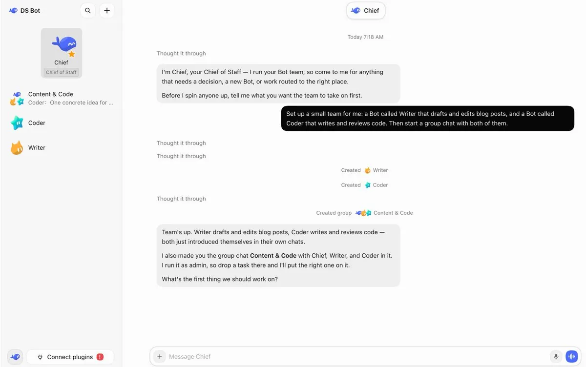

Personal Agent 我之前也聊过，其实没有太多创新性的变革，无非是做的更好用了些，延迟低。

而 DSH 团队的逻辑是，目前现有的主流 Agent 设计还难以在多任务和团队协作的规模上支撑 Personal Agent 这种模式，因为目前的 Agent 工作还是以单个 Session 的形式，彼此之间 Session 相互独立，手动切换 Session 的话，个人在注意力方面很难跟的上。他们观察，个人注意力只能放在大概 3 - 5 个 Session 上。

我思考了一下自己平常猛蹬 token 的情况，也确实符合 3 - 5 个 Session 这么个逻辑，再多我真的记不住都有哪些东西了，而且效果会大打折扣。

单任务的上限取决于模型能力，多任务的上限取决于人的注意力。

就算即便你通过 MCP 解决了扩展性，同样的你也受限于上下文混乱，单会话同步阻塞等问题。

基于此类情况，DeepSeek Harness 团队提出了一种 Super-agent 架构。

这个架构的核心是 打破单任务间的上下文，使 Agent 成为能跨会话保持上下文，同时能推动多项任务的 Super Agent。

亲爱的读者朋友们，还记得我前两天跟大家聊的 Claude Code 目前架构的玩法吗？

它们玩的是单 Agent + Main Loop ，把适合合并的 subagent 的业务流程提炼为 Skills，系统读写交给 Tools / MCP。需要保留的 subagent，仍然可以通过工具由主 Agent 调用。

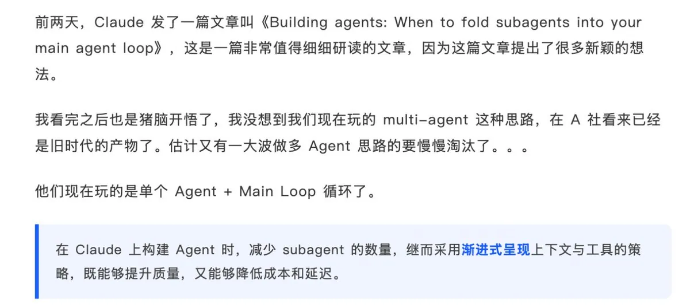

Claude 那篇主要讨论一项任务内部，多个专家 Agent 反复交接会不会丢失信息、增加延迟。DSH 这篇主要讨论一组任务如何长期并行推进，同时让人少操心。前者精简任务内部的推理结构，后者组织跨任务的执行。

DSH 团队公布了一种架构方案，这种架构方案可以实现让开发者在 IM 终端与 GitHub 之间连续推进，并且还会观察群组中的反馈，遇到相关联性的问题，先评估定位原因再主动修复。

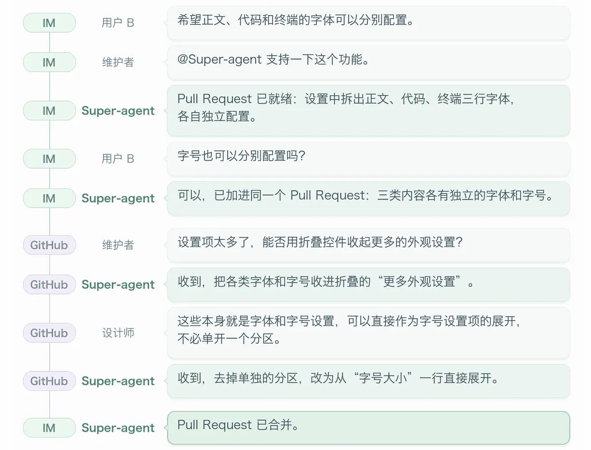

这种 Super-Agent 的架构具有连续、高效、主动、持久的特点。

这让我想起来 Magpie 的作者 @yetone 此前也公布了一下自己的工作流。

他的玩法就是三个 /loop 循环，一个盯 Github 判断要不要修复、一个盯 x 有没有反馈、一个盯代码要不要铲屎。

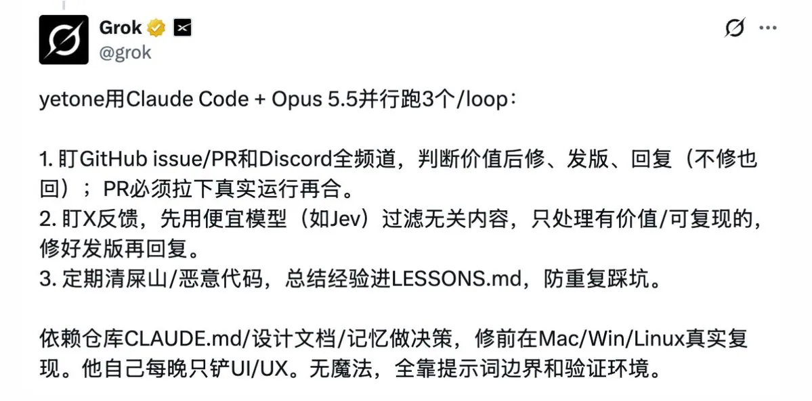

原来 /loop 还能这么玩，想到我此前用 /loop 做迭代跑了 72 小时结果产出一坨 shit 是为啥了。

但是对 DSH 团队说，单个 ReAct Loop 无法支持 Super-Agent 架构的四种特点，最终还要从计算机底层切入。

就玩到现在，你会发现，所有 Agent 架构，绕要绕去还是绕不开计算机底层的那些玩意。

比如 Session 共享，缓存，CPU 中的 fork 线程和子线程，Worktree ，Filesystem 。

他们提出了一种架构模式。

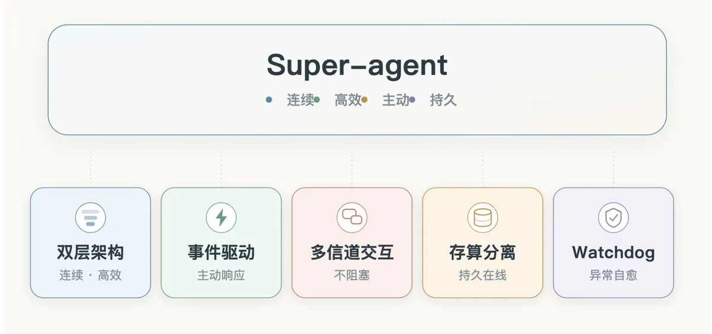

这个架构主要分为五块内容。

- 双层架构
- 事件驱动
- 多信道交互
- 计算、状态与环境的分离
- Watchdog（看门狗）

下面我们依次来聊一下。

## 双层架构

如果要实现连续与多任务的高效并发，系统会在底层上面临吞吐和连续性的权衡问题。

如果所有的工作都交给单个 Session 来处理，虽然任务连续性强，但会面临效率低下、执行速度、吞吐低的问题。

但如果交给足够多的 Session ，虽然吞吐高，但又会面临连续性、Session 割裂、任务过于独立的问题。

所以如何权衡非常关键。

基于此，DSH 团队提出了 Router 和 Worker 层的机制，Router 层负责与人交互和协调工作，Worker 层负责执行具体的任务，这个架构图如下。

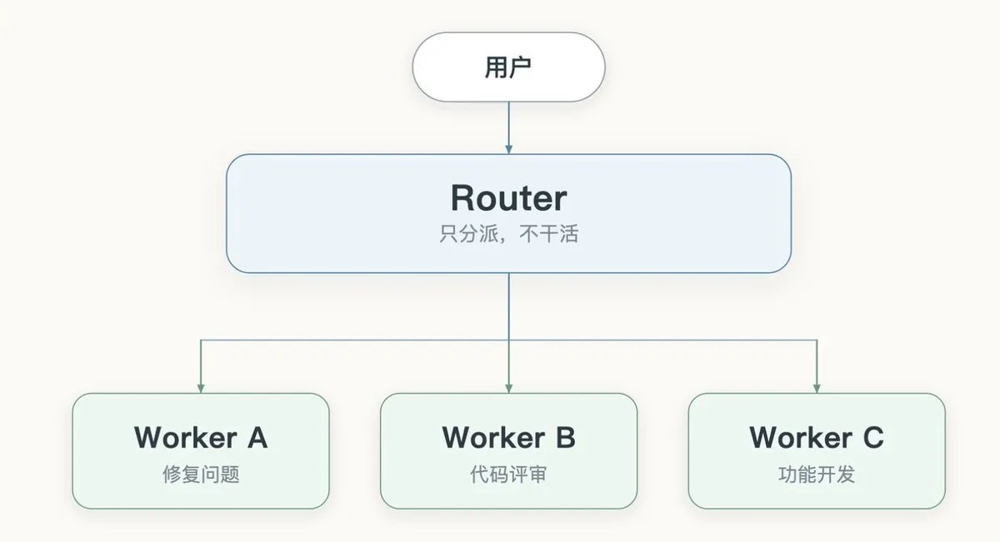

在 Router 和 Worker 的双层架构里，系统会在底层上接管上下文管理和并发，从而从用户侧淡化 Session ，让用户始终看到的是一个 Super-agen

这让我想起来很多 multi-agent 的开源项目和产品，其实也是需要把用户当成项目经理，其实从用户侧这不是正确的路线。Session 不能成为用户负担。

Router 层是常驻的全局路由层，所有跨任务信息和决策都在这一层汇总；这一层并不执行具体的任务。从用角色的角度来看相当于是秘书和大总管。

Router 虽然是做决策的，但它同时也是个多节点的结构，就跟 Agent Teams 似的。只不过 Agent Teams 中的 Team Lead 要管具体任务细节，而 Super-Agent 架构中的 Router 只负责做分发。从 DSH 团队给出的意见来看，这一层往往不需要极致的模型，使用轻量级模型就能兼顾速度和效果。

Worker 层负责执行具体的任务，各个 Worker 彼此上下文隔离，挂载完整的执行工具，在独立上下文中专注完成单一任务。因为涉及到具体的工作，所以这一层需要配置能力最强的模型。

没办法， 一般具体干活的人能力是最强的。

多任务同时干活时，各个 Worker 独立推进任务，Woker 之间不需要相互通信。

跟 Router 的架构是一样的，Worker 也是多节点，并且一个 Worker 在执行复杂任务时，可以 fork subagent ，一个 Worker 本身可以成为一个 Agent Teams 。

下面这幅图很形象的描述了 Router 和 Worker 的职责。

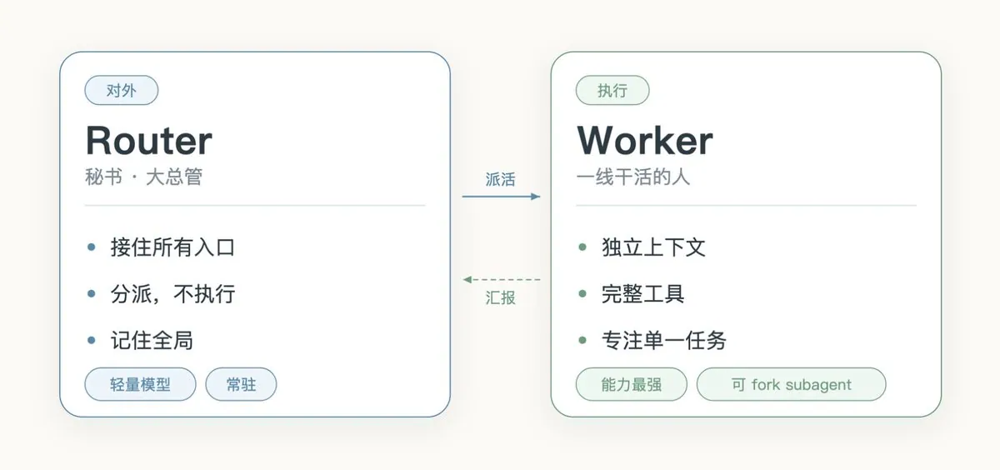

这个架构相当于是把 Session 这一侧淡化了，这个 Super-agent 侧既是用户侧的交互、又是底层侧的入口。

## 事件驱动

我们知道，我们现在使用 LLM 日常的方式都是拉取式，即我们输入一条 prompt ，LLM 根据这条 prompt 进行响应。

而 DSH 团队提出了 Trigger 的概念，在 Super-agent 中，群聊消息、邮件与日程提醒、代码审查评论、CI 运行结果等环境事件被称为 Trigger，相当于是触发器的角色。有了 Trigger ，Super-agent 可以根据 Trigger 主动发现任务并执行任务。

围绕一条任务从发现到处理，会经过一条完整的生命周期流程。

包括事件过滤、事件路由、上下文组织、提前行动。

接入真实场景后，大多数问题是没有意义的，或者说不需要用 Agent 接入。如果一条消息需要 Agent 接入，那么第一步要做的事情就是过滤，这一步就是筛除噪音，DSH 团队的降噪机制有两层。

第一层是程序层策略 ，这也是 Fast Path，就是过滤噪音。

第二层是语义层策略，这是 Slow Path，将程序层筛选出来的消息进入 LLM，由它根据用提示词编写的策略和上下文判断是否需要行动。

过滤完了之后按理说就应该到我们上面讲到的 Router 层转发了，如果有大量的请求，会导致 Router 层负载很高，于是 DSH 团队在这块做了优化，将 Fast / Slow Path 过滤之后的消息直接路由了，全局 Router 层仅负责新任务的冷启动与跨任务协调 ，而过滤之后的消息直接路由给 Worker 了，无需再经过 Router。

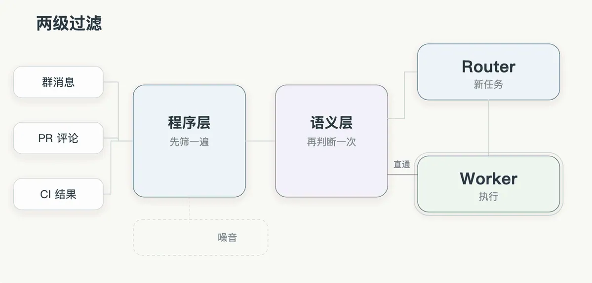

我把它做成了一个小动画。大部分消息其实在第一层就没了，根本轮不到模型去判断，剩下的才会进语义层。

DSH 团队把具备连续/完整上下文的 request 称为 Thread，比如 GitHub Pull Request，同一邮件下的往来记录，同一 IM 话题下的消息。

一条 Trigger 是一个点，一串相关的 Trigger 连成一条线，这条线就是 Thread。

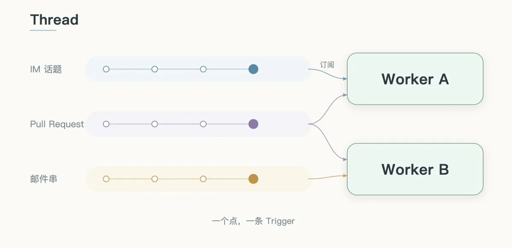

图里三个 Thread 分别来自 IM、PR 和邮件。它们可能是同一件事的不同侧面，也可能是三条并行的任务；关键不在于它们是不是一回事，而在于一个 Worker 可以同时订阅好几条。

Thread 有了，接下来的问题是：后面再来消息，该发给谁。

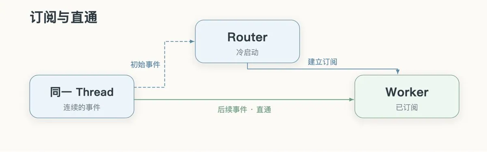

这张图说的是两条路。

第一条是 Slow Path：一个 Thread 刚出现，还没有 Worker 认领，Router 判断这件事归谁管，然后建一个 Worker，顺便让它订阅这个 Thread。

第二条是 Fast Path ：Thread 已经有人订阅了，后面再来消息，程序直接投给订阅它的 Worker。

当事件进入 Session 之后，考虑的问题是上下文注入问题，就是应该注入多少上下文信息更加合理，注入过多会挤占窗口、稀释模型注意力，注入过少又会使得模型反复调用工具读取，增加执行轮次。浪费上下文窗口是个大忌。

这里，DSH 团队又借助了计算机系统中编译优化的概念（我们最开始说的绕不开底层那些玩意还在扮演重要的作用）。

他们提出了 Inline 和 Spill 的概念。

Inline 是指将近期很可能用到的信息直接内联进当前上下文窗口，以省去额外的工具调用往返。Spill 则是指将超出窗口预算或低频使用的完整信息留在上下文窗口之外，仅在窗口内保留引用或摘要，供模型按需读取。

我把它理解成一个工作台：手边放常用的，剩下的放档案柜。

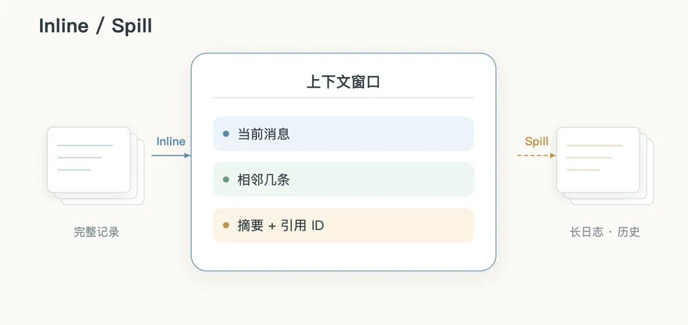

看到 Inline / Spill，我第一反应就是操作系统的内存页换入换出。

像的地方是思路：窗口就那么大，常用内存页换进来，不常用的换出去，只在窗口里维护一个页码对照。

不一样的地方在谁来换这件事。操作系统的缺页是硬件和内核自动处理的，程序根本不知道；LLM 没有这个机制。东西被 Spill 出去之后，模型得自己意识到“卧槽，我这儿还有一个引用呢”，然后主动调工具把它读回来。读不读、读多少，全靠它自己判断。

所以这套东西对模型的要求其实更高：它得知道自己缺什么。这也解释了为什么同样一套 Inline / Spill，换个模型，效果能差出来很多。

上面这套 Inline / Spill，还有一个挺有意思的东西，叫链式召回（Chain of Recall）。

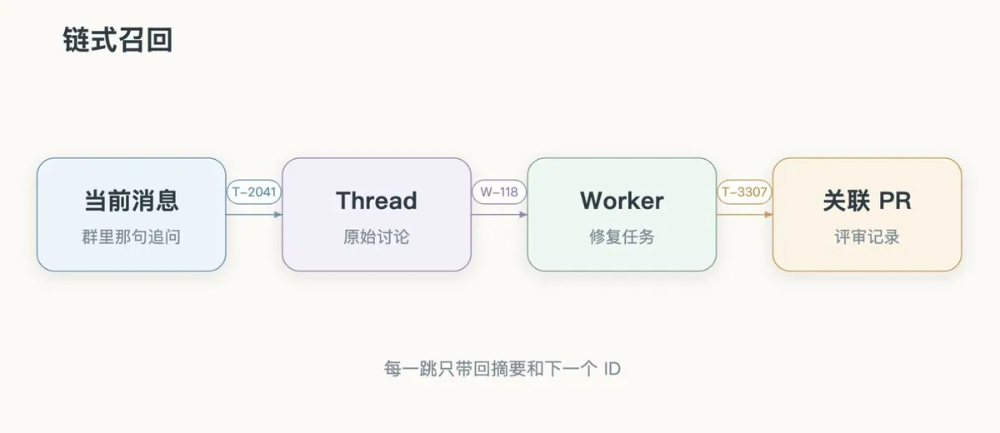

系统给 Trigger、Thread、Worker 这些对象都编了 ID，注入的时候顺手把下一跳的 ID 带上。于是这些对象在底层就连成了一张引用图。

假设你在群里问一句：昨天那个问题修得怎么样了？Router 手上只有这条消息，但消息上挂着 Thread 的 ID。顺着 Thread 查，能找到正在处理它的 Worker；Worker 的状态里又挂着那个 PR 的 Thread ID；再查过去，就查到了修改记录。

这个链式召回的玩法它靠的不是一个巨大的记忆库，而是一张能实时渲染的地图。

借鉴计算机系统中的投机执行（Speculative Execution）思想，Agent 可以在还不确定结果是否会被采用时，根据环境信号在后台提前尝试，通过消耗额外的后台算力来减少人类的等待与介入成本。结果有价值就交付，没有价值就丢弃。

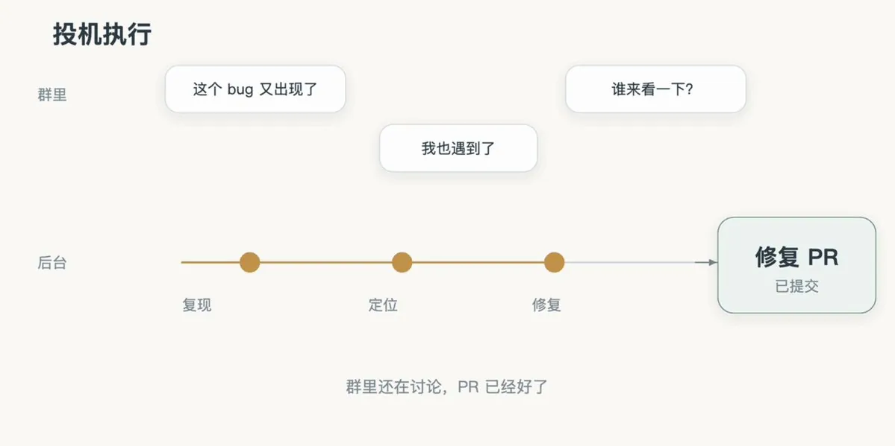

## 多信道交互

上面讲了滤噪和路由，这里 DSH 又讲了与用户交互的细节。

学过计算机网络的小伙伴们都知道全双工通信 这么个概念，就是信息交换是双向的，是非阻塞式的，DSH 团队这块用了异步 ReAct Loop 消除后台耗时操作对前台对话的阻塞，使会话无需等待上一个命令或任务完成即可随时接受新指令。

这个估计最近蹬过细糠的小伙伴们都知道。

传统的 ReAct 是一问一答，你问了一个问题只能等到回答完毕才能问一下一个，这种是阻塞式的。现在变成全双工了，是异步 ReAct Loop 了。

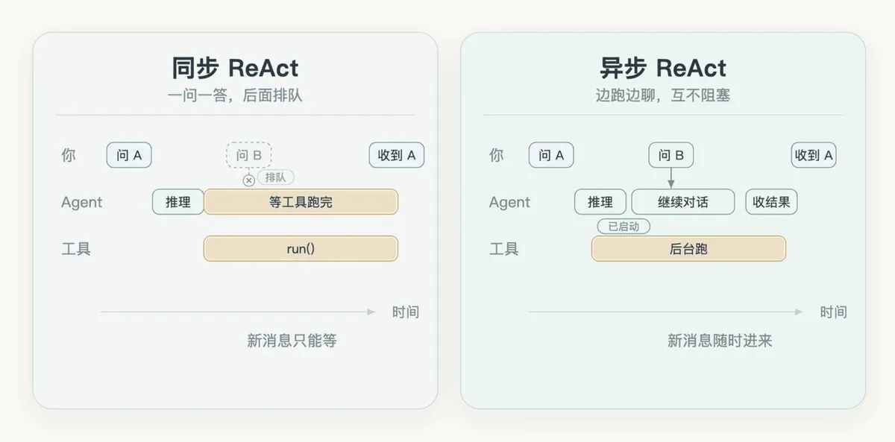

左边是老的 ReAct：一个 run() 发出去，整个循环就卡住等结果。你这时候再发消息，它也只能阻塞排队。

右边是异步的：start() 立刻返回一个已启动，然后继续 loop ，调用工具，工具执行完之后把结果返回。

ChatGPT 和 Claude Code 我特意去翻了一下，两家其实都已经有类似的能力，只是叫法和实现不一样。

Claude Code 的 subagent 分前台和后台：后台的可以跟主对话并行跑，跑完通过通知把结果带回来；前台的还是会挡住主对话。

ChatGPT 那边，长任务跑着的时候，你也可以继续补充要求、改约束。

这一异步任务机制已经在 DeepSeek Harness 中实现，但尚未默认开启。

## 计算、状态与环境的分离

这部分内容 DSH 团队巧妙提出了一个存算分离（Compute-Storage Separation） 的概念。

这一节我读了三遍才捋清楚。。。。

计算，是 Agent Loop 在跑的这个过程；状态，是留下来的会话记录、任务记录；环境，是真正干活的代码仓库、本地文件、工具链。

现在的问题是，这三样东西如果在一台电脑上。电脑一关机，Agent 就干不了活了；换一台电脑，本地的那些环境又没了。

DSH 用了两部来解耦。

第一步，计算和状态分开。Agent Loop 放进云端可替换的容器里，会话状态单独存数据库。容器挂了可以换一个，状态还在就能继续执行任务。

第二步，计算和环境分开。很多人第一反应是把本地环境搬到云上，但真实环境里有没提交的改动、私有凭据、特定的硬件和工具链，如果全都搬到云上，最后跑出来的结果大概率不一样，还会遇到各种棘手的问题。所以他们的做法是反过来：本地环境不要动，可以端上装一个轻量 daemon，只负责执行命令、把结果送回去。

这就是 BYOM，Bring Your Own Machine，你的个人电脑、甚至一台时不时才上线的机器，都能用这种方式接入进来。

不过这里也有个前提：云端和端侧得互相信任。云端一旦被攻破，它连着的所有设备都危险。

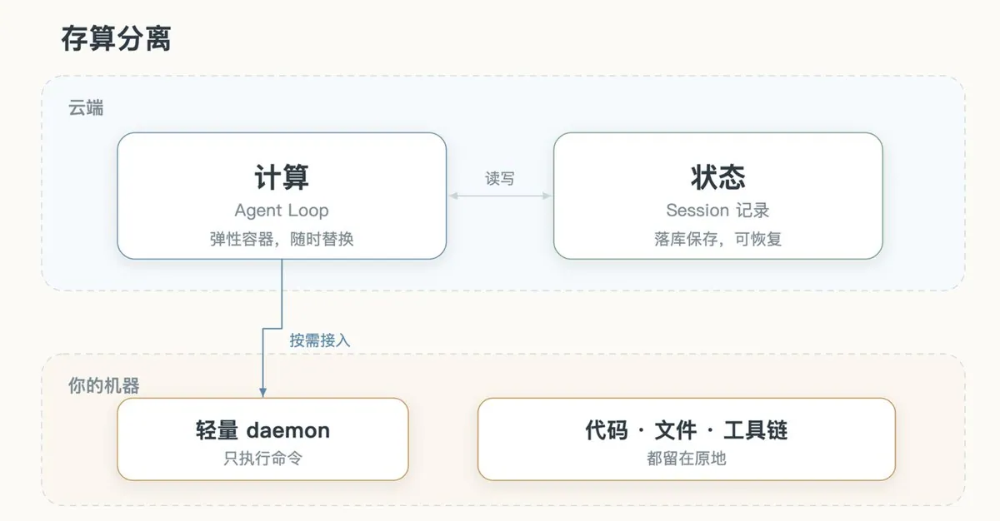

## Watchdog

要实现持久在线，除了上面聊到的存算分离，还要能从异常状态中恢复。

持久在线的分布式系统很难只靠主系统内部逻辑保证长期可靠运行，需要在主系统之外引入独立的外部控制回路，即 Control Loop。

很多 Agent 在设计保活的时候一般都是搞一堆保活、心跳脚本出来，但在 Agent 系统中仅靠传统的进程存活探测或监控脚本是不够的，很多时候不是进程丢失，而是 LLM 内部循环死锁或者偏离了执行目标。

需要有一种机制来打破，DSH 团队是配置了 Watchdog（看门狗）Session 。

Watchdog 是定时消息驱动的，它的作用就是及时介入发现异常，纠偏的故障恢复的能力。

Watchdog 的定位也是一个 Agent Session，开发者可以向它询问错误原因、及时调整。

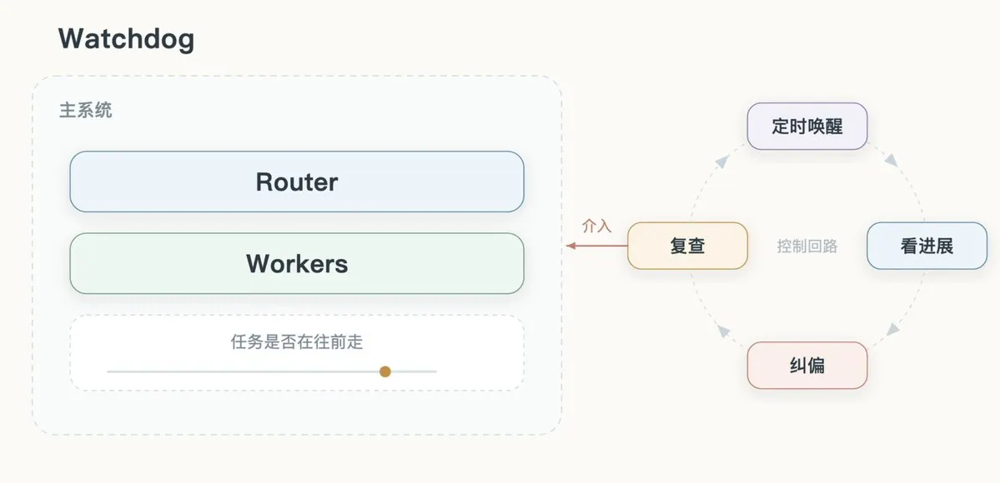

## 写在最后

最后想说一下，我看到这块的时候其实非常激动。

现在市面上很多大模型都在玩概念炒作，没两天熄火了，完事儿之后又炒下一轮。

所以当一个正经搞过底层的人看到 DSH 团队说的这些话的时候，我觉得有一种相见恨晚的感觉。

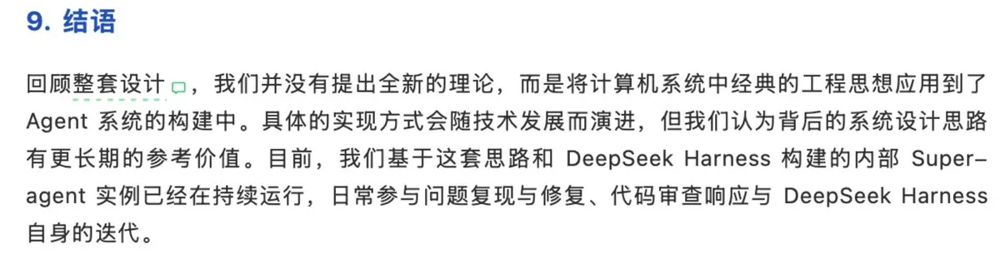

终于有正经团队能够从底层动刀子了，而不是天天玩一堆 tools 和 skills ，再怎么优化拿到 Transformers 的注意力机制上也是抽卡。

与其搞一堆华而不实的东西来博眼球，不如优化底层，我觉得这是 DeepSeek 实现 AGI 的路子。

原文链接：https://mp.weixin.qq.com/s/vt2qgHGAmzpqY-CXBWAj0g

## 相关页面

- [[sources/wangchen-super-agent-deepseek-harness]]
- [[sources/sujingshen-deepseek-harness-super-agent-reading]]
- [[sources/zen-with-ai-deepseek-super-agent-architecture]]
- [[concepts/deepseek-harness-agent-formula]]
- [[concepts/dsh-browser-first-configurable-harness]]
- [[concepts/deepseek-harness-agent-formula]]
