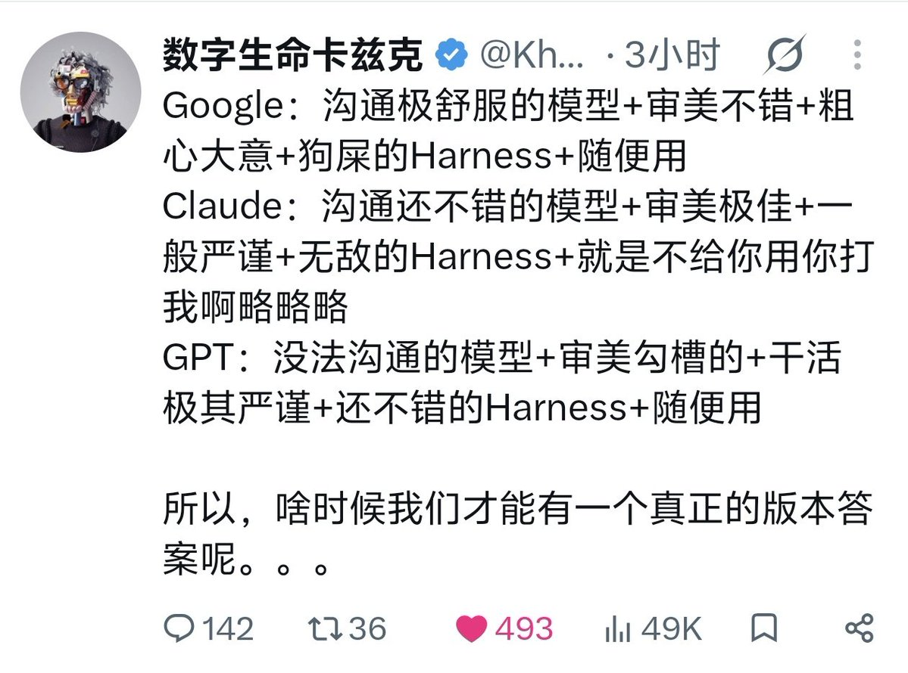
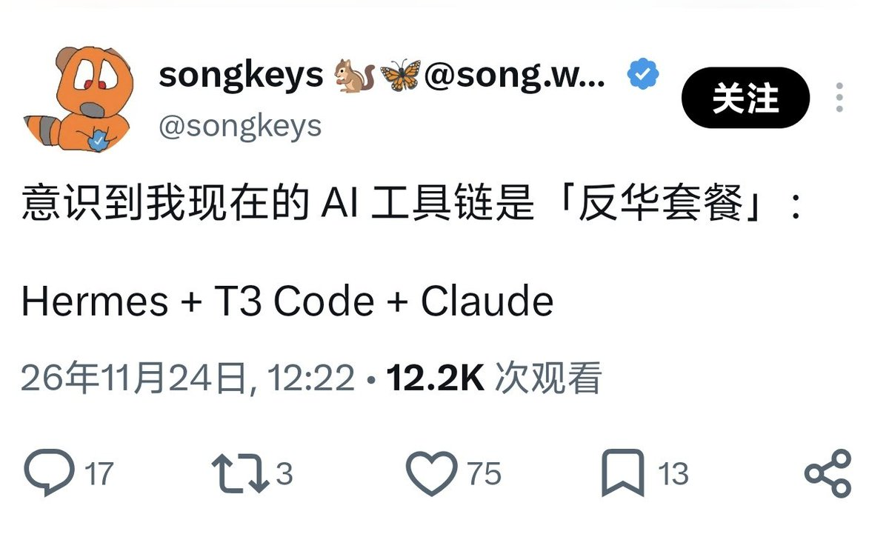
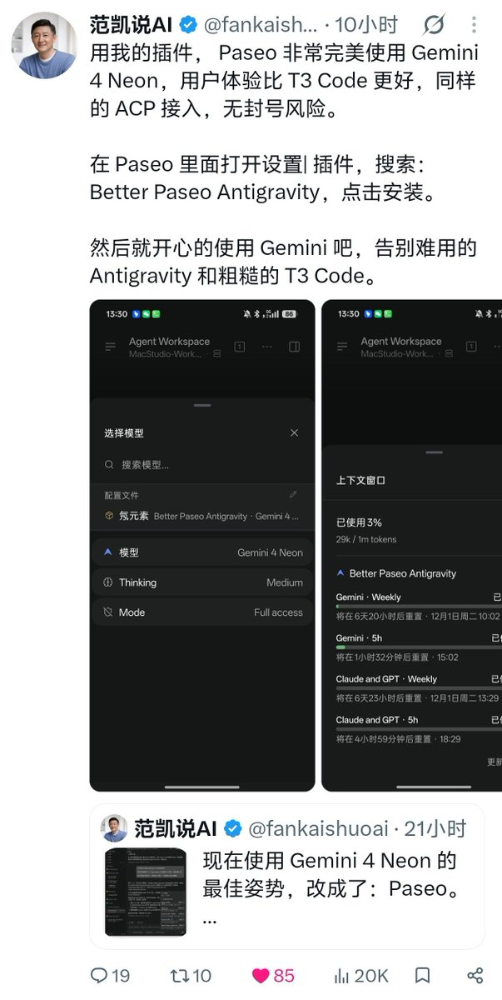

# Daklnl：国产可用工具链——DeepSeek Harness + Magpie + GLM 5.4 的大一统套壳

> 现在最好的国产可用工具链：DeepSeek Harness + Magpie + GLM 5.4。技术能力强的路线：① DSH 结合 T3 Code 与 Paseo 魔改 UI 和后端，同步到手机端 DSH Go，手机 SSH 连 Mac 上魔改后的 DSH；② 用 ACP 协议连接海内外模型账号，把 Magpie 当插件融入魔改 Harness；③ Magpie 反代后同时用海外 Gemini/Claude/GPT 与国内 GLM/Kimi/DeepSeek。结果是一个「大一统套壳工具」：同一套 Harness、上下文记忆互通，还能调用 Claude Code / Codex / WorkBuddy 等其他 Harness——模型与 Harness 的升级不是替代而是提升，因为你的工具建立在所有其他工具之上。作者的比喻：海内外 AI 工具诸侯纷争，现在可以成立「大秦帝国」统一度量衡，把模型与工具变成郡县，通过中央集权调度；不用在电脑上管，手机 App 甚至微信 Clawbot 上就能管。

<!-- more -->

现在最好的国产可用工具链：

DeepSeek Harness + Magpie + GLM 5.4

如果技术能力比较强，可以选择：

1. DeepSeek Harness 结合 T3 Code 和 Paseo 魔改一套 UI 和后端

再把魔改之后的 UI 和功能，同步到手机端 DSH Go，然后手机 SSH 连接 mac 上魔改后的 DSH

2. 用 ACP 协议，连接海内外的模型账号，把 Magpie 当成插件功能融入前面那套魔改的 Harness

3. 用 Magpie 反代一波，你可以同时使用海外的 Gemini 模型、Claude 模型、GPT 模型，还有国内的 GLM 模型、Kimi 模型、DeepSeek 模型

……

OK，这时候你就拥有了一个大一统套壳工具

同一套 Harness，所有的上下文记忆，都是互通的

还可以调用其他的 Harness，比如 ClaudeCode，比如 Codex，比如 WorkBuddy

模型的升级和 Harness 的升级，对你来说不是替代和削弱，反而是一种提升

因为你的大一统工具，建立在所有其他工具之上

​

​……

​

​听不懂是吧？

​

​没关系

​

​简单来说，就是现在海内外的 AI 工具，都是诸侯纷争，分裂割据

​

​现在你可以成立一个「大秦帝国」，统一度量衡，车同轨、书同文

​

​把海内外的所有模型、工具，都变成你的郡县

​

​然后你通过中央集权部门，去调用和指挥底下的所有郡县

​

​管你什么天才 Claude，还是黑马 Gemini，或者新秀 GLM 5.4

​

​统统听我号令，一切都归我的魔改版 DSH 管理

​

​而且我不需要在电脑上管，我只需要在手机 APP 上管

​

​甚至我只需要在微信的 Clawbot 上管

​

​而且接下来，豆包工作要出 Tag 功能了，具体啥功能还没内测，但是可以释放更大的生产力

​

​感觉年底了各家都在憋个大的😅

这个项目也有点牛逼，原因在于，市面上大部分 Agent 都是在电脑上运行的

但大部分人并不用电脑，就算有电脑，也没有人愿意天天打开它，除非工作所迫，或者要打游戏

所以用电脑其实是反人性的

人就喜欢在手机上语音转文字，或者扒拉几下，划一划，就能干活，还能娱乐

而且最好还不需要切换窗口

什么意思呢？

就是理论上，最好的 Agent 普及方式，是在微信上 Clawbot 的接口，有一个类似元宝的 AI 好友，你可以直接像跟好友聊天一样，跟他聊几句就能帮你干活

其次是微信小程序，因为聊天窗口太简洁了，很多定制功能无法实现，那么小程序就是一个还不错的方案

再往下是抖音的好友窗口，原理跟微信类似，因为每天打开抖音的人很多，那么点一个聊天窗口并不需要花太多力气

然后是小红书的好友，原理依旧是流量入口

再往下才是 APP，是封装好的产品

但以前的 APP，本质上还是云服务器在做存储和运算，如果能在手机上，完成大部分的工作呢？

如果 Agent 调用工具、执行任务，可以在手机上执行呢？

只需要买 API Key，或者买一个 token plan 账号，就可以在手机上帮你咔咔干活

是不是很爽？

这个时候，Agent 才会真正意义上被普及

🔘项目地址（安卓版）：

https://github.com/ccch1mneyyy/dsh-Go

🔘项目地址（iOS 版）：

https://github.com/launsion-boop/phone-dsh/

而且？还有鲸娘设定

抖音上「大肥鱼」有点无孔不入了，加上一个人设，才是 Agent 出圈的流量密码，换一套新技术的皮，来迎合人类的癖好，这才叫真正的技术创新

## 相关页面

- [[concepts/magpie-local-model-gateway]]
- [[sources/dsh-complete-guide]]
- [[sources/xiongchun-dsh-openmotion-video-plugin]]
