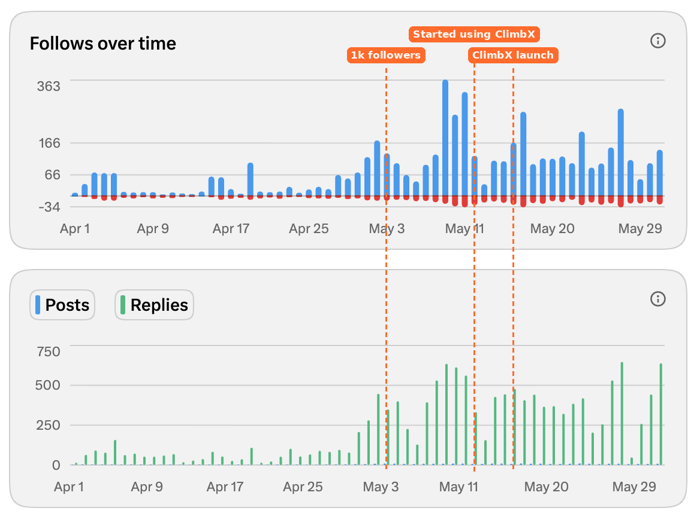
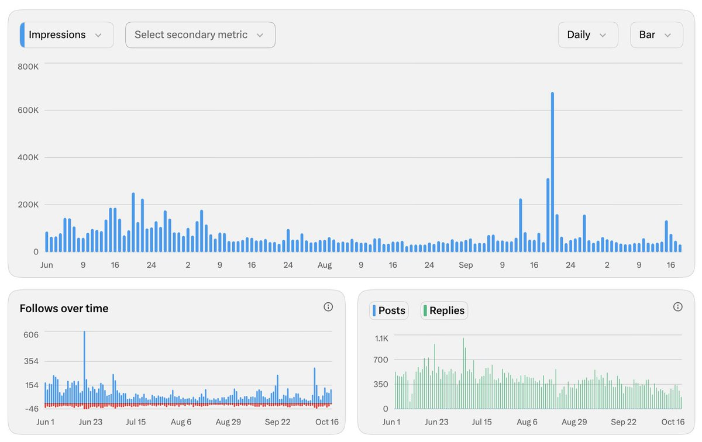
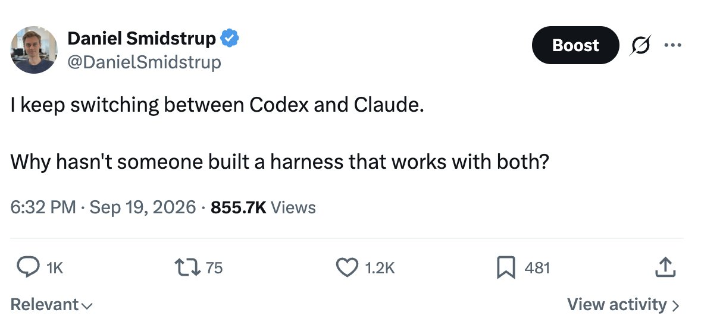
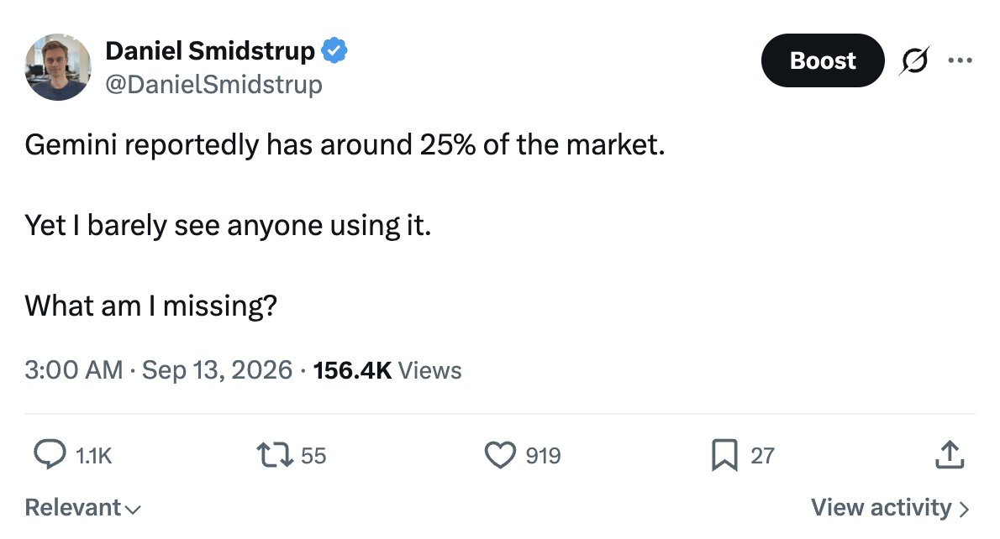
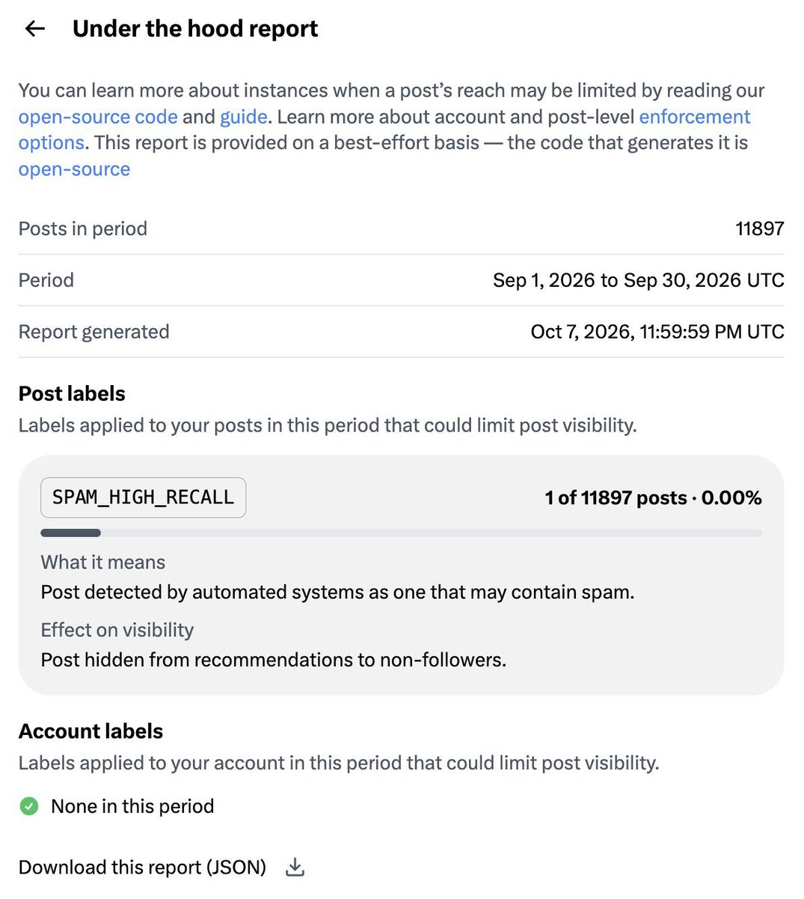
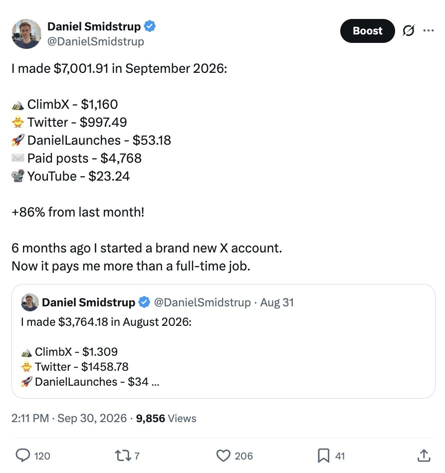

# Daniel Smidstrup（@DanielSmidstrup）：200 天从 0 涨到 12.9k 粉丝——$1k MRR 的 ClimbX、$7,001.91 单月收入与靠回复长大

> Daniel Smidstrup 说 200 天前他在 X 上是 0 粉丝（账号 2013 年就注册只为占名，直到 4 月 1 日才第一次发帖），现在 12.9k 粉丝、自己的 SaaS ClimbX 做到 $1k MRR，第 6 个月公司收入 $7,001.91（比 8 月增长 86%）。涨粉节奏是 33 天到 1k、再过 7 天到 2k、约 90 天到 8k；过去约 150 天他每天发 8 条帖、至少回 400 条回复（最近两周降到约 250 条），9 月一共发出 11,897 条帖子和回复，只有 1 条被打了 spam 标签。ClimbX 从想法到付费用户约两周：花大约 5 天做出基础版，5 月 16 日在约 2k 粉丝时上线，约第 7 天出现首批付费用户。月度收入逐笔是 M1（April）$0、M2（May）$268、M3（June）$2,029、M4（July）$3,984、M5（August）$3,764、M6（September）$7,002，但钱的主体不是 SaaS 而是付费帖——第一条来自 7 月（当时约 8–9k 粉丝），9 月靠约 30 条付费帖赚进 $4,768。失败的路他也照写：ClimbX 在 $1k 附近横盘约四个月；Meta 广告花掉 $867 只换来 1,608 次点击、6 个注册、2 个试用、0 个付费客户，而一条免费的 X 回复拿到 26K views、一天带来约 4 个注册和 3 个试用。他强调此前已有约 2 年创业经验、每周工作 70+ 小时无休，技术栈是 Vercel 上的 Next.js、Supabase、Claude Code 与 Codex 构建，且 ClimbX 只走 X 官方 API 排程、每条帖子都人工确认。

<!-- more -->

200 days ago I had 0 followers on X. Today I have 12.9k followers, my own SaaS at $1k MRR, and in month 6 my company made $7,001.91 in revenue.

Most of that $7K came from X itself, not the SaaS. More on that below.

I’d made the account back in 2013 just to grab my name, but never posted until April 1.

Here’s exactly how it happened, what worked, what didn’t, and what’s next.

## How it started

I hit 1k followers in 33 days. Then 2k just 7 days later. 8k at around 90 days.

And a lot of people started asking me the same thing: how are you growing so fast?

My first 2 months. For the first 30 days I engaged actively with the community to get my first followers. Around day 30, when things took off, I switched to mostly replying to comments on my own posts, and follows kept growing with it.

So I built a tool that helps me follow the same routine I used to grow. That became ClimbX!!

## I wasn’t starting from zero experience

Before this solo journey, I already had around 2 years of startup experience:

- 2 startups with teams
- 2 “real” solo attempts

And I work 70+ hours a week with no days off.

So when you see “$0 to $100K in 48 hours”, remember that the person behind it usually has years of experience, an audience, a network and several failed attempts.

## From idea to paying users in 2 weeks

I spent about 5 days building the base version of ClimbX.

It went live on May 16, when I had around 2k followers.

People started free trials on day one. The first paying users came around day 7.

Idea to paying users in about two weeks!!

Not because I’m a genius. Because I already had a small audience, and their questions gave me the idea. The interest was there before the product was.

That’s the biggest advantage you can have.

## What my daily routine actually looks like

For the last 150 days or so:

- 8 posts a day
- At least 400 replies a day

The last 2 weeks I’ve cut replies down to around 250 a day.

I schedule all my posts through ClimbX. It gives me ideas, a daily overview of my planned days, and finds good posts to reply to.

But it’s still a tool, not magic. It keeps me consistent. The replying and building connections is still me, every day.

If I had to name one thing that moved the needle most, it’s replying. Every single day.

## What my best posts look like

Honestly, super simple.

- “I keep switching between Codex and Claude. Why hasn’t someone built a harness that works with both?” got 856K views

- “Gemini reportedly has around 25% of the market. Yet I barely see anyone using it. What am I missing?” got 156K views and 1,100+ replies

- A question about whether to leave my new MacBook plugged in got 41K views

The pattern:

- Short and easy to read
- A relatable question or an honest number
- Usually a question at the end

My biggest posts have usually been simple questions people could easily jump in on.

## What you can copy today

1. Reply every day, with something real. An opinion, a quick tip or your own number, not just “great post”. I aimed for 50+ replies a day to accounts a bit bigger than me, and that’s what got me my first 1k in 33 days.
2. Post several times a day. I do 8. Not all of them hit, but more posts give you more chances.
3. End posts with a simple question. My biggest posts were easy questions anyone could answer.
4. Share real numbers, wins and losses. My post about losing $867 on Meta ads got 49K views.
5. Build for the questions your audience asks. ClimbX came from people asking how I grew so fast.
6. Stay where your users are. One free reply on X brought more trials than $867 in ads.

## What hasn’t worked

Getting ClimbX to $1k MRR was fast. Growing past it has been hard.

It’s been flat at around $1k for about four months. Steady, but not growing.

So I’ve tried a lot of things to scale. Most didn’t work.

Reddit: My best post, “4 months in, 43 paying users, $1,247 MRR”, did really well in r/indiehackers. Lots of discussion. Basically zero signups. A lot of people on Reddit do not seem to like X, so it feels a bit like a mismatch.

Meta ads: I ran a small test and spent $867. That got 1,608 clicks, 6 signups, 2 trials and 0 paying customers, and most of the clicks were junk traffic. It didn’t work for me this time, but it was a small test, not a verdict on Meta ads. I might try again later with a better setup.

Meanwhile, one free reply on X, “climbx.so :D but not much”, got 26K views and brought in about 4 signups and 3 trials in a day.

Lesson: go where your users already are. For me, that’s X.

## About automation and getting flagged

People ask me this a lot.

I don’t use the kind of automation X doesn’t allow. ClimbX schedules posts through X’s official API. No auto-replies, no auto-DMs. A human approves every post.

In September I did 11,897 posts and replies. Only one got a spam label.

## My stack

Pretty typical:

- Next.js on Vercel
- Supabase for the database
- Claude Code and Codex for building
- AI agents connected to ClimbX through MCP

## The real income breakdown

- Month 1 (April): $0
- Month 2 (May): $268
- Month 3 (June): $2,029
- Month 4 (July): $3,984
- Month 5 (August): $3,764
- Month 6 (September): $7,002

Here’s what that looked like in September:

## Where the money actually comes from

Most of my revenue doesn’t come from ClimbX. It comes from paid posts.

The first one came in July, when I had around 8–9k followers.

Since then, brands mostly reach out by DM, and I also have a few ongoing partnerships with creator agencies.

In September, paid posts brought in $4,768 from roughly 30 posts.

The audience came first. The income followed.

I built the community faster than the products. Turning that audience into a growing SaaS is my next big challenge.

## If I started over tomorrow

- With an audience: build in public and talk about it, same as before.
- Without an audience: build one first. It was my biggest advantage.
- For a B2B tool: cold outreach.

## What’s next

- Pausing ads for now. I’m not skilled enough at them yet and haven’t found an approach that works, so I’m sticking with organic, which converts great for me right now.
- Going all in on SEO. Early signs look promising, and I’ll share real numbers once I have them.
- Improving ClimbX every day, mainly making it simpler and easier to understand, so more signups start a trial and more trials turn into paid.
- Keeping the grind going on X and building this amazing audience.
- Maybe starting daily video blogs to share more of the journey.

## Thank you

The startup journey isn’t a get-rich-quick scheme, even when the viral stories make it look like one. I’m not doing this to get rich fast. I’m doing it because I love building.

And none of this would’ve happened without you. Every reply, follow and DM has meant more than you know.

If you made it all the way to the end of this article, thank you. Seriously, it means a lot. ❤️

## 相关页面

- [[concepts/selfmedia-compound-model]]
- [[concepts/indie-product]]
- [[concepts/session-token-acquisition]]
