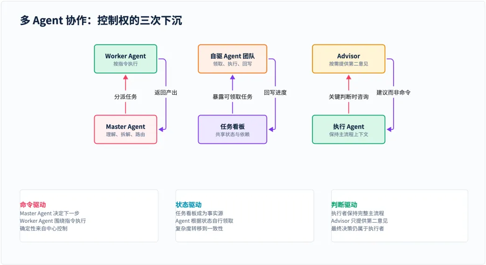
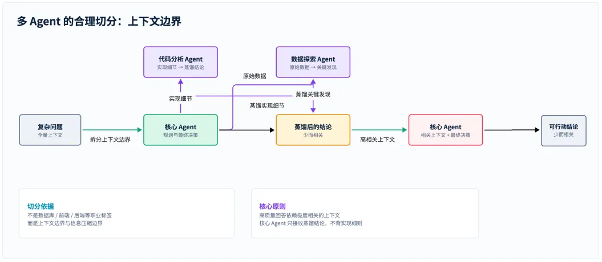
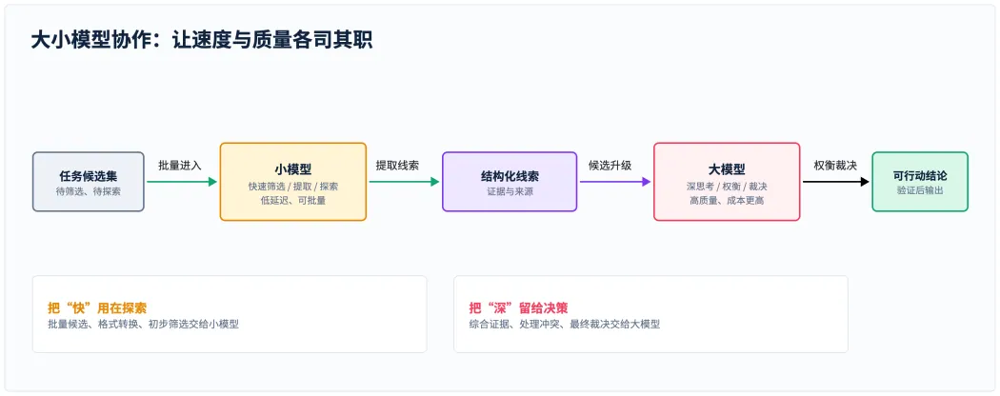
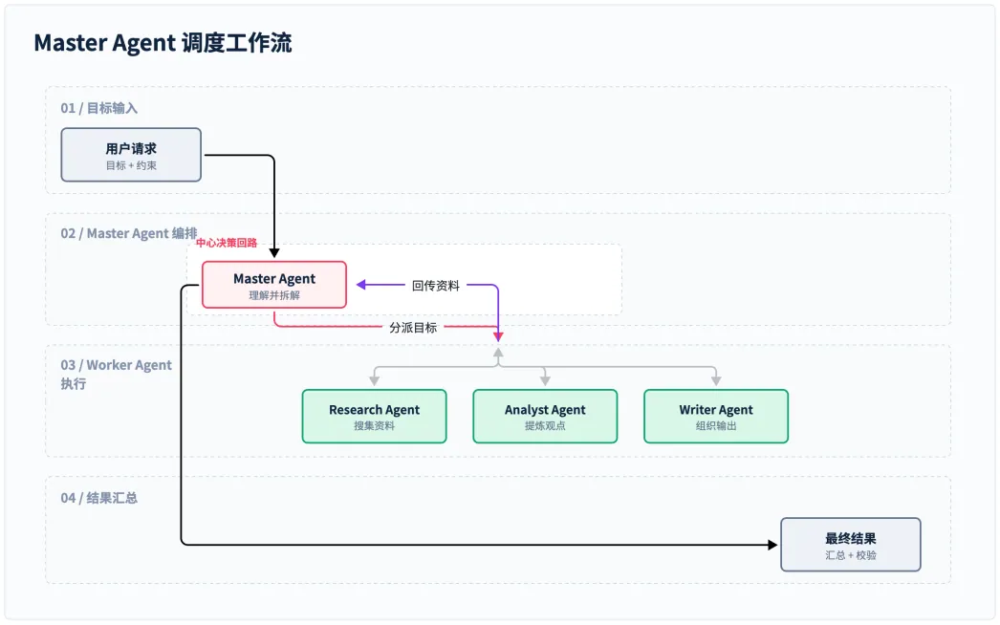
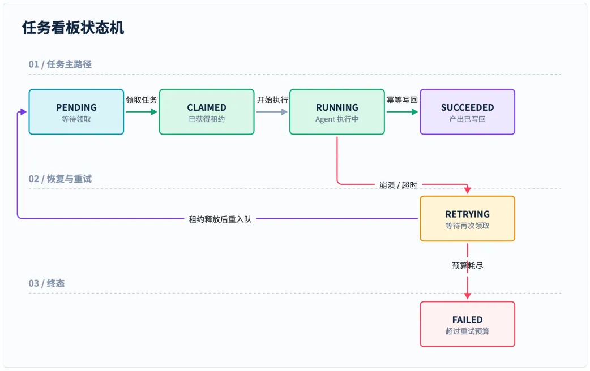
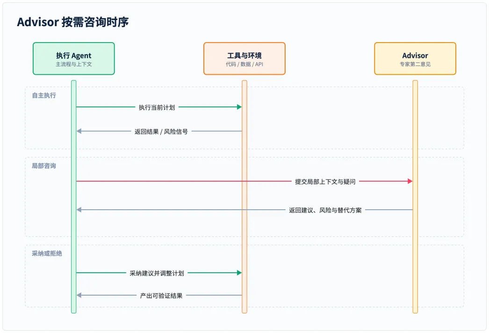
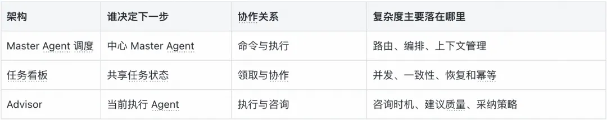
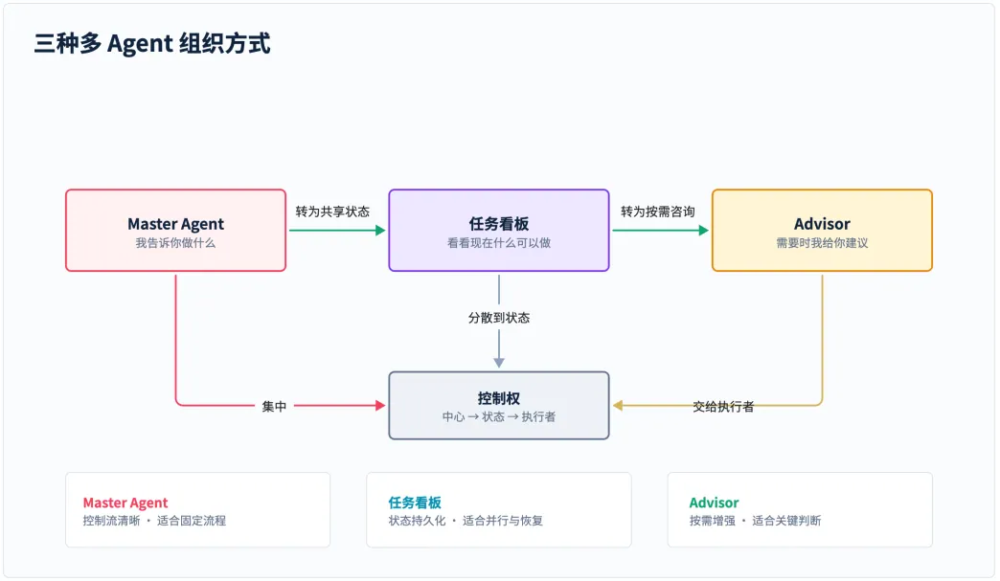
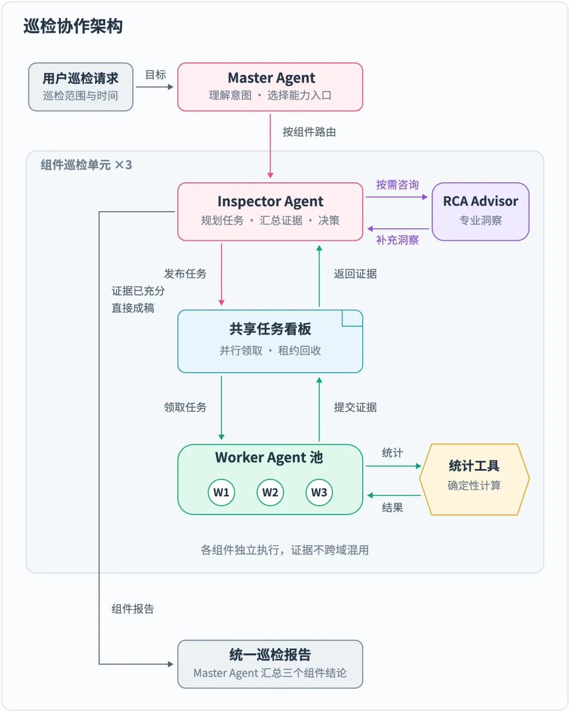
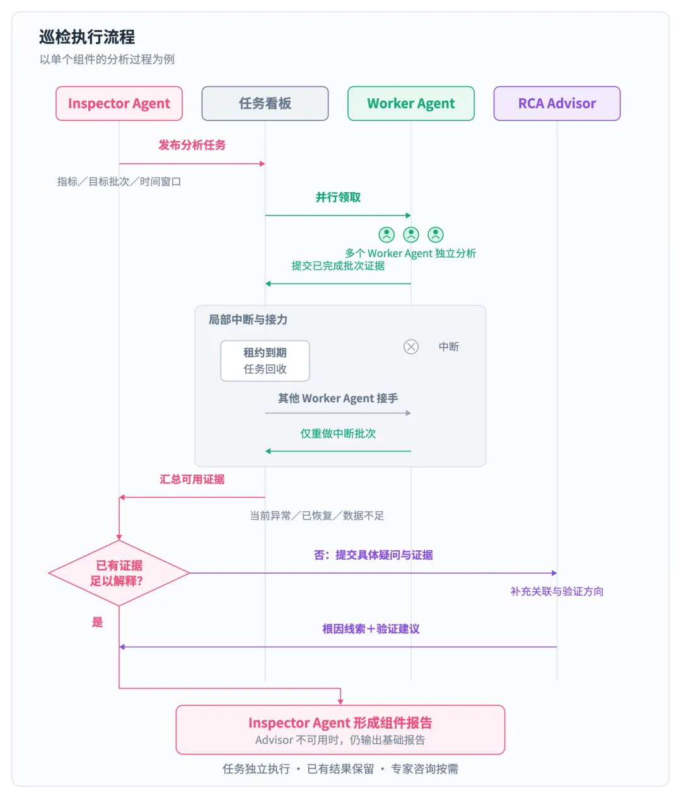

# 多 Agent 架构的三次反转：从中心调度到自驱协作

> 得物技术《多 Agent 架构的三次反转》。核心论点：多 Agent 架构真正要解决的不是“如何调用更多模型”，而是四个组织问题——**谁拆解任务、谁分配任务、谁判断完成、Agent 之间共享什么信息**，四问最终都指向同一件事：**系统里的控制权究竟放在哪里**。
> 本文给出 Master Agent / 任务看板 / Advisor 三种协作方式构成的**控制权下沉路径**，并以中间件巡检为落地案例。

<!-- more -->

## 目录

1. 引言：控制权问题
2. 设计前提：两个边界
   1. 上下文边界
   2. 模型边界
3. 协作方式
   1. 第一种：Master Agent 调度
   2. 第二种：任务看板
   3. 第三种：Advisor
4. 三次反转：控制权下沉
5. 落地案例：中间件巡检
   1. 巡检难点
   2. Master Agent：意图与路由
   3. 任务看板：并行与自愈
   4. Advisor：按需咨询
6. 结语：匹配控制权

---

## 1. 引言：控制权问题

当一个任务只需要一次回答时，单个 Agent 往往已经够用。但任务一旦变成长链路工作，例如先检索资料、再分析、再写代码、最后复核，问题就不再只是“模型够不够聪明”，而是“**整个系统怎样组织行动**”。

我们需要安排不同的能力，也需要处理任务依赖、并发、失败重试和上下文传递。于是，多 Agent 架构真正要解决的不是“如何调用更多模型”，而是四个组织问题：**谁拆解任务，谁分配任务，谁判断任务完成，以及 Agent 之间共享什么信息。**

这四个问题最终都指向同一件事：**系统里的控制权究竟放在哪里。** 沿着控制权的变化往下看，Master Agent、任务看板和 Advisor 正好构成一条逐步反转的路径。不过，在比较三种架构之前，还需要先划清两个经常被忽略的设计边界。

---

## 2. 设计前提：两个边界

### 2.1 上下文边界

很多人第一次接触多 Agent，会自然地把它理解成一支“职业团队”：数据库 Agent、前端 Agent、后端 Agent，各自负责一个领域。但在同一个基础模型上，仅仅换一段角色提示词，通常不足以让 Agent 真正专精于某个领域。**模型知道什么，首先取决于它拿到了什么上下文**；它能否给出高质量回答，也取决于上下文是否足够相关。

因此，更有价值的切分方式**不是给 Agent 贴职业标签，而是划分上下文边界和信息压缩边界**。代码分析 Agent 面对的是完整的调用关系、错误堆栈和实现细节，它的任务是把这些细节压缩成核心 Agent 可以直接使用的结论。数据探索 Agent 则处理原始数据、分布和异常，把探索过程蒸馏成少量关键发现。核心 Agent 不必携带所有原始材料，只需要接收与当前决策最相关的上下文。

这也是为什么“代码分析 Agent”“数据探索 Agent”往往比“后端 Agent”“数据库 Agent”更实用：**前者描述了上下文和产出的边界，后者只是一个容易被提示词放大的职业想象。**

### 2.2 模型边界

多 Agent 的另一个现实收益，是可以把不同模型放在同一条协作链上。大模型通常更擅长长链路推理、复杂权衡和最终裁决，但代价是更高的延迟和调用成本；小模型响应很快，适合批量筛选、结构化提取和早期探索，却可能在开放式问题上失去细节。

一个更实际的组合是**让小模型负责“快”**：先扫描大量候选、提取字段、发现异常，把结果压缩成结构化线索；再**让大模型负责“深”**：基于这些线索补足上下文，比较方案，处理冲突，并对最终结果负责。模型之间不是简单的上下级替代关系，而是通过 Agent 边界把速度和质量组合起来。

当然，模型切换也会带来新的工程问题：小模型输出需要被校验，大模型需要知道结论的来源，预算和超时要有明确上限。只有把**输出协议、证据引用和失败回退**设计好，“大小模型协作”才不会变成一次不可解释的随机接力。

上下文边界决定每个 Agent 应该看见什么，模型边界决定每一步值得投入多少能力。划清这两个边界之后，接下来的问题才是：这些 Agent 到底由谁组织，又由谁决定下一步。

---

## 3. 协作方式

### 3.1 第一种：Master Agent 调度

最容易理解的多 Agent 形式，是让一个 Master Agent 站在中心位置。它负责理解用户目标，把大任务拆成若干步骤，再将每一步路由给合适的 Worker Agent。Worker Agent 完成工作后把结果交回 Master Agent，由 Master Agent 决定下一步并最终汇总。

例如，一项“调研并撰写技术报告”的工作，可以先由 Research Agent 搜集资料，再由 Analyst Agent 提炼观点，最后交给 Writer Agent 组织文章。每个 Worker Agent 都只需要做好自己的局部工作，整个流程由 Master Agent 负责串起来。

Master Agent 模式的优势在于控制流非常清楚。谁先执行、谁后执行、哪些结果要传给下一个 Agent，都可以在一个地方观察和修改。权限、预算、超时和失败处理也更容易集中管理。对于流程固定、依赖明确的任务，这种确定性很有价值。

它的问题也来自同一个中心。任务变复杂后，Master Agent 不仅要完成自己的推理，还要记住所有 Worker Agent 的状态、处理中间结果，并持续判断下一步应该路由给谁。久而久之，**Master Agent 容易变成一个“超级 Agent”**：既要理解业务，又要维护调度器、状态机和异常处理。

所以，Master Agent 适合流程相对稳定、步骤需要严格编排的场景：例如固定的审核链路、需要统一权限控制的工具调用，或者对执行顺序有明确要求的自动化流程。

可一旦任务数量和并行度继续上升，让 Master Agent 逐个判断“下一步该叫谁”就会越来越沉重。于是，第二种架构不再把调度藏在中心节点的推理里，而是把它摊开成所有 Agent 都能读取的共享状态。

### 3.2 第二种：任务看板

第二种架构把“分配任务”这件事从 Master Agent 的内部推理中拿出来，放到一个所有 Agent 都能看到的任务看板上。看板记录待处理任务、负责人、依赖关系、执行状态和产出物。Agent 不再等待 Master Agent 点名，而是主动查看看板，领取自己有能力完成的任务。

这是一种重要的反转：**调度不再表现为“Master Agent 发出命令”，而表现为“共享状态暴露机会”。** Agent 根据自己的能力和当前状态做出选择，完成任务后再更新看板，新的状态又会让后续任务变得可执行。

如果只是把任务写进数据库，再让 Agent 定时读取，系统并不会自动变得可靠。**真正的难点在于协作协议**：两个 Agent 同时看到同一个任务时，谁能领取；领取任务的 Agent 崩溃后，任务怎样回收；一个任务完成后，怎样解除下游依赖；重复执行时，结果怎样保持幂等。

因此，看板通常需要配合**任务状态机**。任务可以从 `PENDING` 进入 `CLAIMED`，再进入 `RUNNING`，成功后变成 `SUCCEEDED`，失败则进入 `FAILED` 或 `RETRYING`。领取动作还需要锁或租约，状态变化需要留下历史记录，任务产出最好通过稳定的引用传递，而不是把所有内容塞进下一次提示词。

看板模式把中心调度的压力转移到了状态管理和一致性上。它牺牲了一部分直观性，却换来了更好的并行能力、弹性扩展和故障恢复能力。**只要任务协议稳定，新增一个 Agent 通常不需要改动一个巨大的路由器。**

这类架构更适合任务数量多、并行度高、执行时间长，或者需要断点恢复的系统，例如批量数据处理、代码仓库扫描、持续运行的研究任务和后台工作流。

任务看板解决的是“工作怎样被领取”，但并不是每次协作都值得被建模成一项任务。有些时候，执行 Agent 已经知道该做什么，只是在关键判断上需要另一个视角。这就引出了第三种、更轻量的协作关系。

### 3.3 第三种：Advisor

前两种架构都在讨论“谁来安排任务”。Advisor 形式换了一个角度：主流程已经由执行 Agent 自己推进，只有在遇到高风险判断、专业盲区或方案分歧时，它才主动向另一个 Agent 征求意见。

**Advisor 不负责接管任务，也不负责替执行 Agent 调用工具。** 它提供的是第二意见：可以是安全评估、架构审查、领域知识补充，也可以是对当前计划的反驳。最终是否采纳建议，仍然由执行 Agent 决定。

Advisor 模式的方向和 Master Agent 模式正好相反。**Master Agent 是中心节点调用 Worker Agent；Advisor 是执行节点调用咨询者。** 这个变化看起来只是一次工具调用，实际上改变了系统的责任边界：执行 Agent 保持完整上下文和主流程，Advisor 只在局部决策上提供额外认知。

比如 Coding Agent 正在修改支付模块，发现自己的方案可能影响幂等性和事务边界。它可以把当前设计、相关代码和具体疑问发给 Architecture Advisor。Advisor 给出风险提示和替代方案，Coding Agent 再结合测试结果决定是否调整。**Advisor 不需要知道整个项目的所有历史，也不需要拥有直接改代码的权限。**

这种模式尤其适合不确定性高、但不值得预先编排成固定流程的任务。代码审查、安全评估、产品方案比较和领域咨询，都可以通过 Advisor 形成轻量的协作闭环。需要注意的是，咨询也有成本：什么时候问、问什么、提供多少上下文，以及如何判断建议是否值得采纳，都需要成为 Agent 的一部分能力。

走到这里，三种架构的差别已经不只是调用方向不同。它们分别把“下一步做什么”的决定交给中心节点、共享状态和当前执行者，呈现出一条清晰的**控制权下沉路径**。

---

## 4. 三次反转：控制权下沉

把三种架构放在一起，最清楚的不是组件数量，而是**控制权的变化**。

可以把它们理解成**三种不同的组织哲学**：

- **Master Agent** 会说：“我告诉你做什么。”
- **任务看板** 会说：“你看看现在什么任务可以做。”
- **Advisor** 则会说：“你自己推进，需要时我给你建议。”

---

## 5. 落地案例：中间件巡检

以组内负责的三个中间件为例，一次巡检请求需要先明确检查范围，再完成批量分析，最后形成可供排查的结论：

> 检查组内负责的三个中间件最近一小时的运行情况，重点关注仍在持续的异常，并给出排查建议。

### 5.1 巡检难点

这句话背后涉及多个组件、多类指标和大量时序采样。不同指标还对应不同的实例、节点或接口。把所有原始数据放进同一个 Agent 的上下文，既增加处理成本，也容易让真正需要关注的异常被正常数据淹没。

分析任务的耗时也不一致：有的批次很快完成，有的需要更多数据探索，还有的可能因执行中断而没有结果。与此同时，**窗口内出现过峰值、当前仍然异常和数据不足，代表三种不同情况**；发现指标越线之后，进一步解释原因又需要另一层判断。

### 5.2 Master Agent：意图与路由

入口 Master Agent 先提取用户要求的组件、时间窗口和关注点，再将任务交给对应的 Inspector Agent。它只需要知道各 Inspector Agent 对外的能力描述、输入要求和调用入口；指标目录、目标发现、任务拆分和分析方法，都由 Inspector Agent 自己管理。

这里把入口的中心职责**限定在组件级路由**：Master Agent 不逐个跟踪分析批次，组件内的规划、证据汇总和完整性检查由 Inspector Agent 承担。组件报告返回后，Master Agent 保持各组件的事实边界，整理最终结果。下层指标、工具和分组策略的变化，都可以留在组件巡检单元内。

### 5.3 任务看板：并行与自愈

进入组件内部，Inspector Agent 根据指标目录和完整目标集合，将工作拆成“指标＋目标批次＋时间窗口”的独立任务。在共享看板的演进方案中，Inspector Agent 负责发布分析目标，多个 Worker Agent 根据能力和空闲容量并行领取任务，执行进度和结果都通过看板汇合。

Worker Agent 调用**确定性统计工具**计算峰值、阈值超限和已观测持续时长，再提交精简证据：**异常对象保留必要明细，正常对象压缩为汇总**。原始时序留在工具层，Inspector Agent 根据这些证据核对异常及覆盖范围。

假设一个 Worker Agent 在执行中途退出，已完成批次的证据仍保留在看板上。中断任务的租约到期后，由其他 Worker Agent 接手；配合有限重试和幂等提交，只补做未完成的批次。这样可以维持并行处理，并从局部中断中恢复，避免整轮重跑。

Inspector Agent 最终核对任务覆盖范围，并区分**当前异常、窗口内已恢复和数据不足**。达到总体截止时间仍未完成的范围，会作为限制写进报告；**没有数据的目标也会明确标注，避免形成“没有发现异常，所以一切正常”的误判。**

### 5.4 Advisor：按需咨询

汇总证据后，Inspector Agent 先判断是否仍有待解释的问题。对于短时越线后已恢复、且证据足以支持结论的情况，可以直接说明状态和限制；当关联指标难以解释、可能原因存在分歧，或需要额外领域知识时，再向**根因分析顾问（RCA Advisor）**提交具体疑问。

例如，Inspector Agent 可以把同一窗口内的异常对象、峰值、持续情况和关联指标一起提交，询问流量变化是否足以解释资源压力。Advisor 返回可能原因及验证方向：

> 两者在时间上接近，建议结合对应时段的运行日志进一步验证，当前证据不足以确认具体根因。

Inspector Agent 负责核对和采纳建议，在报告中保留“可能”“待验证”等不确定性。**Advisor 超时或失败时，仍输出已有证据支持的基础结论；能够自行解释的问题则直接成稿，控制咨询成本。**

最终交到用户手里的仍是一份按组件归纳的报告：当前异常、恢复情况、数据限制和必要的排查建议。**协作细节留在系统内部，报告中的每项结论都能回到对应的任务证据。**

---

## 6. 结语：匹配控制权

多 Agent 系统的演进，不是从一个 Agent 机械地复制出更多 Agent，而是**不断重新安排谁拥有决策权**。Master Agent 把决策集中起来，任务看板把决策编码进共享状态，Advisor 则把决策交还给正在执行任务的 Agent。

因此，架构选择应让控制权与问题匹配：**需要统一顺序的步骤交给编排，可以并行的任务由共享状态协调，执行中的专业疑问通过按需咨询补足。** 随着任务变化，调整的是这些责任的边界。

---

## 相关链接

- 交叉参考：[编排器模式](/md/wiki/patterns/orchestrator-pattern)（Master Agent 的集中调度形态）、[Multi-Agent Architecture（多 Agent 协作架构）](/md/wiki/patterns/multi-agent-architecture)（Anthropic 三层九阶段框架）、[多 Agent 系统](/md/wiki/concepts/multi-agent)、[Agent Loop](/md/wiki/patterns/agent-loop)、[Harness Engineering](/md/wiki/concepts/harness-engineering)
- 原文作者：微辣帝（得物技术）
