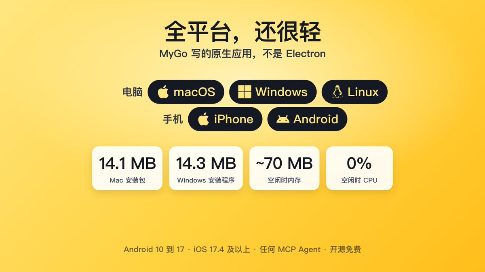
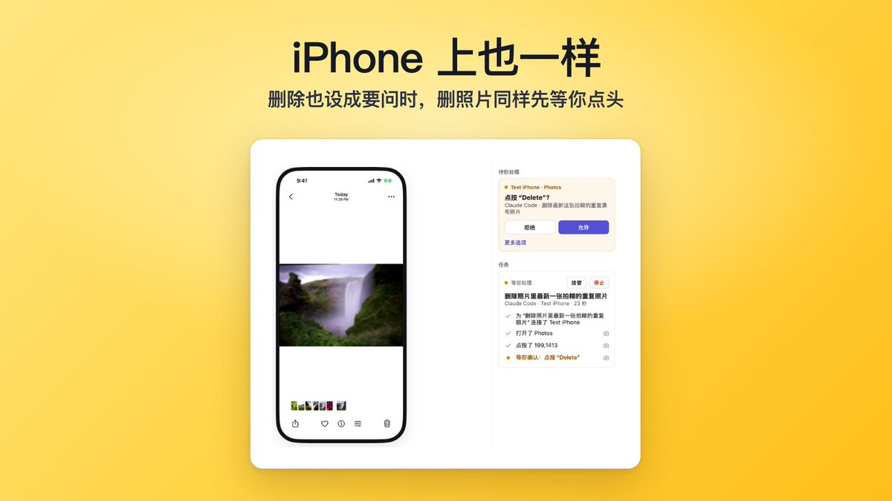
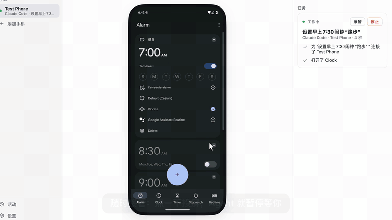
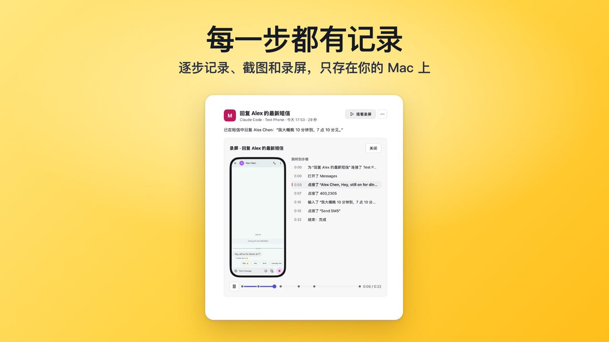

# DIŸgöd（@DIYgod）：开源 Pinky——让任何 AI Agent 用上你的 iPhone 和 Android

> 开源免费（Apache-2.0）的跨平台手机 Agent 操控工具 Pinky（github.com/DIYgod/pinky）：电脑端 macOS/Windows/Linux、手机端 iPhone(iOS 17.4+)/Android(10-17)，Claude Code、Claude Desktop、Codex、Cursor 点一下即接入，任何 MCP Agent 都能用；用 MyGo 写的原生应用（非 Electron），Mac 版 14.1MB / Windows 版 14.3MB，空闲内存约 70MB、CPU 0%，可常驻菜单栏。安全设计三条：审批不靠提示词而由 Pinky 自身拦截（Agent 点「支付/购买/下单」等动钱按钮时——可识别 10 种语言——会被扣住等人工放行，发消息与删除也可设为先问，被提示词注入的 Agent 也无法自行批准）；Android 13 以上 Agent 在隐藏第二屏幕工作、手机可锁屏揣兜或照常刷、点一下投屏即暂停交还后续跑；银行钱包密码管理器默认对 Agent 隐身（银行钱包类需先问且可只放行单次任务），密码框与验证码框无法输入，锁屏可在 Mac 上用 Touch ID 解锁、PIN 码 Agent 看不到。所有记录与录屏只存本地。

<!-- more -->

做了个新项目 Pinky：让任何 AI Agent 用上你的 iPhone 和 Android 手机，Mac、Windows、Linux 都能跑，开源免费

付款前会停下来等你点头，发消息、删除也可以设成先问，随时能接管，每一步都有录屏。原生应用，安装包十几 MB

GitHub：https://t.co/k79map72UK

Discord：https://t.co/GCszL2vMIs https://t.co/IHGz3UwywU

[video](https://video.twimg.com/amplify_video/2119268324106551296/vid/avc1/1920x1080/tlzzOUi42WVJIH_S.mp4?tag=29)

全平台：电脑上 macOS、Windows、Linux，手机上 iPhone 和 Android。Android 10 到 17，iPhone 支持 iOS 17.4 及以上。

Claude Code、Claude Desktop、Codex、Cursor 点一下就能接入，任何 MCP Agent 都能用。

而且很轻：用 MyGo @localhost_4173 写的原生应用，不是 Electron。Mac 版 14.1 MB，Windows 版 14.3 MB，空闲时内存约 70 MB、CPU 0%，可以一直挂在菜单栏。

@localhost_4173 审批不靠提示词，而是 Pinky 自己拦着：Agent 点「支付」「购买」「下单」这类动钱的按钮时（认得 10 种语言），这一下会被扣住，等你点允许才执行。图里这次还设了发消息、删除前也要问。被提示词注入的 Agent 也没法自己批准。 https://t.co/2S6zTEtmAi

@localhost_4173 Android 13 以上，Agent 在一块隐藏的第二屏幕上干活：手机可以锁着屏揣兜里，或者你照常刷你的。

想插手就点一下投屏，Agent 立刻暂停；交还后它接着干。 https://t.co/CPbeKDX6v7

银行、钱包、密码管理器这类 App 默认对 Agent 隐身（银行、钱包类要用时先问你，可以只放行一次任务），密码框和验证码框它输不了。手机锁了可以在 Mac 上用 Touch ID 解锁，PIN 码 Agent 看不到。

所有记录和录屏只存在你自己的电脑上。 https://t.co/yP7DPQBLoz

开源免费（Apache-2.0），还很早期，欢迎来玩：https://t.co/k79map72UK

brew install --cask diygod/tap/pinky

你会让 Agent 在手机上帮你干点啥？

---

## 补充报道：RSSHub 作者视角（@Ryrenz）

> **采集说明**：以下为另一位作者对同一项目的独立评述，补充了作者自述之外的使用门槛与项目成熟度信息。

开源项目作者 **DIYgod 此前做过 Folo、xLog 和 DPlayer**，Pinky 仓库 11 月 6 日才建，**一天就连发了好几个版本**。

**为什么需要它**：以前想让 AI 帮你在手机上点点按按，基本只能在模拟器里折腾——真机上一来权限吓人，二来谁也不放心它乱点。

**风险控制**：Pinky 通过 **MCP** 接进 Agent，风险操作要你在 Pinky 里点 **Allow** 才执行，**60 秒没人理就当拒绝**；银行、钱包、密码管理器这类 App 默认对 Agent 不可见，密码框和验证码框它也输不进去。安卓 13 以上还能让 Agent 在一块**隐藏的第二屏**上干活，不抢你正在用的屏幕。

**体积**：桌面端没用 Electron，下载包只有 16 到 22 MB，Mac、Windows、Linux 都有。

> ⚠️ **成熟度提示**：项目自己标的是 **pre-alpha**，现在更适合愿意尝鲜的人先玩起来。

**一句话总结**：手机以前是给人点的，现在 Agent 也能上手了。

---

## 相关页面

- [[concepts/agent-sandbox-three-layer-model]]
- [[sources/kagent-agent-substrate-k8s-agent-sandbox]]
- [[concepts/agent-skill]]
- [[concepts/agent-autonomous-pipeline]]
