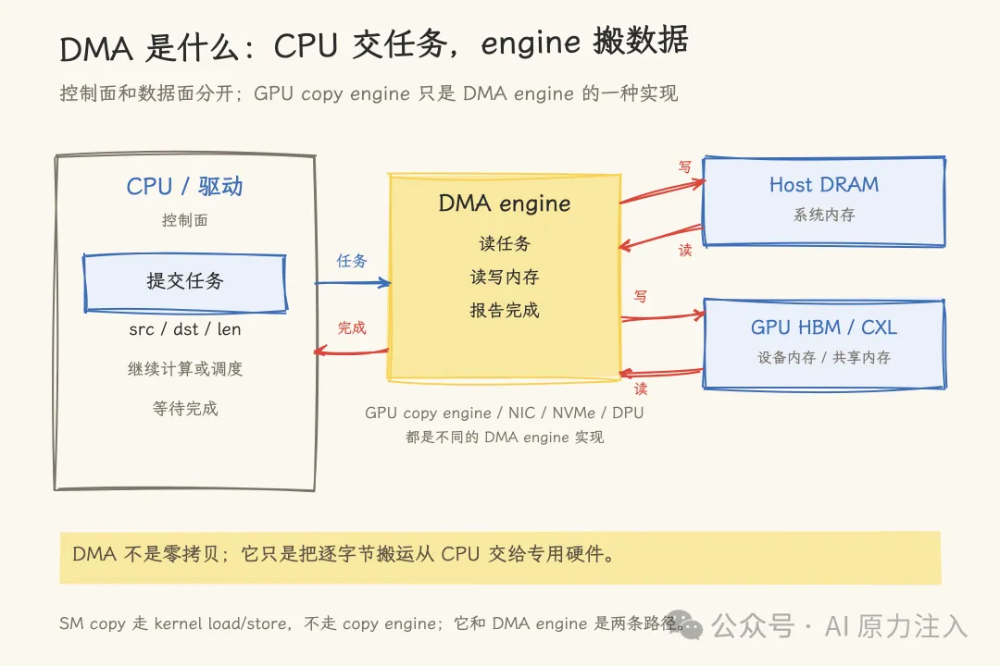
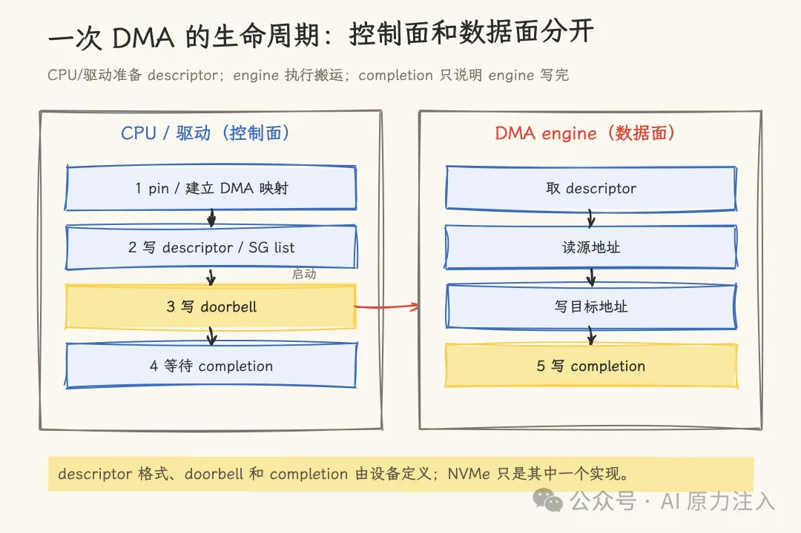
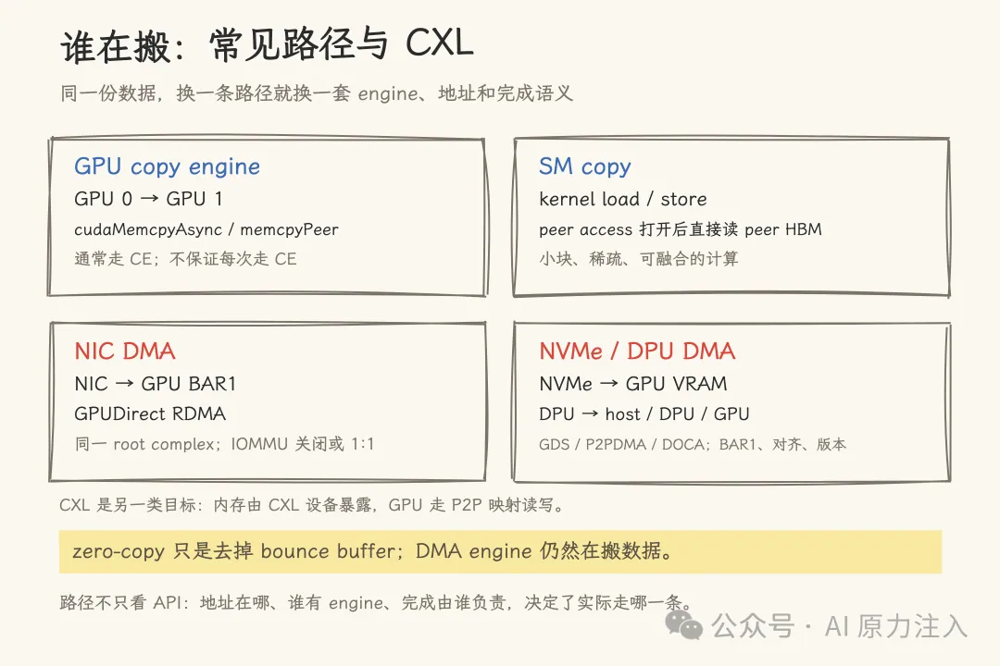
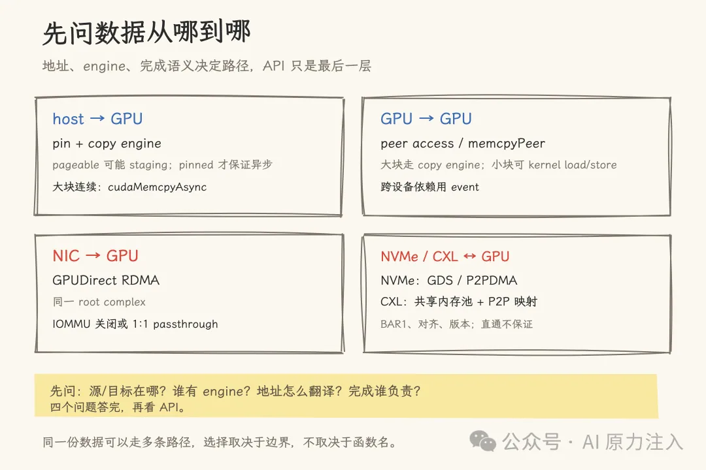

# GrissomFI：DMA engine——从描述符到完成，一次数据搬运发生了什么

> 一台 AI 训练机在加载 Checkpoint 时，`nvidia-smi` 显示显存占用暴涨，CPU 核心却并没有忙着逐字节拷贝；一次大模型推理要把 KV Cache 从一张 GPU 传送到另一张 GPU，应用程序只提交了一个 `cudaMemcpyAsync`。数据到底是谁搬的？真正执行底层数据搬运的通常是 DMA engine。理解从内存锁页、地址映射、描述符（Descriptor）提交、Doorbell 敲门、数据搬运到完成（Completion）通知的完整全景，才能彻底搞清：为什么小块拷贝不一定快？为什么必须使用锁页内存（Pinned Memory）？为什么异步拷贝经常无法与计算重叠？以及 GPUDirect RDMA / Storage 究竟在什么条件下才能发挥翻倍性能。

<!-- more -->

## 1. 建立直觉：DMA 的本质与误区

把 DMA 想成一次**“任务委托”**：
- CPU 不亲自逐字节搬运数据，而是把源地址、目的地址、传输长度写成一个任务描述符（Descriptor），交给专门的硬件（DMA engine）；
- CPU 继续执行调度或业务计算，DMA 硬件在后台直接读写内存总线，数据传输完成后通过中断或状态位通知 CPU。

> **核心认知**：控制面在 CPU/驱动，数据面在 DMA engine。

DMA 解决的是“CPU 亲自逐字节搬数据太浪费算力”的问题，它**不等于零拷贝**，也**不保证一定比 CPU 内存拷贝更快**。如果数据量极小、地址映射开销巨大、或 DMA engine 已被占满，走 DMA 反而更慢。DMA 真正的核心价值在于**将数据搬运与计算重叠（Overlap）**。

| 概念 | 是什么 | 不是什么 |
|---|---|---|
| **DMA** | 设备直接访问物理内存的硬件机制 | 某一个特定 API 函数，也不保证绝对比 CPU 拷贝更快 |
| **DMA engine** | 负责读取描述符、发起总线读写、报告完成状态的独立硬件单元 | 不是 CPU 核心，也不仅限于 GPU 内部 |
| **Copy Engine (CE)** | GPU 芯片上专门承担内存拷贝的专用 DMA engine | 不是每次 `cudaMemcpy*` 调用都必然走 CE |
| **SM Copy** | 运行在 GPU 流式多处理器（SM）上的常规 Load/Store 指令 | 不占用 Copy Engine，但通过计算单元逐字节搬运数据 |


*图 1：DMA 宏观控制面与数据面分离：CPU 负责提交任务描述符，DMA engine 执行数据搬运*

---

## 2. 一次 DMA 的完整生命周期

```
Buffer 准备与 Page-Lock (Pinning) 
  → DMA/Bus 地址映射与 IOMMU 翻译 
    → 构建描述符 (Descriptor / SG-List) 
      → 触发硬件 Doorbell (MMIO 写) 
        → DMA Engine 数据面执行 
          → 完成通知与内存可见性同步 (Completion & Memory Order)
```

### 2.1 锁页（Pinning）与地址映射
DMA 目标内存必须对硬件设备持续可见：
- 普通的可分页内存（Pageable Memory）随时可能被操作系统交换到磁盘（Swap Out），会直接破坏正在进行的硬件传输；
- 驱动通常强制要求使用 **Page-locked（Pinned）内存**（如通过 `cudaHostAlloc` / `cudaHostRegister` 分配）；
- CPU 虚拟地址无法直接交给外设，驱动必须建立 DMA/Bus 地址（在虚拟化环境中通常为 IOVA），由 IOMMU 或 GPU 内部页表翻译到真实物理内存。

### 2.2 描述符（Descriptor）与 Doorbell
1. 驱动将源物理地址、目的物理地址、长度、传输方向与完成标记格式化为描述符；大块数据通常采用分散-聚集列表（Scatter-Gather List）分割成多个离散物理页。
2. CPU 通过 MMIO（内存映射 I/O）向设备专用的寄存器写入信号——即 **Doorbell（门铃）**，通知 DMA engine 存在待处理的描述符队列（如 NVMe 的 SQ/CQ 机制）。

### 2.3 执行完成与可见性（Completion vs Visibility）
完成包含两层截然不同的含义：
1. **DMA Engine 写完数据**：硬件总线层面的事务结束；
2. **CPU/GPU 处理器能够看到新数据**：涉及 CPU Cache 刷写（`dma_sync_*`）与内存屏障。在 GPUDirect RDMA 场景下，应用不能仅凭“DMA 完成中断”就假定 GPU 已经看到了最新数据，必须依靠 CUDA 官方的同步流与事件（Stream/Event）来确立严格的内存时序。


*图 2：DMA 生命周期：从控制面准备描述符、Doorbell 通知到数据面搬运与完成同步*

---

## 3. GPU Copy Engine 与多流并发边界

1. **Copy Engine vs SM Copy**：Copy Engine 独立于 SM 计算单元，适合大规模、连续、需要与 Kernel 计算并行的 Host-to-Device（H2D）或 Device-to-Host（D2H）传输；而 SM Copy 走显卡核心指令，适合细粒度、稀疏、需要与算子内部紧密融合的访问。
2. **`cudaMemcpyAsync` 的真实行为**：
   - 必须使用 Pinned 内存才真正对 Host 异步；
   - 若传入 Pageable 内存，驱动内部可能先执行同步 Staging 到临时缓冲区，函数返回时底层 DMA 可能尚未启动；
   - 不同的 Stream 可能会在底层映射到相同的物理 Work Queue，产生虚假的串行依赖（False Dependency），必须借助 Nsight Systems 工具分析真实的硬件执行时间线。


*图 3：GPU Copy Engine、SM Copy、NIC DMA 与 CXL 共享内存交互全貌*

---

## 4. 架构选型与排查四问

在优化模型训练与分布式推理数据搬运时，必须依次明确四个核心问题：


*图 4：高性能数据传输路径设计闭环*

1. **数据从哪到哪**：Host DRAM、GPU HBM、网卡 NIC、NVMe SSD 还是 CXL 外部扩展池？
2. **谁来承担 DMA Engine**：是由 GPU 的 Copy Engine 搬，还是网卡 RDMA 引擎、还是 NVMe 控制器直接搬？
3. **地址如何跨总线翻译**：IOMMU 是否直通？BAR1 Aperture 空间是否足够大？是否支持 P2PDMA？
4. **数据可见性与完成由谁保障**：依靠 CUDA Event 依赖、驱动回调、还是主机侧内存屏障？

---

## 相关页面

- [[concepts/lake-native-architecture]]
- [[concepts/agent-token-architecture]]
- [[columns/agentic-engineer/zero-agent/agent-from-zero-longterm-memory-management]]
