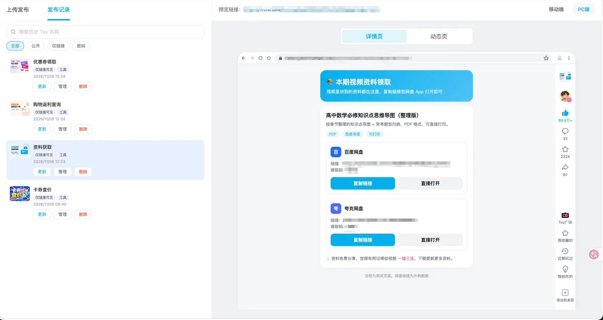
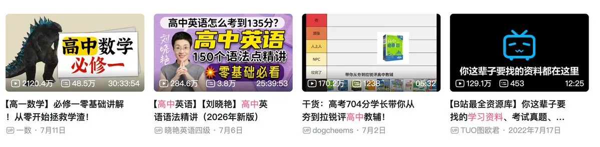
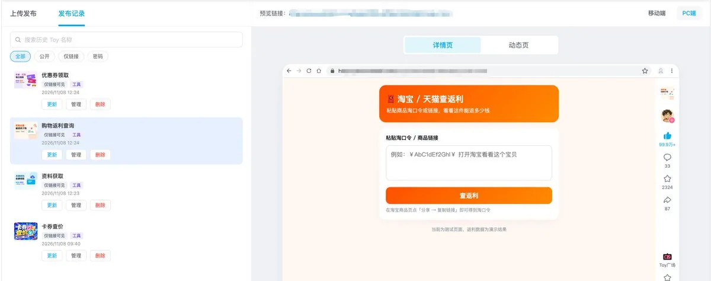
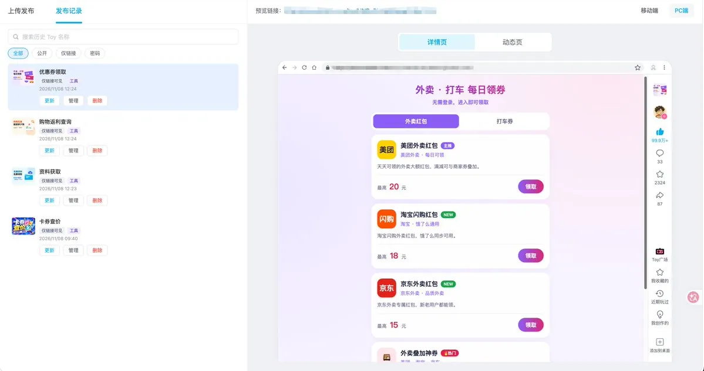
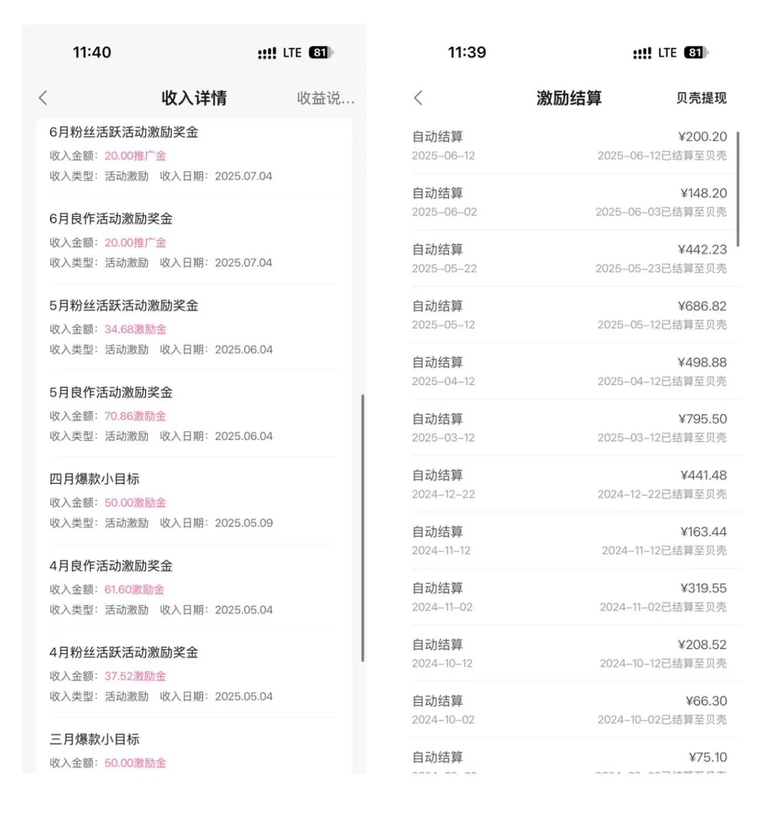
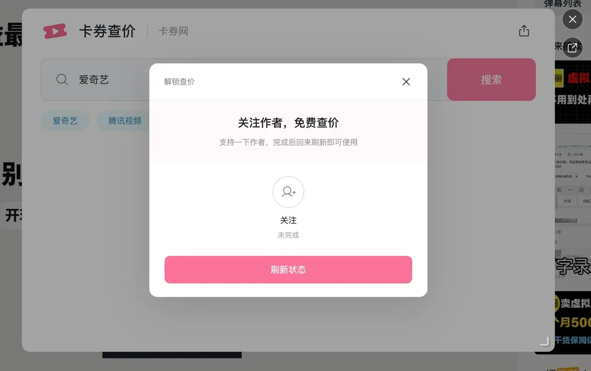
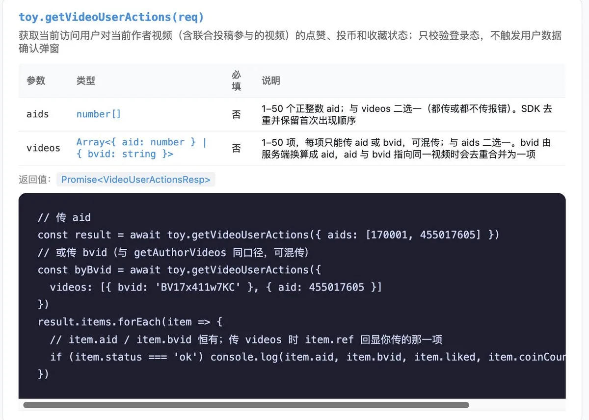

# 冬青（@DongQingAsk）：新玩法——用 B 站 TOY 做网盘拉新和 CPS

> B 站新推出的 TOY 功能——一个「Vibe Coding 的发布平台」：把做好的网页代码传上去，审核通过后即可运行，还能挂载到自己的 B 站视频下，形态类似小程序。作者把它与既有的网盘拉新、CPS 返利、虚拟资料等项目串联，提出「先做小的项目积累起来，等机会来了就能链接成大项目」的思路，并坦承这是刚起步尚未拿到结果的项目，先放思路让大家一起试——当前 TOY 广场上以小游戏与测试类为主，差异化空间在于内容型工具。

<!-- more -->

我是冬青，感谢大家，要一万粉了，这离不开各位父老乡亲的支持 🙏

在这个节点上，我想分享一个近期在琢磨的项目。也算是对大家的感谢

先说清楚：这个项目我刚开始做，还没有拿到结果。但我还是决定把思路先发出来。大家如果觉得底层逻辑是通的，可以一起试试，毕竟等我做出结果再发，大家再去做，可能已经是红海了。第一波吃螃蟹的，我认为还有很大的机会。

也借这个机会，对我来 X 之后的内容做一次复盘，顺便把新项目的思路串起来。这也说明之前我说过的，先做小的项目，积累起来，等机会来了，就能链接起来，成为大项目

▍来 X 之后，我都分享了什么

到现在一共发了 7 篇长文，项目主线大概是这些：

· 小红书虚拟资料

· 闲鱼 / 淘宝虚拟店铺

· 网站搭建、软件制作、小程序制作

· 公众号贴图号

· CPS 返利机器人

· 网盘拉新

我相信这些都是普通人比较容易上手的项目，感兴趣的可以翻翻原帖。

今天要讲的新思路，就是把上面某些个项目，和 B 站的一个新功能结合起来。

▍B 站 TOY 是什么

官方介绍：https://www.bilibili.com/toy/publish

是 X 上的大 V 告知我的，我就去看了看， B 站推出了一个功能，叫 TOY。

我的概括是：一个 Vibe Coding 的发布平台。你把做好的网页代码传上去，审核通过后就能运行，还能挂载到自己的 B 站视频下面，形态很像小程序。

目前广场上的 TOY 大部分是小游戏、测试类。对我来说这些意义不大

我们是搞钱的，看到新东西，第一反应得是：它能不能帮我赚钱？ 做个小游戏免费给别人玩，当休闲没问题，但从变现角度不划算。

我看着 TOY 大概是今年 8 月左右上线的，我也不知道为什么现在才看到。但我发现很多玩法还没人开发。我昨晚研究到凌晨两点多，有了一些思路，趁着万粉，直接分享出来。

先看一下我自己做的 TOY：

视频链接👉 https://www.bilibili.com/video/BV17HWE65EPB/

工具链接👉[ https://www.bilibili.com/toy/kaquanwan](https://www.bilibili.com/toy/kaquanwang)g

研究下来，关键点就两个：

🔹 本质上就是一个网页，用 HTML / JS 写前台就行；

🔹 它可以请求接口，拿接口返回的内容展示给用户。

🔹 还有很多的 SDK 权限，这一点非常好用

想明白这两点，事情就简单了。

▍为什么说这是机会：B 站终于能「放链接」了

B 站一直有个限制：评论区和简介里的外链是点不了的。 只有官方蓝链可以点，而蓝链需要开通推广账户、经过商业审核，门槛不低。我以前做 B 站推广，都是走蓝链。

TOY 等于把这个门槛降下来了：用户点视频下方的「UP 主新玩法」，或者评论区的 TOY 链接，这个链接是直接可以点击的，这样就能直接进到你做的页面。

而且 TOY 官方还提供 SDK，能读到用户 是否关注你、对这条视频的点赞 / 投币 / 收藏状态。这一点非常关键，后面讲起号部分会用到。

下面分开讲两个能直接变现的玩法。

▍TOY + 网盘拉新

思路： 视频讲一份资料的内容，用户进 TOY 领取这份资料的网盘链接。

我凌晨翻了一些学习资料类的视频，播放量普遍很高，相关视频的流量都不低。现在这类账号的变现方式基本是 B 站带货、卖实体书。


真的能看到时间，1 点 52 了，还在看，因为我觉得这项目挺有搞头

如果我们换成 网盘拉新 + 免费分享学习资料，对用户来说是免费拿资料，对我们来说是每个新用户都有拉新收益，网盘老用户，我们可以赚到转存的钱。别人在带货需要花钱购买的书籍，我们是免费分享的电子资料

那为什么以前没人用视频推网盘资料？原因就是上面说的：B 站放不了外链。 现在有了 TOY，这个问题解决了。而且不合规，官方不允许，现在有了 TOY，外链这个障碍小了很多。我这个页面过审很快。

两种做法：

· 一期一个 TOY（最简单）：不用写后端，页面里直接写死这一期的资料和网盘链接，下一期再做一个新的 TOY；

· 一个通用 TOY（省事）：做一个前台页面 + 后端接口，根据是哪一期视频返回对应资料，或者直接展示全部资料列表，所有视频共用。

我自己做了一个网盘资料 TOY 并提交了审核：



已经过审了，而且非常迅速就过审了，这说明，这种种类的工具，是可以过审核的

只是我的账号不垂直学习资料这个品类，我暂时也没有要分享的资料，所以没挂视频，大家可以自己操作。

这方面的收益就是使用 AI 制作视频以及资料，然后通过视频讲解，去让别人领取免费的网盘资料，我们赚的是网盘收益，一个转存下载大概是 0.45 元，一个网盘新用户大概是 10 元，这是目前的参考价格，实际上可能会随着时间变动

视频的播放量普遍都很高，我家里有家人参加高考，他就是在 B 站上学习找资料的，所以我对这块的需求还是有一些了解的，也是我能想到这方面的原因



相关提示词：

```
帮我写一个 B 站 TOY 网页「本期视频资料领取」，输出单文件 index.html（除 B 站 TOY 官方 SDK 外不引用任何外部资源），手机竖屏优先。

接口：页面顶部定义常量 API_BASE = 'https://api.example.com'（我自己替换）。从链接参数 ?bv= 读取当前视频 BV 号，请求 GET {API_BASE}/api/toy/resources?bvid=BV号，返回格式：
{ "code": 0, "data": [ { "title": "资料名", "desc": "一句介绍", "links": [ { "type": "baidu", "url": "网盘链接", "pwd": "提取码" }, { "type": "quark", "url": "...", "pwd": "..." } ] } ] }

页面：每份资料一张卡片，显示名称、介绍，每个网盘一行（百度 / 夸克区分图标），带「复制链接」「直接打开」按钮；要有加载中、请求失败（可重试）、暂无资料三种状态。

关注三连解锁：<head> 加载 https://s1.hdslb.com/bfs/seed/toy/app/sdk/toy-sdk.js（全局 window.toy）。点按钮前用 toy.getAuthorRelation() 查关注、toy.getVideoUserActions({ videos: [BV号] }) 查点赞/投币/收藏，未完成就弹窗引导，按钮调用 toy.navigate({ type: 'video', id: BV号 }) 去三连；返回字段名要宽松识别；没有 window.toy 或接口报错时直接放行。

复制先用 textarea + execCommand('copy')，失败再用 navigator.clipboard 并加超时。
```

▍TOY + CPS 返利

CPS 这个项目我之前讲过：淘宝、抖音、京东、拼多多的返利，用户查一个商品能返多少钱，下单后拿返利。

🔸 老路子（继续能做）：B 站带货。比如视频讲一本书，就挂这本书的淘宝链接，用户买了你有佣金。

🔸 新路子：查返利。把返利机器人后端的查询接口接进 TOY。

· 用户用 B 站账号登录 TOY（SDK 支持）；

· 粘贴淘宝口令 / 链接，点「查返利」，马上看到这件商品能返多少钱；

· 用户下单后，返利记到他登录的账号下；



以前挂链接带货，用户自己拿不到优惠；都是直接点击评论区链接跳转到淘宝京东购买，用户没有返利，但是作者拿到佣金了，其实就是不返还给用户，纯靠着用户购买得到佣金，但是现在用户也有返利拿

用户体验会不一样。一份商品在别人那边购买是没有返利的，钱让作者赚走，现在能返利，自己也能得到一份！

我也做了一个查返利 TOY 并提交了审核：目前也是已经通过的状态

相关提示词：

```
帮我写一个 B 站 TOY 网页「淘宝查返利」，输出单文件 index.html（除 B 站 TOY 官方 SDK 外不引用任何外部资源），手机竖屏优先，淘宝橙配色。

接口：页面顶部定义常量 API_BASE = 'https://api.example.com'（我自己替换）。用户粘贴淘口令/链接后，请求 POST {API_BASE}/api/toy/rebate，JSON 参数 { "content": "用户输入的原文" }，返回格式：
{ "code": 0, "msg": "", "data": { "title": "商品名", "image": "商品图", "price": 99.0, "coupon": 10, "final_price": 89.0, "rate": 5.5, "rebate": 4.9, "buy_code": "购买口令" } }
code 不为 0 时把 msg 提示给用户（如“该商品暂无返利”）。

页面：输入框（字号 16px）+「查返利」按钮（查询中禁用）→ 结果卡片显示商品图、商品名、商品价、优惠券、券后价、返利比例，绿色大字突出「预估返利」；下方「复制购买口令」按钮，和三步说明：复制口令去淘宝下单 → 确认收货后返利到账 → 私信 UP 主提现。

关注三连解锁：同网盘 TOY（加载官方 SDK，点「查返利」前检查关注和三连，没有 window.toy 时放行）。
```

🔸 新路子：外卖 / 打车领券。这个是我刚想到的，门槛比查返利还低。

美团外卖、淘宝闪购（饿了么）、京东外卖、滴滴打车……这些平台都有 CPS 推广券：用户通过你的推广链接领券下单，你就有佣金。

做一个「每日领券」TOY：外卖红包、打车券分类展示，用户点「领取」复制口令，打开对应 App 就能领。点外卖、打车是高频刚需，用户会反复回来用。视频内容可以做「外卖怎么点最省钱」「打车券怎么叠加」这类省钱攻略，流量不难拿。



相关提示词：

```
帮我写一个 B 站 TOY 网页「外卖 · 打车 每日领券」，输出单文件 index.html（除 B 站 TOY 官方 SDK 外不引用任何外部资源），手机竖屏优先，紫粉渐变风格，不用品牌 Logo 图片（平台图标用色块 + 文字）。

接口：页面顶部定义常量 API_BASE = 'https://api.example.com'（我自己替换）。打开页面请求 GET {API_BASE}/api/toy/coupons，返回格式：
{ "code": 0, "data": [ { "id": 1, "category": "food 或 car", "name": "美团外卖红包", "sub": "每日可领", "icon_text": "美团", "color": "#ffd100", "badge": "主推", "desc": "一句描述", "max": 20, "app": "美团", "code": "推广口令或链接" } ] }

页面：「外卖红包 / 打车券」两个标签页，按 category 分组；每张券卡片显示图标、名称、角标、描述、「最高 X 元」和「领取」按钮；点「领取」复制 code 并提示「口令已复制，打开 XX 即可领取」（code 是 http 链接时直接打开）。要有加载中、请求失败（可重试）、暂无券三种状态。

关注三连解锁：同网盘 TOY（加载官方 SDK，点「领取」前检查关注和三连，没有 window.toy 时放行）。
```

其实本质上就是还是我之前讲到过的返利 CPS 玩法，有专门一期长文可以直接去查看，现在只不过是关联起来了 toy，而且很多用户反馈说知道了有 cps 知道有虚拟资料网盘打新，但是不会搞流量，这一期内容也算是补充了一些

其他变现玩法，我想到了会引用这条帖子继续更新。目前能直接变现的就这几个，大家可以自己试试。我的账号不垂直，没去实操，建议起一个新号来做。

▍怎么用 TOY 起一个新号

能把号做起来，后面还有创作者激励。我做得一般，但每个月也有些收入。



TOY 官方提供的 SDK 里，有一个很好用的能力：检测用户有没有关注你、有没有给这条视频三连。 你可以设置成「关注 + 三连后才能使用 TOY」。



比如我的 TOY，就是关注并三连后才能用。

同理，你免费分享学习资料，用户关注你、三连视频后才能领到网盘链接。这样：

· 起号难度大大降低，更容易度过冷启动；

· 粉丝和互动数据一起涨，账号能长期运营；

· 这是 B 站官方支持、提供 SDK 的玩法，不是钻空子。



实操步骤：

→ 在 TOY 平台申请发布权限；

→ 用 AI 写好网页，打包上传、提交审核；每一个玩法我都附上了提示词

→ 审核通过后，在视频里绑定这个 TOY，评论区置顶 TOY 链接；

→ 视频播放破万后，可以申请平台推流，还有机会进 TOY 广场推荐。

▍最后说一句

还是那句话，不只是这个项目，所有项目都一样：

做虚拟资料，不管是开店卖还是免费分享，都不要抄袭搬运，一定要原创。 你可以用 AI 针对某个学科，做一套完整的学习笔记，这完全没问题。

TOY 是个新玩法，我说的这几种还没开始被大规模地玩，大家可以利用这个时间差，去操作一下。能借这个机会做起来一个 B 站账号，是很不错的。

相关项目实测之后会再发结果，新的思路也会引用这条帖子更新。

我是冬青，感谢阅读

## 相关页面

- [[sources/dongqing-5-ai-money-making-projects]]
- [[sources/dongqing-rebate-cps-bot-passive-income]]
- [[concepts/selfmedia-compound-model]]
- [[concepts/digital-products-side-income]]
