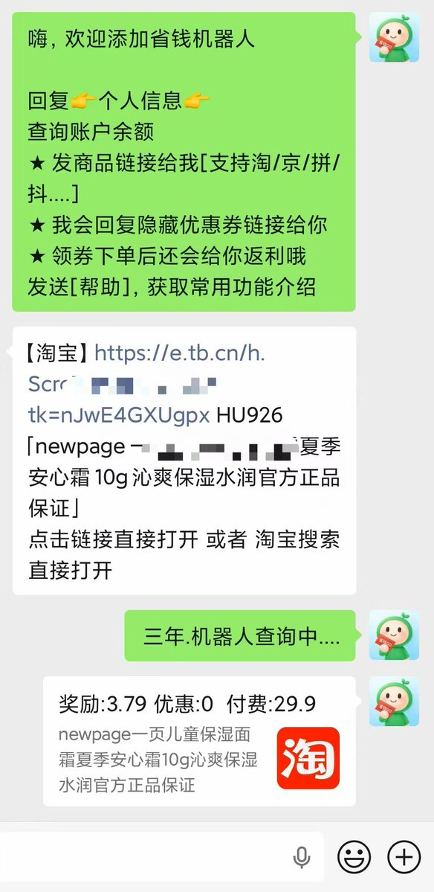
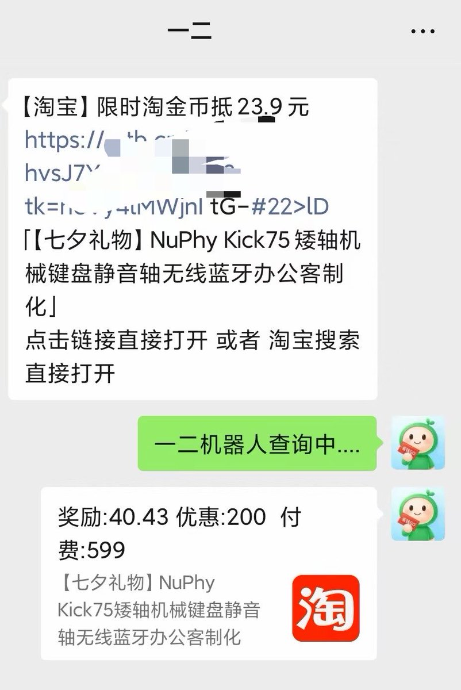

# 冬青：返利机器人项目依然值得做，月入 3K-5k 滚雪球

> 返利机器人项目做了多年，很多人一听就觉得是老掉牙的项目——没错，老掉牙换个说法就是很稳。市场非常大：身边的人都在网购。

<!-- more -->

## 项目原理

用户自己在购物平台选择一款商品，把链接发送给你的机器人，机器人查询商品能返佣金多少，最后把佣金分一部分给买家。

**佣金是怎么来的**：商家想要找人推广自己的商品，在后台设置，如果通过渠道把这个商品分享给别人，别人购买之后就返一部分佣金。

## 实际案例

用户想买一个保湿水，复制链接发给机器人：

- 查询到价格 **29.9 元**
- 返利 **3.79 元**
- 实际上可能有 **5 元**返利
- 作为机器人运营者，你赚 **1.21 元**，分给用户 **3.79 元**
- 用户通过你的链接购买，商家返你 5 元，你返用户 3.79 元
- 用户如果不通过你购买，他自己购买也是 29.9 元（价格不变）

**核心逻辑**：产品还是那个产品，价格还是那个价格，买完还返佣金。

## 增长策略：种子人群 + 自发裂变

我们要做的就是让机器人有**第一批种子人群**，先推广，让 100 个人使用你的机器人，他们省钱之后会自行推荐给其他人，自行裂变。

## 作者判断

这个项目做了多年，很多人一听就觉得很老、老掉牙——**换个说法就是很稳，活了很多年了**。作者建议每个人都搞一个，市场非常大。

**反问**：你身边的人网购吗？他们知道通过这种方式吗？

## 配图

原帖附有两张截图（见下方），展示了返利机器人的实际操作界面和佣金明细。

## 相关页面

- [[sources/dongqing-xhs-product-selection]] — 冬青：小红书选品方法论与监控软件开发指南。
- [[sources/sell-digital-products]] — 数字产品售卖与收款。
- [[concepts/overseas-tool-stack]] — 出海工具栈全景。

---

*原文为 X 短帖（非 X Article），抓取接口返回纯文本正文及 2 张图片。*
