# 冬青（@DongQingAsk）：返利 CPS 机器人——月入 3-5K 长期稳定被动收入小项目

> 私域流量返利 CPS 机器人运营闭环：通过自动化社群/微信机器人承接购物领券比价需求，以线下海报地推低成本获取第一波种子高粘性人群，建立长期稳定的被动管道收益。

<!-- more -->

其实一直想写写返利这个项目，拖了很久，今天先把大家问得最多的几个问题答完，再把我自己从 0 到现在的过程讲清楚。

这期只讲 0 到 1：怎么把一个个人微信的返利机器人跑通。不会教你一个月暴富，主要是思路以及一个 0-1 的设置，因为这个项目真的没有什么门槛，重点还是在坚持、还是在执行力

## 先回答大家的问题

1. 会不会封号？

会。用机器人挂着个人微信跑，本身就有风险，这点我不否认。个人号最简单，也最容易出问题。

但你也可以换个角度看：这个项目已经做了这么多年，不少人一年又一年地在做这个项目。人家也会遇到掉线、风控，人家照样能持续做下去。赚钱，哪有容易的

我的建议是：先用个人微信把流程跑通，熟悉之后再逐步加上企业微信、公众号、网站 H5、App 这些入口。一方面为了「降低概率」，而是用户习惯不一样，多几个入口，风险更分散，服务也更稳。

2. 收益怎么样？

前期非常低。

很多商品的佣金就几毛、几块，大部分还要返给用户，我们只留一小部分。

举个粗算：一个月加了 100 个人，每人买一件商品，这件商品佣金 1 块，你可能只留 2 毛。一个月下来，也就 20 块。下个月又加 100 人，同时上个月那批人还在买，大概就变成 40 块。人越积越多，单量滚起来，收入才会慢慢上来。

它靠的是持续裂变和长期坚持，需要脚踏实地，一步一个脚印，持续分析问题，持续优化，坚持下去，才能有大结果

3. 做起来难不难？

上手不难。这个项目已经发展很久了，软件、流程、常见坑，前辈基本都踩过一遍。你要做的是选好软件、按步骤配置，然后老老实实执行。

难的不是怎么设置软件，难的是愿不愿意坚持，以及愿不愿意放下面子去推第一批人。

4. 项目都老掉牙了，为什么还拿出来讲？

正是因为它老，才说明模式稳。

只要还有人网购，平台就需要推广，推广就有佣金。X 上很多人发的产品链接，本质也是带佣金的推广链接。你进了去买，博主就有佣金——和返利是同一套逻辑。

老项目不一定差，差的是指望靠它一夜暴富。

5. 现在做晚不晚？

后来者总有机会，这个项目从什么时候开始做，都不算晚

你先想想身边的人：他们网购吗？买东西会不会走返利，还是直接下单？

- 如果身边很多人还不会用返利，市场对你来说就是空白的
- 如果已经有人在用，说明他们认可这种方式，本身就是长期用户

只要你开始做，我相信总能找到人来使用，如果你连这种推广都懒得去做，我也不知道能有什么项目适合了，几乎没有成本，也不需要你的用户掏钱，免费给用户使用

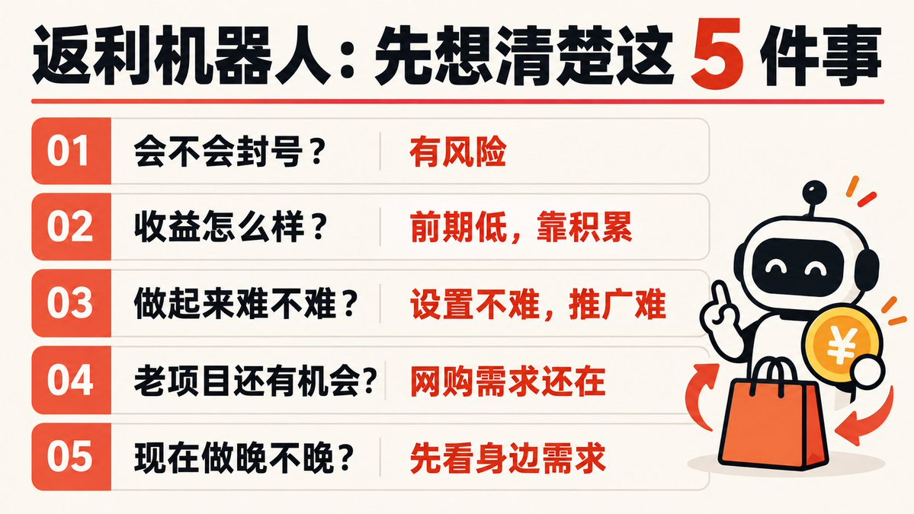

## 我是怎么做的，怎么来的第一波客户

做这个项目，最难的就是第一波人，等你有了第一波人之后

你会发现，这些用户自己就会去裂变，他们会推荐给同事，朋友

所以你就不要脸皮的、不辞辛苦的搞定，第一波种子人群即可

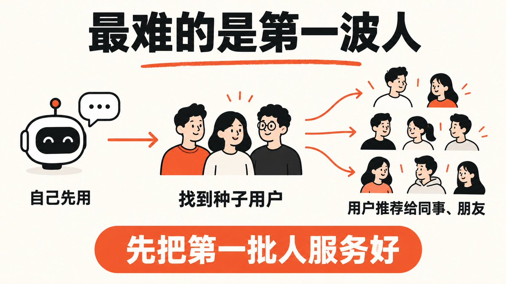

2021 年，房子交房，开始装修。

小到水龙头，大到洗衣机冰箱，几乎都在网上买。

我之前就跟大家说过：看到别人推荐某个商品，先想想对方怎么赚钱。测评、直播间带货，很多都是在引导你下单，然后拿佣金。你既然也要买，为什么不能自己把这条链路做起来，把佣金留一部分给自己？

哪怕暂时只给自己用，我也建议你把返利跑通。装修期间，我用自己的返利，大概省了几千块；我还推荐给同小区的朋友，他也省了几千。我按大约 90% 返给他，自己留 10%，双方都合适。

再往后，我找了小区菜鸟驿站的老板，给了 200 块，跟他说：门口放一周海报展架，这 200 就是你的。对他几乎没损失，就占个小角落。海报上放的是活码，一定要用活码，账号出问题换码，海报才不会整张作废。

那一周大概加了 400 人左右。中间电脑端微信强制退出过一次，重新登录还能继续用。之后这些人陆续推荐给同事、朋友，大概一个月，好友就过了 1000。

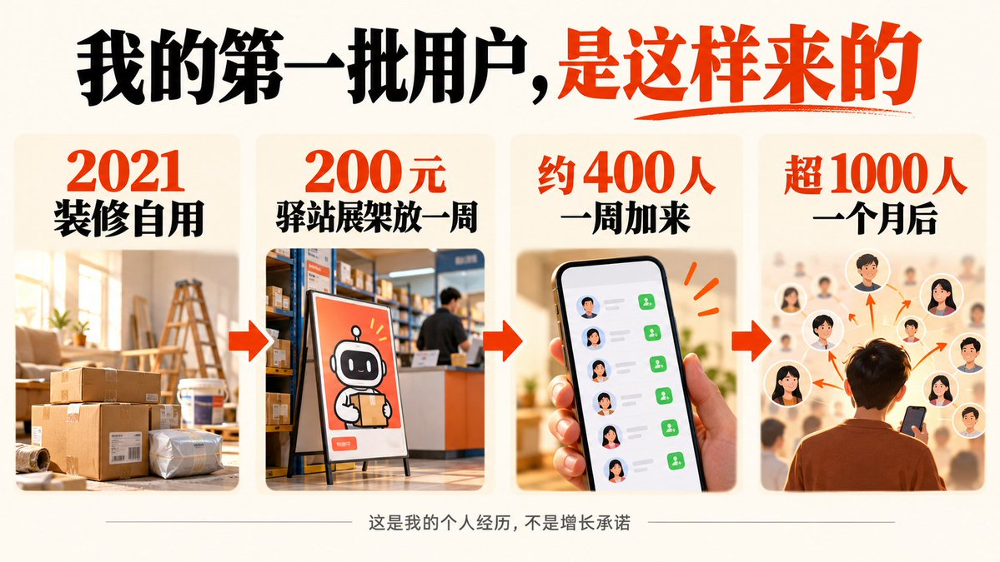

不过那段时间装修事多，也没心思再去想这些，没怎么正经运营，确实错过一部分机会。等装修告一段落，才重新捡起来。

接着我给机器人开了代理功能，又去联系我们这其他菜鸟驿站：每家大概 100 块，我出海报；从他们这边加进来的人，算驿站老板的下级，下级产生返利，分一部分给老板。有几家没谈成，但是多数达成了合作。

当时用的软件，代理上下级绑定不太好用，好多对不上。后来不少驿站老板干脆把机器人微信名片发到自己群里，因为有的驿站和超市是一起的，超市有用户群。就这样，两个微信号大概各加到 2000 人上下，合计三千人左右。最好不要加的太满了，避免有用户推荐你的名片给别人添加，到时候万一加不上，少加一些，分布多个账号，也可以被团灭账号的概率

再往后我几乎没再专门引流，就靠这三千人自己推荐给朋友、同事、家人。收入也从一个月几块、几百，慢慢到现在普通月份大概几千；双十一、618、年货节会更高一些，因为我的用户是小区业主为主，过年备年货，单量本来就会上来。

还有去年外卖补贴打得凶的那段时间，大家应该都经历过：平台狂发券，群里也有人喊你领。他们为什么这么好心呢？里面一样有返利。那几个月我靠外卖这块大概多了接近一万块的营收。这数字不算高，很多专注做外卖返利的人，赚得比这个多得多。

我开始意识到要提供更多的产品进来，下半年我又在机器人里嵌了快递代发、电影票、餐饮、打车等带 CPS 的渠道，收入又叠了一层。这些都不是一口吃成的，是有人了、链路完善的差不多了，再一点点往上加。

所以你要是冲着暴富来看这篇文章，可以直接关掉。但如果你想长期攒人、长期有点稳定进账，我觉得这个项目很合适。网购还在，这种模式就很难彻底消失。第一月哪怕只赚一毛钱，也别急着下桌；遇到风控就想办法、换入口、把流程做稳，接着做。

## 上面都是我个人经历，不一定适合所有人。

后面想到靠谱的推广方式，我还会再写。

我也和一个大学在做这个项目的朋友有过一次交流：他大学生在学校做表白墙，把自己的返利机器人挂上去。学生消费其实并不低，也能做出不错的量。渠道可以很多

渠道真的太多太多了。关键是你愿不愿意放下所谓的面子

我认为哪怕发传单，哪怕地推，也能推到第一批人。

这期不往太深里讲。目标只有一个：配置成功一个个人微信的返利机器人，把 0 到 1 跑通。

## 0 到 1：个人微信返利怎么配

现在这类软件已经比较成熟，可选的也不少。我用的是淘宝上买的「安娜尔」返利机器人，激活码大概 200 多。大家自己找一下吧，很多卖的

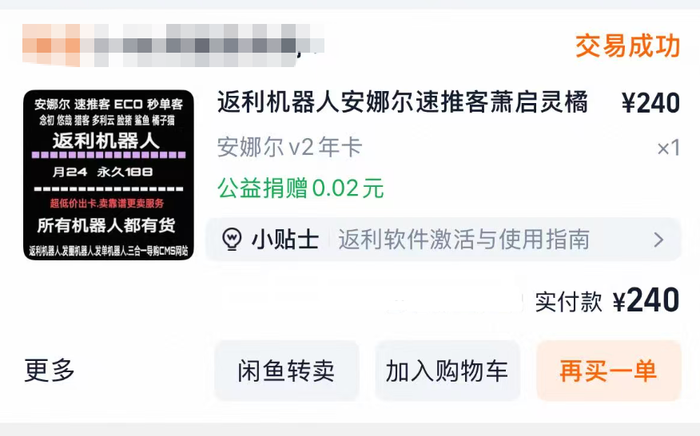

硬件上，建议一台能 24 小时开机的本地电脑挂机，尽量不要放服务器。因为要登录微信，服务器环境更容易引起异常，本地相对稳一点。

大致步骤：

1. 买软件、装到本地电脑

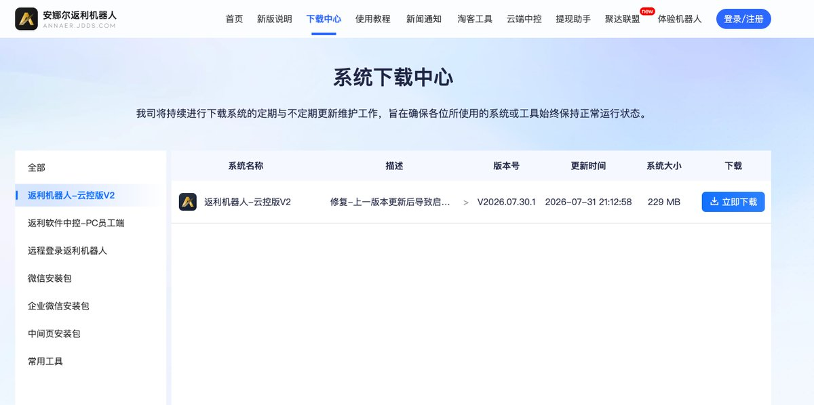

2. 下载指定版本的微信
   可以选稍新一点的版本，功能全一些。登录你的微信号

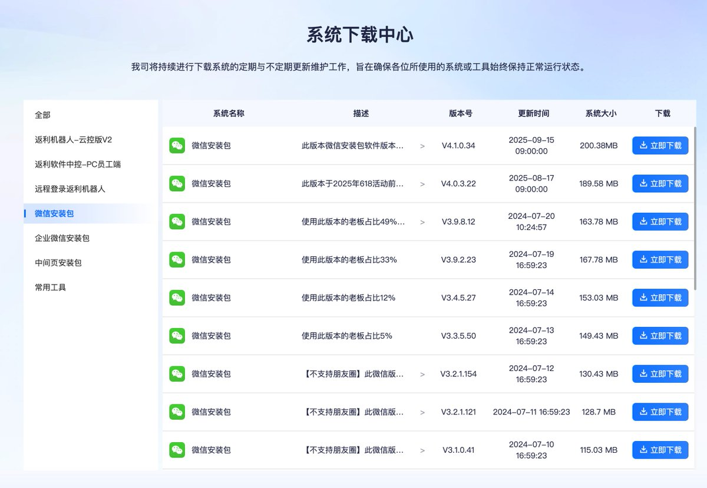

登录成功后，这个号就已经被软件接管成「机器人」了，但还不能返利——还要对接联盟。

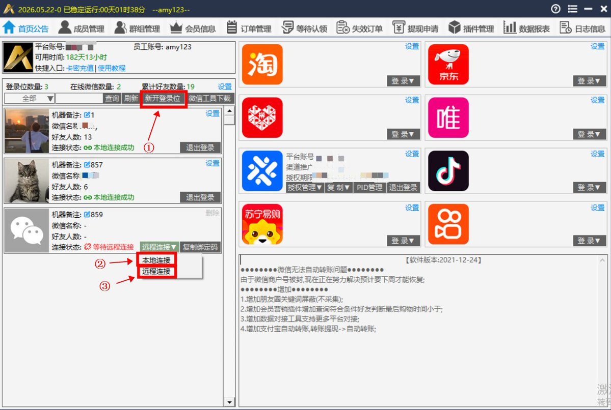

对接淘宝联盟、京粉等

软件右侧一般有这些渠道入口。主流先配淘宝，其他平台逻辑差不多，按各官网教程一步步来即可。

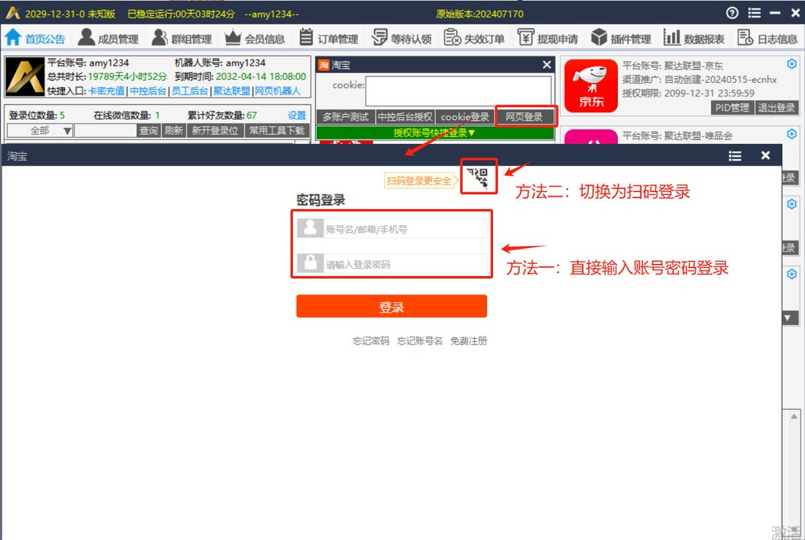

理解钱怎么走（以淘宝为例）

打开阿里妈妈，用自己的淘宝账号扫码登录。用户买了一件有佣金的商品，比如佣金 10 元：这 10 元进的是你的淘宝联盟账户；你提现到支付宝，再转 8 元给用户，自己留 2 元。

所以联盟账户既是收款账户，也是查询佣金的数据来源。用户把商品链接发给机器人，机器人查到的「能返多少」，本质上就是联盟返回的佣金，再按你设的比例算。

在软件里填好淘宝联盟，发链接测试

用另一个微信给机器人发一条淘宝商品链接，看能不能正常返回佣金信息。能返回，这一步就算通了。

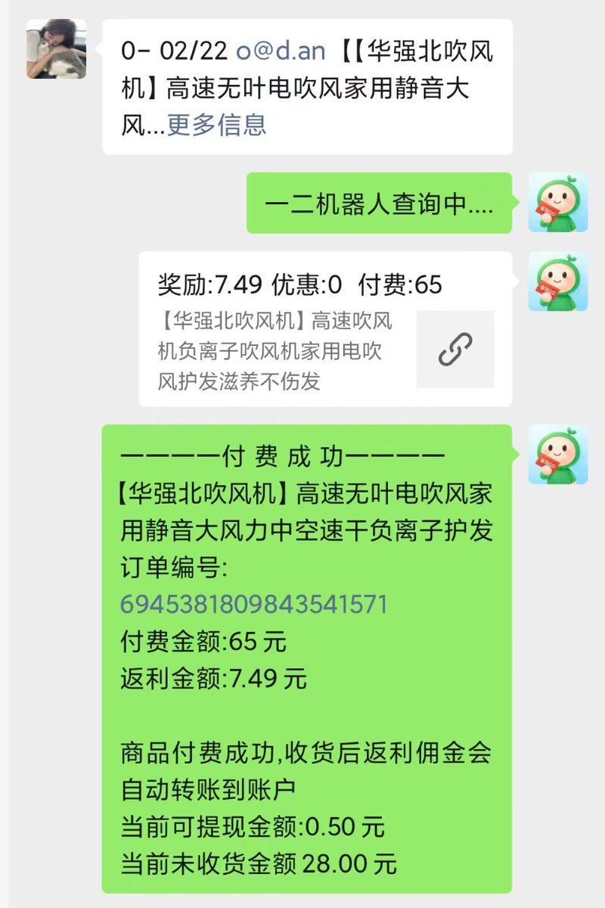

设返利比例

软件一般支持多种方式，比如阶梯：佣金 1 元的商品，返用户 9 毛，自己留 1 毛；

佣金 100 元的商品，返用户 60，自己留 40。

低佣金让用户多拿一点，高佣金自己多留一点，用户体感通常也不错。

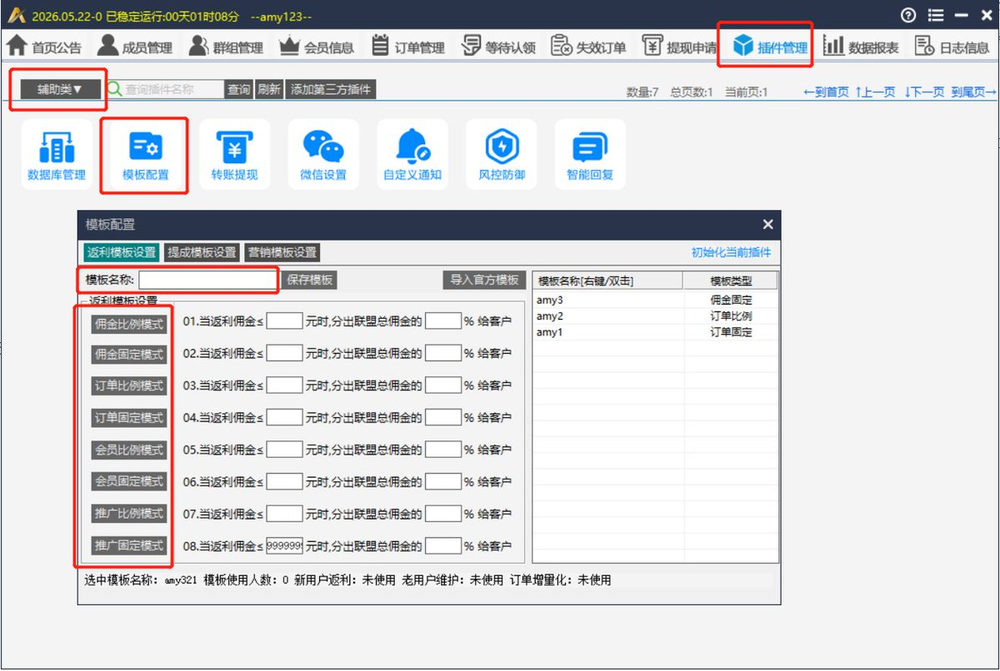

务必搞清楚结算和提现节奏

淘宝联盟大致是每月固定时间结算上一期。用户刚买完你就秒提现，一旦退款，联盟侧佣金没了，钱却已经给出去，等于被薅。

所以「可提现时间」、确认收货后再结算这类设置，一定要按自己的风险承受能力配好。

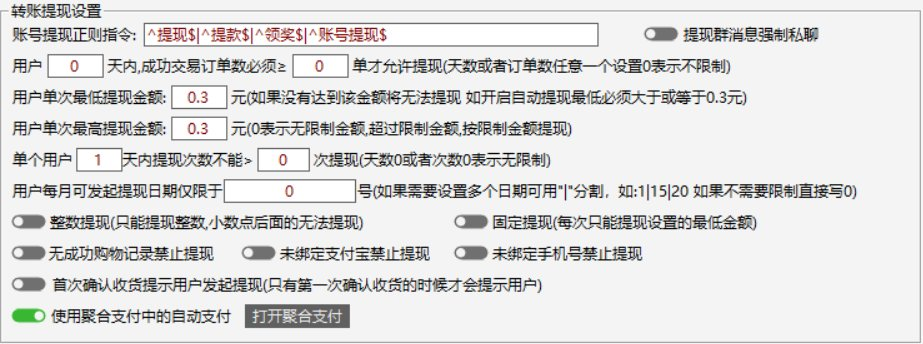

杀熟（前十单一个比例，后边订单一个比例）、代理等功能点很多，我就不把官网说明复述一遍了。每一个开关是干什么的，自己去官网文档里看清楚，再决定开不开、怎么开。你买的是哪一家的，你就去哪一家的官网

下面的教程我就不多说了，官网太全了，这个项目这么长时间了，已经有很完善的体系，教程，以及思路，已经完全不需要手把手的教了，手册喂给 AI，让 AI 就可以解答你的全部问题了，甚至帮你自动配置都不在话下，我也相信这篇文章足够让你入门了

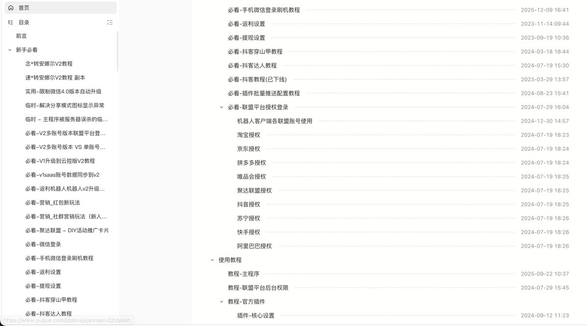

## 跑通之后可以怎么扩展

个人微信跑顺了，再逐步加公众号、企业微信、小程序、App、H5。有人就爱微信里直接聊着返；有人更习惯打开 H5 或 App。按你用户的习惯配，风险也能摊薄一点。

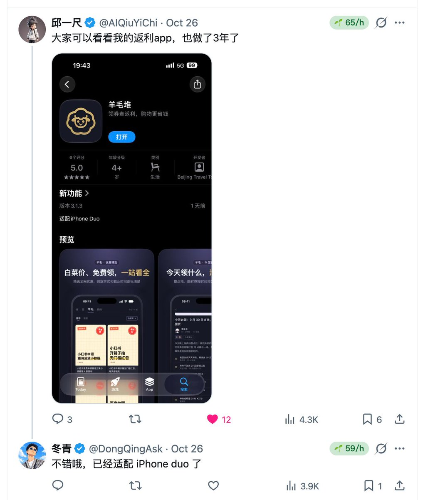

在我评论区我也看到也有大佬做了 APP，上线到了 apple 软件商店，我觉得这个相当不错了，之前我也没有做过 APP，因为我一直没下定决心买苹果开发者上架，现在我也要准备准备做个 APP 出来了，一样的，大家也可以根据自己的能力，来决定要做哪个渠道，APP 有一个下载成本，需要下载，但是不封号，比较稳定，重要的只是把 APP 长期留存在用户手机里，提供更多的功能

我是有一个想法，但是自己也没有上架过苹果应用，不知道是否可行

复制淘宝链接后，苹果手机点侧边键或者敲击背面，调用快捷指令

用快捷指令直接查返利，减少用户的链路成本

不知道是否可行，后续我在试一试

再强调一次：这期内容，不会让你突然月入几千几万。它适合当一个长期、相对稳的底仓项目——以后你做别的项目，它不用天天盯，还能有点进账；攒下来的私域，遇到像去年外卖补贴那种窗口，手里有人就能接得住，没人就只能看着。

这个项目赚来的钱，也许就是你试下一个项目的底气。哪怕别的项目亏了，它挣的那部分，有时也够你撑一阵。生活保证不了，但是生存问题不大

我感觉这些内容，主要就是引入门，因为我感觉不出来还有什么好写的，整个的流程照搬手册非常简单，剩下的就是如何找到第一波种子人群，我的建议就是放下面子，海报地推就完事了，成功率非常高！

只要这些私域用户在手，你可以做很多可以做的项目

## 相关页面

- [[sources/dongqing-xhs-product-selection]]
- [[patterns/gray-market-customer-acquisition]]
- [[concepts/selfmedia-compound-model]]
