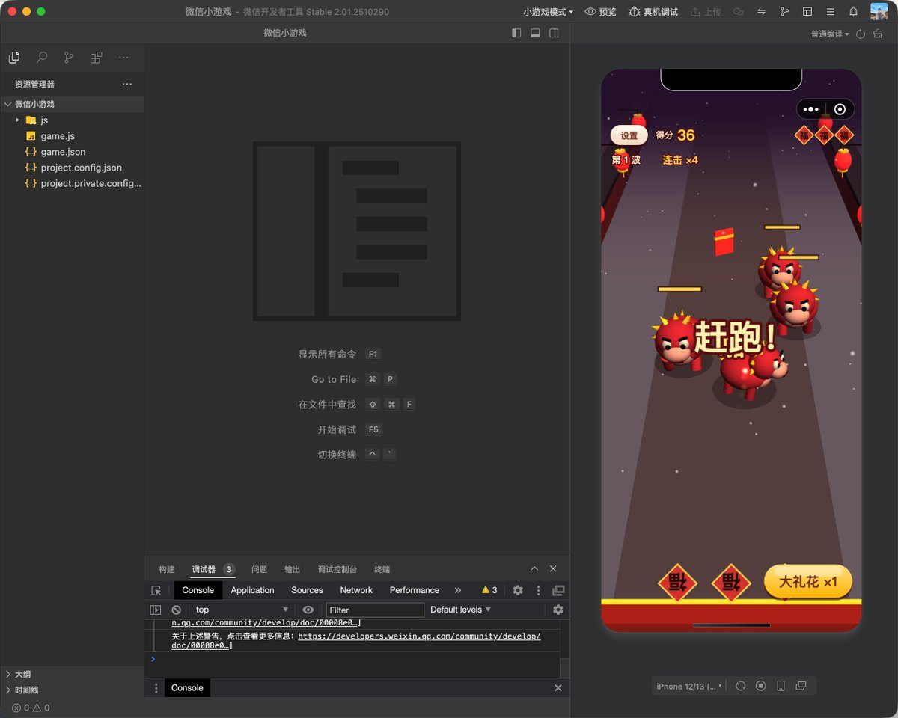

# 冬青：微信小游戏成了热门项目——从一句话到 3D 游戏、过审上架、接流量主

> 转述 Fini.Yang《AI 变现焚诀之——微信小游戏篇》：从一句话做 3D 游戏、内置微信预审体检、自动压包直传，到 11 张真机过审截图范本和接流量主变现，拆成 4 步可照抄的施工单；作者自己用 Claude 做了个「打年兽」小游戏，初版已跑通。

<!-- more -->

小游戏真的最近热门项目了，看很多人都在做

我也感觉是个好的项目，特别是马上过年了

我清楚的记得，过年期间，我是偶尔就来上一把小游戏的

看了这一期内容，直接给 Claude 去做，给了一个想法，做一个打年兽的游戏，初版已经搞定，还得继续优化 https://x.com/FiniYang/status/2123725927414972793

AI 变现焚诀之——微信小游戏篇

从一句话做 3D 游戏、内置微信预审体检、自动压包直传，到 11 张真机过审截图范本和接流量主变现，全拆成了 4 步可照抄施工单

想自己拿 AI 上架一款微信小游戏，这篇先收藏 ⬇️ https://t.co/TEuqiVeMgo

## 相关页面

- [[sources/wechat-tietu-fast-launch]]
