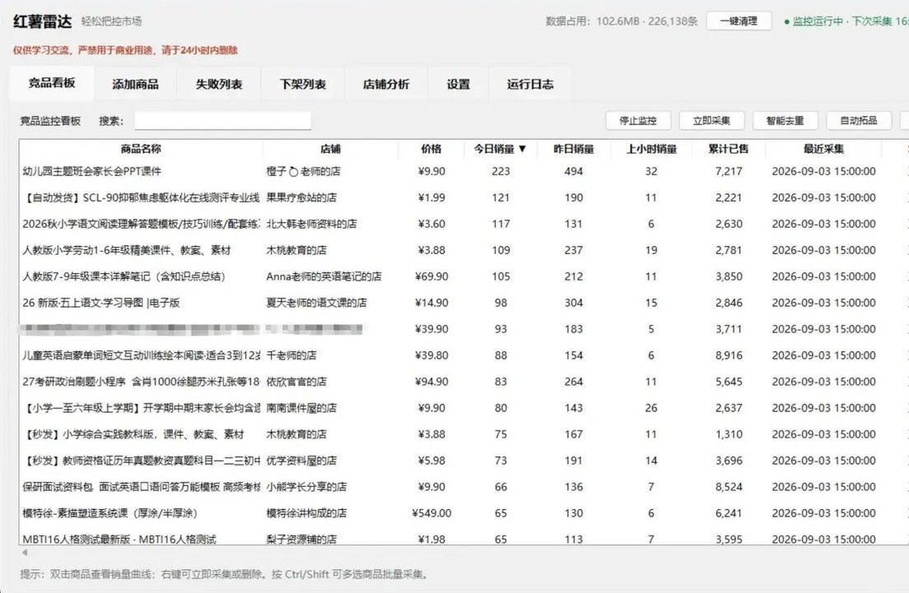
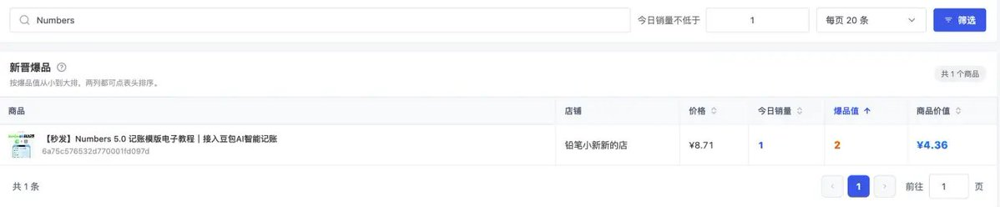
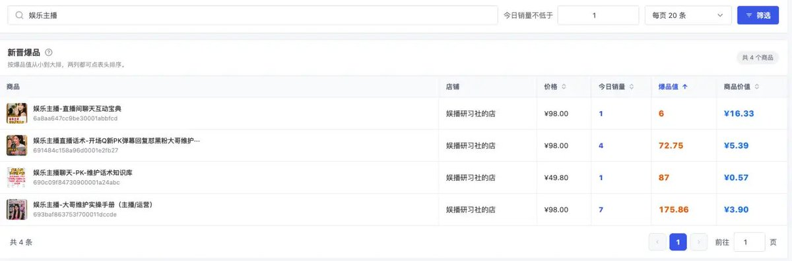
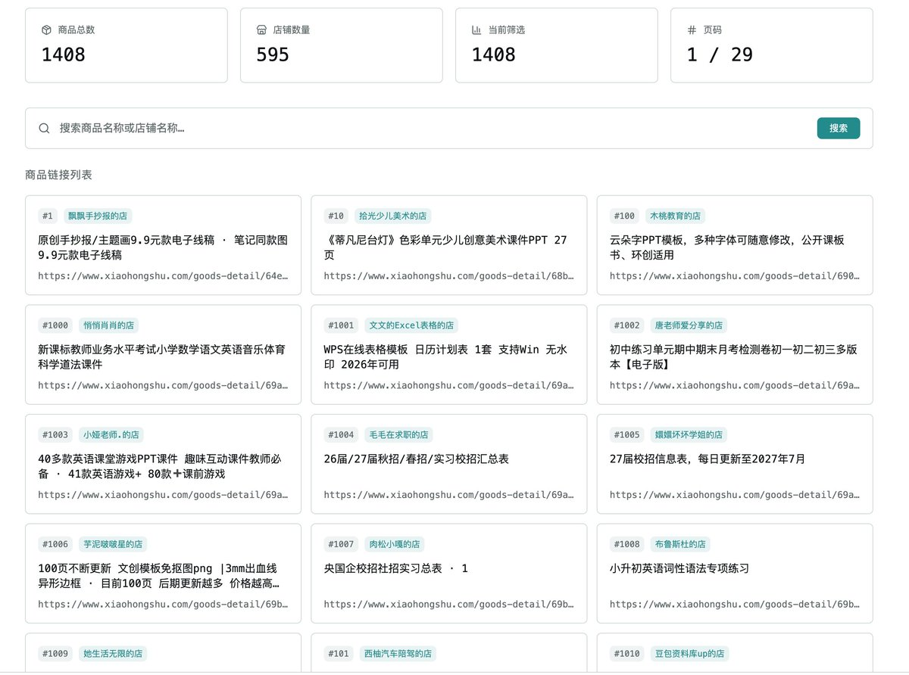
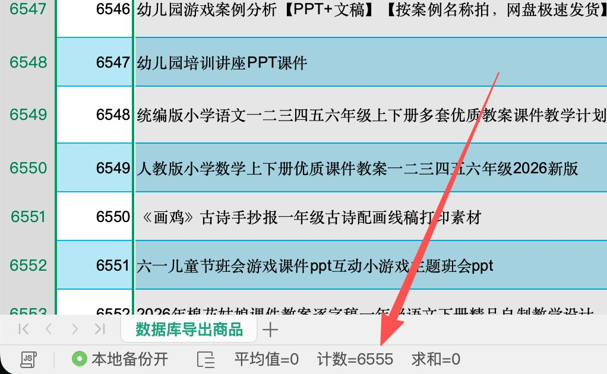
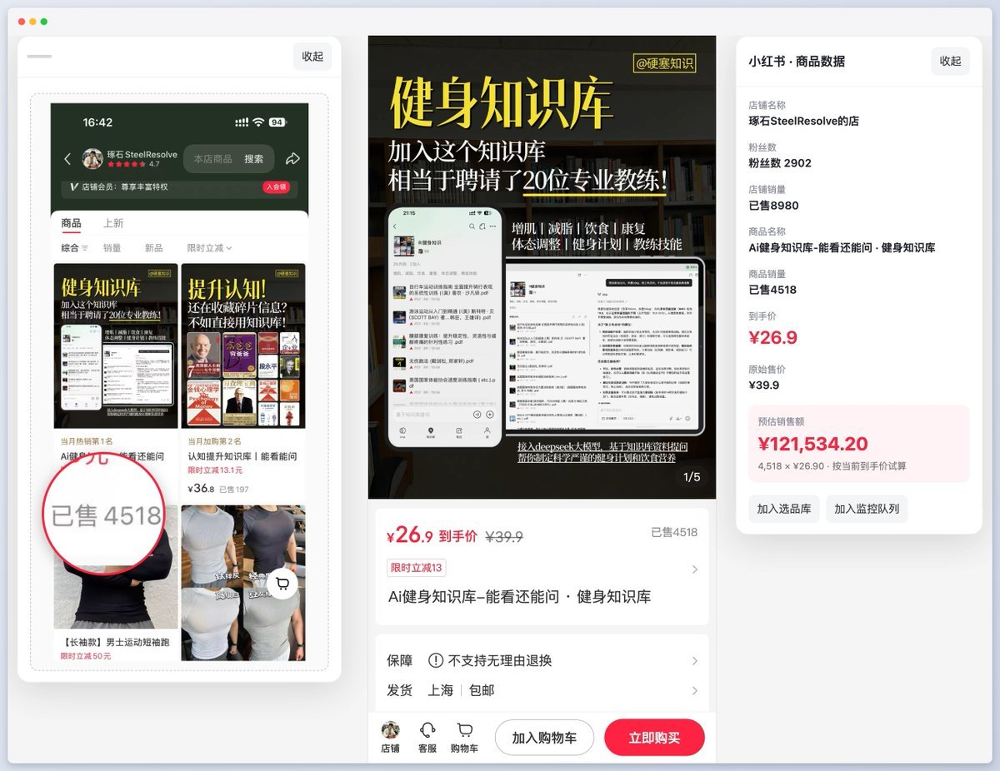

# 冬青：小红书选品方法论与监控软件开发指南

> 先问"卖什么"，再问"怎么运营"。连卖什么都没想好，后面的东西听再多也不知道往哪儿用。

## 先把监控软件做出来

如果想全天监控，需要一台能一直开着的电脑（服务器也行，但要看采集方式）。

**原理**：每隔一小时读一次指定商品的累计销量，存下来。两次的差值就是这段时间页面显示销量的变化。

> 关键：如果只显示"1万+"，就别硬算成精确日销量。采集失败也不能当成零，不然下次读成功会凭空算出一大堆销量。

**开发提示词开源**：[红薯雷达完整开发提示词](https://github.com/dong-liudong/hongshuleida/blob/main/dq.md)

> 原文说明：软件大致会是下面这种形式，具体界面可能不一样。哪里不顺手，接着让 AI 调。

## 选品七看

1. **看做了多久**：更关注短时间内起来，而且最近还在出单的品
2. **看发了多少篇笔记**：100篇笔记卖1000单 > 1000篇笔记卖1000单
3. **看爆品值**：爆品值 = 累计已售 ÷ 今日销量增量。越小越值得先看
4. **看商品价值**：商品价值 = 客单价 × 今日销量增量 × (今日销量增量 ÷ 累计已售)
5. **跟着时间走**：假期安全教育PPT→开学；毕业、节日、年终汇报都是时机
6. **搜搜有多少人在做**：一家卖得好 ≠ 市场上只有他
7. **别把没人做都当成蓝海**：高中教师资料就是例子，老师有自己的课件和题库

> 原文说明：爆品值越小越愿意先看，但一天只出一单也能算出很好看的比例，不能只看这个数。

> 原文说明：商品价值把价格、当天增量和近期增量占比一起考虑，但别把它当利润。

## 选品表

整理了1400多个虚拟商品供参考（来自6000+商品AI处理后），附飞书表格链接。

> 原文说明：里面有一些已经下架或者已经违规了的商品，没有删掉也没有筛选，大家自行查看处理。这是其中的 1400 多个，从 6000 多个里用 AI 简单处理删减噪音后的结果。

## 怎么从这张表里挑

还是**多看**：不用一天看完，每天看一点。可以先从兴趣开始——喜欢健身看健身知识库，喜欢旅游看旅游攻略，喜欢做饭看食谱。

**先选你觉得不错、也愿意花时间研究的**，选几个出来让 AI 帮你整理比较，缺什么信息补什么，最后自己决定。再有经验也别省掉测试：先挑一两个方向做个小版本，看看有没有人问、有没有人买，再决定继续还是换。

## 本地软件 + 网站同步

原文补充了一套架构：提示词最终实现的是**本地化软件**（数据只有你自己能看），但在软件里加一个功能——每次采集完成后把数据同步到自己的服务器或其他地方，再把网站 UI 优化一下，就得到一个随时随地用电脑或手机打开的网站。数据来自本地电脑提交，网站负责展示和接受，UI 可以随意美化。

思路是：软件负责接收浏览器传来的网页链接。可以交给 AI 实现，中间可能需要一个中介——比如浏览器插件点击加入监控队列，商品链接同步到飞书，软件自动运行、每小时从飞书同步一次新增的商品链接。

> 原文说明：把页面的数据展示在一起，可以更直观地看完一个商品并试算，还方便快速加到选品库和监控队列。

## 相关页面

- [[concepts/xhs-product-selection]]
- [[sources/dongqing-5-ai-money-making-projects]]
- [[sources/dongqingai-xianyu-virtual-product-automation]]
- [[sources/dongqing-cashback-bot-project]]
- [[patterns/agent-loop]]
